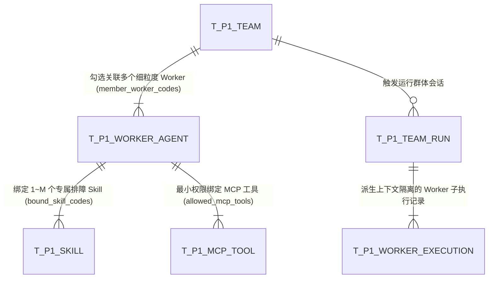

# 01 | Team (SuperAgent) 与细粒度 WorkerAgent 领域模型及 PostgreSQL 17 表设计

> **所属项目**：`P1 - 通用群体智能平台`  
> **分册编号**：`01 - 领域模型与 PostgreSQL 17 数据库设计`  
> **数据库标准**：`PostgreSQL 17`（启用 `vector` 扩展）  
> **上层汇总文档**：[P1_通用群体智能平台_DDD.md](file:///Users/gaorenjie/Documents/Company/aiops-brainstorming-gemini/设计文档/P1_通用群体智能平台_DDD.md)

---

## 1. 四元核心配置模型与细粒度 WorkerAgent 设计准则

### 1.1 两层扁平化实体关系图 (ER Diagram)



### 1.2 细粒度 WorkerAgent 拆分最佳实践（以华为 SRv6 骨干网排障 Team 为例）
在 P1 中，推荐直接将 `WorkerAgent` 拆分为**职责高度单一、只负责一个独立分析维度**的细粒度智能体，由 `Team` 的 `SuperAgent` 直接按需组合调度：

| 细粒度 WorkerAgent 编码 (`worker_code`) | 细粒度专家名称 | 推荐 Harness | 绑定专属 Skill (`bound_skill_codes`) | 授权 MCP 工具 (`allowed_mcp_tools`) |
| :--- | :--- | :---: | :--- | :--- |
| `worker_vpn_impact_analyzer` | **VPN与客户业务影响分析Agent** | `NATIVE_GO` | `skill-vpn-reverse-impact` | `query_vpn_and_customer_impact` |
| `worker_srv6_path_tracer` | **SRv6双层路径穿透分析Agent** | `NATIVE_GO` | `skill-srv6-dual-path-trace` | `trace_srv6_dual_layer_path` |
| `worker_srv6_policy_state` | **SRv6隧道状态与BFD分析Agent** | `NATIVE_GO` | `skill-srv6-te-policy-state` | `run_huawei_readonly_cli` |
| `worker_optical_phy_analyzer` | **光模块收发光与CRC错包分析Agent** | `NATIVE_GO` | `skill-optical-gray-failure` | `query_network_telemetry_metrics`, `run_huawei_readonly_cli` |
| `worker_isis_neighbor_analyzer` | **IS-ISv6邻居与拓扑开销分析Agent** | `NATIVE_GO` | `skill-isis-neighbor-lsdb` | `run_huawei_readonly_cli` |
| `worker_bgp_state_analyzer` | **BGP邻居会话状态分析Agent** | `NATIVE_GO` | `skill-bgp-peer-state` | `run_huawei_readonly_cli` |
| `worker_bgp_config_route_analyzer` | **BGP配置与路由优选分析Agent** | `DEEPSEEK_HARNESS` / `PI` | `skill-bgp-config-audit`, `skill-bgp-route-selection` | `run_huawei_readonly_cli`, `get_huawei_config_diff` |
| `worker_huawei_cli_planner` | **华为修复CLI生成与P3送检Agent** | `DEEPSEEK_HARNESS` / `CODEX` | `skill-huawei-vrpv8-remediation` | `verify_huawei_remediation_cli`, `get_huawei_config_diff` |

---

## 2. PostgreSQL 17 数据库表结构定义 (DDL)

### 2.1 Team 与 SuperAgent 定义表 (`t_p1_team`)
```sql
CREATE EXTENSION IF NOT EXISTS vector;

CREATE TABLE t_p1_team (
    id BIGSERIAL PRIMARY KEY,
    tenant_id VARCHAR(64) NOT NULL DEFAULT 'default',
    team_code VARCHAR(64) NOT NULL UNIQUE,             -- 如 team_huawei_srv6_ops
    team_name VARCHAR(128) NOT NULL,                   -- 如 华为SRv6骨干网智能排障战队
    description VARCHAR(512) DEFAULT '',
    
    -- SuperAgent 核心配置 (Team Prompt 即 SuperAgent 的系统提示词)
    super_agent_prompt TEXT NOT NULL,                  -- 定义任务拆解、规划准则、何时调哪个细粒度Worker及汇总要求
    super_harness_type VARCHAR(32) NOT NULL DEFAULT 'DEEPSEEK_HARNESS', -- NATIVE_GO / DEEPSEEK_HARNESS / PI_HARNESS / CODEX_CLI
    super_model_key VARCHAR(64) NOT NULL DEFAULT 'deepseek-reasoner',
    max_plan_iterations INT NOT NULL DEFAULT 12,       -- SuperAgent 最大重规划循环轮数
    
    -- 关联的细粒度 WorkerAgent 编码数组
    member_worker_codes JSONB NOT NULL DEFAULT '[]'::jsonb, -- 如 ["worker_bgp_state_analyzer", "worker_bgp_config_route_analyzer", ...]
    
    -- 安全护栏与输出契约
    default_safety_mode VARCHAR(32) NOT NULL DEFAULT 'STRICT_READ_ONLY', -- STRICT_READ_ONLY / CONTROLLED_WRITE
    output_json_schema JSONB DEFAULT NULL,             -- 强制约束 SuperAgent 最终输出的 JSON Schema
    
    is_enabled BOOLEAN NOT NULL DEFAULT TRUE,
    created_at TIMESTAMPTZ(3) NOT NULL DEFAULT CURRENT_TIMESTAMP(3),
    updated_at TIMESTAMPTZ(3) NOT NULL DEFAULT CURRENT_TIMESTAMP(3)
);
```

### 2.2 细粒度专职 WorkerAgent 定义表 (`t_p1_worker_agent`)
```sql
CREATE TABLE t_p1_worker_agent (
    id BIGSERIAL PRIMARY KEY,
    tenant_id VARCHAR(64) NOT NULL DEFAULT 'default',
    worker_code VARCHAR(64) NOT NULL UNIQUE,           -- 如 worker_bgp_state_analyzer
    worker_name VARCHAR(128) NOT NULL,                 -- 如 BGP邻居状态分析Agent
    
    -- 供 SuperAgent 选人派单的核心依据！
    specialty_description VARCHAR(512) NOT NULL,       -- 清晰描述该 Worker 擅长分析什么具体问题、交付什么结论
    worker_system_prompt TEXT NOT NULL,                -- 专职系统提示词
    
    -- 该 Worker 绑定的执行 Harness 与模型 (支持为简单细粒度 Worker 绑定高速轻量模型)
    harness_type VARCHAR(32) NOT NULL DEFAULT 'NATIVE_GO', -- NATIVE_GO / DEEPSEEK_HARNESS / PI_HARNESS / CODEX_CLI
    model_key VARCHAR(64) NOT NULL DEFAULT 'deepseek-chat',
    max_tool_steps INT NOT NULL DEFAULT 6,             -- 细粒度 Worker 单次唤醒最大工具步数 (专注快进快出)
    
    -- 绑定的 Skill 与最小权限 MCP 工具列表
    bound_skill_codes JSONB NOT NULL DEFAULT '[]'::jsonb,  -- 如 ["skill-bgp-peer-state"]
    allowed_mcp_tools JSONB NOT NULL DEFAULT '[]'::jsonb,  -- 如 ["run_huawei_readonly_cli"]
    
    is_enabled BOOLEAN NOT NULL DEFAULT TRUE,
    created_at TIMESTAMPTZ(3) NOT NULL DEFAULT CURRENT_TIMESTAMP(3),
    updated_at TIMESTAMPTZ(3) NOT NULL DEFAULT CURRENT_TIMESTAMP(3)
);
```

### 2.3 Skill 技能包仓库表 (`t_p1_skill`)
```sql
CREATE TABLE t_p1_skill (
    id BIGSERIAL PRIMARY KEY,
    tenant_id VARCHAR(64) NOT NULL DEFAULT 'default',
    skill_code VARCHAR(64) NOT NULL UNIQUE,            -- 如 skill-bgp-peer-state
    skill_name VARCHAR(128) NOT NULL,
    brief_description VARCHAR(512) NOT NULL,           -- 一句话摘要(用于生成 SKILL.md YAML Frontmatter)
    sop_markdown_content TEXT NOT NULL,                -- 标准 SKILL.md 完整内容(含排查步骤、命令示例与判读规则)
    version VARCHAR(32) NOT NULL DEFAULT 'v1.0.0',
    created_at TIMESTAMPTZ(3) NOT NULL DEFAULT CURRENT_TIMESTAMP(3),
    updated_at TIMESTAMPTZ(3) NOT NULL DEFAULT CURRENT_TIMESTAMP(3)
);
```

### 2.4 MCP Server 与工具治理表 (`t_p1_mcp_server`)
```sql
CREATE TABLE t_p1_mcp_server (
    id BIGSERIAL PRIMARY KEY,
    server_code VARCHAR(64) NOT NULL UNIQUE,           -- 如 p4_network_mcp
    server_name VARCHAR(128) NOT NULL,
    transport_type VARCHAR(32) NOT NULL DEFAULT 'SSE', -- SSE / STREAMABLE_HTTP / STDIO
    endpoint_url VARCHAR(256) NOT NULL,                -- 如 http://p4-server:8080/mcp/sse
    auth_headers_jsonb JSONB NOT NULL DEFAULT '{}'::jsonb,
    tools_metadata_jsonb JSONB NOT NULL DEFAULT '[]'::jsonb, -- 缓存的工具Schema及风险分级(L0_READ_ONLY / L2_HIGH_CHANGE)
    forbidden_arg_regex JSONB NOT NULL DEFAULT '[]'::jsonb,  -- 参数安全黑名单正则列表
    cache_ttl_seconds INT NOT NULL DEFAULT 15,
    created_at TIMESTAMPTZ(3) NOT NULL DEFAULT CURRENT_TIMESTAMP(3),
    updated_at TIMESTAMPTZ(3) NOT NULL DEFAULT CURRENT_TIMESTAMP(3)
);
```

### 2.5 Team 运行会话与动态计划表 (`t_p1_team_run`) 及 Worker 隔离执行轨迹表 (`t_p1_worker_execution`)
```sql
CREATE TABLE t_p1_team_run (
    id BIGSERIAL PRIMARY KEY,
    run_id VARCHAR(64) NOT NULL UNIQUE,                -- 全局运行 UUID
    team_code VARCHAR(64) NOT NULL,
    external_biz_id VARCHAR(128) NOT NULL,             -- 关联外部单号 (如 P4 的 incident_no)
    safety_mode VARCHAR(32) NOT NULL DEFAULT 'STRICT_READ_ONLY',
    status VARCHAR(32) NOT NULL DEFAULT 'RUNNING',     -- RUNNING / COMPLETED / FAILED
    
    task_input_jsonb JSONB NOT NULL,                   -- 初始输入任务上下文
    -- SuperAgent 动态维护的计划表 (记录每一步 Plan 与 Re-plan 的状态变更)
    dynamic_plan_jsonb JSONB NOT NULL DEFAULT '[]'::jsonb,
    -- 各细粒度 WorkerAgent 汇报上来的高浓度结论摘要列表
    worker_findings_jsonb JSONB NOT NULL DEFAULT '[]'::jsonb,
    final_output_jsonb JSONB DEFAULT NULL,             -- 最终符合 Output Schema 的结构化结论
    
    total_tokens INT NOT NULL DEFAULT 0,
    cost_ms INT NOT NULL DEFAULT 0,
    created_at TIMESTAMPTZ(3) NOT NULL DEFAULT CURRENT_TIMESTAMP(3),
    completed_at TIMESTAMPTZ(3) DEFAULT NULL
);

-- 细粒度 WorkerAgent 的独立子会话执行轨迹（主从上下文物理隔离！）
CREATE TABLE t_p1_worker_execution (
    id BIGSERIAL PRIMARY KEY,
    exec_id VARCHAR(64) NOT NULL UNIQUE,
    run_id VARCHAR(64) NOT NULL,                       -- 归属的 Team Run ID
    plan_step_id VARCHAR(32) DEFAULT '',               -- 对应 SuperAgent 计划表中的 Step ID
    worker_code VARCHAR(64) NOT NULL,                  -- 如 worker_bgp_state_analyzer
    harness_used VARCHAR(32) NOT NULL,                 -- 实际执行的 Harness 类型
    sub_task_instruction TEXT NOT NULL,                -- SuperAgent 下达给该 Worker 的具体指令
    loaded_skills JSONB NOT NULL DEFAULT '[]'::jsonb,  -- 本次唤醒加载的 Skill 列表
    mcp_tool_calls_jsonb JSONB NOT NULL DEFAULT '[]'::jsonb, -- 详细工具调用入参、原始大文本回显与耗时(留存在此表，不塞给SuperAgent)
    concise_finding_report TEXT NOT NULL,              -- 提炼后交还给 SuperAgent 的精简结论摘要(200~500字)
    status VARCHAR(32) NOT NULL DEFAULT 'COMPLETED',
    cost_ms INT NOT NULL DEFAULT 0,
    created_at TIMESTAMPTZ(3) NOT NULL DEFAULT CURRENT_TIMESTAMP(3)
);

CREATE INDEX idx_p1_wexec_run ON t_p1_worker_execution (run_id);
```
