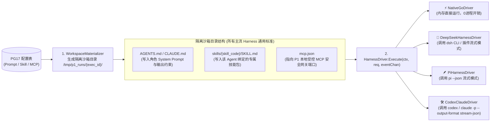

# 02 | 可插拔多 Harness 适配器详细设计（DeepSeek Harness / pi / Codex 与内置 Go 引擎）

> **所属项目**：`P1 - 通用群体智能平台`  
> **分册编号**：`02 - 多 Harness 运行时驱动适配模块`  
> **技术栈标准**：`Go 1.22` (`os/exec`, `bufio.Scanner`, `text/template`, `go-openai`)  
> **上层汇总文档**：[P1_通用群体智能平台_DDD.md](file:///Users/gaorenjie/Documents/Company/aiops-brainstorming-gemini/设计文档/P1_通用群体智能平台_DDD.md)

---

## 1. 模块设计原理（借鉴 `oryx-labs/SuperAgent` 的多 Harness 容器化驱动模式）

在 `oryx-labs/SuperAgent` 中，上层系统通过动态生成运行时配置目录，并调用预装在环境中的成熟 Agent CLI / Harness（如 `DeepSeek Harness`、`pi`、`Codex`、`Claude Code`）来执行具体任务。

P1 在 Go 语言中将这一机制抽象为标准的 **`HarnessDriver` 接口** + **`WorkspaceMaterializer`（沙箱工作区物化器）**，同时提供一个 **0 毫秒启动的内置原生 Go Harness (`NativeGoDriver`)**：



---

## 2. 统一 `HarnessDriver` 接口与事件模型 (`internal/harness/driver_interface.go`)

```go
// internal/harness/driver_interface.go
package harness

import "context"

type HarnessType string

const (
    HarnessNativeGo  HarnessType = "NATIVE_GO"        // 内置极速 Go 协程引擎（推荐用于秒级细粒度 WorkerAgent）
    HarnessDeepSeek  HarnessType = "DEEPSEEK_HARNESS" // DeepSeek Harness (dsh)
    HarnessPi        HarnessType = "PI_HARNESS"       // Pi Agent Harness
    HarnessCodexCLI  HarnessType = "CODEX_CLI"        // OpenAI Codex / Claude Code Headless CLI
)

// HarnessExecRequest 驱动单次智能体（SuperAgent 或 细粒度 WorkerAgent）运行的标准请求
type HarnessExecRequest struct {
    ExecID           string            // 本次执行唯一 ID
    AgentCode        string            // TeamCode 或 WorkerCode
    HarnessType      HarnessType       // 选用的 Harness 类型
    ModelKey         string            // 模型标识
    SystemPrompt     string            // 系统提示词
    UserTaskPrompt   string            // 具体待办任务描述
    BoundSkills      []SkillBundle     // 绑定的 SKILL.md 列表
    LocalMcpProxyURL string            // P1 本地安全护栏 MCP 网关地址 (如 http://127.0.0.1:18080/mcp/sse?exec_id=xxx)
    MaxSteps         int               // 最大工具调用步数
}

// HarnessStreamEvent 屏蔽不同 Harness 输出差异后的统一事件流结构
type HarnessStreamEvent struct {
    ExecID    string                 `json:"execId"`
    AgentCode string                 `json:"agentCode"`
    EventType string                 `json:"eventType"` // THINKING / SKILL_LOAD / TOOL_CALL / TOOL_RESULT / PLAN_UPDATE / FINAL_TEXT
    Content   string                 `json:"content"`
    Payload   map[string]interface{} `json:"payload,omitempty"`
}

// HarnessDriver 所有内置与外部 Harness 适配器必须实现的统一接口
type HarnessDriver interface {
    Name() HarnessType
    Execute(ctx context.Context, req HarnessExecRequest, outEvents chan<- HarnessStreamEvent) (finalAnswer string, err error)
}
```

---

## 3. 动态沙箱工作区物化器 (`internal/harness/materializer.go`)

当选用 `DEEPSEEK_HARNESS`、`PI_HARNESS` 或 `CODEX_CLI` 等外部 Harness 时，P1 在启动子进程前，在 `/tmp/p1_workspace/{exec_id}` 下自动生成外部 Harness 原生识别的配置文件：

```go
// internal/harness/materializer.go
package harness

func MaterializeSandboxWorkspace(req HarnessExecRequest) (workspaceDir string, cleanup func(), err error) {
    dir, err := os.MkdirTemp("", "p1_harness_"+req.ExecID+"_")
    if err != nil {
        return "", nil, err
    }
    cleanup = func() { _ = os.RemoveAll(dir) }

    // 1. 写入角色系统指令文件 (同时写入 AGENTS.md 与 CLAUDE.md 兼容所有主流 CLI Harness)
    _ = os.WriteFile(filepath.Join(dir, "AGENTS.md"), []byte(req.SystemPrompt), 0600)
    _ = os.WriteFile(filepath.Join(dir, "CLAUDE.md"), []byte(req.SystemPrompt), 0600)

    // 2. 写入绑定的所有 SKILL.md 技能包目录树 (.agents/skills/{skill_code}/SKILL.md)
    for _, sk := range req.BoundSkills {
        skillDir := filepath.Join(dir, ".agents", "skills", sk.SkillCode)
        _ = os.MkdirAll(skillDir, 0700)
        _ = os.WriteFile(filepath.Join(skillDir, "SKILL.md"), []byte(sk.MarkdownContent), 0600)
    }

    // 3. 写入受控 MCP 配置文件 (强制外部 Harness 只能连接 P1 本地的安全护栏 MCP 代理端点！)
    mcpCfg := map[string]interface{}{
        "mcpServers": map[string]interface{}{
            "p1_guarded_gateway": map[string]interface{}{
                "url": req.LocalMcpProxyURL,
            },
        },
    }
    mcpBytes, _ := json.MarshalIndent(mcpCfg, "", "  ")
    _ = os.WriteFile(filepath.Join(dir, "mcp.json"), mcpBytes, 0600)

    return dir, cleanup, nil
}
```

---

## 4. 外部 CLI Harness 通用流式驱动实现（以 DeepSeek / Pi / Codex 为例）

```go
// internal/harness/driver_external_cli.go
package harness

func (d *ExternalCliDriver) Execute(ctx context.Context, req HarnessExecRequest, outEvents chan<- HarnessStreamEvent) (string, error) {
    // 1. 生成隔离沙箱目录（挂载好 AGENTS.md、skills/*.md 与受控 mcp.json）
    workDir, cleanup, err := MaterializeSandboxWorkspace(req)
    if err != nil {
        return "", err
    }
    defer cleanup()

    // 2. 根据 Harness 类型组装 Headless JSON 流式启动参数
    var cmd *exec.Cmd
    switch d.harnessType {
    case HarnessDeepSeek:
        cmd = exec.CommandContext(ctx, d.binPath, "run", "--headless", "--json-stream", "--mcp-config", "mcp.json", "--prompt", req.UserTaskPrompt)
    case HarnessPi:
        cmd = exec.CommandContext(ctx, d.binPath, "--non-interactive", "--output", "jsonl", "--mcp", "mcp.json", req.UserTaskPrompt)
    case HarnessCodexCLI:
        cmd = exec.CommandContext(ctx, d.binPath, "exec", "--json", "--mcp-config", "mcp.json", req.UserTaskPrompt)
    }
    cmd.Dir = workDir

    stdoutPipe, err := cmd.StdoutPipe()
    if err != nil {
        return "", err
    }
    if err := cmd.Start(); err != nil {
        return "", err
    }

    // 3. 实时按行扫描外部 Harness 输出的 JSONL 事件流，转换为 P1 标准事件推送给前端/P4作战室
    var finalOutput string
    scanner := bufio.NewScanner(stdoutPipe)
    scanner.Buffer(make([]byte, 64*1024), 4*1024*1024)
    for scanner.Scan() {
        line := scanner.Text()
        evt, isFinal, finalTxt := d.parseHarnessJsonLine(req.ExecID, req.AgentCode, line)
        if evt != nil {
            outEvents <- *evt
        }
        if isFinal {
            finalOutput = finalTxt
        }
    }
    _ = cmd.Wait()
    return finalOutput, nil
}
```

---

## 5. 内置极速 Go Harness 实现 (`driver_native_go.go`)

针对像 `BGP状态分析Agent`、`光模块收发光分析Agent`、`VPN影响反查Agent` 这样只需要加载 1 个 Skill、调用 1~2 次只读 MCP 工具的**细粒度 WorkerAgent**，P1 提供 `NativeGoDriver`：
- **零进程启动开销**：不创建临时目录、不 Fork 外部进程，直接在当前 Go 协程中从内存读取绑定的 `Skill` 与本地 `MCP` 工具列表；
- **内置 `load_skill` 原语**：默认在 System Prompt 中注入绑定 Skill 的摘要，若绑定的 Skill 只有 1 个（细粒度专职 Worker 最常见情况），**直接将该唯一 Skill 的 SOP 正文预加载进上下文**，省去一次大模型往返调用，让细粒度 WorkerAgent 在 **1~2 秒内一击必中返回结论**！
