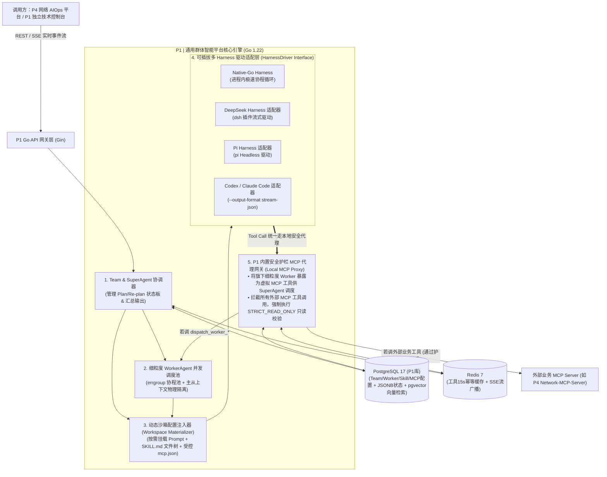

# P1 | SynapseOS — 通用群体智能平台 详细设计文档 (DDD)

> **文档状态**：`已基线 (v2.0 Go 1:1 重构 SuperAgent & 多Harness版)`  
> **当前版本**：`v2.0.0`  
> **所属项目**：`P1 - SynapseOS (通用群体智能平台 | git: synapse-os)`  
> **技术栈标准**：后端 **Go 1.22 (`Gin` + `GORM` + `mcp-go` + `go-openai`)** + 前端 **React 18 (`TypeScript` + `Ant Design 5` + `ReactFlow` + `Monaco Editor`)** + 数据库 **PostgreSQL 17 (含 `JSONB` 与 `pgvector` 向量扩展)** + **Redis 7**。  
> **关联 PRD**：[P1_通用群体智能平台_PRD.md](file:///Users/gaorenjie/Documents/Company/aiops-brainstorming-gemini/需求文档/P1_通用群体智能平台_PRD.md)  
> **专项子设计目录**：[设计文档/通用群体智能平台/](file:///Users/gaorenjie/Documents/Company/aiops-brainstorming-gemini/设计文档/通用群体智能平台)

---

## 1. 文档概述与专项设计导航

### 1.1 核心架构设计概要
本设计吸取了 `oryx-labs/SuperAgent` 与 `deepseek-harness` 的核心设计精髓，摒弃沉重的 Java 栈与冗余的 OA 办公包装，使用 **Go + PostgreSQL 17** 1:1 提炼实现了一套轻量、高并发的企业级群体智能底座：
1. **两层扁平化协同架构**：`Team (内置通用 SuperAgent 主控规划器)` $\xrightarrow{1:N}$ `细粒度专职 WorkerAgent（如 BGP状态分析Agent、BGP配置分析Agent）` $\xrightarrow{1:M}$ `Skill (SKILL.md)` + `MCP Tools`。
2. **可插拔多 Harness 驱动适配层**：内置极速 **Go 原生 Harness (`native-go`)**，同时通过标准沙箱目录挂载与 JSONL 流解析器无缝接入 **`DeepSeek Harness (dsh)`、`pi`、`Codex`、`Claude Code`** 等多种外部 Harness。
3. **跨 Harness 统一调度与安全护栏**：通过将旗下 `WorkerAgent` 动态注册为虚拟 MCP Tool，并强制所有外部 Harness 通过 P1 的本地安全 MCP 代理网关访问外部工具，实现跨异构 Harness 的丝滑调度与 100% 只读安全拦截（`STRICT_READ_ONLY`）。

### 1.2 专项技术设计文档分册索引（落盘于 `设计文档/通用群体智能平台/`）
已在 [通用群体智能平台](file:///Users/gaorenjie/Documents/Company/aiops-brainstorming-gemini/设计文档/通用群体智能平台) 文件夹下建立了 4 份可直接用于 Go 编码落地的深度技术分册：

1. **[00_P1_总体技术架构与oryx-SuperAgent_Go改造工程设计.md](file:///Users/gaorenjie/Documents/Company/aiops-brainstorming-gemini/设计文档/通用群体智能平台/00_P1_总体技术架构与oryx-SuperAgent_Go改造工程设计.md)**
   - 对标 `oryx-labs/SuperAgent` 的 Go 语言工程目录结构、核心模块映射、偏技术型独立前端控制台 5 大页面设计及 8 人天研发排期。
2. **[01_Team-SuperAgent与细粒度WorkerAgent领域模型及PG17表设计.md](file:///Users/gaorenjie/Documents/Company/aiops-brainstorming-gemini/设计文档/通用群体智能平台/01_Team-SuperAgent与细粒度WorkerAgent领域模型及PG17表设计.md)**
   - 基于 **PostgreSQL 17 (`JSONB` + `pgvector`)** 的全套数据表 DDL（涵盖 `t_p1_team`、`t_p1_worker_agent`、`t_p1_skill`、`t_p1_mcp_server`、`t_p1_team_run_session`、`t_p1_worker_sub_trace` 及知识库向量表）。
3. **[02_可插拔多Harness适配器设计_DeepSeek-Pi-Codex与内置Go引擎.md](file:///Users/gaorenjie/Documents/Company/aiops-brainstorming-gemini/设计文档/通用群体智能平台/02_可插拔多Harness适配器设计_DeepSeek-Pi-Codex与内置Go引擎.md)**
   - 统一 `HarnessDriver` Go 接口定义、沙箱工作区动态渲染器（自动生成 `AGENTS.md`、`skills/*.md`、`mcp.json`）、外部 CLI Harness（DeepSeek/pi/Codex）子进程流式驱动器与内置 `Native-Go Harness` 核心代码实现。
4. **[03_SuperAgent动态规划Re-plan与MCP安全护栏网关详细设计.md](file:///Users/gaorenjie/Documents/Company/aiops-brainstorming-gemini/设计文档/通用群体智能平台/03_SuperAgent动态规划Re-plan与MCP安全护栏网关详细设计.md)**
   - `SuperAgent` 动态规划（`update_plan`）与并行派发细粒度 `WorkerAgent`（`dispatch_workers`）的完整 Go 协调代码、主从上下文物理隔离机制、以及 P1 安全护栏 MCP 代理网关实现。

---

## 2. 系统总体架构图

---

## 3. PostgreSQL 17 核心表设计汇总

| 序号 | 表名 | 核心用途与 PG17 特性 |
| :---: | :--- | :--- |
| 1 | `t_p1_team` | 存储 Team 定义、**`super_agent_prompt`（Team 提示词）**、主控选用的 Harness 类型、关联的细粒度 `worker_codes` 数组及强制输出 JSON Schema |
| 2 | `t_p1_worker_agent` | 存储细粒度专职 `WorkerAgent`（如 BGP 状态分析 Agent、BGP 配置分析 Agent）的职责描述、Prompt、选用 Harness、绑定的 `skill_codes` 与 `allowed_mcp_tools` |
| 3 | `t_p1_skill` | 存储标准 `SKILL.md` 技能包元数据与 Markdown SOP 正文 |
| 4 | `t_p1_mcp_server` | 存储注册的外部 MCP Server 地址及各工具的风险等级（`L0_READ_ONLY` 等）与缓存策略 |
| 5 | `t_p1_team_run` | 存储每次 Team 群体任务的运行主记录、**`SuperAgent` 的动态计划表历史 (`plan_steps_jsonb`)**、共享结论摘要与最终输出 |
| 6 | `t_p1_worker_execution` | 独立存储每次细粒度 `WorkerAgent` 被唤醒后的隔离上下文轨迹（加载了哪个 Skill、调用了什么 MCP 工具及原始回显），实现主从上下文隔离与可观测穿透 |
| 7 | `t_p1_knowledge_chunk` | 基于 PostgreSQL 17 **`pgvector` (`vector(1536)`)** 存储领域文档切片与历史成功排障案例 |
