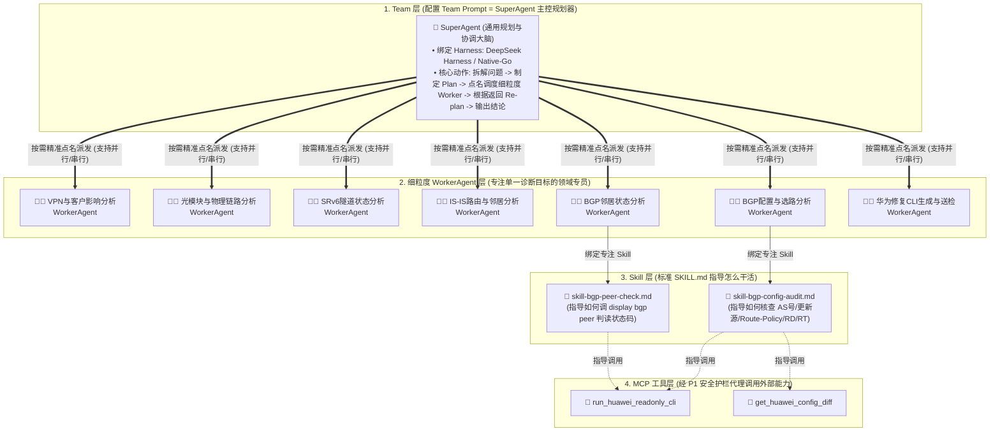

# P1 | SynapseOS — 通用群体智能平台 软件需求文档 (PRD)

> **文档状态**：`已基线 (v2.0 SuperAgent & 多Harness架构版)`  
> **当前版本**：`v2.0.0`  
> **所属项目**：`P1 - SynapseOS (通用群体智能平台 | git: synapse-os)`  
> **核心架构决策**：
> 1. **两层扁平化群体智能架构（`Team [SuperAgent] -> 细粒度 WorkerAgent`）**：管理上创建 `Team`（Team 提示词即通用主控 `SuperAgent` 的规划提示词），关联多个专注单一任务的细粒度 `WorkerAgent`（如 BGP 状态分析 Agent、BGP 配置分析 Agent、光衰分析 Agent 等），每个 `WorkerAgent` 通过绑定的 **`Skill + MCP`** 完成专业干活并汇报结论，`SuperAgent` 负责拆解任务、动态更新规划（Plan & Re-plan）与汇总决策。
> 2. **可插拔多 Harness 运行时引擎（Multi-Harness Runtime）**：借鉴 `oryx-labs/SuperAgent` 与 `deepseek-harness` 架构思想，采用 **Go + React + PostgreSQL 17 (`pgvector`)** 实现统一管控外壳，底层支持自由挂载 **`DeepSeek Harness`、`pi`、`Codex`、`Claude Code`** 等主流外部 Harness 以及 **`内置极速 Go Harness`**。
> 3. **独立商业售卖能力**：配备偏技术管理型独立前端控制台，既可作为 P4 的智能底座，也可作为通用企业级 Multi-Agent 平台独立对外售卖。  
> **关联总纲**：[00_AIOps智能网络运维全景架构与项目总纲.md](file:///Users/gaorenjie/Documents/Company/aiops-brainstorming-gemini/需求文档/00_AIOps智能网络运维全景架构与项目总纲.md)  
> **关联设计**：[P1_通用群体智能平台_DDD.md](file:///Users/gaorenjie/Documents/Company/aiops-brainstorming-gemini/设计文档/P1_通用群体智能平台_DDD.md) 及 [通用群体智能平台专项设计目录](file:///Users/gaorenjie/Documents/Company/aiops-brainstorming-gemini/设计文档/通用群体智能平台)

---

## 1. 文档综述

### 1.1 版本修订记录
| 版本号 | 修订日期 | 修订人 | 修订类型 | 修订内容摘要 | 审核人 |
| :--- | :--- | :--- | :--- | :--- | :--- |
| v1.0 | 2026-11-18 | 产品专家 | 新增 | 完成 P1 通用群体智能平台初稿 | 架构委员会 |
| v2.0 | 2026-11-18 | 产品与AI专家 | 重大修订 | 确立 **“Team (SuperAgent) + N 个细粒度 WorkerAgent + Skill + MCP”** 两层架构；引入对标 `oryx-labs/SuperAgent` 的 **可插拔多 Harness（DeepSeek/pi/Codex/内置Go）** 驱动模型与 Go + PG17 技术栈 | 架构委员会 |

### 1.2 术语与缩略语表
| 术语 / 缩略语 | 全称 / 英文对应 | 业务定义与说明 |
| :--- | :--- | :--- |
| **Team (战队)** | Agent Team | P1 对外提供群体智能服务的顶层组织单元，由 **1 个主控 `SuperAgent` + N 个细粒度 `WorkerAgent`** 组成 |
| **SuperAgent** | Supervisor / Lead Coordinator Agent | 由 `Team Prompt` 驱动的通用主控智能体，不直接调用底层业务工具，专门负责：任务拆解、维护动态计划表（Plan）、派发协调 `WorkerAgent` 干活、根据返回结果更新计划（Re-plan）及输出最终结论 |
| **WorkerAgent** | Fine-Grained Specialist Agent | 细粒度专职工作智能体（如“BGP状态分析Agent”、“BGP配置分析Agent”、“SRv6隧道状态分析Agent”），职责高度单一专注，绑定专属 `Skill` 与最小集合的 `MCP 工具` |
| **Harness** | Agent Execution Harness | 驱动智能体运行“Prompt组装 + 读取 `SKILL.md` + 上下文自动压缩 + 调用 MCP 工具循环”的底层执行引擎（如 `DeepSeek Harness`、`pi`、`Codex`、`内置 Go Harness`） |
| **Skill** | `SKILL.md` Package | 结构化作业指导书（Markdown），指导 `WorkerAgent` 在特定诊断任务中如何按步骤调用 MCP 工具并判读结果 |
| **MCP** | Model Context Protocol | 标准化工具调用协议；在 P1 中，所有外部业务工具以及旗下的 `WorkerAgent` 均通过P1 安全 MCP 网关统一暴露与管控 |

---

## 2. 项目背景、目标与严格边界

### 2.1 架构设计理念（为什么采用“两层扁平化 + 细粒度 WorkerAgent + 多 Harness”）
1. **两层扁平化（`SuperAgent -> 细粒度 WorkerAgent`）优于多层嵌套**：
   - 将专家能力直接拆解为细粒度的专职 `WorkerAgent`（例如拆分为独立的 `BGP状态分析Agent` 和 `BGP配置分析Agent`），由顶层 `SuperAgent` 直接按需点名调度；
   - **更精细的控制力**：`SuperAgent` 先调 `BGP状态分析Agent`，若发现状态正常则直接排除 BGP 嫌疑，根本无需唤醒 `BGP配置分析Agent`；
   - **更极致的经济性与准确率**：每个细粒度 `WorkerAgent` 仅关联 1~2 个专属 `Skill` 和 1~2 个 `MCP 工具`，Prompt 极短、上下文纯净零干扰，可用高速高性价比模型秒级完成，且将冗长的工具原始回显隔离在 Worker 子会话内，只向 `SuperAgent` 返回高浓度结论摘要。
2. **多 Harness 可插拔适配（站在开源巨人肩膀上）**：
   - 借鉴 `oryx-labs/SuperAgent` 将企业协同管控面与底层 Agent CLI/Harness 解耦的思想，P1 用 **Go 语言** 构建统一的“配置管理、沙箱目录生成、跨 Agent 派发与安全护栏外壳”，底层既支持零外部依赖的 **内置轻量 Go Harness**，也支持一键切换为 **`DeepSeek Harness (dsh)`、`pi`、`Codex`、`Claude Code`** 等成熟 Harness。

### 2.2 产品目标与核心指标
| 指标分类 | 指标名称 | 目标值 | 统计口径与说明 |
| :--- | :--- | :--- | :--- |
| 平台解耦度 | 业务无关性 | `100%` | P1 源码与 PG17 表结构不含任何网络硬编码，纯靠配置 `Team/Worker/Skill/MCP` 赋能 P4 |
| 成本与效率 | 主从上下文隔离节省 Token 比 | `≥ 65%` | 相比单一大 Agent 塞入全部回显，隔离原始回显在细粒度 Worker 内可降低 65% 以上主干 Token |
| 兼容性 | 支持接入的 Harness 种类 | `≥ 4 种` | 原生支持 `Native-Go Harness`、`DeepSeek Harness`、`pi Harness`、`Codex / Claude Code Headless` |
| 安全底线 | 只读护栏拦截准确率 | `100%` | 无论底层选用哪种外部 Harness，所有 MCP 工具调用 100% 强制经过 P1 安全代理网关校验 |

### 2.3 项目范围与跨项目边界

#### 2.3.1 P1 项目自身功能范围 (In Scope)
1. **四元核心配置中心（Harness Control Plane）**：
   - **`Team` 管理**：定义团队名称、`Team Prompt`（即 `SuperAgent` 提示词）、主控选用的 Harness 与大模型、关联的 `WorkerAgent` 成员列表、输出 JSON Schema；
   - **`WorkerAgent` 管理**：定义细粒度专家名称、职责边界描述（供 `SuperAgent` 选人）、专家人设 Prompt、选用的 Harness 与模型、绑定的 `Skill` 与 `MCP 工具` 白名单；
   - **`Skill` 技能库管理**：在线编写与版本化管理标准 `SKILL.md` 技能包；
   - **`MCP` 工具与安全网关管理**：注册外部 MCP Server，设置工具风险等级（`L0_READ_ONLY` / `L1_LOW_WRITE` / `L2_HIGH_CHANGE`）与参数正则黑名单。
2. **多 Harness 运行时调度内核（Go 实现）**：
   - 动态沙箱工作区生成器（Materializer：自动为被唤醒的 Agent 渲染 `AGENTS.md`、`skills/*.md` 与受控 `mcp.json`）；
   - `SuperAgent` 动态计划引擎（内置 `update_plan`、`dispatch_workers` 并行/串行派发、`finish_task` 原语）；
   - 多 Harness 驱动器（`NativeGoDriver`、`DeepSeekHarnessDriver`、`PiHarnessDriver`、`CodexCliDriver`）。
3. **基于 PostgreSQL 17 (`pgvector`) 的知识与经验库**：支持文档切片向量检索与历史成功排障案例（Episodic Memory）检索。
4. **偏技术型独立前端控制台（Developer Console，支撑 P1 独立售卖）**：包含 Team 编排台、WorkerAgent 仓库、Skill 编辑器、MCP 与 Harness 网关配置、Playground 实时计划与调用树（Trace）调试台。

#### 2.3.2 P1 严禁越界范围 (Out of Scope)
- 不编写具体华为网络设备 SSH 采集或拓扑解析代码（由 P2 实现，P4 封装为 MCP 注册进 P1）；
- 不负责面向最终网络客户领导的态势汇报大屏与故障工单流转（由 P4 实现）。

---

## 3. 核心架构与运行机制详述

### 3.1 四元核心配置架构图（Team / SuperAgent $\rightarrow$ 细粒度 WorkerAgent $\rightarrow$ Skill $\rightarrow$ MCP）

---

### 3.2 SuperAgent 动态规划（Plan & Re-plan）与细粒度 Worker 协同流程

1. **Step 1：接收任务与制定初始规划 (`Initial Plan`)**
   - `SuperAgent` 收到任务（如 P4 传入的聚合故障事件 `Incident`），读取当前 `Team` 关联的所有细粒度 `WorkerAgent` 的名称与职责列表；
   - `SuperAgent` 调用内置工具 `update_plan`，生成初始排查步骤表（如：`[1. 调 VPN影响分析Worker 查清受影响业务与承载路径] -> [2. 调 SRv6隧道状态Worker 查隧道Active路径]`）。
2. **Step 2：精准派发细粒度 WorkerAgent（支持并发派发）**
   - `SuperAgent` 调用 `dispatch_workers`（可一次派发 1 个或多个无依赖的细粒度 WorkerAgent）；
   - P1 引擎在后台为每个被点名的 `WorkerAgent` 创建**独立隔离的子会话上下文**，启动该 Worker 绑定的 Harness，自动加载其专属 `Skill` 并调用授权的 `MCP 工具`。
3. **Step 3：Worker 交付浓缩结论，SuperAgent 动态更新规划 (`Dynamic Re-plan`)**
   - `WorkerAgent` 完成工具调用后，按规定格式输出**《子任务结论与关键客观证据摘要》**（几千行的原始 CLI 回显留在 Worker 自身的 Trace 日志中，不塞入 `SuperAgent` 上下文）；
   - `SuperAgent` 根据返回的证据动态调用 `update_plan`：
     - **剪枝排除**：若 `BGP状态分析Worker` 汇报状态正常，则直接跳过原计划中后续的 `BGP配置分析Worker`；
     - **动态追加**：若 `SRv6隧道状态Worker` 发现主路径某跳物理口存在错包，则动态插入新步骤：唤醒 `光模块与物理链路分析Worker` 专查该端口收发光功率。
4. **Step 4：收敛结案与结构化输出**
   - 当所有根因证据链与修复方案（经 `修复CLI生成与送检Worker` 调 P3 验证通过）齐备后，`SuperAgent` 调用 `complete_team_task`，按 `Team` 配置的 `Output JSON Schema` 输出最终结果。

---

## 4. 功能性需求详述

### 4.1 模块一：Team 与 SuperAgent 编排管理
- **需求优先级**：`P0 (MVP)`
- **配置字段要求**：
  - `team_code` / `team_name`：团队唯一编码与名称；
  - `super_agent_prompt`：**Team 级提示词（即 SuperAgent 的系统提示词）**，定义任务拆解原则、何时并行派发、何时终止排查以及最终结论合成规范；
  - `super_harness_type`：主控选用的 Harness 类型（`NATIVE_GO` / `DEEPSEEK_HARNESS` / `PI_HARNESS` / `CODEX_CLI`）；
  - `super_model_key`：主控绑定的强推理大模型路由标识；
  - `member_worker_ids`：勾选关联的细粒度 `WorkerAgent` 列表；
  - `default_safety_mode`：默认安全护栏等级（MVP 默认锁定为 `STRICT_READ_ONLY` 只读模式）；
  - `output_json_schema`：最终输出的强制 JSON 结构定义。

### 4.2 模块二：细粒度 WorkerAgent 与 Skill 绑定管理
- **需求优先级**：`P0 (MVP)`
- **配置字段要求**：
  - `worker_code` / `worker_name`：如 `worker_bgp_state_analyzer`（BGP邻居状态分析专家）；
  - `specialty_description`：**专长与触发条件描述**（极为重要，直接展示给 `SuperAgent` 用于决定何时调用该 Worker）；
  - `worker_prompt`：专职人设与输出格式要求；
  - `worker_harness_type` & `worker_model_key`：该 Worker 选用的 Harness 与大模型（支持为简单细粒度 Worker 绑定轻量高速模型以降低成本）；
  - `bound_skill_ids`：关联的 1 个或多个 `Skill` 编码；
  - `allowed_mcp_tools`：最小权限绑定的 MCP 工具白名单。

### 4.3 模块三：多 Harness 驱动适配中心
- **需求优先级**：`P0 (MVP)`
- **核心业务规则**：
  1. **内置极速 Go Harness (`NATIVE_GO`)**：P1 进程内原生实现的轻量 Tool-Calling 循环，0 毫秒启动开销，默认用于细粒度 `WorkerAgent` 的秒级诊断。
  2. **外部 CLI / RPC Harness 适配器（`DEEPSEEK_HARNESS` / `PI_HARNESS` / `CODEX_CLI`）**：
     - P1 自动在隔离临时目录生成外部 Harness 所需的 `AGENTS.md`（写入 Prompt）、`skills/` 目录（写入绑定的 `SKILL.md`）与 `mcp.json`（指向 P1 受控 MCP 代理端口）；
     - 实时解析外部 Harness 标准输出流（JSONL / Event Stream），统一映射为 P1 的标准 SSE 事件推送给调用方。

### 4.4 模块四：P1 统一安全护栏 MCP 代理网关
- **需求优先级**：`P0 (MVP)`
- **核心业务规则**：
  1. **虚拟工具自动映射**：自动将 `Team` 内的所有 `WorkerAgent` 映射为供 `SuperAgent` 调用的派发工具 `dispatch_worker_<worker_code>`。
  2. **强制只读安全锁**：当会话处于 `STRICT_READ_ONLY` 模式时，网关层 100% 拦截任何风险等级非 `L0_READ_ONLY` 的工具调用，并对工具入参执行敏感禁用词正则扫描。

### 4.5 模块五：P1 偏技术型独立前端控制台（支撑独立商业售卖）
- **需求优先级**：`P0 (MVP)`
- **五大核心技术页面**：
  1. **Team 战队编排工作台 (`/teams`)**：可视化配置 `Team (SuperAgent)` 与勾选下属细粒度 `WorkerAgent` 拓扑关系；
  2. **细粒度 WorkerAgent 专家库 (`/workers`)**：管理所有专职 WorkerAgent 的 Prompt、Harness 绑定与工具授权；
  3. **Skill 技能包 IDE (`/skills`)**：在线编辑与测试 `SKILL.md`；
  4. **MCP 与多 Harness 网关中心 (`/gateway`)**：注册外部 MCP Server、配置各 Harness 运行环境与大模型 API Key；
  5. **Playground 调试与全链路 Trace 观测台 (`/traces`)**：实时查看 `SuperAgent` 的动态计划变更表（Plan & Re-plan 历史）以及每个 `WorkerAgent` 子会话的内部思考链、加载的 Skill、MCP 调用耗时与 Token 消耗账单。
