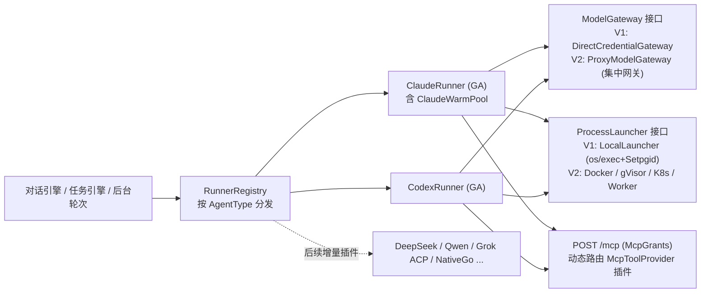

# 03. 核心抽象与插件化引擎：Runtime、MCP 网关与 ModelGateway

> 本文档定义 Go 版最具长期生命力的核心可扩展层：四大面向二期沙箱与多引擎演进的核心接口（`ProcessLauncher`、`AgentRunner`/`StreamParser`、`ModelGateway`、`McpToolProvider`）、V1 落地的 `Claude Code`（含 Go 并发热进程池）与 `Codex` 适配器详设、内置 `/mcp` 协议网关与 `McpGrants`，以及保留飞书/钉钉预置连接器与通用自定义 MCP 连接器的精简设计。

---

## 1. 四大核心可插拔接口（一期立骨，二期零重构演进）



### 1.1 `ProcessLauncher`：面向沙箱隔离的进程启动抽象

所有 CLI 子进程与 `STDIO` MCP 子进程**严禁直接调用 `exec.Command`**，必须统一经由 `ProcessLauncher` 启动，使二期切入 Docker/gVisor/Kata/远端 Worker 时上层执行器零修改：

```go
package spi

type TempFileSpec struct {
    Prefix  string
    Suffix  string
    Content []byte
    Mode    os.FileMode // 固定 0600，防止多租户同机泄露
}

type ProcessSpec struct {
    CompanyID    string
    OwnerUserID  string            // 供二期定位每员工专属沙箱 sa-<company>-<user12>
    Command      string
    Args         []string
    WorkDir      string
    Env          map[string]string
    StripEnvKeys []string          // 启动前必须清除的宿主机环境变量（如 ANTHROPIC_API_KEY）
    MountFiles   []TempFileSpec    // 需随进程生命周期自动创建的 0600 临时配置文件
}

type ProcessHandle interface {
    Stdin() io.WriteCloser
    Stdout() io.ReadCloser
    Stderr() io.ReadCloser
    Wait() (exitCode int, err error)
    Terminate(grace time.Duration) error // 优雅关闭 stdin -> SIGTERM 整个进程组 -> grace 后 SIGKILL
    Kill() error                         // 立即强杀整个进程组 (-pgid)，杜绝孤儿孙进程
    Close() error                        // 清理全部临时文件与句柄
}

type ProcessLauncher interface {
    Mode() string // "local" | "docker" | "gvisor" | "kata" | "worker"
    Start(ctx context.Context, spec ProcessSpec) (ProcessHandle, error)
}
```

- **V1 `LocalLauncher` 关键强化**：
  - 自动接入 `CliPaths` 解析可执行文件并拼接 `PATH`（私有 Node 目录优先），自动叠加企业代理环境变量与 `NODE_EXTRA_CA_CERTS`；
  - Linux/macOS 开启 `SysProcAttr{Setpgid: true}`，取消或超时时调用 `syscall.Kill(-pgid, SIGKILL)` 整组查杀，彻底杜绝 CLI 衍生的 `node`/`bash` 孙进程泄漏为僵尸进程；
  - 统一管理 `MountFiles`（`0600` 创建并在 `Close()` 中确保删除）。

### 1.2 `AgentRunner`、`RunnerRegistry` 与 `StreamParser`（支持无限新增 CLI）

```go
package spi

type RunnerCapabilities struct {
    Type            domain.AgentType
    SupportImages   bool
    SupportStdioMCP bool
    SupportWarmPool bool
    Maturity        string // "ga" | "beta" | "experimental"
}

type EventSink func(ev domain.AgentEvent)

type AgentRunner interface {
    Type() domain.AgentType
    Capabilities() RunnerCapabilities
    Run(ctx context.Context, req domain.AgentRunRequest, sink EventSink) error
    RunChat(ctx context.Context, req domain.AgentRunRequest, sink EventSink) error
}

// StreamParser 抽象每家 CLI 的 NDJSON 行流式解析，新增 CLI 只需实现配置模板 + Parser 即可注册
type StreamParser interface {
    ParseLine(line []byte) ([]domain.AgentEvent, error)
    Finish() []domain.AgentEvent
    Usage(fallbackModel string) (tokens []domain.TokenUsage, cliCostUSD *float64)
}
```

- **`RunnerRegistry` 插件注册中心**：启动装配时调用 `registry.Register(claudeRunner)`、`registry.Register(codexRunner)`。后续新增 `GLM`、`DeepSeek`、`Qwen`、`Kimi`、`Gemini`、`Grok ACP` 或 Go 内置引擎，只需在 `internal/runtime/runner/` 新增单个文件实现 `AgentRunner`（或复用通用 `JSONLineRunner` 基座模板）并注册一行即可生效，**任务、对话与调度引擎零改动**。
- **取消机制简化**：直接采用 Go 原生 `context.Context` 替代原版 `Cancellation` 对象——外层将 `cancelFn` 存入 `activeRuns[sessionOrTaskID]`，用户点停止调用 `cancelFn()`，`ProcessLauncher` 监听 `<-ctx.Done()` 立即终止整个子进程组。

### 1.3 `ModelGateway`：面向集中式网关的凭证与端点抽象

```go
package spi

// ResolvedEndpoint 描述本回合发往底层 CLI 的模型访问参数
type ResolvedEndpoint struct {
    CredentialID string // V1 故障归因用
    BaseURL      string
    APIKey       string
    Bearer       bool
    ProxyMode    bool   // V2 集中式网关开启后为 true，计量改由网关侧完成
}

type ModelGateway interface {
    Resolve(ctx context.Context, providerKey string, excludeCredID string) (*ResolvedEndpoint, error)
    ReportEndpointFailure(ctx context.Context, providerKey string, ep *ResolvedEndpoint, reason string) (*ResolvedEndpoint, error)
}
```

- **V1 实现 (`DirectCredentialGateway`)**：封装 `CredentialService` 严格按当前租户解析加密密钥池，无密钥即返 `403 NoCompanyKey`（绝不回退宿主机环境变量）；零输出端点报错时标记原 Key 为 `ERROR` 并自动返回下一优先级 Key。
- **V2 平滑演进 (`ProxyModelGateway`)**：二期上线集中式三协议网关后，只需替换该接口实现，向沙箱下发 `http://<gateway>/v1` + 单回合临时代理令牌，真实厂商 Key 彻底留在控制面，上层全部执行器零改动。

---

## 2. V1 两大 GA 适配器详设：`Claude Code` 与 `Codex`

### 2.1 `ClaudeRunner` + Go 并发热进程池 (`ClaudeWarmPool`)

1. **冷启动执行规格**：
   - 完整对齐 [../SuperAgent/02_Agent执行运行时与CLI-ACP协议适配.md](../SuperAgent/02_Agent执行运行时与CLI-ACP协议适配.md) §4.3：固定注入 `CLAUDE_CODE_DISABLE_NONESSENTIAL_TRAFFIC=1`，清除宿主机 `ANTHROPIC_*`，通过 `0600` 临时 `--settings` 文件双重覆盖 `env` 块（有图片时附 `"enableArtifact": false`），通过临时 `--mcp-config` + `--strict-mcp-config` 完整透传 HTTP/SSE/STDIO MCP，以 `--` 隔离提示词防参数注入。
   - **双分支自愈重试**：首轮报 `"is already in use"` 自动切 `--resume <sessionId>` 重试；续跑报 `"No conversation found with session ID"` 抑制错误、发 `THINKING` 提示并清空 `agentSessionId` 重开新会话（携带完整记忆结转）。
   - **原生图片支持**：有图片时切 `--input-format stream-json` 经 `stdin` 发送含 base64 `image` 块的 JSON 行。
2. **Go 并发长驻热进程池 (`ClaudeWarmPool`)**：
   - **数据结构**：`sync.Mutex` 保护 `container/list` 双向链表 + `map[string]*list.Element` 实现 O(1) LRU（默认上限 `max = 20`，空闲超时 `10m`）；后台单 goroutine `time.NewTicker(30 * time.Second)` 清扫超时或已退出进程。
   - **执行期移出池**：取用会话时立即从 LRU 移出，确保无并发争抢、不被后台清扫误杀；仅在 `OutcomeDone && alive && ctx.Err() == nil` 时归还，超容淘汰队尾并在**锁外**优雅关闭（`stdin.Close()` -> `SIGTERM` -> 2s -> `SIGKILL`）。
   - **8 维 SHA-256 指纹**：对 `workspaceDir`、`model`、`systemPrompt`、`allowedTools`、`skipPermissions`、`hasImages`、剥离平台自身 Bearer 的 `mcpConfig` 及 `endpoint(baseUrl/bearer/apiKey)` 计算 SHA-256，任一变化即销毁重建。
   - **Stand-In 令牌与差分计量**：回合起止自动执行 `grants.StandIn(standing, current)` / `defer grants.Release(standing)`；跟踪上次 `reportedCost` 与 `reportedTokens`，每轮扣减前值后仅发出本轮增量；`OutcomeNothing` 自动销毁热进程无缝降级冷启动 `Run()`；`OutcomeBroken` 补记 `unreportedTokens()` 后报错退出。

### 2.2 `CodexRunner`

- 通过 `ProcessLauncher` 执行 `codex exec --json --skip-git-repo-check`，支持 `-c model_provider="openai"`、`-c openai_base_url`、`-c mcp_servers.<name>.*` + `SUPERAGENT_MCP_TOKEN_<UPPER>` 环境变量传递 HTTP Bearer 令牌、`--image=<absPath>` 原生多图、`stdin` 每轮前置 `<system>...</system>`（仅首轮含记忆）。
- 严格校验 `.superagent/codex-sessions/<sessionId>` 内的 `threadId` 符合 36 位 UUID 正则，阻断工作区篡改导致的命令行参数注入。
- `CodexStreamParser` 解析 `thread.started` / `item.started|completed` / `turn.completed|failed`，按 `uncachedInput = max(0, totalInput - cacheRead - cacheWrite)` 拆分出不重叠的五维 `TokenUsage`。
- **能力元数据声明**：`Capabilities()` 明确返回 `SupportImages: true, SupportStdioMCP: false, SupportWarmPool: false, Maturity: "ga"`，便于前端与日志清晰提示 STDIO 连接器仅对 Claude 生效。

---

## 3. 内置 MCP 网关 (`POST /mcp`) 与 `McpGrants`

- **协议规范**：完整实现 MCP Streamable-HTTP JSON-RPC 2.0（`protocolVersion: "2024-11-05"`），`GET /mcp` 返回 `405`，无 `id` 通知返回 `202 Accepted`，鉴权走 `Authorization: Bearer <48-hex>`（无效返 `401`）。
- **工具级错误统一修复**：在 `internal/web/mcp` 统一拦截所有 `McpToolError` 及预期领域异常（如任务不存在/忙碌、参数非法），返回 JSON-RPC `result` + `"isError": true`（文本前缀 `"错误："`），彻底修复原版 `TaskMcpTools` 漏捕异常导致返回 `-32603` 的问题。
- **`McpGrants` 内存并发管理**：`sync.RWMutex` 维护 `grants[token]`、`standIns[standingToken] = activeToken`；每条 Grant 绑定 `CompanyID`、`Kind (CHAT|TASK|SUPER)`、`Owner`、`AgentID`、`TaskID`、`SessionID`、`MessageID`、`Workspace`；回合结束 `defer grants.Close(token)` 确定性吊销；工作区文件校验使用 `filepath.EvalSymlinks` 强校验位于 `Workspace` 之内且为常规文件；服务就绪后异步发起 `ping` 自检记录 `SelfStatus`。

---

## 4. V1 精简后的企业集成与连接器设计

按最终锁定边界，**砍掉 GitHub / Gitee / Notion / Confluence 4 套预置 SaaS 集成与 OAuth**，保留**飞书/钉钉企业生态 + 通用自定义 MCP 连接器**：

| 类别 | V1 保留清单 | 核心实现规格 |
|---|---|---|
| **企业集成 (`IntegrationService`)** | 1. **`feishu`** (`domain`: `feishu`/`lark`, `appId`, `appSecret*`)<br>2. **`dingtalk`** (`clientId`, `clientSecret*`) | 密文经 `SecretCipher` 存入 `system_setting`；更新发布 `IntegrationChanged(key)` 驱动 IM 长连接热重载；`AppUrl` 解析公网回调基址 |
| **预置系统连接器（公司初始化播种）** | 1. **`feishu-docs`**（`OAUTH`，进程内 `OWN_TOOLS`，由 `FeishuDocTools` 直接消费员工 OAuth 令牌）<br>2. **`dingtalk-tools`**（`NONE`，默认关闭，`STDIO`: `npx -y dingtalk-mcp@latest`，依赖 `dingtalk` 集成注入 AppKey/Secret 与 `ACTIVE_PROFILES`） | 列表顶部同步合成 3 个状态行：`superagent`（内置 MCP 自检）、`feishu`（IM 连接状态 + 8 位绑定码）、`dingtalk`（IM 连接状态 + 8 位绑定码）；`FeishuDocsOAuthClient` 保留 10 分钟单次防 CSRF `state` 与 `singleflight`/每用户锁提前 10 分钟刷新（4xx 自动删旧凭证） |
| **通用自定义 MCP 连接器** | 管理员按需自由增删改企业内网或第三方 MCP | 支持 `STDIO` / `HTTP` / `SSE` 三种传输，支持 `NONE` / `SHARED_TOKEN` / `PERSONAL_TOKEN` 认证；`McpClient`（协议 `2025-06-18`）提供只读 `tools/list` 探测（STDIO 120s / HTTP & SSE 30s，按 `(company, connector, viewer)` 缓存 10 分钟）；回合运行期按发起员工动态装配为 `McpServerSpec` 并自动注入 `--mcp-config` 与 `mcp__<name>` 允许规则 |
