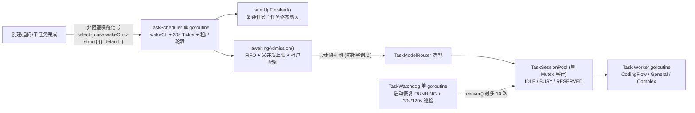

# 04. 核心业务域 Go 并发设计：对话、任务、编排、IM 与成本路由

> 本文档阐述 L2–L4 五大核心业务域在 Go 1.26 中的并发模型、goroutine 生命周期治理、原版缺陷修复点与二期扩展钩子。通用业务规则与字段细节见 [../SuperAgent/README.md](../SuperAgent/README.md) 对应分册，本文聚焦 Go 工程落地设计。

---

## 1. Agent 管理、对话引擎与 `LiveTurn` SSE 扇出 (`internal/agent`)

### 1.1 V1 精简与修复点
- **去掉 24 个内置性格预设**：`Agent` 仅保留自由配置 `persona`（系统提示词直接拼接 `Your name is <name>.\n\n<persona>\n\nAlways reply in the language the user writes in.`）；头像允许任意合法短字符串/Emoji（不再硬限 24 个）。
- **修复原版 3 处小缺陷**：
  1. 共享 Agent 对话发言人前缀 `"[<displayName>]："` 统一检查「直接协作者 OR 所属项目协作者」，不再遗漏项目成员；
  2. 补齐 `AgentService.MergeUpdate` 中的 `settings` 类别运行日志写入；
  3. 删掉死代码 `MaterialPrompt`，保留实际生效的链接自动收藏（`saveLinks`）与 `>= 3,000` 字长粘贴自动存 `.md`（`keepPasted`）。
- **二期离职交接钩子预留**：在 `internal/core/spi` 预留 `OwnerTransferHook` 接口，用户禁用/删除路径预留调用位，二期可直接实现原子转移 Agent、任务与自动化所有权。

### 1.2 `LiveTurn` 多端同屏 SSE 广播器（Go 原生并发模型）

利用 `sync.Mutex` + 订阅者 buffered channel 实现高并发、零阻塞的实时流式分发与中途接管：

```go
type LiveTurn struct {
    mu         sync.Mutex
    By         string
    ByName     string
    StartedAt  time.Time
    SessionID  string
    Activity   string
    events     []api.StreamEvent // 连续 text/thinking 增量原地合并，控制内存占用
    ended      bool
    subs       map[uint64]chan api.StreamEvent
    nextSubID  uint64
}

// Publish 向所有在线观看者非阻塞投递；慢客户端丢弃而非阻塞底层 CLI stdout 读取！
func (l *LiveTurn) Publish(ev api.StreamEvent)
// Subscribe 在同一把锁内原子返回 (历史快照切片, 实时增量 chan, cancelFunc, alreadyEnded)
func (l *LiveTurn) Subscribe() ([]api.StreamEvent, <-chan api.StreamEvent, func(), bool)
```

- **单 Agent 并发互斥**：`ChatService` 维护 `liveTurns sync.Map`（键为 `agentID`，无 Agent 时为 `sessionID`），采用 `LoadOrStore` 原子占锁，冲突立返 HTTP `409 busy`；回合协程在 `tenant.Detach(ctx)` 中运行，**客户端断连 SSE 仅退出响应循环，绝不取消后台回合**。
- **三层容灾 + 7 阶段埋点 + 记忆蒸馏**：
  - Layer 1 密钥切换（`ModelGateway.ReportEndpointFailure`）-> Layer 2 模型跳变（最多 2 跳，`model_down` 新会话）-> Layer 3 连续 10 次非瞬态错误自动轮换会话（`failures`）。
  - `TurnTimer` 通过包装 `spi.EventSink` 无侵入统计 7 阶段耗时与 FIFO 工具调用时长；在推送 `done` 事件**之前**完成落库。
  - `MemoryLoop` 单 goroutine 每 5 分钟按租户轮询（静默 `>=2m` 且 `>=10` 条或空闲 `>=30m`，每轮最多 3 个 Agent），通过 `inFlight` 集合防止与会话轮换/手动立即蒸馏并发冲突。
  - `FileTagger` 单 goroutine 每 60 秒按租户批处理（上限 20 文件，租户异常熔断退避 10 分钟）。

---

## 2. 异步任务引擎、编码三步流、看门狗与自动化 (`internal/task`)

### 2.1 Go 并发调度与会话池设计



- **修复原版 3 处关键缺陷**：
  1. **`TaskSessionPool` 跨模型复用防护**：`Acquire` 复用 `IDLE` 槽位时显式校验 `s.Model == model`，若模型不同则在**同工作区内轮换全新 `sessionID`**（重置 `initialized = false`），避免不同模型历史思考块签名冲突；
  2. **完整修复启动恢复与看门狗恢复 (`RestoreSessions` & `Recover`)**：应用启动完成即刻扫描磁盘重建 `IDLE`/`RESERVED` 池映射，恢复重启前排队的追问任务；看门狗扫描 `RUNNING` 孤儿与 `ERROR` 任务（上限 `MAX_ATTEMPTS = 10`，`ERROR` 立即同工作区轮换新会话），正确调用 `recoverPrompt`（编码任务重注 `brief` + 已确认 PRD，复杂任务不重复拆子任务）；
  3. **取消映射一致性**：`activeRuns` 统一按 `taskID` 索引 `context.CancelFunc`，无会话旋转键漂移隐患。
- **任务前置资料预读**：创建非子任务时用 `errgroup.WithContext` 并发预读最多 **8 个** URL，共享 `context.WithTimeout(ctx, 90*time.Second)`；任一失败立返 HTTP `409 UnreadableMaterials`，零 DB 写入。
- **自动化引擎 (`internal/task/automation`)**：
  - 采用 `robfig/cron/v3`（5 字段 + `time.LoadLocation`）实现 DST 安全调度；
  - 单 goroutine 启动立即首扫，此后每 30 秒按租户扫描，**先落库推进 `next_run_at`（或禁用 `ONCE`），再触发任务**（崩溃安全至多一次 + 停机折叠单次补跑）；
  - 外部 Webhook `POST /api/v1/automations/:id/trigger` 从 `X-Automation-Token: <company>.<64-hex>` 解析租户，使用 `crypto/subtle.ConstantTimeCompare` 校验 SHA-256 摘要，统一 403 防探测。

---

## 3. 个人 SuperAgent 编排器与企业 IM 接入 (`internal/orchestrator` & `internal/event`)

### 3.1 个人主管双半隔离引擎
- **实时对话半 (`SuperAgentChat`)**：通过 `AgentTurnCustomizer` 接口替换提示词、剥离 `Bash`、注入后台新发言与计划状态；支持快速通道 `start_task`（免计划卡）与团队规划通道 `propose_plan -> UI 确认 -> hire/update/assign`。
- **后台循环半 (`SuperAgentLoop`)**：每 3 秒按租户巡检——先更新 `SuperAgentWork` 监控状态机（`KEEP`/`REPORT_AND_KEEP`/`REPORT_AND_DROP`/`DROP`），再检查 10s 静默 / 60s 防饥饿 / P0 立即唤醒条件；按首条是否带 `【外部消息】` 严格切分同类前缀，**外部消息轮次同时裁剪 CLI 工具白名单并在服务端 `requireOwnInput` 双重拒止一切行动工具**；无论成败游标 `processedUntil` 必进，失败时清空后台 `agentSessionId` 防毒丸死循环。

### 3.2 插件化 `IMConnector` 接口与飞书/钉钉实现

```go
package spi

type IMConnector interface {
    Type() string // "feishu" | "dingtalk" | 未来 "wecom"
    Start(ctx context.Context) error
    ReconnectCompany(ctx context.Context, companyID string) error
    NotifyOwner(ctx context.Context, src domain.EventSource, text string) error
    Close() error
}
```

- **V1 落地 `FeishuIMConnector` 与 `DingTalkIMConnector`**：
  - 每家启用集成的公司独立持有一条出站 WebSocket 长连接协程，监听 `CompanyStarted` 与 `IntegrationChanged` 实现单公司精准热重载（通过取消该公司的子 `ctx` 彻底释放旧连接，不再需要反射黑科技！）；
  - 收到消息后毫秒级回 ACK 并投递至每连接 4-worker 有界通道异步入库；
  - 保留每小时手机号自动匹配 + 8 位绑定码私聊绑定（连续输错 5 次锁定、未绑定 6 小时引导冷却）；
  - 保留 7 步确定性 `TriageRules`（结合 `OrgStore` 上下级动态加权）、`ON CONFLICT DO NOTHING` 原子去重、P0 即时池 + 原文兜底私聊直推、60s 巡检窗口（P0 重试 / P1 小时 / P2 每日简报 / 30 天清理）与 `InboxTodo <-> Notice` 双向同步。

---

## 4. 模型供应商托管、在线安装与智能成本路由 (`internal/platform/provider` & `internal/cost`)

- **供应商静态目录 (`ProviderCatalog`)**：V1 正式启用 **`claude`**（`@anthropic-ai/claude-code`）与 **`codex`**（`@openai/codex`）两个 GA 条目，目录结构保持可扩展，后续追加新引擎即插即用。
- **私有 Node.js 托管与在线 CLI 安装（商业增强版）**：
  - 支持读取配置 `network.https_proxy`、`runtime.node_dist_mirror`、`runtime.npm_registry`、`network.ca_bundle_file`，彻底解决国内企业联网下载慢与代理/自签证书问题；
  - 下载 Node LTS 配 **60 秒读字节停滞看门狗** + `SHASUMS256.txt` 校验 + 原子目录替换；
  - 单 worker 串行安装队列 + 3 分钟静默 / 30 分钟总时长进程组强杀 + `EACCES` 自动回退私有 Node 前缀 + 400 行环形安装日志缓冲。
- **健康巡检与模型探活**：4 组定时循环（3s 本地状态 / 1h 版本与模型列表 / 1h 6 并发推理探活 + 5m 不可达补测 / 10m 密钥恢复与 1h 健康复检）。
- **修复后的 `TaskModelRouter`**：
  1. **完整实现管理员固定模型模式 (`fixedStart` / `fixedNext`)**：仅在 `task.fixed-models` 中由廉价到昂贵尝试，无可用直接返回 `refused()`（`model == ""`）绝不越界逃逸，且 `strongest()` 同样服从固定模型约束；
  2. **新增单候选跳过裁判优化**：当 `forTasks` 仅有 1 个可用模型时直接选中（`by = default`），免去无意义的 LLM 裁判耗时与费用；
  3. **保留 LLM-as-Judge + 价格阶梯升档**：最多 3 个裁判冗余、180s 超时、`easy/medium/hard` 非法输出兜底、失败沿 `(3*in+out)/4` 升至下一档更贵模型（`BY_USER` 锁定保护）；
  4. **五维不重叠 Token 计费与账单**：完整保留 `models.dev` 24h 目录同步 + 内嵌 339 条快照 + 手动覆盖价 + 个人/公司/任务/系统探活用量报表与运营大盘。

---

## 5. 工作文件、项目、技能与精简链接阅读 (`internal/files`, `project`, `skills`, `docs`)

- **工作文件与多后端存储 (`internal/files`)**：
  - 实现 `FileStore` / `FileStoreProvider` 插件接口：V1 内置 `LocalFileStoreProvider`（租户目录原子重命名写入）与 `S3FileStoreProvider`（`aws-sdk-go-v2`，支持自定义 endpoint/pathStyle 兼容 MinIO/OSS/COS/R2）；
  - 保留 `locates` 区分凭证轮换与新渠道分配、保存前写入-回读-删除实测探活、SHA-256 上传去重、个人 3 层 `FileFolder` 无损提升删除、三路可见性（404 防探测）及防 XSS 预览响应头（文本类强制 `text/plain` + `CSP: sandbox` + 支持 `Range` 视频流）。
- **项目空间 (`internal/project`) & 技能库 (`internal/skills`)**：
  - 严格成员封闭项目、`ACTIVE`/`ARCHIVED` 可逆状态与归档只读；
  - 个人/企业两级技能（**移除 3 个消费级种子技能**，开箱为空或支持企业自定义初始化目录）、魔数嗅探配图、对话内 `SkillDeletion` 确认卡、`EvalSymlinks` 校验后渐进披露写入 `<workspace>/.superagent/skills/<id>/SKILL.md`。
- **办公文档与精简链接阅读 (`internal/docs`)**：
  - 完整保留 `FeishuDocTools`（6 工具，员工 `feishu-docs` OAuth 令牌 + Markdown 转 Block）与 `DingTalkDocTools`（5 工具，企业 Token + `operatorId=<unionId>`），统一受 `McpGrants.RequireDocAccess`（SuperAgent 后台禁 / 对话只读）守卫；
  - **精简 `LinkReaderService`**：保留 10 分钟 200 条按人 LRU 缓存 + 抗 DNS-Rebinding `EgressGuard`（最多 6 跳重定向、20 MB 上限），数据源精简为 **2 级**：
    1. **飞书授权文档直读**：匹配飞书/Lark 文档 URL 且当前员工已授权 `feishu-docs` 时直接走官方 API 读原文；
    2. **通用抓取源 (`GenericSource`)**：支持 PDF 文本提取、HTML 主容器（`<article>`/`<main>`/`#content`）转 Markdown、以及纯文本/JSON/CSV/Markdown 原样返回；**彻底移除微信公众号、Google Docs 与飞书匿名网页爬虫**。
