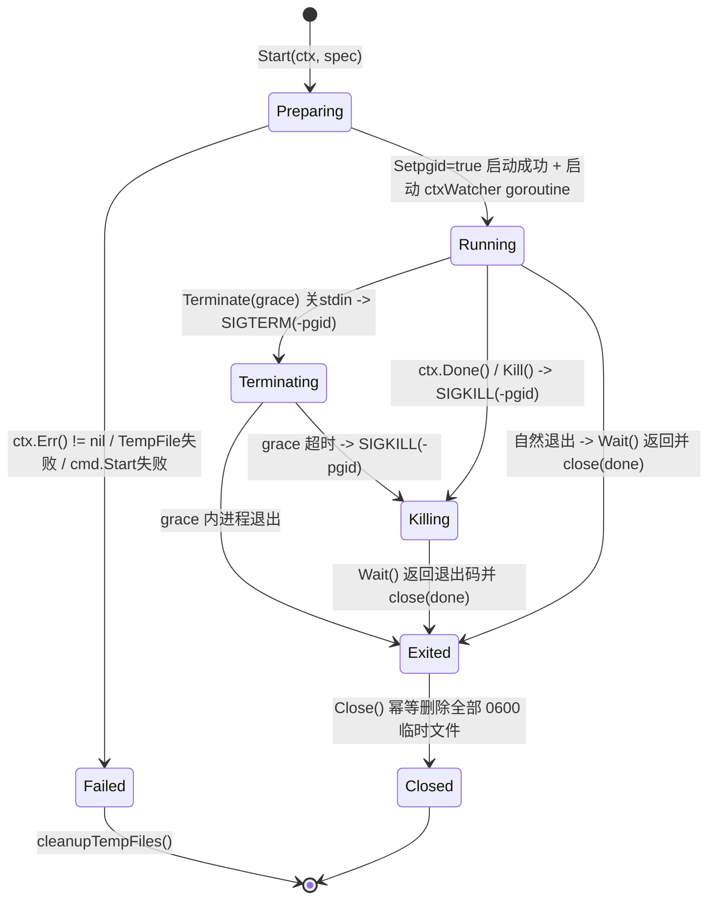

# spec 11 | Runtime Launcher & Runner Framework — 进程启动器、大行管道、Runner 注册表与图片附件存储

- **状态**：`draft`
- **篇号顺序**：11（L1 执行运行时层首篇）
- **对应 PR**：`docs/SuperAgent-Go/DDD/README.md` 看板中的 `SA-11`
- **预估工作量**：`1.5 人天`
- **上位契约**：
  - `docs/SuperAgent-Go/01_Go工程架构_目录结构与核心底座设计.md` §1、§5.1、§5.2
  - `docs/SuperAgent-Go/03_核心抽象与插件化引擎_Runtime_MCP与ModelGateway.md` §1.1、§1.2
  - `docs/SuperAgent-Go/DDD/_epic/L1/spec_03_runtime_launcher_claude_codex_mcp.md` §1–§5
- **前置依赖**：`L0/spec_01 (SA-01)`（`internal/infra/config` `NetworkRuntime`、`internal/infra/obs` 脱敏日志与指标、`internal/infra/lifecycle` `BackgroundGroup`、`internal/core/apperror`）、`L0/spec_04 (SA-04)`（`internal/core/tenant` 多租户与 `TenantPaths`、`internal/arch_test.go`）、`L1/spec_06 (SA-06)`（`internal/core/{domain,spi}` 核心领域模型与 SPI）
- **下游消费者**：`SA-12`（`ClaudeRunner` / `ClaudeWarmPool`）、`SA-13`（`CodexRunner`）、`SA-14`（`McpClient` STDIO 传输与临时 `mcp-config.json` 挂载）、`SA-28`（`ChatService` 消费 `RunnerRegistry` 与 `ImageAttachmentStore`）、`SA-30`（`TaskService` 与 `NodeRuntimeService` / 探测服务消费 `CliPaths` 与 `ProcessLauncher`）
- **重构参照源码**（绝对路径均基于 `/Users/gaorenjie/Documents/Coding/aiops-workspace/orgin/SuperAgent`）：
  - `superagent-core/src/main/java/com/superagent/core/chat/{AgentRunner.java,AgentRunRequest.java,AgentEvent.java,AgentEventType.java,AgentType.java,ImageAttachment.java,Cancellation.java}`
  - `superagent-runtime/src/main/java/com/superagent/runtime/cli/{JsonLineCliRunner.java,CliPaths.java,Tokens.java}`
  - `superagent-runtime/src/main/java/com/superagent/runtime/attachment/{ImageAttachmentStore.java,AttachmentNotFoundException.java}`

---

## 1. 背景与范围

### 1.1 为什么做与用户价值

在原版 Java `superagent-runtime` 中，所有 CLI 执行器均直接调用 `ProcessBuilder` 启动外部进程，依赖 `Cancellation` 自定义回调锁与 `process.destroyForcibly()` 终止子进程，存在三大生产隐患：
1. **孤儿孙进程泄漏**：CLI（尤其是基于 Node.js 的 Claude Code / Codex / MCP Server）在执行 Bash 或子命令时会派生多层孙进程，仅杀直接子进程 PID 会导致僵尸/孤儿进程长期驻留宿主机消耗 CPU/内存；
2. **输出大行截断与 stderr 阻塞死锁**：Go `bufio.Scanner` 默认 64 KiB 行上限会被超长 `tool_result` 或 Base64 JSON 帧直接撑爆导致流异常中断；若不同步排空 `stderr`，子进程写满 OS 管道缓冲区会死锁挂起；
3. **扩展成本与二期演进耦合**：原版缺乏统一的进程启动抽象层与插件注册中心，导致上层对话/任务引擎与具体本地进程模型强绑定，不利于二期无缝切换至 Docker / gVisor / Kata / 远端 Worker 沙箱。

本篇（`SA-11`）在 L1 层建立 `internal/runtime/launcher` 与 `internal/runtime/runner` 两套核心执行骨架，提供：
- **面向二期沙箱隔离的 `LocalLauncher`**：实现 `spi.ProcessLauncher`，Unix 平台强制 `syscall.SysProcAttr{Setpgid: true}` 整组优雅停机（关 `stdin` → `SIGTERM` `-pgid` → `grace` 宽限期后 `SIGKILL` `-pgid` 兜底），支持 `0600` 临时文件挂载占位替换（`${mount:<Key>}`）与幂等清理；
- **大行安全扫描与滚动诊断管道**：提供 16 MiB 单行上限 `LineScanner` 与并发安全 `RollingTail`（2048 字节滚动尾缓冲 + Node 告警过滤），消除大行截断与管道阻塞；
- **插件化 `RunnerRegistry` 与通用 `JSONLineRunner` 模板方法基类**：支撑 V1 双 GA 适配器（`SA-12`/`SA-13`）及后续零侵入增量接入新 NDJSON CLI；
- **`CliPaths` 与 `ImageAttachmentStore`**：统一私有 Node 优先的可执行探测、企业代理/CA/npm 源环境构建，以及带 UUID 强校验和四格式魔数嗅探的多模态图片附件磁盘存储。

### 1.2 本篇边界

- **本篇负责**：
  - `internal/runtime/launcher`：`LocalLauncher`、`proc_unix.go`（`Setpgid` + `-pgid` 信号）、`proc_windows.go`、`PathResolver` 窄接口、`LineScanner`（64 KiB → 16 MiB 大行缓冲）、`RollingTail` 与 `DrainStderr`；
  - `internal/runtime/runner`：`RunnerRegistry` 插件注册表、`JSONLineRunner` 模板方法基类（`JSONLineAdapter` 接口）、`Tokens` 公共计费工具（`EmitTokens`/`ParseTokens`/`FromTotalInput`/`WithModel`）、`CliPaths`（私有 Node 优先路径发现 + 企业网络环境叠加）、`ImageAttachmentStore`（UUID 强校验、4 格式魔数嗅探、5 图 / 5 MiB 限制、读写与临时清理）。
- **本篇不负责（留给后续篇）**：
  - `ClaudeRunner` / `ClaudeStreamParser` / `ClaudeWarmPool` 归属 `SA-12`（`internal/runtime/claude`）；
  - `CodexRunner` / `CodexStreamParser` 与适配器扩展契约套件归属 `SA-13`（`internal/runtime/codex`）；
  - `ModelGateway`（`DirectCredentialGateway`）与 `McpGrants`/`McpClient` 归属 `SA-14`（`internal/runtime/{gateway,mcp}`）；
  - 图片附件 HTTP 下载路由（`GET /api/v1/{sessions,tasks}/:id/messages/:messageId/images/:index`）在 L5 Web 层挂载；
  - **架构红线**：全程纯进程内并发结构，**严禁引入 Redis**；日志脱敏与指标走 L0 `internal/infra/obs`；后台清理循环（如可选孤儿附件清扫任务）挂入 L0 `internal/infra/lifecycle.BackgroundGroup`。

### 1.3 Java 原版源码精确映射表

| 目标 Go 组件 | Java 参照源码（基于 `/Users/gaorenjie/Documents/Coding/aiops-workspace/orgin/SuperAgent`） | 核心行号范围 | Go 重构演进要点 |
|---|---|---|---|
| `launcher.LocalLauncher`、`proc_unix.go`、`proc_windows.go` | `superagent-runtime/src/main/java/com/superagent/runtime/cli/ClaudeCliAgentRunner.java`、`ClaudeWarmSessions.java`、`superagent-core/src/main/java/com/superagent/core/chat/Cancellation.java` | `ClaudeCliAgentRunner.java:114-121,204-222,430-460`, `ClaudeWarmSessions.java:362-379`, `Cancellation.java:11-35` | 抽离 `spi.ProcessLauncher`；`Cancellation` 替换为 `context.Context`；新增 `Setpgid: true` 进程组整组优雅停机与 `SIGKILL` 兜底；强制 `0600` 临时文件挂载与幂等清理 |
| `launcher.LineScanner`、`RollingTail`、`DrainStderr` | `superagent-runtime/src/main/java/com/superagent/runtime/cli/ClaudeCliAgentRunner.java`、`JsonLineCliRunner.java` | `ClaudeCliAgentRunner.java:463-478`, `JsonLineCliRunner.java:250-267` | 抽离共享 16 MiB 大行 `bufio.Scanner` 构造器与 2048B 滚动尾缓冲，统一过滤 Node 噪音告警 |
| `runner.Registry`、`JSONLineRunner`、`JSONLineAdapter` | `superagent-core/src/main/java/com/superagent/core/chat/AgentRunner.java`、`superagent-runtime/src/main/java/com/superagent/runtime/cli/JsonLineCliRunner.java` | `AgentRunner.java:11-36`, `JsonLineCliRunner.java:34-272` | 显式注册表替代 Spring Bean 扫描；模板方法基于组合 `JSONLineAdapter` 而非继承；经 `ProcessLauncher` 启动进程 |
| `runner.Tokens` | `superagent-runtime/src/main/java/com/superagent/runtime/cli/Tokens.java` | `Tokens.java:13-53` | 完整保真 `EmitTokens` / `ParseTokens` / `FromTotalInput` / `WithModel` 五维不重叠计费语义 |
| `runner.CliPaths` | `superagent-runtime/src/main/java/com/superagent/runtime/cli/CliPaths.java` | `CliPaths.java:22-113` | 保真 `<nodeRoot>/current/bin` 优先与 Windows `.exe/.cmd/.bat` 探测；新增企业代理、自签 CA、私有 npm 源注入 |
| `runner.ImageAttachmentStore` | `superagent-runtime/src/main/java/com/superagent/runtime/attachment/ImageAttachmentStore.java`、`AttachmentNotFoundException.java` | `ImageAttachmentStore.java:32-216`, `AttachmentNotFoundException.java:6-11` | 保真 UUID 36 位校验、4 格式魔数嗅探、5 图 / 5 MiB 限制与 `tenant.Path` 隔离；新增 `DeleteMessage` 与孤儿清理支持 |

---

## 2. 本篇交付物表

| # | 交付物 | 落位（相对 `synapse-server/`） | 类型 |
|---|---|---|---|
| 1 | `LocalLauncher` 进程启动器、`${mount:<Key>}` 占位替换、`0600` 临时文件生命周期、`PathResolver` 窄接口 | `internal/runtime/launcher/local.go` | 新增 |
| 2 | 跨平台进程组管理（Unix `Setpgid: true` + `SIGTERM`/`SIGKILL` `-pgid`；Windows Job/Kill 兜底） | `internal/runtime/launcher/proc_unix.go`、`proc_windows.go` | 新增 |
| 3 | stdout/stderr 管道扫描与大行缓冲工具（`NewLineScanner` 16 MiB、`RollingTail`、`DrainStderr`） | `internal/runtime/launcher/stream.go` | 新增 |
| 4 | `RunnerRegistry` 插件注册表（`Register`/`Get`/`Capabilities`） | `internal/runtime/runner/registry.go` | 新增 |
| 5 | `JSONLineRunner` 模板方法基类、`JSONLineAdapter` 扩展接口与公共事件/Token 辅助函数 | `internal/runtime/runner/jsonline.go`、`tokens.go` | 新增 |
| 6 | `CliPaths` 可执行路径发现与企业代理/CA/npm 环境构建（满足 `launcher.PathResolver`） | `internal/runtime/runner/clipaths.go` | 新增 |
| 7 | `ImageAttachmentStore` 多模态图片附件读写、魔数嗅探与清理（支持挂入 `BackgroundGroup`） | `internal/runtime/runner/image_store.go` | 新增 |
| 8 | 同包单元测试套件（进程组孙进程强杀、大行 4 MiB 扫描、注册表并发、`JSONLineRunner` 模板、`CliPaths`、`ImageAttachmentStore`） | `internal/runtime/launcher/*_test.go`、`internal/runtime/runner/*_test.go` | 新增 |

> **分层守卫约束（`internal/arch_test.go` 强制校验）**：
> - `internal/runtime/launcher` 仅允许导入 `internal/core/spi`、`internal/infra/obs` 与 Go 标准库（**严禁导入** `internal/runtime/runner`，避免循环依赖）；
> - `internal/runtime/runner` 仅允许导入 `internal/core/{domain,spi,tenant,apperror}`、`internal/infra/{lifecycle,obs}`、`internal/runtime/launcher` 与 Go 标准库；
> - 本篇所有包**严禁导入** `internal/storage`、`internal/platform`、`internal/agent`、`internal/task`、`internal/web` 或任何 Redis 客户端库。

---

## 3. 数据库设计

本篇属于 L1 执行运行时层，**不新增 PostgreSQL 17 表或 SQL 迁移脚本**，亦不依赖任何数据库驱动或外部缓存（严禁 Redis）。

### 3.1 本地磁盘与内存态存储契约

| 组件 | 存储介质 | 路径 / 数据结构 | 权限与生命周期 | 租户隔离机制 |
|---|---|---|---|---|
| `LocalLauncher` 挂载文件 | OS 临时目录 | `superagent-<prefix>-*<suffix>`（如 `superagent-settings-*.json`） | 写入前强制 `Chmod(0o600)`；启动失败立即清理；`ProcessHandle.Close()` 幂等删除 | 每进程独立临时文件，不写入业务工作区 |
| `RunnerRegistry` | 进程内存 | `sync.RWMutex` 保护 `map[domain.AgentType]spi.AgentRunner` + 确定性注册序切片 | 启动期注册、运行期高频只读并发安全 | 无租户状态（按每次 `AgentRunRequest` 携带 `CompanyID` 运行） |
| `JSONLineRunner` 会话文件 | 工作区磁盘 | `<workspaceDir>/.superagent/<cli>-session-<sessionId>` | 目录 `0700`、文件 `0600`；读写校验合法会话 ID | 继承租户隔离的 `workspaceDir` |
| `ImageAttachmentStore` | 独立附件根目录 | `<attachments.dir>/<companyId>/<ownerId>/<messageId>/<n>.<ext>` | 独立于 Agent 工作区防篡改；目录 `0750`、文件 `0640`；支持按消息删除与过期孤儿目录清理 | `tenant.Path(ctx, root)` 强校验 `companyId` + 36 位 UUID 正则拦截 `..` |

### 3.2 与上层持久化消费边界

- `JSONLineRunner` 仅通过 `spi.EventSink` 流式回调 `domain.AgentEvent`；事件持久化入 PG17 `agent_event` 表与 `TOKENS` 拦截记账入 `token_usage` 表由上层调用方（`SA-28` `ChatService`、`SA-30` `TaskService`）完成。

---

## 4. 冻结契约

### 4.1 导出符号

#### 4.1.1 `internal/runtime/launcher`

```go
package launcher

import (
	"bufio"
	"context"
	"io"
	"log/slog"
	"time"

	"github.com/Karlsk/synapse-os/internal/core/spi"
)

const (
	// ModeLocal V1 本地进程启动器标识（V2 演进为 "docker" | "gvisor" | "kata" | "worker"）
	ModeLocal = "local"

	// DefaultScannerInitBuf 行扫描器初始缓冲区大小（64 KiB）
	DefaultScannerInitBuf = 64 * 1024
	// DefaultScannerMaxLine 行扫描器单行最大长度（16 MiB），防止长 tool_result 截断
	DefaultScannerMaxLine = 16 * 1024 * 1024
	// DefaultStderrTailBytes stderr 滚动尾部诊断缓冲区大小（2 KiB）
	DefaultStderrTailBytes = 2048
)

// PathResolver 窄接口：由 runner.CliPaths 实现，消除 launcher 与 runner 之间的循环依赖
type PathResolver interface {
	Find(cli string) (string, bool)
	BuildEnv(base []string, extra map[string]string, strip []string) []string
}

// LocalLauncher 实现 spi.ProcessLauncher 接口
type LocalLauncher struct {
	resolver PathResolver
}

func NewLocalLauncher(resolver PathResolver) *LocalLauncher
func (l *LocalLauncher) Mode() string
func (l *LocalLauncher) Start(ctx context.Context, spec spi.ProcessSpec) (spi.ProcessHandle, error)

// NewLineScanner 构造支持大行（默认 16 MiB）的 bufio.Scanner，防止标准 64 KiB 限制导致 ErrTooLong
func NewLineScanner(r io.Reader, maxLineBytes int) *bufio.Scanner

// RollingTail 线程安全的固定容量滚动尾部缓冲，用于捕获子进程退出前最后 N 字节 stderr
type RollingTail struct { /* mu sync.Mutex; buf []byte; limit int */ }

func NewRollingTail(limit int) *RollingTail
func (t *RollingTail) AppendLine(line string)
func (t *RollingTail) String() string

// DrainOptions 控制 stderr 后台排空与噪音过滤行为
type DrainOptions struct {
	SessionID     string
	CLIName       string
	IgnoreSubstrs []string     // 命中任一子串的行跳过追加至 tail（如 Node 告警）
	Logger        *slog.Logger // 经 L0 obs.NewRedactingHandler + NewContextHandler 包装的脱敏日志器
}

// DrainStderr 持续读取 stderr 防止子进程管道写满阻塞，写入脱敏 Debug 日志并保留 RollingTail
func DrainStderr(ctx context.Context, r io.Reader, tail *RollingTail, opts DrainOptions)
```

#### 4.1.2 `internal/runtime/runner`

```go
package runner

import (
	"context"
	"time"

	"github.com/Karlsk/synapse-os/internal/core/domain"
	"github.com/Karlsk/synapse-os/internal/core/spi"
	"github.com/Karlsk/synapse-os/internal/infra/config"
)

// --- 1. RunnerRegistry 插件注册表 ---

type Registry struct { /* mu sync.RWMutex; runners map[domain.AgentType]spi.AgentRunner; order []domain.AgentType */ }

func NewRegistry() *Registry
func (r *Registry) Register(runner spi.AgentRunner) error // nil 或重复 AgentType 返回 apperror.Conflict/InvalidArg
func (r *Registry) Get(t domain.AgentType) (spi.AgentRunner, bool)
func (r *Registry) Capabilities() []spi.RunnerCapabilities // 按注册顺序返回，供前端与路由查询

// --- 2. JSONLineRunner 模板方法基类 ---

// JSONLineAdapter 供任意 NDJSON CLI 适配器实现的扩展钩子
type JSONLineAdapter interface {
	Type() domain.AgentType
	Capabilities() spi.RunnerCapabilities
	Command() string
	Timeout() time.Duration
	Precondition(req domain.AgentRunRequest) error
	BuildProcessSpec(req domain.AgentRunRequest, resumeID string) (spec spi.ProcessSpec, stdinPayload []byte, err error)
	NewParser() spi.StreamParser
}

// LoggedTokensHook 可选扩展接口：用于不打印 stdout 用量、需从日志文件差值读取 Token 的 CLI
type LoggedTokensHook interface {
	BeforeRun(req domain.AgentRunRequest) any
	LoggedTokens(req domain.AgentRunRequest, before any) []domain.TokenUsage
}

type JSONLineRunner struct {
	adapter  JSONLineAdapter
	launcher spi.ProcessLauncher
}

func NewJSONLineRunner(adapter JSONLineAdapter, l spi.ProcessLauncher) *JSONLineRunner
func (r *JSONLineRunner) Type() domain.AgentType
func (r *JSONLineRunner) Capabilities() spi.RunnerCapabilities
func (r *JSONLineRunner) Run(ctx context.Context, req domain.AgentRunRequest, sink spi.EventSink) error
func (r *JSONLineRunner) RunChat(ctx context.Context, req domain.AgentRunRequest, sink spi.EventSink) error

// CanWrite 判断请求权限配置是否包含写/执行工具（Edit/Write/Bash 或 SkipPermissions）
func CanWrite(req domain.AgentRunRequest) bool
// BuildPromptWithMemory 通用提示词拼装（仅首轮/新会话前置 SystemPromptWithMemory）
func BuildPromptWithMemory(req domain.AgentRunRequest, resumeID string) string
// ModelOrDefault 空模型名归一化为 "default"
func ModelOrDefault(model string) string

// --- 3. Tokens 与事件发射工具 ---

func NewEvent(sessionID string, seq int64, evType domain.AgentEventType, payload string) domain.AgentEvent
func EmitTokens(sink spi.EventSink, sessionID string, seq int64, usage []domain.TokenUsage)
func ParseTokens(rawJSON string) ([]domain.TokenUsage, error)
func FromTotalInput(model string, totalInput, cacheRead, cacheWrite, output, reasoning int64) domain.TokenUsage
func WithModel(usage []domain.TokenUsage, fallbackModel string) []domain.TokenUsage

// --- 4. CliPaths 可执行路径与企业网络环境 ---

type NetworkOptions struct {
	HTTPProxy    string
	HTTPSProxy   string
	NoProxy      string
	CABundleFile string
	NPMRegistry  string
	// ExtraChildEnv 可直接接收 L0 config.BuildNetworkRuntime 产出的 NetworkRuntime.ChildEnv
	ExtraChildEnv map[string]string
}

type CliPaths struct { /* nodeRoot string; net NetworkOptions */ }

func NewCliPaths(nodeDir string, net NetworkOptions) *CliPaths
func NewCliPathsFromRuntime(nodeDir string, netRT *config.NetworkRuntime) *CliPaths
func (c *CliPaths) NodeRoot() string
func (c *CliPaths) PrivateNodeBin() string
func (c *CliPaths) SearchPath() []string
func (c *CliPaths) Find(cli string) (string, bool)
func (c *CliPaths) BuildEnv(base []string, extra map[string]string, strip []string) []string

// --- 5. ImageAttachmentStore 多模态图片附件存储 ---

const (
	MaxImages       = 5
	MaxImageBytes   = 5 * 1024 * 1024 // 5 MiB
	ImageOnlyPrompt = "See the attached image(s)."
)

type StoredImage struct {
	Bytes     []byte
	MediaType string
}

type ImageAttachmentStore struct { /* root string */ }

func NewImageAttachmentStore(dir string) *ImageAttachmentStore
func (s *ImageAttachmentStore) Save(ctx context.Context, ownerID, messageID string, uploads []domain.ImageUpload) ([]domain.ImageAttachment, error)
func (s *ImageAttachmentStore) List(ctx context.Context, ownerID, messageID string) ([]domain.ImageAttachment, error)
func (s *ImageAttachmentStore) Read(ctx context.Context, ownerID, messageID string, index int) (*StoredImage, error)
func (s *ImageAttachmentStore) URLs(ctx context.Context, basePath, ownerID, messageID string) ([]string, error)
func (s *ImageAttachmentStore) DeleteMessage(ctx context.Context, ownerID, messageID string) error
func (s *ImageAttachmentStore) CleanupTempFiles(ctx context.Context, maxAge time.Duration) (int, error)
func SniffImage(b []byte) (mediaType string, ok bool)
func ImageExtension(mediaType string) string
```

### 4.2 路由契约

本篇不注册 Gin HTTP 路由，但冻结 `ImageAttachmentStore` 供 L5 Web 层（`SA-38`）挂载下载端点的契约：

| 消费路径（L5 挂载） | 方法 | 本篇调用 | 响应头约束 |
|---|---|---|---|
| `/api/v1/sessions/:id/messages/:messageId/images/:index` | `GET` | `ImageAttachmentStore.Read(ctx, sessionID, messageID, index)` | `Content-Type: <StoredImage.MediaType>`、`X-Content-Type-Options: nosniff`、`Cache-Control: max-age=2592000, private` |
| `/api/v1/tasks/:id/messages/:messageId/images/:index` | `GET` | `ImageAttachmentStore.Read(ctx, taskID, messageID, index)` | 同上 |

### 4.3 错误语义

| 场景 | 返回错误类型 / 码 | 精确文案 / 处理行为 |
|---|---|---|
| `LocalLauncher.Start` 调用时 `ctx` 已取消 | `ctx.Err()` | 直接返回，不创建任何临时文件、不启动进程 |
| `LocalLauncher.Start` 创建挂载文件或启动进程失败 | `error` | 立即回滚清理本次已创建的全部临时文件，返回包装错误 |
| `Registry.Register` 传入 `nil` 或重复 `AgentType` | `apperror.InvalidArg` / `apperror.Conflict` | 拒绝覆盖已有适配器，暴露配置错误 |
| `JSONLineRunner` 前置条件不满足（默认无凭据） | 发射 `EventError` | `"还没有配置 <cliName> 的 API Key：请到 Models 页的 API Key 里添加"` |
| `JSONLineRunner` 单行超过 16 MiB 缓冲上限 | 发射 `EventError` + 强杀进程组 | `"<cmd> output line exceeded 16 MiB buffer limit"` |
| `JSONLineRunner` 超过 `adapter.Timeout()` | 发射 `EventError` + 强杀进程组 | `"<cmd> timed out after <N>s"` |
| `ImageAttachmentStore.Save` 超过 5 张 | `apperror.InvalidArg`（HTTP `400`） | `"At most 5 images per message"` |
| `ImageAttachmentStore.Save` 非法 Base64 | `apperror.InvalidArg`（HTTP `400`） | `"Image is not valid base64"` |
| `ImageAttachmentStore.Save` 单图超过 5 MiB | `apperror.InvalidArg`（HTTP `400`） | `"Image exceeds 5 MB"` |
| `ImageAttachmentStore.Save` 魔数不属于 PNG/JPEG/GIF/WebP | `apperror.InvalidArg`（HTTP `400`） | `"Only PNG, JPEG, GIF and WebP images are supported"` |
| `ImageAttachmentStore.Save` 非法 `ownerID` / `messageID` | `apperror.InvalidArg`（HTTP `400`） | `"Invalid id"` |
| `ImageAttachmentStore.Read` 越界或非 UUID | `apperror.NotFound`（HTTP `404`） | `"No image <index> on message <messageId>"`（对齐 `AttachmentNotFoundException.java:9`） |

### 4.4 SQL 与进程安全契约

本篇不编写 SQL，但通过以下四条安全铁律冻结进程启动与文件操作契约：
1. **禁止 Shell 注入**：`LocalLauncher` 仅调用 `exec.Command(resolvedBin, args...)`，严禁经 `sh -c` / `cmd /c` 拼接命令行；
2. **强制进程组隔离与整组终止**：Unix 平台一律启用 `syscall.SysProcAttr{Setpgid: true}`，停机与超时均向 `-pgid` 发信号，杜绝孙进程残留；
3. **敏感临时文件 `0600` + 日志脱敏**：`MountFiles` 默认且强制 `0o600` 权限，进程启动日志必须经 L0 `internal/infra/obs` 脱敏过滤（绝不打印环境变量值或完整挂载内容）；
4. **附件与工作区物理隔离**：`ImageAttachmentStore` 严格落盘于独立附件目录 `<root>/<companyId>/<ownerId>/<messageId>/`，先经 `tenant.Path(ctx, root)` 强校验租户，再经 36 位 UUID 正则阻断路径穿越，并且仅信字节魔数、完全忽略客户端声明的 `mediaType`。

---

## 5. 行为语义与 Java→Go 详细伪代码

### 5.1 `LocalLauncher` 进程组生命周期与优雅停机状态机



- **核心并发不变量**：
  1. `Wait()` 经 `sync.Once` 包装保证底层 `cmd.Wait()` 最多调用一次，结果缓存在 `waitExitCode`/`waitErr` 中，同时 `close(h.done)` 立即唤醒并结束 `ctxWatcher` goroutine，防止 goroutine 泄漏；
  2. `Alive()` 通过原子标志 `exited atomic.Bool` 快速判死，避免对已回收 PID 发送信号误伤 OS 复用的同号进程组；
  3. 仅当进程仍在运行（`!h.exited.Load()`）且 `pid > 0` 时，才对 `-pid` 发送 `SIGTERM`/`SIGKILL`；
  4. `Close()` 经 `sync.Once` 保证幂等：先关闭未关的 `stdin` 句柄，再删除 `tempFiles` 中所有挂载文件。

```go
package launcher

// proc_unix.go (//go:build !windows)
func setProcGroup(cmd *exec.Cmd) {
	cmd.SysProcAttr = &syscall.SysProcAttr{Setpgid: true}
}

func signalProcGroup(pid int, sig syscall.Signal) error {
	if pid <= 0 {
		return nil
	}
	err := syscall.Kill(-pid, sig)
	if errors.Is(err, syscall.ESRCH) {
		return nil
	}
	return err
}

func killProcGroup(pid int) error {
	return signalProcGroup(pid, syscall.SIGKILL)
}
```

```go
package launcher

// local.go
func (l *LocalLauncher) Start(ctx context.Context, spec spi.ProcessSpec) (spi.ProcessHandle, error) {
	if err := ctx.Err(); err != nil {
		return nil, err
	}
	// 1. 挂载 0600 临时文件，支持 ${mount:<Key>} 占位符替换
	mounted := make(map[string]string, len(spec.MountFiles))
	created := make([]string, 0, len(spec.MountFiles))
	cleanup := func() {
		for _, p := range created {
			_ = os.Remove(p)
		}
	}
	for _, mf := range spec.MountFiles {
		mode := mf.Mode
		if mode == 0 {
			mode = 0o600
		}
		f, err := os.CreateTemp("", mf.Prefix+"*"+mf.Suffix)
		if err != nil {
			cleanup()
			return nil, fmt.Errorf("create mount file %q: %w", mf.Key, err)
		}
		p := f.Name()
		created = append(created, p)
		if err := f.Chmod(mode); err != nil {
			_ = f.Close()
			cleanup()
			return nil, fmt.Errorf("chmod mount file %q: %w", mf.Key, err)
		}
		if _, err := f.Write(mf.Content); err != nil {
			_ = f.Close()
			cleanup()
			return nil, fmt.Errorf("write mount file %q: %w", mf.Key, err)
		}
		if err := f.Close(); err != nil {
			cleanup()
			return nil, fmt.Errorf("close mount file %q: %w", mf.Key, err)
		}
		mounted[mf.Key] = p
	}

	// 2. 替换 ${mount:<Key>} 参数并解析二进制绝对路径
	args := make([]string, len(spec.Args))
	for i, a := range spec.Args {
		if strings.HasPrefix(a, "${mount:") && strings.HasSuffix(a, "}") {
			key := a[len("${mount:") : len(a)-1]
			if path, ok := mounted[key]; ok {
				a = path
			}
		}
		args[i] = a
	}
	bin := spec.Command
	if l.resolver != nil {
		if found, ok := l.resolver.Find(bin); ok {
			bin = found
		}
	}

	cmd := exec.Command(bin, args...)
	cmd.Dir = spec.WorkDir
	if l.resolver != nil {
		cmd.Env = l.resolver.BuildEnv(os.Environ(), spec.Env, spec.StripEnvKeys)
	} else {
		cmd.Env = mergeEnv(os.Environ(), spec.Env, spec.StripEnvKeys)
	}
	setProcGroup(cmd)

	stdin, err := cmd.StdinPipe()
	if err != nil {
		cleanup()
		return nil, err
	}
	stdout, err := cmd.StdoutPipe()
	if err != nil {
		cleanup()
		return nil, err
	}
	var stderr io.ReadCloser
	switch {
	case spec.MergeStderr:
		cmd.Stderr = cmd.Stdout
	case spec.DiscardStderr:
		cmd.Stderr = io.Discard
	default:
		stderr, err = cmd.StderrPipe()
		if err != nil {
			cleanup()
			return nil, err
		}
	}

	if err := cmd.Start(); err != nil {
		cleanup()
		return nil, err
	}

	h := &localHandle{
		cmd:       cmd,
		stdin:     stdin,
		stdout:    stdout,
		stderr:    stderr,
		tempFiles: created,
		done:      make(chan struct{}),
	}
	// 监控 ctx 取消：先尝试 SIGTERM 整组或直接 SIGKILL 整组，杜绝孤儿孙进程
	go func() {
		select {
		case <-ctx.Done():
			_ = h.Kill()
		case <-h.done:
		}
	}()
	return h, nil
}

func (h *localHandle) Wait() (int, error) {
	h.waitOnce.Do(func() {
		defer close(h.done)
		err := h.cmd.Wait()
		h.exited.Store(true)
		if err != nil {
			var exitErr *exec.ExitError
			if errors.As(err, &exitErr) {
				h.exitCode = exitErr.ExitCode()
			} else {
				h.exitCode = -1
			}
			h.waitErr = err
			return
		}
		h.exitCode = 0
	})
	return h.exitCode, h.waitErr
}

// Terminate: 优雅停机——关 stdin -> SIGTERM(-pgid) -> 等待 grace -> 超时 SIGKILL(-pgid) 兜底
func (h *localHandle) Terminate(grace time.Duration) error {
	_ = h.stdin.Close()
	if !h.Alive() {
		return nil
	}
	if grace <= 0 {
		return h.Kill()
	}
	pid := h.PID()
	_ = signalProcGroup(pid, syscall.SIGTERM)
	// 启动异步等待以便提前感知退出（若调用方尚未调用 Wait）
	go func() { _, _ = h.Wait() }()
	timer := time.NewTimer(grace)
	defer timer.Stop()
	select {
	case <-h.done:
		return nil
	case <-timer.C:
		return h.Kill()
	}
}

func (h *localHandle) Kill() error {
	if !h.Alive() {
		return nil
	}
	return killProcGroup(h.PID())
}

func (h *localHandle) Close() error {
	h.closeOnce.Do(func() {
		if h.stdin != nil {
			_ = h.stdin.Close()
		}
		for _, p := range h.tempFiles {
			_ = os.Remove(p)
		}
	})
	return nil
}
```

### 5.2 大行扫描与 `RollingTail` / `DrainStderr`

- **问题根源**：Claude/Codex 返回大型文件 `tool_result` 或多段 JSON 时单行常超过 64 KiB（`bufio.MaxScanTokenSize`）。
- **实现规则**：
  - `NewLineScanner(r, maxLineBytes)` 初始化 `64 KiB` 切片并设置最大容量 `maxLineBytes`（传入 `<= 0` 时默认 `16 MiB`），按 `\n` 扫描并自动剥离尾部 `\r`；
  - `DrainStderr` 在独立 goroutine 运行，逐行读取 `stderr`：通过注入的 L0 脱敏日志器（已包装 `obs.NewRedactingHandler` 与 `obs.NewContextHandler`）输出 `DebugContext(ctx, ...)`，若命中 `opts.IgnoreSubstrs`（如 `NODE_TLS_REJECT_UNAUTHORIZED`、`--trace-warnings`）则跳过，否则写入 `RollingTail`（超过 `limit` 时按字节裁去头部，保持最新诊断尾部）。

```go
package launcher

func NewLineScanner(r io.Reader, maxLineBytes int) *bufio.Scanner {
	if maxLineBytes <= 0 {
		maxLineBytes = DefaultScannerMaxLine
	}
	sc := bufio.NewScanner(r)
	initBuf := min(DefaultScannerInitBuf, maxLineBytes)
	sc.Buffer(make([]byte, initBuf), maxLineBytes)
	return sc
}

func (t *RollingTail) AppendLine(line string) {
	t.mu.Lock()
	defer t.mu.Unlock()
	t.buf = append(t.buf, line...)
	t.buf = append(t.buf, '\n')
	if len(t.buf) > t.limit {
		// 保留尾部 limit 字节，向前拷贝避免底层数组无限增长
		excess := len(t.buf) - t.limit
		copy(t.buf, t.buf[excess:])
		t.buf = t.buf[:t.limit]
	}
}
```

### 5.3 `RunnerRegistry` 与 `JSONLineRunner` 模板方法基类

- **Java 参考**：`JsonLineCliRunner.java:34-272`
- **模板执行流程**：
  1. 执行 `adapter.Precondition(req)`（失败立即发射 `EventError` 并返回）；
  2. 非首轮时从 `<workspaceDir>/.superagent/<cli>-session-<sessionId>` 读取 `resumeID`；
  3. 若适配器实现了可选 `LoggedTokensHook`，记录 `before := hook.BeforeRun(req)`；
  4. 调用 `adapter.BuildProcessSpec(req, resumeID)` 获取 `ProcessSpec` 与 `stdinPayload`；
  5. 构造 `turnCtx, cancel := context.WithTimeout(ctx, adapter.Timeout())`，调用 `launcher.Start(turnCtx, spec)`；`defer proc.Close()`；
  6. 若 `stdinPayload != nil` 则写入 `proc.Stdin()` 并立即 `Close()`；
  7. 启动独立 goroutine 调用 `launcher.DrainStderr(ctx, proc.Stderr(), tail, ...)`，过滤 `NODE_TLS_REJECT_UNAUTHORIZED` 与 `--trace-warnings`；
  8. 用 `launcher.NewLineScanner(proc.Stdout(), launcher.DefaultScannerMaxLine)` 逐行解析：
     - 遇到 `EventSystem` 自动将 `payload` 落盘到 `.superagent/<cli>-session-<sessionId>`（`0600`）；
     - 遇到 `EventResult` 或 `EventError` 标记 `concluded = true`；
     - 扫描结束后调用 `parser.Finish()` 发射收尾事件；若 `scanner.Err() != nil && ctx.Err() == nil`，发射大行超限或读取失败 `EventError`；
  9. `exitCode, waitErr := proc.Wait()`：
     - 若 `errors.Is(turnCtx.Err(), context.DeadlineExceeded)`，发射 `"<cmd> timed out after <N>s"`；
     - 若 `waitErr != nil && !concluded && ctx.Err() == nil`，最多等待 2s 让 `stderrDone` 排空，发射 `"<cmd> exited with code <code>[: <tail>]"`；
  10. `defer` 中汇总 `parser.Usage(ModelOrDefault(req.Model))` 与可选 `hook.LoggedTokens(req, before)`，调用 `EmitTokens` 统一发射 `EventTokens`。

### 5.4 `CliPaths`：私有 Node 优先与企业网络环境叠加

- **Java 参考**：`CliPaths.java:24-112`
- **查找优先级（保序去重）**：
  1. `<nodeRoot>/current/bin`（SuperAgent 私有 Node 目录，由 `SA-30` 安装）；
  2. 宿主机 `PATH` 切分列表；
  3. `EXTRA_BIN_DIRS`：`/opt/homebrew/bin`、`/usr/local/bin`、`$HOME/.npm-global/bin`、`$HOME/.local/bin`。
- **跨平台候选文件名**：Windows 按 `.exe` → `.cmd` → `.bat` → 裸名顺序尝试（规避 CreateProcess 对无扩展名 Unix 脚本报 error 193）；Unix 仅检查裸名且要求常规文件具有可执行位（`mode&0o111 != 0`）。
- **企业网络环境构建（`BuildEnv`）**：
  1. 复制 `base` 环境变量并删除 `strip` 列表中的所有键；
  2. 写入合并后的 `PATH`；
  3. 仅当配置非空时写入 `HTTP_PROXY`/`http_proxy`、`HTTPS_PROXY`/`https_proxy`、`NO_PROXY`/`no_proxy`、`NODE_EXTRA_CA_CERTS`、`NPM_CONFIG_REGISTRY`；
  4. 最后覆盖写入 `extra`（调用方显式变量优先级最高）。

### 5.5 `ImageAttachmentStore`：UUID 校验、魔数嗅探与清理

- **Java 参考**：`ImageAttachmentStore.java:32-216`
- **关键行为保真**：
  1. **强隔离与防穿越**：`ownerID` 与 `messageID` 必须严格匹配 `^[0-9a-fA-F]{8}-[0-9a-fA-F]{4}-[0-9a-fA-F]{4}-[0-9a-fA-F]{4}-[0-9a-fA-F]{12}$`（不合法时 `Save` 返 `apperror.InvalidArg("Invalid id")`，`List` 返空切片，`Read` 返 `apperror.NotFound`）；租户目录通过 `tenant.Path(ctx, s.root)` 计算；
  2. **原子预校验（All-or-Nothing）**：`Save` 在写入任何文件前先完整校验全部上传项（数量 `<= 5`、标准 Base64 解码、单张 `<= 5 MiB`、`SniffImage` 魔数识别仅认 PNG `89 50 4E 47 0D 0A 1A 0A` / JPEG `FF D8 FF` / GIF `47 49 46 38` / WebP `RIFF....WEBP`），**完全忽略客户端声明的 `MediaType`**；全部通过后写入临时文件 `*.tmp` 再 `os.Rename` 为 `<i+ext>` 避免半写文件残留；
  3. **排序与 URL 构造**：`List` 过滤 `<int>.<ext>` 文件名并按整数下标升序排列；`URLs` 生成 `<basePath>/<messageId>/images/<i>`；
  4. **清理能力**：`DeleteMessage` 删除整个消息附件目录（会话/任务删除时级联调用）；`CleanupTempFiles(ctx, maxAge)` 清理异常崩溃残留的 `*.tmp` 临时文件，并可挂入 L0 `lifecycle.BackgroundGroup` 定期执行。

---

## 6. 任务清单（TDD 粒度）

- [ ] T1: 编写 `internal/runtime/launcher/local_test.go` 与 `stream_test.go`（先红灯：验证 `Setpgid` 孙进程整组强杀、`Terminate(grace)` 优雅退出与 `SIGKILL` 兜底、`0600` 临时文件权限与清理、4 MiB 单行扫描、2048B 滚动尾缓冲）
- [ ] T2: 实现 `internal/runtime/launcher/{local.go,proc_unix.go,proc_windows.go,stream.go}` 使 launcher 测试全绿
- [ ] T3: 编写 `internal/runtime/runner/{clipaths_test.go,registry_test.go,tokens_test.go}` 并实现 `clipaths.go`、`registry.go`、`tokens.go`
- [ ] T4: 编写 `internal/runtime/runner/jsonline_test.go`（使用 Fake `ProcessLauncher` + 虚拟 `StubAdapter` 覆盖首轮/续跑会话文件、stderr 噪音过滤、超时、非零退出、`LoggedTokensHook`）并实现 `jsonline.go`
- [ ] T5: 编写 `internal/runtime/runner/image_store_test.go`（覆盖 4 格式魔数嗅探、伪造 `MediaType` 拒绝、超 5 张/超 5 MiB、路径穿越拦截、多租户隔离、临时文件清理）并实现 `image_store.go`
- [ ] T6: 运行 `go test -race -cover ./internal/runtime/launcher/... ./internal/runtime/runner/...` 与 `internal/arch_test.go` 验证零竞态与零反向依赖

---

## 7. 文档同步

- [ ] `docs/SuperAgent-Go/DDD/README.md` 看板：合入后将 `SA-11` 状态由 `draft` 更新为 `已实施（commit <sha>）`
- [ ] `docs/SuperAgent-Go/03_核心抽象与插件化引擎_Runtime_MCP与ModelGateway.md`：若 `ProcessLauncher` / `JSONLineAdapter` 签名有微调，同步回写
- [ ] `configs/config.example.yaml`：补充 `runtime.node_dir`、`runtime.attachments_dir`、`network.{http_proxy,https_proxy,no_proxy,ca_bundle_file}`、`runtime.npm_registry` 配置项说明

---

## 8. 测试清单

| 测试点 | 落位 | 关键断言 |
|---|---|---|
| `LocalLauncher` Unix 进程组孙进程查杀 | `internal/runtime/launcher/local_test.go` | 子进程派生 `sleep 60` 孙进程并输出其 PID；取消 `ctx` 后父子孙 PID 全部不可达（`kill(pid, 0) == ESRCH`） |
| `LocalLauncher` 优雅停机与 `SIGKILL` 兜底 | `internal/runtime/launcher/local_test.go` | 捕获 `SIGTERM` 退出的进程在 `grace` 内返回 nil；忽略 `SIGTERM` 的进程在 `grace` 后被 `SIGKILL` 强杀 |
| `LocalLauncher` `0600` 临时文件挂载与清理 | `internal/runtime/launcher/local_test.go` | `${mount:settings}` 正确替换为实际路径；文件权限严格为 `0600`；`Start` 失败或 `Close()` 后文件已删除 |
| `LineScanner` 4 MiB 超长大行与 `RollingTail` | `internal/runtime/launcher/stream_test.go` | 4 MiB 单行 JSON 完整无截断读取；超 2048B stderr 仅保留尾部 2048B；`NODE_TLS_REJECT_UNAUTHORIZED` 行被过滤 |
| `RunnerRegistry` 并发读写与防覆盖 | `internal/runtime/runner/registry_test.go` | 重复注册同 `AgentType` 返回 `Conflict`；并发 `Get`/`Capabilities` 在 `-race` 下无数据竞争且保序 |
| `JSONLineRunner` 完整模板生命周期 | `internal/runtime/runner/jsonline_test.go` | 缺凭据返中文错误；首轮落盘 `.superagent/<cli>-session-<id>`；续跑自动携带 `resumeID`；超时/非零退出发射 `ERROR` 且仍发射 `TOKENS` |
| `Tokens` 五维拆桶与补齐默认模型 | `internal/runtime/runner/tokens_test.go` | `FromTotalInput` 扣除 `cacheRead`/`cacheWrite` 且下限为 0；全 0 用量不发 `TOKENS` 事件；空 model 补为 `"default"` |
| `CliPaths` 私有 Node 优先与企业网络注入 | `internal/runtime/runner/clipaths_test.go` | `<nodeRoot>/current/bin` 优先于系统 `PATH`；`HTTPS_PROXY`/`NODE_EXTRA_CA_CERTS`/`NPM_CONFIG_REGISTRY` 生效且 `extra` 可覆盖、`strip` 生效 |
| `ImageAttachmentStore` 魔数嗅探与安全隔离 | `internal/runtime/runner/image_store_test.go` | PNG/JPEG/GIF/WebP 忽略伪造 `MediaType` 落盘；拒绝 SVG/HTML/超 5 张/超 5 MiB/`../` 越权 ID；跨租户读取返 `NotFound`；`DeleteMessage`/`CleanupTempFiles` 生效 |

---

## 9. 验收门

- [ ] `go build ./... && go test -race ./internal/runtime/launcher/... ./internal/runtime/runner/...` 全绿（零 data race）
- [ ] §2 交付物表 8 项逐一存在且落位准确
- [ ] `internal/arch_test.go` 通过：`internal/runtime/launcher` 与 `internal/runtime/runner` 零循环依赖、零引入上层业务包与存储包、零引入 Redis
- [ ] §8 测试清单 9 组用例全部落地且核心断言保真，两包语句覆盖率均 ≥ 80%
- [ ] 安全门禁：临时文件全部 `0600`；`exec.Command` 零调用 `sh -c`/`cmd /c`；`DrainStderr` 经 L0 `internal/infra/obs` 脱敏
- [ ] 前置篇 `SA-01`、`SA-04`、`SA-06` 单测全绿回归

---

## 10. 可提交节点

- **建议主 commit**：`feat(runtime): 实现 LocalLauncher 进程组管理、大行管道、RunnerRegistry、JSONLineRunner、CliPaths 与 ImageAttachmentStore（spec 11，PR SA-11）`
- **推荐分层拆分提交（可选）**：
  1. `feat(runtime-launcher): 实现 LocalLauncher 进程组停机、0600 挂载与 16MiB 大行管道`
  2. `feat(runtime-runner): 实现 RunnerRegistry、JSONLineRunner 模板、Tokens、CliPaths 与 ImageAttachmentStore`
