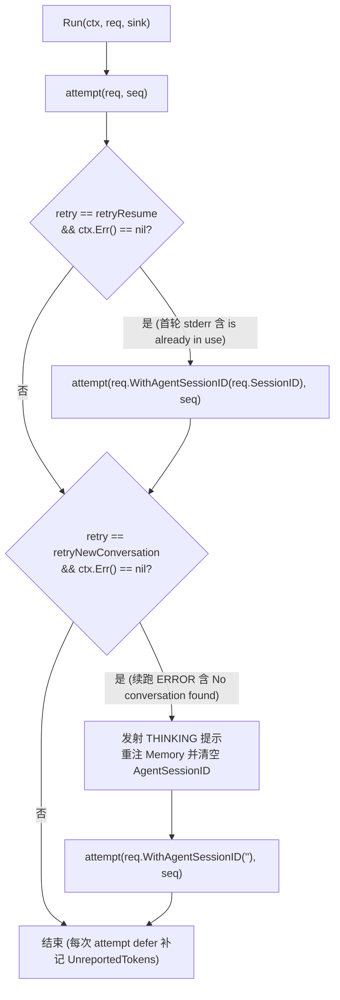
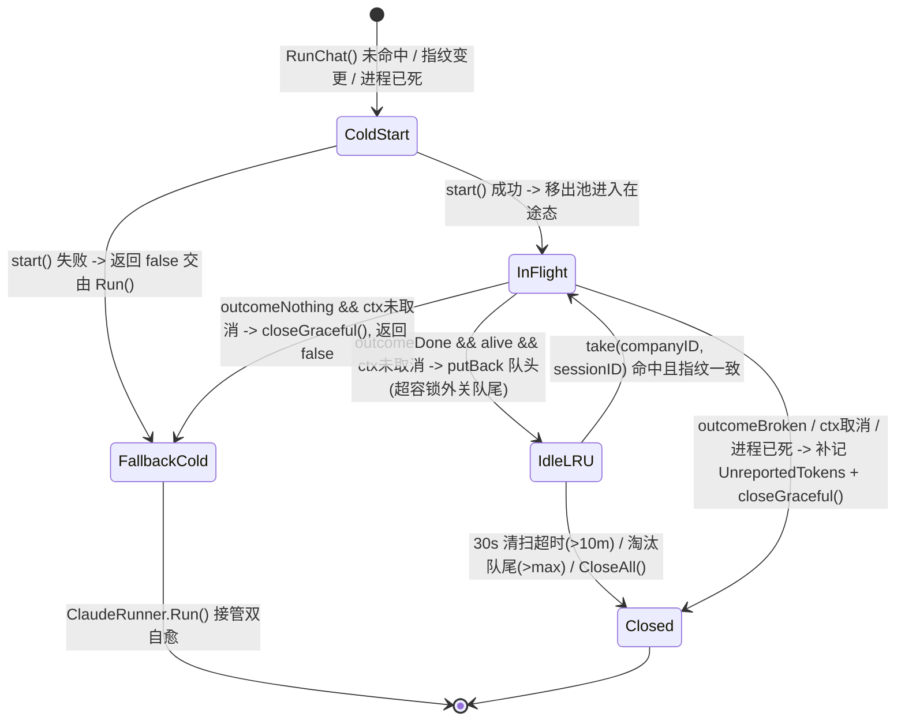

# spec 12 | Runtime Claude Adapter & WarmPool — Claude Code 执行器、stream-json 解析与进程内热池

- **状态**：`draft`
- **篇号顺序**：12（L1 执行运行时层，V1 第一 GA 执行适配器）
- **对应 PR**：`docs/SuperAgent-Go/DDD/README.md` 看板中的 `SA-12`
- **预估工作量**：`2 人天`
- **上位契约**：
  - `docs/SuperAgent-Go/01_Go工程架构_目录结构与核心底座设计.md` §1、§5.2
  - `docs/SuperAgent-Go/03_核心抽象与插件化引擎_Runtime_MCP与ModelGateway.md` §1.2、§2.1
  - `docs/SuperAgent-Go/DDD/_epic/L1/spec_03_runtime_launcher_claude_codex_mcp.md` §4、§5.4、§5.5
- **前置依赖**：`L1/spec_11 (SA-11)`（`LocalLauncher`、`LineScanner`、`RollingTail`、`RunnerRegistry`、`Tokens`）、`L1/spec_14 (SA-14)`（`gateway` 凭据/环境组装与敏感变量过滤、`mcp.McpGrants` `StandIn`/`Release`/`TokenIn`）
- **下游消费者**：`SA-18`（Provider 推理探测与 `ModelCall`）、`SA-28`（`ChatService` 消费 `RunChat` 热池加速）、`SA-31`（`TaskService` 消费 `Run` 冷启动与自动续跑）、`SA-41`（`cmd/synapse-server/wire.go` 装配注册与 `BackgroundGroup` 优雅停机）
- **重构参照源码**（绝对路径均基于 `/Users/gaorenjie/Documents/Coding/aiops-workspace/orgin/SuperAgent`）：
  - `superagent-runtime/src/main/java/com/superagent/runtime/cli/ClaudeCliAgentRunner.java`
  - `superagent-runtime/src/main/java/com/superagent/runtime/cli/ClaudeStreamParser.java`
  - `superagent-runtime/src/main/java/com/superagent/runtime/cli/ClaudeWarmSessions.java`
  - `superagent-core/src/main/java/com/superagent/core/chat/{AgentRunRequest.java,AgentEvent.java,AgentEventType.java,RunCredential.java}`

---

## 1. 背景与范围

### 1.1 为什么做与用户价值

Claude Code 是 SuperAgent V1 最核心的 GA 编码与对话执行引擎。每一次冷启动 `claude` CLI 都要经历 Node.js 引导、加载 `--settings`、连接 `--mcp-config` 外部/内置 MCP 服务以及重放历史会话文件，冷启动首字延迟可达 3–5 秒；而多轮对话场景中，若能将同一个租户会话的长驻 CLI 进程保活于进程内存并通过 `--input-format stream-json` 连续喂入用户消息，可将后续回合首字延迟压缩至亚秒级。

在原版 Java 实现中，`ClaudeCliAgentRunner`、`ClaudeStreamParser` 与 `ClaudeWarmSessions` 承载了大量经过真实生产踩坑沉淀下来的关键语义（双重 `--settings` + env 凭据覆写、`enableArtifact: false` 规避多模态边缘拒绝、`is already in use` / `No conversation found` 双分支自愈、`StandIn` 令牌代持、`modelUsage` 优先计费、中断前 `unreportedTokens` 补记、以及热进程多轮累计用量的差分减法）。本篇（`SA-12`）在 `internal/runtime/claude` 包中对上述语义进行 100% 保真重构，并完成三项 Go 工程强化：
1. **统一接入 `ProcessLauncher` 与大行安全管道**：所有冷/热进程统一经 `SA-11` `spi.ProcessLauncher` 启动，继承 `Setpgid` 整组查杀、`0600` 临时文件挂载与 16 MiB 单行 `LineScanner`；
2. **多租户隔离的纯进程内 Go `ClaudeWarmPool`**：以 `(CompanyID, SessionID)` 为池主键 + 9 项要素 SHA-256 环境指纹（含 `companyID` 与加密密钥摘要），采用 `sync.Mutex` + `container/list` + `map` 实现 O(1) LRU（**严禁 Redis**，长驻进程句柄天然绑定本机进程空间）；
3. **接入 L0 `lifecycle.BackgroundGroup` 与 `obs` 底座**：30s 空闲清扫循环与停机 `CloseAll()` 全生命周期托管于 `internal/infra/lifecycle.BackgroundGroup`，锁外限时优雅退出所有热进程；日志全程经 `internal/infra/obs` 脱敏，池容量变化实时刷新 Prometheus 指标 `CLIWarmPoolSize`。

### 1.2 本篇边界

- **本篇负责（`internal/runtime/claude`）**：
  - `ClaudeRunner`：CLI 参数构造、凭据与 `--settings` 双重覆写、`--mcp-config` 临时挂载、多模态 Base64 Stdin 帧编码、Session ID 续接、双分支自愈状态机（`retryResume` / `retryNewConversation`）、`defer` 中断补记 `UnreportedTokens`；
  - `ClaudeStreamParser`：完整 `stream-json` NDJSON 帧解析、工具结果文本/数组拼接、`permission_denials` 120 字符截断、`modelUsage`/`usage`/`assistant` 按 `message.id` 去重计费；
  - `ClaudeWarmPool`：按租户+会话键控与环境指纹校验、支持按需启动与可选 `Warmup` 预热、租借移出与归还、空闲超时与容量上限 LRU 淘汰、`StandIn` 令牌切换、三态 Outcome 冷降级、累积成本与 Token 差分减法、以及挂入 L0 `lifecycle.BackgroundGroup` 的 30s 清扫与优雅停机。
- **本篇不负责**：
  - `LocalLauncher`、`LineScanner`、`RollingTail`、`RunnerRegistry`、`ImageAttachmentStore` 归属 `SA-11`；
  - `CodexRunner` 归属 `SA-13`；
  - `ModelGateway` 凭据解析/敏感环境白名单过滤与 `McpGrants` 实现归属 `SA-14`；
  - 业务层调用 `RunChat`/`Run`、SSE 广播、落库 `agent_event` 与 `token_usage` 归属 `SA-28`/`SA-31`。

### 1.3 Java 原版源码精确映射表

| 目标 Go 组件 | Java 参照源码（基于 `/Users/gaorenjie/Documents/Coding/aiops-workspace/orgin/SuperAgent`） | 核心行号范围 | Go 重构保真与加固点 |
|---|---|---|---|
| `claude.ClaudeRunner` | `superagent-runtime/src/main/java/com/superagent/runtime/cli/ClaudeCliAgentRunner.java` | `L48-479`（`runChat:103-107`, `applyEnvironment:133-151`, `run:154-175`, `attempt:178-297`, `buildCommand:316-379`, `stdinMessage:382-398`, `writeRunSettings:410-433`, `writeMcpConfig:436-449`） | 经 `ProcessLauncher` 启动 + `MountFiles(0600)` 替代裸 `Files.createTempFile`；环境净化委托 `SA-14` `gateway`；完整保真双分支自愈与 `CLAUDE_CODE_DISABLE_NONESSENTIAL_TRAFFIC=1` |
| `claude.ClaudeStreamParser` | `superagent-runtime/src/main/java/com/superagent/runtime/cli/ClaudeStreamParser.java` | `L28-251`（`parse:56-76`, `parseSystem:78-84`, `parseStreamEvent:86-112`, `parseUser:120-150`, `noteUsage:159-168`, `resultTokens:174-192`, `unreportedTokens:198-215`, `parseResult:223-250`） | 同步实现 `spi.StreamParser` 接口与细粒度 `Parse(line)`；100% 保真 5 类帧、`modelUsage` 优先与 `permission_denials` 120 字符截断 |
| `claude.ClaudeWarmPool` | `superagent-runtime/src/main/java/com/superagent/runtime/cli/ClaudeWarmSessions.java` | `L48-385`（`run:78-112`, `closeAll:114-122`, `keep:130-142`, `closeIdle:144-157`, `start:159-173`, `fingerprint:179-197`, `Kept.turn:242-329`, `sinceLastResult:332-348`, `Kept.close:362-379`） | 纯进程内 `container/list`+`map[warmKey]*list.Element`（严禁 Redis）；键升级为 `(companyID, sessionID)`；挂入 L0 `lifecycle.BackgroundGroup` 托管清扫与停机；锁外 `Terminate(2s)` 整组关闭；接入 `obs` 指标与脱敏日志 |

---

## 2. 本篇交付物表

| # | 交付物 | 落位（相对 `synapse-server/`） | 类型 |
|---|---|---|---|
| 1 | `ClaudeConfig`、`ClaudeRunner`、`buildProcessSpec`、多模态 Stdin 编码、双分支自愈执行引擎 | `internal/runtime/claude/runner.go` | 新增 |
| 2 | `ClaudeStreamParser`（`stream-json` NDJSON 解析、`permission_denials`、`resultTokens`、`UnreportedTokens`） | `internal/runtime/claude/parser.go` | 新增 |
| 3 | `ClaudeWarmPool`（租户键控 LRU 热池、SHA-256 指纹、预热/租借/归还、`StandIn`、三态 Outcome、差分计量、`BackgroundGroup` 生命周期接线） | `internal/runtime/claude/warm_pool.go` | 新增 |
| 4 | 同包单元测试套件（命令参数与防注入、解析器全帧与中断补记、热池并发 LRU/指纹/StandIn/差分/冷降级/优雅停机） | `internal/runtime/claude/{runner_test.go,parser_test.go,warm_pool_test.go}` | 新增 |

> **分层守卫约束**：`internal/runtime/claude` 仅允许导入 `internal/core/{domain,spi,tenant,apperror}`、`internal/infra/{lifecycle,obs}`、`internal/runtime/{launcher,runner,gateway,mcp}` 与 Go 标准库；**严禁导入** `internal/storage`、`internal/platform`、`internal/agent`、`internal/task`、`internal/web` 或任何 Redis 依赖。

---

## 3. 数据库设计

本篇属于 L1 执行运行时适配器层，**不新增 PostgreSQL 17 表或迁移脚本**，**严禁引入 Redis**。

### 3.1 进程内热池与临时文件状态契约

| 资源 | 存储介质 | 键 / 路径规则 | 容量与生命周期 | 租户安全边界 |
|---|---|---|---|---|
| `ClaudeWarmPool` 空闲池 | 进程内存 | `warmKey{CompanyID, SessionID}` → `*list.Element`（双向链表 O(1) LRU） | 默认上限 `WarmMax = 20`、空闲超时 `WarmIdle = 10m`、每 `30s` 清扫；`BackgroundGroup` 停机触发 `CloseAll()` 全量关闭 | 主键强制携带 `CompanyID`；指纹含 `CompanyID`、`WorkspaceDir`、`Credential` 摘要，杜绝跨租户复用 |
| `--settings` 临时 JSON | OS 临时目录（由 `LocalLauncher` 挂载） | `superagent-settings-*.json` | `0600` 权限；冷启动在回合结束 `proc.Close()` 删除；热进程在淘汰/损坏/停机 `kept.closeGraceful()` 时删除 | 不落盘于工作区；含 API Key 的另一键置空串压制宿主机 `~/.claude/settings.json` |
| `--mcp-config` 临时 JSON | OS 临时目录（由 `LocalLauncher` 挂载） | `superagent-mcp-*.json` | `0600` 权限；生命周期与对应冷/热进程绑定 | 仅含本回合/热进程专属 `standingToken`；空闲期 `StandIn` 释放后访问 `/mcp` 一律 `401` |

---

## 4. 冻结契约

### 4.1 导出符号（`internal/runtime/claude`）

```go
package claude

import (
	"context"
	"log/slog"
	"time"

	"github.com/Karlsk/synapse-os/internal/core/domain"
	"github.com/Karlsk/synapse-os/internal/core/spi"
	"github.com/Karlsk/synapse-os/internal/infra/lifecycle"
	"github.com/Karlsk/synapse-os/internal/infra/obs"
	"github.com/Karlsk/synapse-os/internal/runtime/gateway"
	"github.com/Karlsk/synapse-os/internal/runtime/mcp"
)

const (
	DefaultCommand     = "claude"
	DefaultTimeout     = 600 * time.Second
	DefaultWarmIdle    = 10 * time.Minute
	DefaultWarmMax     = 20
	DefaultReapInterval = 30 * time.Second
	DefaultCloseGrace  = 2 * time.Second
)

type Config struct {
	Command      string        // 默认 "claude"
	Timeout      time.Duration // 默认 600s
	WarmEnabled  bool          // 默认 true
	WarmIdle     time.Duration // 默认 10m
	WarmMax      int           // 默认 20（小于 1 自动归一化为 1）
	ReapInterval time.Duration // 默认 30s（测试可注入更短周期）
	CloseGrace   time.Duration // 默认 2s（优雅停机等待 SIGTERM 退出宽限）
}

type ClaudeRunner struct {
	cfg      Config
	launcher spi.ProcessLauncher
	grants   *mcp.McpGrants
	envPrep  *gateway.EnvAssembler // 负责凭据环境与敏感宿主机变量过滤（SA-14）
	logger   *slog.Logger          // 经 L0 obs.NewRedactingHandler + NewContextHandler 包装
	metrics  *obs.Metrics          // 上报 CLIWarmPoolSize (superagent_cli_warm_pool_size)
	warm     *ClaudeWarmPool
}

// NewClaudeRunner 构造 ClaudeRunner；若 cfg.WarmEnabled 为 true，同时创建 ClaudeWarmPool。
// 当 bgGroup 非 nil 时，热池 30s 清扫循环自动注册到 bgGroup；停机阶段可再配合 lifecycle.ShutdownManager (PhaseConnections)。
func NewClaudeRunner(
	cfg Config,
	l spi.ProcessLauncher,
	grants *mcp.McpGrants,
	envPrep *gateway.EnvAssembler,
	logger *slog.Logger,
	metrics *obs.Metrics,
	bgGroup *lifecycle.BackgroundGroup,
) *ClaudeRunner

func (r *ClaudeRunner) Type() domain.AgentType
func (r *ClaudeRunner) Capabilities() spi.RunnerCapabilities
func (r *ClaudeRunner) Run(ctx context.Context, req domain.AgentRunRequest, sink spi.EventSink) error
func (r *ClaudeRunner) RunChat(ctx context.Context, req domain.AgentRunRequest, sink spi.EventSink) error
func (r *ClaudeRunner) WarmPool() *ClaudeWarmPool // 仅用于运维指标/预热/单测观测；WarmEnabled=false 时为 nil
func (r *ClaudeRunner) Close() error              // 幂等优雅关闭热池内全部进程

// --- StreamParser ---

type ParsedEvent struct {
	Type              domain.AgentEventType
	Payload           string
	CostUSD           *float64
	PermissionDenials []string
	Tokens            []domain.TokenUsage
}

type StreamParser struct { /* messageUsage, messageModel, resultSeen */ }

func NewStreamParser() *StreamParser
func (p *StreamParser) Parse(line []byte) (*ParsedEvent, bool)
func (p *StreamParser) ParseLine(line []byte) ([]domain.AgentEvent, error) // 实现 spi.StreamParser
func (p *StreamParser) Finish() []domain.AgentEvent
func (p *StreamParser) Usage(fallbackModel string) ([]domain.TokenUsage, *float64)
func (p *StreamParser) UnreportedTokens() []domain.TokenUsage

// --- WarmPool ---

type WarmPoolStats struct {
	IdleCount int
	InFlight  int
	MaxSize   int
}

type ClaudeWarmPool struct { /* runner, grants, logger, metrics, idleTTL, maxSize, reapInterval, closeGrace, mu, lru, byKey, inFlight, closed */ }

func NewWarmPool(r *ClaudeRunner, grants *mcp.McpGrants, cfg Config, logger *slog.Logger, metrics *obs.Metrics) *ClaudeWarmPool
// RegisterLifecycle 将 30s 清扫循环挂入 L0 lifecycle.BackgroundGroup（停机阶段同步支持 ShutdownManager PhaseConnections）
func (p *ClaudeWarmPool) RegisterLifecycle(bgGroup *lifecycle.BackgroundGroup)
// RegisterShutdown 将 CloseAll 注册到 L0 lifecycle.ShutdownManager 的 PhaseConnections（≤5s 预算）
func (p *ClaudeWarmPool) RegisterShutdown(sm *lifecycle.ShutdownManager)
// Warmup 按租户+会话预先拉起并驻留一个空闲热进程（若已存在且指纹一致则幂等跳过）
func (p *ClaudeWarmPool) Warmup(ctx context.Context, req domain.AgentRunRequest) error
// Run 在热进程上执行一轮对话；返回 false 表示未产出任何用户可见输出（OutcomeNothing），由调用方无缝冷降级
func (p *ClaudeWarmPool) Run(ctx context.Context, req domain.AgentRunRequest, sink spi.EventSink) bool
// EvictSession 主动驱逐指定租户+会话的热进程（如切换人设/清空会话/禁用租户）
func (p *ClaudeWarmPool) EvictSession(companyID, sessionID string)
// CloseAll 幂等优雅关闭所有空闲及在途热进程，并清理挂载临时文件
func (p *ClaudeWarmPool) CloseAll()
func (p *ClaudeWarmPool) Stats() WarmPoolStats
```

### 4.2 路由契约

本篇不注册 HTTP 路由。通过 `ClaudeRunner.Capabilities()` 向上层（`SA-28`/`SA-31`/`SA-38`）暴露标准能力元数据：
- `Type: "CLAUDE"`、`CLIName: "claude"`、`SupportImages: true`、`SupportStdioMCP: true`、`SupportWarmPool: r.warm != nil`、`Maturity: "ga"`。

### 4.3 错误语义

| 场景 | 发射事件 / 返回值 | 精确文案 / 行为 |
|---|---|---|
| 附件图片磁盘读取失败 | 发射 `EventError` | `"Cannot read attached image: <err>"` |
| `--settings` 临时文件构造失败 | 发射 `EventError`，立即中止 | `"Cannot prepare the run's settings: <err>"`（**绝不降级裸跑，防止泄漏密钥到宿主机默认中继**） |
| 进程启动失败（冷启动） | 发射 `EventError` | `"Failed to start agent: <err>"` |
| 单回合超时（`cfg.Timeout`） | 发射 `EventError` + 整组查杀 | `"Agent timed out after <N>s"` |
| 首轮非零退出且 stderr 含 `"is already in use"` | 不发错误，触发 `retryResume` | 自动切 `--resume <SessionID>` 重试一次 |
| 续跑收到 `ERROR` 含 `"No conversation found with session ID"` | 抑制原错误，发 `EventThinking` + 触发 `retryNewConversation` | `"Previous conversation for this session was not found; continuing in a new conversation (same session id, same workspace — earlier context is not available)."` 后清空 `AgentSessionID` 重开并重注 `Memory` |
| 冷启动非零退出且未收到 `RESULT`/`ERROR` 且未取消 | 发射 `EventError` | `"claude exited with code <code>[: <stderrTail>]"` |
| 热进程尚未输出非 `SYSTEM` 事件即异常/无会话 | 静默销毁热进程，`WarmPool.Run` 返回 `false` | 由 `ClaudeRunner.RunChat` 无缝降级到冷启动 `Run()` |
| 热进程已输出内容后超时或异常退出（`outcomeBroken`） | 发射 `EventError` + 补记 `UnreportedTokens` | 超时：`"Agent timed out after <N>s"`；早退：`"claude exited before finishing[: <stderrTail>]"`；返回 `true` 禁止冷重试避免重复回复 |
| `ClaudeWarmPool.Warmup` 时池已关闭 | 返回 `apperror.Conflict` | `"claude warm pool is closed"` |

### 4.4 SQL 与运行时安全契约

本篇无 SQL 操作，冻结以下五条运行时安全与并发不变量：
1. **双重凭据隔离**：除清除宿主机 `ANTHROPIC_API_KEY` / `ANTHROPIC_AUTH_TOKEN` / `ANTHROPIC_BASE_URL` 并通过子进程 env 注入外，必须在 `0600` `--settings` JSON 的 `env` 对象中同时写入当前键并将另一键置为 `""`（压制宿主机 `~/.claude/settings.json` 与工作区 `.claude/settings.json` 更高优先级）；
2. **禁止 Prompt 与密钥落日志**：启动日志只记录脱敏后的命令骨架（严禁打印 `--` 后的 Prompt、API Key、`Bearer` Token 与 Base64 图片内容），日志统一经 L0 `internal/infra/obs` 脱敏处理器输出；
3. **锁外关进程铁律**：`ClaudeWarmPool` 绝不在持有 `p.mu` 时调用 `Terminate`/`Close`/`Wait`，防止单进程 2s 优雅等待阻塞所有租户会话的租借与归还；
4. **Stand-In 最小暴露窗口**：热进程固定的 `standingToken` 仅在单回合执行期间经 `grants.StandIn(standing, current)` 映射为当前回合 Grant，`defer grants.Release(standing)` 保证空闲态热进程任何 `/mcp` 请求恒返 `401`；
5. **严禁跨租户热池串用**：池主键强制为 `warmKey{CompanyID, SessionID}`（若 `req.CompanyID` 为空则经 `tenant.Require(ctx)` 回填；缺失租户上下文直接拒绝入池并走冷路径/报错）。

---

## 5. 行为语义与 Java→Go 详细伪代码

### 5.1 `ClaudeRunner` CLI 参数构造与双分支自愈状态机



- **精确参数装配顺序**（100% 对齐 `ClaudeCliAgentRunner.java:316-379`）：
  1. 固定开关：`-p`, `--output-format`, `stream-json`, `--include-partial-messages`, `--verbose`；
  2. 模型：`--model`, `<req.Model>`（非空时）；
  3. 系统提示词：`--append-system-prompt`, `<req.SystemPromptWithMemory() if req.IsFirstTurn() else req.SystemPrompt>`（非空时）；
  4. MCP 配置：若 `req.MCPConfig` 非空，挂载 `TempFileSpec{Key: "mcp-config", Prefix: "superagent-mcp-", Suffix: ".json", Mode: 0o600}` 并加 `--mcp-config`, `${mount:mcp-config}`；随后**恒定**追加 `--strict-mcp-config`（禁止加载宿主机用户个人 MCP）；
  5. 会话延续：首轮 `--session-id`, `<req.SessionID>`；续跑 `--resume`, `<req.AgentSessionID>`；
  6. 权限控制：`req.SkipPermissions` → `--dangerously-skip-permissions`（并记 `WARN` 日志）；否则若 `len(req.AllowedTools) > 0` → `--allowedTools`, `strings.Join(req.AllowedTools, " ")`；
  7. 运行时覆盖设置：只要 `req.Credential != nil || len(req.Images) > 0`，必须挂载 `TempFileSpec{Key: "settings", Prefix: "superagent-settings-", Suffix: ".json", Mode: 0o600}` 并加 `--settings`, `${mount:settings}`；
  8. 输入模式：若 `kept == true || len(req.Images) > 0` → 追加 `--input-format`, `stream-json`（消息从 stdin 传入）；否则追加 `--`, `<req.Prompt>` 防 `-`/`--` 开头参数注入。

```go
package claude

const (
	errSessionInUse   = "is already in use"
	errNoConversation = "No conversation found with session ID"
)

type retryKind int

const (
	retryNone retryKind = iota
	retryResume
	retryNewConversation
)

func (r *ClaudeRunner) buildSettingsJSON(req domain.AgentRunRequest) ([]byte, bool, error) {
	if req.Credential == nil && len(req.Images) == 0 {
		return nil, false, nil
	}
	root := make(map[string]any, 2)
	if len(req.Images) > 0 {
		// 规避 Claude 网关在 Artifacts 开启时对带图请求报 "request is not representable on this edge"
		root["enableArtifact"] = false
	}
	if req.Credential != nil {
		envObj := map[string]string{
			"ANTHROPIC_API_KEY":    "",
			"ANTHROPIC_AUTH_TOKEN": "",
		}
		if req.Credential.BaseURL != "" {
			envObj["ANTHROPIC_BASE_URL"] = req.Credential.BaseURL
		}
		if req.Credential.Bearer {
			envObj["ANTHROPIC_AUTH_TOKEN"] = req.Credential.APIKey
		} else {
			envObj["ANTHROPIC_API_KEY"] = req.Credential.APIKey
		}
		root["env"] = envObj
	}
	b, err := json.Marshal(root)
	return b, true, err
}

func (r *ClaudeRunner) buildProcessSpec(req domain.AgentRunRequest, kept bool) (spi.ProcessSpec, error) {
	var mountFiles []spi.TempFileSpec
	args := []string{"-p", "--output-format", "stream-json", "--include-partial-messages", "--verbose"}

	if m := strings.TrimSpace(req.Model); m != "" {
		args = append(args, "--model", m)
	}
	sysPrompt := req.SystemPrompt
	if req.IsFirstTurn() {
		sysPrompt = req.SystemPromptWithMemory()
	}
	if strings.TrimSpace(sysPrompt) != "" {
		args = append(args, "--append-system-prompt", sysPrompt)
	}
	if strings.TrimSpace(req.MCPConfig) != "" {
		mountFiles = append(mountFiles, spi.TempFileSpec{
			Key: "mcp-config", Prefix: "superagent-mcp-", Suffix: ".json",
			Content: []byte(req.MCPConfig), Mode: 0o600,
		})
		args = append(args, "--mcp-config", "${mount:mcp-config}")
	}
	args = append(args, "--strict-mcp-config")

	if req.IsFirstTurn() {
		args = append(args, "--session-id", req.SessionID)
	} else {
		args = append(args, "--resume", req.AgentSessionID)
	}

	if req.SkipPermissions {
		args = append(args, "--dangerously-skip-permissions")
	} else if len(req.AllowedTools) > 0 {
		args = append(args, "--allowedTools", strings.Join(req.AllowedTools, " "))
	}

	settingsBytes, hasSettings, err := r.buildSettingsJSON(req)
	if err != nil {
		return spi.ProcessSpec{}, err
	}
	if hasSettings {
		mountFiles = append(mountFiles, spi.TempFileSpec{
			Key: "settings", Prefix: "superagent-settings-", Suffix: ".json",
			Content: settingsBytes, Mode: 0o600,
		})
		args = append(args, "--settings", "${mount:settings}")
	}

	if kept || len(req.Images) > 0 {
		args = append(args, "--input-format", "stream-json")
	} else {
		args = append(args, "--", req.Prompt)
	}

	// 经 SA-14 gateway.EnvAssembler 组装 Claude 环境变量并过滤宿主机敏感变量
	env, strip := r.envPrep.ForClaude(req.Credential)
	env["CLAUDE_CODE_DISABLE_NONESSENTIAL_TRAFFIC"] = "1"

	return spi.ProcessSpec{
		CompanyID:    req.CompanyID,
		OwnerUserID:  req.OwnerUserID,
		Command:      r.cfg.Command,
		Args:         args,
		WorkDir:      req.WorkspaceDir,
		Env:          env,
		StripEnvKeys: strip, // 包含 ANTHROPIC_API_KEY/ANTHROPIC_AUTH_TOKEN/ANTHROPIC_BASE_URL + 宿主机平台机密黑名单
		MountFiles:   mountFiles,
	}, nil
}
```

### 5.2 `ClaudeStreamParser` 完整帧映射与中断补记

- **Java 参考**：`ClaudeStreamParser.java:56-250`
- **帧映射契约**：
  1. `type == "system" && subtype == "init"` → `EventSystem(session_id)`；
  2. `type == "stream_event"`：
     - `event.type == "content_block_delta"` + `delta.type == "text_delta"` → `EventText(delta.text)`；
     - `event.type == "content_block_delta"` + `delta.type == "thinking_delta"` → `EventThinking(delta.thinking)`；
     - `event.type == "content_block_start"` + `content_block.type == "tool_use"` → `EventToolUse(content_block.name)`；
  3. `type == "user"`：遍历 `message.content[]`，取首个 `type == "tool_result"` 且文本非空的块 → `EventToolResult`（`content` 兼容纯字符串或 `[{type:"text",text:...}]` 数组拼接）；
  4. `type == "assistant"`：提取 `message.id` 与 `message.usage`（非空时覆盖写入有序 map `messageUsage[id]` 与 `messageModel[id]`，防止同一 API 调用多个 content block 重复计费），不发射事件；
  5. `type == "result"`：
     - 置 `resultSeen = true`；
     - 若 `is_error == true` 且 `result` 为空，优先用 `"; "` 拼接 `errors[]`，再兜底 `subtype` 或 `"error"`；
     - 提取 `total_cost_usd`（若字段存在）；
     - 提取 `permission_denials[]`：取 `tool_name`（缺省 `"tool"`）与 `tool_input.command` / `tool_input.file_path`（超过 120 字符截取前 117 字符 + `"..."`），拼为 `<tool>: <detail>`；
     - `resultTokens`：若 `modelUsage` 对象非空则逐模型读取 `inputTokens` / `cacheReadInputTokens` / `cacheCreationInputTokens` / `cacheCreationEphemeral1hInputTokens` / `outputTokens` / `thinkingTokens` / `costUSD`；否则兜底读取 `usage`（`input_tokens` / `cache_read_input_tokens` / `cache_creation_input_tokens` / `cache_creation.ephemeral_1h_input_tokens` / `output_tokens` / `output_tokens_details.thinking_tokens`）；
  6. `UnreportedTokens()`：若 `resultSeen == true` 返回空切片；否则将 `messageUsage` 按 `messageModel` 聚合返回，供回合在 `defer` 中对取消/超时/崩溃前已发生的 API 调用补记计费。

### 5.3 `ClaudeWarmPool` 热进程池状态机与 `BackgroundGroup` 托管



- **9 维 SHA-256 环境指纹**（对齐 `ClaudeWarmSessions.java:179-197` 并强化多租户维度）：
  - 依次按 `\n` 拼接：`companyID`、`workspaceDir`、`model`、`systemPrompt`（不含 `memory`）、`strings.Join(allowedTools, ",")`、`skipPermissions`、`len(images) > 0`、**剥离本平台自身 Bearer Token 后的 `mcpConfig`**、`credential.BaseURL` / `credential.Bearer` / `credential.APIKey`；
  - 计算 `sha256.Sum256` 编码为 64 位小写 hex 存储，内存中绝不保留明文 API Key。
- **挂入 L0 `lifecycle.BackgroundGroup` 优雅生命周期**：

```go
package claude

type warmKey struct {
	CompanyID string
	SessionID string
}

// RegisterLifecycle 将 30s 周期空闲回收器挂入 L0 lifecycle.BackgroundGroup；
// 当服务收到 SIGINT/SIGTERM 导致 bgCtx 取消时，退出循环并执行 CloseAll() 优雅关闭所有热进程。
func (p *ClaudeWarmPool) RegisterLifecycle(bgGroup *lifecycle.BackgroundGroup) {
	if bgGroup == nil {
		return
	}
	bgGroup.Go("claude-warm-reaper", func(ctx context.Context) error {
		ticker := time.NewTicker(p.reapInterval)
		defer ticker.Stop()
		defer p.CloseAll()
		for {
			select {
			case <-ctx.Done():
				return nil
			case <-ticker.C:
				p.reapIdle()
			}
		}
	})
}

func (p *ClaudeWarmPool) take(key warmKey) *keptClaude {
	p.mu.Lock()
	defer p.mu.Unlock()
	if p.closed {
		return nil
	}
	el, ok := p.byKey[key]
	if !ok {
		return nil
	}
	p.lru.Remove(el)
	delete(p.byKey, key)
	kept := el.Value.(*keptClaude)
	p.inFlight[kept] = struct{}{}
	p.setPoolGauge(p.lru.Len())
	return kept
}

func (p *ClaudeWarmPool) setPoolGauge(n int) {
	if p.metrics != nil && p.metrics.CLIWarmPoolSize != nil {
		p.metrics.CLIWarmPoolSize.Set(float64(n))
	}
}

func (p *ClaudeWarmPool) putBack(key warmKey, kept *keptClaude) {
	var evicted []*keptClaude
	p.mu.Lock()
	delete(p.inFlight, kept)
	if p.closed {
		evicted = append(evicted, kept)
	} else {
		kept.lastUsed = time.Now()
		if oldEl, exists := p.byKey[key]; exists {
			p.lru.Remove(oldEl)
			delete(p.byKey, key)
			evicted = append(evicted, oldEl.Value.(*keptClaude))
		}
		el := p.lru.PushFront(kept)
		p.byKey[key] = el
		for p.lru.Len() > p.maxSize {
			back := p.lru.Back()
			if back == nil {
				break
			}
			p.lru.Remove(back)
			old := back.Value.(*keptClaude)
			delete(p.byKey, old.key)
			evicted = append(evicted, old)
		}
		p.setPoolGauge(p.lru.Len())
	}
	p.mu.Unlock()
	// 严禁持锁关进程：锁外并发/顺序执行 Terminate(2s) + Close()
	for _, k := range evicted {
		k.closeGraceful(p.closeGrace)
	}
}

func (p *ClaudeWarmPool) CloseAll() {
	var toClose []*keptClaude
	p.mu.Lock()
	if p.closed {
		p.mu.Unlock()
		return
	}
	p.closed = true
	for e := p.lru.Front(); e != nil; e = e.Next() {
		toClose = append(toClose, e.Value.(*keptClaude))
	}
	p.lru.Init()
	clear(p.byKey)
	for k := range p.inFlight {
		toClose = append(toClose, k)
	}
	clear(p.inFlight)
	p.setPoolGauge(0)
	p.mu.Unlock()

	var wg sync.WaitGroup
	for _, k := range toClose {
		wg.Add(1)
		go func(proc *keptClaude) {
			defer wg.Done()
			proc.closeGraceful(p.closeGrace)
		}(k)
	}
	wg.Wait()
}
```

- **单回合差分计量与 StandIn 协议**（对齐 `ClaudeWarmSessions.java:242-348`）：
  1. `standing := k.standingToken`，`current := mcp.TokenIn(req.MCPConfig)`；两者非空时调用 `grants.StandIn(standing, current)` 并 `defer grants.Release(standing)`；
  2. 为本回合派生 `turnCtx, cancel := context.WithTimeout(ctx, timeout)`，启动单回合 watch goroutine 监听 `<-turnCtx.Done()`，触发时调用 `k.closeGraceful(p.closeGrace)` 解除 `k.scanner.Scan()` 阻塞；
  3. 写入单行 JSON 用户消息（支持文本与多图 Base64 `content` 数组）；若 `k.conversation != ""` 立刻发射 `EventSystem(k.conversation)` 终止上层冷启动耗时计时；
  4. 收到 `costUsd` 时计算 `delta := math.Max(0, *ev.CostUSD - k.reportedCost)` 并更新 `k.reportedCost = math.Max(k.reportedCost, *ev.CostUSD)`；
  5. 收到 `ev.Tokens` 时经 `k.sinceLastResult(ev.Tokens)` 逐模型做非负差分减法并剔除 `NothingUsed()` 模型后再调用 `runner.EmitTokens`；
  6. 若 `said == true` 且在 `result` 前中断，在 `defer` 补记 `parser.UnreportedTokens()`。

---

## 6. 任务清单（TDD 粒度）

- [ ] T1: 编写 `internal/runtime/claude/parser_test.go`（覆盖 5 类帧、文本/数组 `tool_result`、`errors[]` 兜底、`permission_denials` 120 字符截断、`modelUsage` 优先于 `usage`、`assistant` 去重与 `UnreportedTokens`）并实现 `parser.go`
- [ ] T2: 编写 `internal/runtime/claude/runner_test.go`（使用 Fake `ProcessLauncher` 验证完整 argv 顺序、`--` 防 flag 注入、`--settings` 双重覆写与 `enableArtifact:false`、图片 Base64 Stdin、`retryResume` 与 `retryNewConversation` 双自愈、中断补记）并实现 `runner.go`
- [ ] T3: 编写 `internal/runtime/claude/warm_pool_test.go`（覆盖租户键控隔离、9 维指纹重建与换 per-turn MCP Token 不重建、`StandIn`/`Release` 窗口、多轮 `costUSD`/`tokens` 差分减法、LRU 容量淘汰、空闲超时回收、`outcomeNothing` 冷降级、`outcomeBroken` 补记、`Warmup` 预热、以及 `lifecycle.BackgroundGroup` 取消优雅关闭）并实现 `warm_pool.go`
- [ ] T4: 运行 `go test -race -cover ./internal/runtime/claude/...` 与 `internal/arch_test.go` 确认零竞态与分层合规

---

## 7. 文档同步

- [ ] `docs/SuperAgent-Go/DDD/README.md` 看板：合入后将 `SA-12` 状态更新为 `已实施（commit <sha>）`
- [ ] `docs/SuperAgent-Go/03_核心抽象与插件化引擎_Runtime_MCP与ModelGateway.md` §2.1：同步多租户 `warmKey{CompanyID, SessionID}` 与 `BackgroundGroup` 接线说明
- [ ] `configs/config.example.yaml`：确认 `runtime.claude.{command,timeout_seconds,warm.enabled,warm.idle_minutes,warm.max}` 配置注释完备

---

## 8. 测试清单

| 测试点 | 落位 | 关键断言 |
|---|---|---|
| `ClaudeStreamParser` 全帧映射与去重计费 | `internal/runtime/claude/parser_test.go` | `init`→`SYSTEM`；`text_delta`→`TEXT`；`thinking_delta`→`THINKING`；`tool_use`→`TOOL_USE`；`tool_result` 字符串与数组块均正确拼接；`result` 含 `is_error=true` 且空 `result` 时拼接 `errors[]`；`permission_denials` 超 120 字符截断为 `117 + "..."`；`modelUsage` 优先于 `usage`；未收 `result` 时 `UnreportedTokens()` 按 `message.id` 去重汇总 |
| `ClaudeRunner` 命令拼装与安全防注入 | `internal/runtime/claude/runner_test.go` | 恒含 `CLAUDE_CODE_DISABLE_NONESSENTIAL_TRAFFIC=1` 与 `--strict-mcp-config`；`--settings` JSON 另一凭据键为 `""` 且挂载权限 `0600`；带图时含 `enableArtifact: false` 与 `--input-format stream-json`；纯文本以 `--` 隔离 `-evil-flag` 提示词 |
| `ClaudeRunner` 双分支自愈与超时补记 | `internal/runtime/claude/runner_test.go` | 首轮非零退出且 stderr 含 `"is already in use"` 自动以 `--resume <SessionID>` 重试；续跑收到 `"No conversation found with session ID"` 抑制原错误、发 `THINKING` 提示并重注 `Memory` 重开；中断/超时前已收 `assistant` 帧仍发射 `TOKENS` |
| `ClaudeWarmPool` 租户隔离与 9 维指纹 | `internal/runtime/claude/warm_pool_test.go` | 不同 `CompanyID` 同 `SessionID` 互不命中；切换 `model`/`credential`/`systemPrompt`/`hasImages` 触发销毁重建；仅更换每轮自身 MCP Bearer Token **不**触发重建 |
| `ClaudeWarmPool` StandIn 与差分计费 | `internal/runtime/claude/warm_pool_test.go` | 回合中 `grants.Find(standing)` 返回当前回合 Grant，回合结束后立刻返回 `false`；第 2 轮累计 `costUSD=0.35`（第 1 轮 `0.10`）仅发 `USAGE=0.25`；每模型 `TokenUsage` 仅发增量且剔除 `NothingUsed()` 模型 |
| `ClaudeWarmPool` LRU 淘汰、冷降级与优雅停机 | `internal/runtime/claude/warm_pool_test.go` | `WarmMax=2` 写入 3 会话淘汰最久未使用且锁外关闭；空闲超 `WarmIdle` 被 `reapIdle` 清理；`outcomeNothing` 返回 `false` 并由 `RunChat` 降级冷启动；取消 `BackgroundGroup` 上下文时 `CloseAll()` 关闭全部在池/在途进程并将 `CLIWarmPoolSize` 归零 |

---

## 9. 验收门

- [ ] `go build ./... && go test -race ./internal/runtime/claude/...` 全绿（零 data race、零 goroutine 泄漏）
- [ ] §2 交付物表 4 项逐一存在且落位在 `internal/runtime/claude/`
- [ ] `internal/arch_test.go` 通过：零引入上层包、存储包与 Redis
- [ ] §8 测试清单 6 组用例全部落地且关键断言保真，`internal/runtime/claude` 语句覆盖率 ≥ 80%
- [ ] 安全门禁：API Key / Bearer Token 零出现在 `argv` 与日志中；`--settings`/`--mcp-config` 均经 `0600` 挂载；热池绝不持锁关进程
- [ ] 前置篇 `SA-11`、`SA-14` 单测全绿回归

---

## 10. 可提交节点

- **建议主 commit**：`feat(runtime-claude): 实现 ClaudeRunner、stream-json 解析器与进程内 LRU 热池（spec 12，PR SA-12）`
- **推荐分层拆分提交（可选）**：
  1. `feat(runtime-claude): 实现 ClaudeStreamParser 与 ClaudeRunner 双分支自愈执行引擎`
  2. `feat(runtime-claude): 实现多租户 ClaudeWarmPool 进程内热池并接入 lifecycle.BackgroundGroup`
