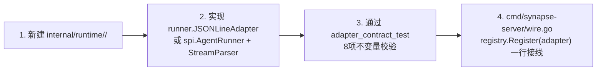

# spec 13 | Runtime Codex Adapter — OpenAI Codex 执行器、JSONL 解析、TOML MCP 注入与扩展契约

- **状态**：`draft`
- **篇号顺序**：13（L1 执行运行时层，V1 第二 GA 执行适配器）
- **对应 PR**：`docs/SuperAgent-Go/DDD/README.md` 看板中的 `SA-13`
- **预估工作量**：`1.5 人天`
- **上位契约**：
  - `docs/SuperAgent-Go/01_Go工程架构_目录结构与核心底座设计.md` §1
  - `docs/SuperAgent-Go/03_核心抽象与插件化引擎_Runtime_MCP与ModelGateway.md` §1.2、§2.2
  - `docs/SuperAgent-Go/DDD/_epic/L1/spec_03_runtime_launcher_claude_codex_mcp.md` §4、§5.6、§5.7
- **前置依赖**：`L1/spec_11 (SA-11)`（`LocalLauncher`、`LineScanner`、`RollingTail`、`RunnerRegistry`、`JSONLineRunner`、`Tokens`）、`L1/spec_14 (SA-14)`（`gateway.EnvAssembler` 凭据组装与敏感环境白名单过滤、`mcp` 配置格式契约）
- **下游消费者**：`SA-18`（Provider 推理探测与 `ModelCall`）、`SA-28`（`ChatService`）、`SA-31`（`TaskService`）、`SA-41`（`cmd/synapse-server/wire.go` 装配注册）
- **重构参照源码**（绝对路径均基于 `/Users/gaorenjie/Documents/Coding/aiops-workspace/orgin/SuperAgent`）：
  - `superagent-runtime/src/main/java/com/superagent/runtime/cli/CodexCliAgentRunner.java`
  - `superagent-runtime/src/main/java/com/superagent/runtime/cli/CodexStreamParser.java`
  - `superagent-runtime/src/main/java/com/superagent/runtime/cli/JsonLineCliRunner.java`
  - `superagent-runtime/src/main/java/com/superagent/runtime/cli/Tokens.java`
  - `superagent-core/src/main/java/com/superagent/core/chat/{AgentRunner.java,AgentRunRequest.java,AgentType.java}`

---

## 1. 背景与范围

### 1.1 为什么做与用户价值

OpenAI Codex CLI（`codex exec --json`）是 SuperAgent V1 并列交付的第二套 GA 执行引擎，使商业私有化客户在 Anthropic / OpenAI 兼容端点之间具备双引擎容灾与差异化选型能力。与 Claude Code 相比，Codex 在协议形态上有五处根本差异：
1. **无外部指定 Session ID**：Codex 自行签发 UUID `thread_id`，需由 Runner 在工作区持久化 `<workspaceDir>/.superagent/codex-sessions/<sessionId>`，续跑时切换子命令 `codex exec ... resume ... <threadId> -`；由于工作区对 Agent 可写，读写两侧必须做严格 36 位 UUID 正则防参数注入；
2. **无 `--mcp-config` 标志**：需将上层统一的 Claude 形态 `MCPConfig` JSON 动态翻译为 TOML `-c mcp_servers.<name>.*` 参数，并将 Bearer 令牌下沉到 `SUPERAGENT_MCP_TOKEN_<UPPER>` 环境变量；
3. **无独立 `--system-prompt` 参数**：需每轮经 `stdin` 前置 `<system>...</system>` 块（仅首轮/新线程拼入长期 `Memory`），使人设变更在续跑线程中即时生效；
4. **沙箱与审批语义映射**：将平台统一的 `SkipPermissions` / `AllowedTools` 映射为 `--dangerously-bypass-approvals-and-sandbox`、`-s workspace-write` 或 `-s read-only`，同时支持模型名防 flag 注入校验与推理强度（`model_reasoning_effort`）配置映射；
5. **OpenAI 风格 Token 归集**：Codex 返回的 `input_tokens` 包含 `cached_input_tokens`，`output_tokens` 包含 `reasoning_output_tokens`，且不回报美元费用，需经 `FromTotalInput` 拆桶去重，绝不发射 `USAGE`。

此外，本篇正式交付**“如何按接口扩展新 CLI 适配器”的扩展契约规范与自动化校验套件**，保证 V1.x / V2 增量接入 DeepSeek / Qwen / Kimi / Gemini / GLM / CodeBuddy 等 CLI 时，只需单文件实现适配器并注册至 `RunnerRegistry`，上层对话、任务、MCP 与计费域零改动。

### 1.2 本篇边界

- **本篇负责（`internal/runtime/codex`）**：
  - `CodexRunner`（实现 `spi.AgentRunner`）：`codex exec --json` 与 `codex exec ... resume` 参数装配、线程文件 UUID 防注入读写、模型/推理强度/沙箱审批映射、HTTP MCP TOML `-c` 翻译与令牌 env 隔离、`--image=<absPath>` 多图传递、stdin `<system>` 拼接与大行扫描执行；
  - `CodexStreamParser`（实现 `spi.StreamParser`）：`thread.started` / `item.started|completed` / `turn.completed|failed` / 顶层 `error` 解析、4 类工具标签去重与 120 字符截断、5 维 Token 累加与 `FromTotalInput` 拆桶；
  - 新 CLI 适配器扩展契约规范与自动化校验用例（验证 `CodexRunner` 与示例第三方 `JSONLineAdapter` 实现均满足全部 8 项平台不变量）。
- **本篇不负责**：
  - V1 裁剪的 8 家非 GA 适配器（`Glm`/`Gemini`/`DeepSeek`/`Qwen`/`Kimi`/`Minimax`/`CodeBuddy`/`GrokAcp`）不在 V1 编译交付，仅通过扩展契约保证可零侵入增量接入；
  - `LocalLauncher`/`LineScanner`/`RunnerRegistry`/`JSONLineRunner` 归属 `SA-11`；
  - `ClaudeRunner`/`ClaudeWarmPool` 归属 `SA-12`；
  - `ModelGateway` 与 `McpGrants`/`McpClient` 归属 `SA-14`；
  - **架构红线**：纯进程内无状态执行（`SupportWarmPool: false`），严禁 Redis；敏感日志经 L0 `internal/infra/obs` 脱敏。

### 1.3 Java 原版源码精确映射表

| 目标 Go 组件 | Java 参照源码（基于 `/Users/gaorenjie/Documents/Coding/aiops-workspace/orgin/SuperAgent`） | 核心行号范围 | Go 重构保真与加固点 |
|---|---|---|---|
| `codex.CodexRunner` | `superagent-runtime/src/main/java/com/superagent/runtime/cli/CodexCliAgentRunner.java` | `L51-335`（`THREAD_ID:61`, `run:86-161`, `buildCommand:163-219`, `mcpServers:222-255`, `prompt:270-276`, `readThreadId/recordThreadId:282-312`, `tail:331-334`） | 统一经 `ProcessLauncher` 启动与 `Setpgid` 整组强杀；经 `SA-14` `EnvAssembler` 剥离宿主机机密；保留 36 位 UUID 强校验、模型 `-` 防注入与 `SUPERAGENT_MCP_TOKEN_*` 隔离；扩展支持可选推理强度参数白名单映射 |
| `codex.StreamParser` | `superagent-runtime/src/main/java/com/superagent/runtime/cli/CodexStreamParser.java` | `L30-161`（`parse:44-92`, `addUsage/tokens:109-127`, `announceTool/toolLabel:129-160`） | 同时实现 `spi.StreamParser` 与细粒度状态方法 `ThreadID()`/`Finished()`；100% 保真 4 类工具 120 字符截断、配置告警静默与 `FromTotalInput` 五维拆桶 |
| 新 CLI 适配器扩展契约 | `superagent-runtime/src/main/java/com/superagent/runtime/cli/JsonLineCliRunner.java`、`superagent-core/src/main/java/com/superagent/core/chat/AgentRunner.java` | `JsonLineCliRunner.java:34-272`, `AgentRunner.java:11-36` | 固化 8 项扩展契约不变量与自动化测试套件，确保任何新适配器行为与平台完全对齐 |

---

## 2. 本篇交付物表

| # | 交付物 | 落位（相对 `synapse-server/`） | 类型 |
|---|---|---|---|
| 1 | `CodexConfig`、`CodexRunner`、命令与 TOML MCP 参数装配、UUID 线程文件读写、stdin 提示词编码 | `internal/runtime/codex/runner.go` | 新增 |
| 2 | `CodexStreamParser`（Codex JSONL 解析、4 类工具去重标签、5 维 Token 累加与 `FromTotalInput` 拆桶） | `internal/runtime/codex/parser.go` | 新增 |
| 3 | 同包单元测试套件（参数与防注入、MCP TOML 翻译、UUID 篡改防御、流解析与拆桶） | `internal/runtime/codex/{runner_test.go,parser_test.go}` | 新增 |
| 4 | CLI 适配器扩展契约自动化校验套件（校验 `CodexRunner` 与示例 `JSONLineAdapter` 新扩展） | `internal/runtime/codex/adapter_contract_test.go` | 新增 |

> **分层守卫约束**：`internal/runtime/codex` 仅允许导入 `internal/core/{domain,spi,apperror}`、`internal/infra/obs`、`internal/runtime/{launcher,runner,gateway}` 与 Go 标准库；**严禁导入** `internal/storage`、`internal/platform`、`internal/agent`、`internal/task`、`internal/web`、`internal/runtime/claude` 或任何 Redis 依赖。

---

## 3. 数据库设计

本篇属于 L1 执行运行时适配器层，**不新增 PostgreSQL 17 表或迁移脚本**，亦不依赖外部缓存（严禁 Redis）。

### 3.1 本地工作区线程映射契约

| 资源 | 存储介质 | 路径规则 | 权限与校验规则 | 租户隔离机制 |
|---|---|---|---|---|
| Codex 线程 ID 文件 | 工作区磁盘 | `<workspaceDir>/.superagent/codex-sessions/<sessionId>` | 目录 `0700`、文件 `0600`；读写均强匹配 36 位 UUID 正则（非法值静默丢弃并回退开启新线程，阻断 Agent 篡改工作区文件注入 argv 参数） | 继承租户级 `workspaceDir`；`<sessionId>` 经合法性校验防目录穿越 |

---

## 4. 冻结契约

### 4.1 导出符号（`internal/runtime/codex`）

```go
package codex

import (
	"context"
	"log/slog"
	"time"

	"github.com/Karlsk/synapse-os/internal/core/domain"
	"github.com/Karlsk/synapse-os/internal/core/spi"
	"github.com/Karlsk/synapse-os/internal/runtime/gateway"
)

const (
	DefaultCommand = "codex"
	DefaultTimeout = 600 * time.Second
)

// ReasoningEffort 允许注入的推理强度白名单（空串表示不传，沿用 Codex 模型默认）
type ReasoningEffort string

const (
	ReasoningDefault ReasoningEffort = ""
	ReasoningLow     ReasoningEffort = "low"
	ReasoningMedium  ReasoningEffort = "medium"
	ReasoningHigh    ReasoningEffort = "high"
	ReasoningXHigh   ReasoningEffort = "xhigh"
)

type Config struct {
	Command                string          // 默认 "codex"
	Timeout                time.Duration   // 默认 600s
	DefaultReasoningEffort ReasoningEffort // 可选默认推理强度（空串不注入）
}

type CodexRunner struct {
	cfg      Config
	launcher spi.ProcessLauncher
	envPrep  *gateway.EnvAssembler
	logger   *slog.Logger // 经 L0 obs.NewRedactingHandler + NewContextHandler 包装
}

func NewCodexRunner(cfg Config, l spi.ProcessLauncher, envPrep *gateway.EnvAssembler, logger *slog.Logger) *CodexRunner
func (r *CodexRunner) Type() domain.AgentType
func (r *CodexRunner) Capabilities() spi.RunnerCapabilities
func (r *CodexRunner) Run(ctx context.Context, req domain.AgentRunRequest, sink spi.EventSink) error
func (r *CodexRunner) RunChat(ctx context.Context, req domain.AgentRunRequest, sink spi.EventSink) error

// MCPServerSpec 描述从 Claude 形态 mcpConfig JSON 翻译出的单个 HTTP MCP 服务
type MCPServerSpec struct {
	Name  string
	URL   string
	Token string // 仅通过环境变量传入，绝不出现在 argv 或日志
}

func (s MCPServerSpec) TokenEnvVar() string // "SUPERAGENT_MCP_TOKEN_" + strings.ReplaceAll(strings.ToUpper(s.Name), "-", "_")

// ParseHTTPMCPServers 从统一 mcpConfig JSON 提取 Codex 可用的 HTTP MCP 服务列表（静默忽略 STDIO 与非法服务名）
func ParseHTTPMCPServers(mcpConfig string) []MCPServerSpec

// BuildPrompt 组装 stdin 提示词（freshThread=true 时拼入 Memory）
func BuildPrompt(req domain.AgentRunRequest, freshThread bool) string

// --- StreamParser ---

type StreamParser struct { /* announcedTools, threadID, lastMessage, finished, tokens[5] */ }

func NewStreamParser() *StreamParser
func (p *StreamParser) ParseLine(line []byte) ([]domain.AgentEvent, error) // 实现 spi.StreamParser
func (p *StreamParser) Finish() []domain.AgentEvent
func (p *StreamParser) Usage(fallbackModel string) ([]domain.TokenUsage, *float64)
func (p *StreamParser) ThreadID() string
func (p *StreamParser) Finished() bool
```

### 4.2 路由契约

本篇不注册 HTTP 路由。通过 `CodexRunner.Capabilities()` 向上层与前端明确声明能力边界：
- `Type: "CODEX"`、`CLIName: "codex"`、`SupportImages: true`、`SupportStdioMCP: false`、`SupportWarmPool: false`、`Maturity: "ga"`；
- 前端与调度器据此向管理员/用户明确提示 STDIO MCP 连接器仅对 Claude 生效、Codex 仅透传 HTTP MCP 连接器。

### 4.3 错误语义

| 场景 | 发射事件 / 返回值 | 精确文案 / 行为 |
|---|---|---|
| `req.Model` 以 `"-"` 开头（flag 注入尝试） | 发射 `EventError` 并终止启动 | `"Invalid model name: <model>"`（对齐 `CodexCliAgentRunner.java:205`） |
| 配置了非法 `DefaultReasoningEffort`（非白名单值） | 发射 `EventError` 并终止启动 | `"Invalid reasoning effort: <value>"` |
| 进程启动失败 | 发射 `EventError` | `"Failed to start codex: <err>"` |
| 单回合超时（`cfg.Timeout`） | 发射 `EventError` + 整组查杀 | `"Codex timed out after <N>s"` |
| 非零退出且未 `Finished()` 且未取消 | 发射 `EventError` | `"codex exited with code <code>: <stderrTail<=400>"` |
| `turn.failed` JSONL 帧 | 发射 `EventError` + 累加 `usage` | `error.message`（缺省 `"Codex turn failed"`） |
| 顶层 `error` JSONL 帧 | 发射 `EventError` | `message`（缺省 `"Codex error"`） |
| `item.completed` 中 `item.type == "error"` | 不发事件 | 仅记 `Debug` 日志（配置警告如 unrecognized setting，非致命错误） |
| 线程文件内容非 36 位 UUID 或读取失败 | 静默忽略 | 记 `Warn` 日志并回退为 `threadID == ""` 开启新线程 |
| `MCPConfig` 不可解析或含 STDIO MCP | 静默跳过不中断回合 | 非法 JSON 记 `Warn`，STDIO 项记 `Debug` |

### 4.4 SQL 与命令注入防御契约

本篇无 SQL 操作，冻结以下四条安全铁律：
1. **工作区线程 ID 强校验**：`.superagent/codex-sessions/<sessionId>` 处于 Agent 可写目录，读写两侧均强校验 `^[0-9a-fA-F]{8}-[0-9a-fA-F]{4}-[0-9a-fA-F]{4}-[0-9a-fA-F]{4}-[0-9a-fA-F]{12}$`，彻底封堵通过篡改线程文件注入 `--dangerously-bypass-approvals-and-sandbox` 等参数；
2. **模型名与 MCP 服务名白名单**：拒绝 `-` 开头模型名；MCP 服务名仅允许 `^[A-Za-z0-9_-]{1,64}$`，所有 TOML 值经 `json.Marshal` 编码为合法 TOML Basic String，阻断 TOML 注入；
3. **凭据与 MCP Token 零入 argv/日志**：`CODEX_API_KEY` 与 `SUPERAGENT_MCP_TOKEN_<UPPER>` 均通过子进程环境变量传入，且经 `SA-14` `EnvAssembler` 剥离宿主机机密；命令行日志经 `internal/infra/obs` 脱敏且绝不打印 stdin Prompt；
4. **`--image=` 粘连格式**：多图参数必须使用 `--image=<absPath>` 而非 `-i <path>`，避免 Codex 参数解析器将末尾代表 stdin 的 `-` 误吞为图片路径。

---

## 5. 行为语义与 Java→Go 详细伪代码

### 5.1 `CodexRunner` 参数装配、沙箱映射与 TOML MCP 注入

- **精确参数装配规则**（对齐 `CodexCliAgentRunner.java:163-219`）：
  1. 固定入口：`codex exec --json --skip-git-repo-check`（任务工作区非 Git 仓库必须跳过检查）；
  2. 沙箱与审批参数映射：
     - `req.SkipPermissions == true` → `--dangerously-bypass-approvals-and-sandbox`；
     - 否则检测 `req.AllowedTools` 是否包含任一写/执行工具 `{"Edit", "Write", "MultiEdit", "NotebookEdit", "Bash"}`：包含则 `-s workspace-write`，否则 `-s read-only`；
  3. 凭据端点覆写（压制宿主机 `~/.codex/config.toml` 默认中继）：
     - `req.Credential != nil` → `-c model_provider="openai"`；
     - `req.Credential != nil && req.Credential.BaseURL != ""` → `-c openai_base_url=<jsonQuoted(BaseURL)>`；
  4. 推理强度映射（V1 增强，白名单受控）：
     - 若配置或模型后缀指定合法推理强度（`low`/`medium`/`high`/`xhigh`），追加 `-c model_reasoning_effort=<jsonQuoted(effort)>`；默认空串时不注入；
  5. HTTP MCP TOML `-c` 注入：
     - 遍历 `ParseHTTPMCPServers(req.MCPConfig)`：
       - `-c mcp_servers.<name>.url=<jsonQuoted(url)>`
       - `-c mcp_servers.<name>.default_tools_approval_mode="approve"`（`exec` 非交互模式无法弹窗审批，与 Claude `allowedTools` 对齐）
       - 若 `Token != ""`：`-c mcp_servers.<name>.bearer_token_env_var=<jsonQuoted(s.TokenEnvVar())>` 并将 `env[s.TokenEnvVar()] = s.Token`；
  6. 续跑子命令：若存在合法 36 位 UUID `threadID`，在此位置插入 `resume`；
  7. 模型选择：若 `req.Model` 非空，校验不以 `"-"` 开头，追加 `-m <req.Model>`；
  8. 多图附件：遍历 `req.Images`，追加 `--image=`；
  9. 续跑线程 ID 与 Stdin 标记：若 `threadID != ""` 追加 `<threadID>`，最后固定追加 `-`（提示词由 stdin 传入并立即关闭 stdin）。

```go
package codex

var (
	threadIDPattern   = regexp.MustCompile(`^[0-9a-fA-F]{8}-[0-9a-fA-F]{4}-[0-9a-fA-F]{4}-[0-9a-fA-F]{4}-[0-9a-fA-F]{12}$`)
	serverNamePattern = regexp.MustCompile(`^[A-Za-z0-9_-]{1,64}$`)
	writeTools        = map[string]struct{}{
		"Edit": {}, "Write": {}, "MultiEdit": {}, "NotebookEdit": {}, "Bash": {},
	}
	validEfforts = map[ReasoningEffort]bool{
		ReasoningDefault: true, ReasoningLow: true, ReasoningMedium: true, ReasoningHigh: true, ReasoningXHigh: true,
	}
)

func (r *CodexRunner) buildProcessSpec(req domain.AgentRunRequest, threadID string) (spi.ProcessSpec, []byte, error) {
	if !validEfforts[r.cfg.DefaultReasoningEffort] {
		return spi.ProcessSpec{}, nil, apperror.InvalidArg("Invalid reasoning effort: " + string(r.cfg.DefaultReasoningEffort))
	}
	args := []string{"exec", "--json", "--skip-git-repo-check"}
	if req.SkipPermissions {
		args = append(args, "--dangerously-bypass-approvals-and-sandbox")
	} else {
		sandbox := "read-only"
		for _, t := range req.AllowedTools {
			if _, ok := writeTools[t]; ok {
				sandbox = "workspace-write"
				break
			}
		}
		args = append(args, "-s", sandbox)
	}
	if req.Credential != nil {
		args = append(args, "-c", `model_provider="openai"`)
		if req.Credential.BaseURL != "" {
			args = append(args, "-c", "openai_base_url="+tomlQuote(req.Credential.BaseURL))
		}
	}
	if r.cfg.DefaultReasoningEffort != ReasoningDefault {
		args = append(args, "-c", "model_reasoning_effort="+tomlQuote(string(r.cfg.DefaultReasoningEffort)))
	}

	env, strip := r.envPrep.ForCodex(req.Credential)
	for _, srv := range ParseHTTPMCPServers(req.MCPConfig) {
		args = append(args,
			"-c", "mcp_servers."+srv.Name+".url="+tomlQuote(srv.URL),
			"-c", "mcp_servers."+srv.Name+`.default_tools_approval_mode="approve"`,
		)
		if srv.Token != "" {
			envVar := srv.TokenEnvVar()
			args = append(args, "-c", "mcp_servers."+srv.Name+".bearer_token_env_var="+tomlQuote(envVar))
			env[envVar] = srv.Token
		}
	}
	if threadID != "" {
		args = append(args, "resume")
	}
	if m := strings.TrimSpace(req.Model); m != "" {
		if strings.HasPrefix(m, "-") {
			return spi.ProcessSpec{}, nil, apperror.InvalidArg("Invalid model name: " + m)
		}
		args = append(args, "-m", m)
	}
	for _, img := range req.Images {
		args = append(args, "--image="+img.Path)
	}
	if threadID != "" {
		args = append(args, threadID)
	}
	args = append(args, "-")

	stdinPayload := []byte(BuildPrompt(req, threadID == ""))
	return spi.ProcessSpec{
		CompanyID:    req.CompanyID,
		OwnerUserID:  req.OwnerUserID,
		Command:      r.cfg.Command,
		Args:         args,
		WorkDir:      req.WorkspaceDir,
		Env:          env,
		StripEnvKeys: strip,
	}, stdinPayload, nil
}
```

### 5.2 `CodexStreamParser` JSONL 解析与五维 Token 拆桶

- **Java 参考**：`CodexStreamParser.java:44-160`
- **完整事件映射表**：

| 输入 JSONL `type` | 子条件 | 输出 `AgentEventType` | Payload 与内部状态更新 |
|---|---|---|---|
| `thread.started` | `thread_id` 非空 | `EventSystem` | `thread_id`；写入 `p.threadID`，由 `CodexRunner` 首次校验 UUID 后落盘至 `.superagent/codex-sessions/<sessionId>` |
| `item.started` | `item.type ∈ {command_execution, file_change, mcp_tool_call, web_search}` | `EventToolUse` | 按 `item.id`（缺省 `<type><len>`）去重，首次格式化为 `Bash: <cmd>` / `Edit: <paths>` / `MCP: <server>.<tool>` / `WebSearch: <query>`，详情超 120 字符截断为 `117 + "..."` |
| `item.completed` | `item.type == "agent_message"` | `EventText` | `item.text`；同步更新 `p.lastMessage` |
| `item.completed` | `item.type == "reasoning"` 且非空 | `EventThinking` | `item.text` |
| `item.completed` | `item.type == "error"` | 无（仅 Debug 日志） | 非致命配置警告（如 `ignoring 1 unrecognized configuration setting`） |
| `item.completed` | 其他（工具项补发） | `EventToolUse`（若未播报过） | 同 `item.started` 去重逻辑 |
| `turn.completed` | — | `EventResult` | `p.finished = true`；累加 5 维 `usage`；输出 `p.lastMessage` |
| `turn.failed` | — | `EventError` | `p.finished = true`；累加 5 维 `usage`；输出 `error.message`（缺省 `"Codex turn failed"`） |
| `error` | 顶层错误帧 | `EventError` | `message`（缺省 `"Codex error"`） |

- **Token 五维不重叠拆分**：`defer` 中统一调用 `runner.FromTotalInput(runner.ModelOrDefault(req.Model), totalIn, cachedIn, cacheWrite, output, reasoning)`，其中 `uncachedInput = max(0, totalIn - cachedIn - cacheWrite)`，随后通过 `runner.EmitTokens` 发送单条 `EventTokens`，**绝不发射 `EventUsage`**。

### 5.3 “如何按接口扩展新 CLI 适配器”的扩展契约规范

为确保 V1.x / V2 增量接入 DeepSeek / Qwen / Kimi / Gemini / GLM / CodeBuddy 等任意新 CLI 时**业务域（对话、任务、MCP、计费、Web）零代码改动**，冻结以下四步接入标准与八项契约不变量：



- **8 项强制契约不变量（由 `adapter_contract_test.go` 自动化验真）**：
  1. **能力自描述准确**：`Type()` 非空且与 `Capabilities().Type` 一致；`Maturity ∈ {"ga","beta","experimental"}`；
  2. **零直启进程**：所有外部进程必须经注入的 `spi.ProcessLauncher` 启动（使用录制型 `FakeLauncher` 即可断言无绕过调用）；
  3. **密钥零入 argv 与脱敏**：检查 `FakeLauncher` 捕获的 `spec.Args`，严禁出现 `req.Credential.APIKey` 或 `MCP` Bearer Token 明文；
  4. **Context 取消即停**：取消 `ctx` 后 `Run` 必须迅速返回，且不发射伪造的成功 `EventResult`；
  5. **事件序号单调递增**：对单次 `Run` 发射的所有 `AgentEvent`，`Seq` 严格单调递增且 `SessionID == req.SessionID`；
  6. **非零退出明确报错**：当进程非零退出且未产出 `RESULT`/`ERROR` 时，必须发射携带退出码与 stderr 摘要的 `EventError`，杜绝静默空回复；
  7. **Token 五维非负且零用不发**：所有 `TokenUsage` 计数 `>= 0`；无消耗时不发射空 `EventTokens`；
  8. **注册表即插即用**：通过 `runner.Registry.Register(adapter)` 注册后，仅凭 `spi.AgentRunner` 接口即可完成首轮 + 续跑全链路，上层零类型断言。

---

## 6. 任务清单（TDD 粒度）

- [ ] T1: 编写 `internal/runtime/codex/parser_test.go`（覆盖 `thread.started`、4 类工具去重与 120 字符截断、`agent_message`/`reasoning`/`error` 告警静默、`turn.completed`/`turn.failed` 与 `FromTotalInput` 五维拆桶）并实现 `parser.go`
- [ ] T2: 编写 `internal/runtime/codex/runner_test.go`（覆盖首轮/续跑命令拼装、沙箱映射 `bypass`/`workspace-write`/`read-only`、模型 `-` 防注入、推理强度白名单、TOML MCP 翻译与 `SUPERAGENT_MCP_TOKEN_*` 隔离、跳过 STDIO、`--image=` 格式、篡改线程文件防御、stdin `<system>` + `Memory` 拼接、超时与非零退出诊断）并实现 `runner.go`
- [ ] T3: 编写 `internal/runtime/codex/adapter_contract_test.go`：实现通用 8 项契约验证函数 `verifyRunnerContract(t, factory)`，分别对 `CodexRunner` 与一个基于 `runner.JSONLineRunner` 编写的演示扩展适配器 `stubVendorAdapter` 全量验真
- [ ] T4: 运行 `go test -race -cover ./internal/runtime/codex/...` 与 `internal/arch_test.go` 确认零竞态与零违规依赖

---

## 7. 文档同步

- [ ] `docs/SuperAgent-Go/DDD/README.md` 看板：合入后将 `SA-13` 状态更新为 `已实施（commit <sha>）`
- [ ] `docs/SuperAgent-Go/03_核心抽象与插件化引擎_Runtime_MCP与ModelGateway.md` §2.2：同步 `DefaultReasoningEffort` 白名单映射与 8 项扩展契约说明
- [ ] `configs/config.example.yaml`：补充 `runtime.codex.{command,timeout_seconds,reasoning_effort}` 配置项注释

---

## 8. 测试清单

| 测试点 | 落位 | 关键断言 |
|---|---|---|
| `CodexStreamParser` 全帧映射与去重 | `internal/runtime/codex/parser_test.go` | `thread.started`→`SYSTEM`；4 类工具同 `item.id` 仅发一次 `TOOL_USE` 且超 120 字符截断；`item.type=error` 不发事件；`turn.completed` 发 `RESULT(lastMessage)`；`FromTotalInput` 中 `input=20588, cached=20224` 正确拆为 `uncached=364, cacheRead=20224` |
| `CodexRunner` 沙箱、模型与推理强度映射 | `internal/runtime/codex/runner_test.go` | `SkipPermissions`→`--dangerously-bypass-approvals-and-sandbox`；含 `Edit`/`Bash`→`-s workspace-write`；仅 `Read`→`-s read-only`；`-evil` 模型报错；`high` 注入 `-c model_reasoning_effort="high"`；非法强度拒绝 |
| `CodexRunner` UUID 线程防注入 | `internal/runtime/codex/runner_test.go` | 篡改 `.superagent/codex-sessions/<id>` 内容为 `--dangerously-bypass-approvals-and-sandbox` 时被正则拦截并回退开启新线程；合法 36 位 UUID 正确触发 `codex exec ... resume ... <uuid> -` |
| `CodexRunner` MCP TOML 翻译与令牌隔离 | `internal/runtime/codex/runner_test.go` | HTTP MCP 生成 3 组 `-c mcp_servers.<name>.*` 参数，Bearer Token 仅写入 `SUPERAGENT_MCP_TOKEN_<UPPER>` 环境变量而不出现在 `argv`；STDIO 与非法名称被静默忽略 |
| `CodexRunner` 多图与 `<system>` Stdin | `internal/runtime/codex/runner_test.go` | 多图严格使用 `--image=<path>` 位于末尾 `-` 之前；首轮 stdin 含 `Memory`，续跑仅含 `SystemPrompt` 不重复 `Memory` |
| 扩展契约 8 项不变量验证 | `internal/runtime/codex/adapter_contract_test.go` | `CodexRunner` 与示例 `stubVendorAdapter`（复用 `runner.JSONLineRunner`）均通过全部 8 项不变量断言（能力声明、密钥零入 argv、ctx 取消、单调 seq、非零退出报错、Token 拆桶、Registry 解耦） |

---

## 9. 验收门

- [ ] `go build ./... && go test -race ./internal/runtime/codex/...` 全绿（零 data race）
- [ ] §2 交付物表 4 项逐一存在且落位在 `internal/runtime/codex/`
- [ ] `internal/arch_test.go` 通过：零引入 `internal/runtime/claude`、上层业务包、存储包与 Redis
- [ ] §8 测试清单 6 组用例（含 8 项扩展契约校验）全部落地且关键断言保真，`internal/runtime/codex` 语句覆盖率 ≥ 80%
- [ ] 安全门禁：`CODEX_API_KEY` 与 `SUPERAGENT_MCP_TOKEN_*` 零入 `argv` 和日志；线程文件读写强校验 36 位 UUID
- [ ] 前置篇 `SA-11`、`SA-14` 单测全绿回归

---

## 10. 可提交节点

- **建议主 commit**：`feat(runtime-codex): 实现 CodexRunner、JSONL 解析器、TOML MCP 注入与 CLI 扩展契约校验（spec 13，PR SA-13）`
- **推荐分层拆分提交（可选）**：
  1. `feat(runtime-codex): 实现 CodexStreamParser 与 CodexRunner 全量执行适配`
  2. `test(runtime-codex): 新增新 CLI 适配器 8 项扩展契约自动化校验套件`
