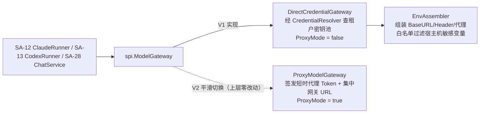

# spec 14 | Runtime ModelGateway & MCP Client — DirectCredentialGateway、环境净化、McpGrants 与外部 McpClient

- **状态**：`draft`
- **篇号顺序**：14（L1 执行运行时层，凭据网关与 MCP 协议底座）
- **对应 PR**：`docs/SuperAgent-Go/DDD/README.md` 看板中的 `SA-14`
- **预估工作量**：`1.5 人天`
- **上位契约**：
  - `docs/SuperAgent-Go/01_Go工程架构_目录结构与核心底座设计.md` §1、§4.2、§5.1
  - `docs/SuperAgent-Go/03_核心抽象与插件化引擎_Runtime_MCP与ModelGateway.md` §1.3、§3、§4
  - `docs/SuperAgent-Go/DDD/_epic/L1/spec_03_runtime_launcher_claude_codex_mcp.md` §4、§5.3、§5.8
- **前置依赖**：`L0/spec_03 (SA-03)`（`internal/infra/httpclient` 双 Profile 可信 `NewTrusted` / 不可信 `NewUntrustedEgress` 客户端与 `internal/core/egress`；并传递复用 `SA-01` `internal/infra/{obs,lifecycle}` 与 `SA-04` `internal/core/{tenant,crypto}`）、`L1/spec_06 (SA-06)`（`internal/core/{domain,spi}` 核心领域模型与 SPI）
- **下游消费者**：`SA-12`（`ClaudeRunner`/`ClaudeWarmPool` 消费 `EnvAssembler.ForClaude` 与 `McpGrants.StandIn`/`Release`/`TokenIn`）、`SA-13`（`CodexRunner` 消费 `EnvAssembler.ForCodex`）、`SA-20`（`ConnectorService`/`ConnectorToolsService` 消费 `McpClient` 与 `McpGrants.WithServers`）、`SA-28`（`ChatService` 消费 `ModelGateway` 与 `McpGrants`）、`SA-38`（L5 Web `/mcp` 协议端点薄壳消费 `McpDispatcher`）
- **重构参照源码**（绝对路径均基于 `/Users/gaorenjie/Documents/Coding/aiops-workspace/orgin/SuperAgent`）：
  - `superagent-platform/src/main/java/com/superagent/platform/provider/{CredentialService.java,EndpointFailures.java}`
  - `superagent-core/src/main/java/com/superagent/core/chat/RunCredential.java`
  - `superagent-core/src/main/java/com/superagent/core/connector/{McpServerSpec.java,ConnectorTransport.java}`
  - `superagent-runtime/src/main/java/com/superagent/runtime/mcp/{McpGrants.java,McpClient.java,McpToolProvider.java,McpTools.java,McpToolResult.java,McpToolException.java}`
  - `superagent-web/src/main/java/com/superagent/web/mcp/McpController.java`

---

## 1. 背景与范围

### 1.1 为什么做与用户价值

Agent 执行时涉及两类最高敏感度边界：**模型 API 凭据注入**与 **MCP 双向协议通信**（平台内置 `/mcp` 服务授信 + 探测外部企业/第三方 MCP 服务）。原版 Java 实现存在四类亟需在 Go 重构期根治的架构与安全痛点：
1. **凭据消费与业务域耦合，阻碍二期集中网关演进**：原版上层业务直接依赖 `CredentialService` 拿明文 Key，二期切换集中式三协议代理网关（让真实厂商 Key 永不进入沙箱）需要大面积改写调用方；
2. **宿主机敏感环境变量泄漏风险**：原版子进程默认继承整个服务端进程环境变量（仅删除 3 个 `ANTHROPIC_*` 键），若 Agent 在沙箱/本地执行 `env` 命令，可能窥探宿主机的 `SECRET_KEY`、`DATABASE_URL`、`PGPASSWORD`、`SUPER_ADMIN_TOKEN` 等平台机密；
3. **`/mcp` 领域异常漏捕缺陷**：原版 `McpController` 仅捕获 `McpToolException`，业务 Provider 抛出的 `NotFound`/`Busy`/`IllegalArgument` 会直接落入兜底 `catch (Exception)` 返回 JSON-RPC `-32603 Internal error`，导致模型误以为服务端宕机而非参数/状态可纠错；
4. **外部 `McpClient` 裸建 `HttpClient` 缺乏出口隔离**：未区分企业内网可信 MCP 与外部非信任 MCP 的 SSRF 防护策略，也未统一复用企业代理与自签根证书池。

本篇（`SA-14`）落地 `internal/runtime/gateway` 与 `internal/runtime/mcp` 两大核心子包：
- **`internal/runtime/gateway`**：落地 `spi.ModelGateway` V1 实现 `DirectCredentialGateway`（经窄端口 `CredentialResolver` 反转依赖，坚守 `L1` 绝不 `import L2`）、支持租户密文校验解密、`EnvAssembler` 统一按厂商组装 BaseURL / Header / 代理环境变量并实施**敏感环境变量白名单过滤**，同时预留 `ResolvedEndpoint.ProxyMode` 接口位供二期零侵入切换 `ProxyModelGateway`；
- **`internal/runtime/mcp`**：交付纯进程内并发 `McpGrants`（48-hex 随机 Token + 动态 HMAC-SHA256 签名防伪校验 + `StandIn`/`Release` + `WorkspaceFile` 抗符号链接逃逸 + 临时 `0600` `mcp-config.json` 生成与清理 + 挂入 L0 `lifecycle.BackgroundGroup` 的启动自检）、统一修复异常映射的 `McpDispatcher`、以及复用 L0 `internal/infra/httpclient`（支持可信/不可信 `UntrustedEgressClient` 隔离）的外部 `McpClient`（Streamable HTTP / Legacy SSE / Stdio 三传输）。

### 1.2 本篇边界

- **本篇负责**：
  - `internal/runtime/gateway`：`DirectCredentialGateway`（实现 `spi.ModelGateway`）、`CredentialResolver` 依赖反转端口、`SecretDecryptor` 可选直解端口、`EndpointFailureMatcher`（对齐 `EndpointFailures.java` 零输出故障识别）、`EnvAssembler`（Claude/Codex 凭据变量组装、上游 Auth Header 生成、宿主机敏感环境变量白名单过滤与剥离）；
  - `internal/runtime/mcp`：`McpGrants`（动态 Token/HMAC 授权、`CHAT`/`TASK`/`SUPER`、`StandIn`/`Release`、全量内置工具白名单与 `FILES_HINT`、`RequireDocAccess`、`WorkspaceFile`、`McpConfig`/`WithServers`/`TokenIn`、临时 `mcp-config.json` 生成清理、`SelfCheckAsync` 挂入 `BackgroundGroup`）、`McpToolProvider`/`McpTools`/`McpToolResult`/`McpToolError`、`McpDispatcher`（无 Gin 依赖的 JSON-RPC 2.0 协议调度器）、`McpClient`（Streamable HTTP / Legacy SSE / Stdio 只读 `tools/list` 客户端，复用 L0 `internal/infra/httpclient`）。
- **本篇不负责**：
  - `CredentialService` 密钥池持久化、健康巡检与 `ProviderCatalog` 归属 L2（`SA-18`/`SA-19`），启动时在 `wire.go` 通过 `CredentialResolver` 注入 `DirectCredentialGateway`；
  - 20 个业务域 `McpToolProvider` 实现分散在各 L2–L4 领域包；
  - Gin 路由 `GET/POST /mcp` 薄壳注册在 L5 Web 层（`SA-38`）；
  - **架构红线**：`McpGrants` 纯进程内存并发结构，**严禁引入 Redis**；外部 HTTP 调用必须走 L0 `internal/infra/httpclient`（含 `UntrustedEgressClient` 隔离）；后台自检挂入 L0 `internal/infra/lifecycle.BackgroundGroup`；日志脱敏走 L0 `internal/infra/obs`。

### 1.3 Java 原版源码精确映射表

| 目标 Go 组件 | Java 参照源码（基于 `/Users/gaorenjie/Documents/Coding/aiops-workspace/orgin/SuperAgent`） | 核心行号范围 | Go 重构演进与加固点 |
|---|---|---|---|
| `gateway.DirectCredentialGateway`、`EndpointFailures` | `superagent-platform/src/main/java/com/superagent/platform/provider/{CredentialService.java,EndpointFailures.java}`、`superagent-core/src/main/java/com/superagent/core/chat/RunCredential.java` | `CredentialService.java:140-207`, `EndpointFailures.java:12-60`, `RunCredential.java:9-15` | 抽离 `spi.ModelGateway` + `CredentialResolver` 反转端口解耦 L1/L2；严格拒绝回退宿主机环境变量；新增 `EnvAssembler` 白名单过滤宿主机平台机密；预留 V2 `ProxyMode` |
| `mcp.McpGrants` | `superagent-runtime/src/main/java/com/superagent/runtime/mcp/McpGrants.java` | `L49-390`（常量 `62-132`, `selfCheck:192-228`, `open*:230-263`, `find/standIn/release:265-289`, `tokenIn/mcpConfig/withServers:292-361`, `workspaceFile:367-389`） | 新增 HMAC-SHA256 进程密钥签名校验 + 恒定时间比对；`WorkspaceFile` 改用 `filepath.EvalSymlinks` + `filepath.Rel` 阻断兄弟前缀目录绕过；自检挂入 L0 `lifecycle.BackgroundGroup` 且复用 L0 `httpclient`；补充 `0600` 临时 `mcp-config.json` 生成与清理 |
| `mcp.McpToolProvider`、`McpTools`、`McpToolResult`、`McpToolError` | `superagent-runtime/src/main/java/com/superagent/runtime/mcp/{McpToolProvider.java,McpTools.java,McpToolResult.java,McpToolException.java}` | `McpToolProvider.java:14-30`, `McpTools.java:9-84`, `McpToolResult.java:4-9`, `McpToolException.java:4-9` | 1:1 映射 Go 结构体与 Builder 工具函数 |
| `mcp.McpDispatcher` | `superagent-web/src/main/java/com/superagent/web/mcp/McpController.java` | `L35-144`（`rpc:54-84`, `toolsList:90-96`, `callTool:98-104`, `initializeResult:106-115`） | 下沉协议调度逻辑至 L1 脱离 Web 框架；**V1 修复**：捕获所有已知 `apperror` 领域错误统一转 HTTP 200 + `isError: true` |
| `mcp.McpClient` | `superagent-runtime/src/main/java/com/superagent/runtime/mcp/McpClient.java` | `L36-397`（`converse:69-91`, `stdio:123-205`, `streamableHttp:209-266`, `sse:270-367`, `httpFailure:388-396`） | 替换裸 `HttpClient` 为 L0 `internal/infra/httpclient` 双客户端（`TrustedClient` 与 `UntrustedEgressClient` 隔离）；STDIO 统一经 `spi.ProcessLauncher` 启动与整组强杀 |

---

## 2. 本篇交付物表

| # | 交付物 | 落位（相对 `synapse-server/`） | 类型 |
|---|---|---|---|
| 1 | `DirectCredentialGateway`（实现 `spi.ModelGateway`）+ `CredentialResolver` 反转端口 + `EndpointFailures` 故障识别 | `internal/runtime/gateway/direct.go`、`failures.go` | 新增 |
| 2 | `EnvAssembler`（Claude/Codex 凭据环境与 Header 组装 + 宿主机敏感环境变量白名单过滤） | `internal/runtime/gateway/env.go` | 新增 |
| 3 | `McpGrants`（48-hex/HMAC 动态令牌、租户绑定、`StandIn`/`Release`、工具白名单与 `FilesHint`、`WorkspaceFile`、临时 `mcp-config.json` 生成清理、`BackgroundGroup` 自检） | `internal/runtime/mcp/grants.go`、`constants.go`、`config_file.go` | 新增 |
| 4 | `McpToolProvider`、`McpTools`、`McpToolResult`、`McpToolError`、`McpDispatcher`（领域错误统一转 `isError: true`） | `internal/runtime/mcp/provider.go`、`tools.go`、`dispatcher.go` | 新增 |
| 5 | `McpClient`（复用 L0 `httpclient` 可信/不可信隔离的 Streamable HTTP / Legacy SSE / Stdio 外部 MCP 客户端） | `internal/runtime/mcp/client.go` | 新增 |
| 6 | 同包单元测试套件（Gateway 解析与 failover、敏感环境白名单过滤、Grants 令牌/HMAC/符号链接防逃逸/自检、Dispatcher 错误修复、Client 三传输与 SSRF 隔离） | `internal/runtime/gateway/*_test.go`、`internal/runtime/mcp/*_test.go` | 新增 |

> **分层守卫约束**：
> - `internal/runtime/gateway` 仅允许导入 `internal/core/{domain,spi,tenant,apperror,crypto}`、`internal/infra/obs` 与 Go 标准库；
> - `internal/runtime/mcp` 仅允许导入 `internal/core/{domain,spi,tenant,apperror}`、`internal/infra/{httpclient,lifecycle,obs}` 与 Go 标准库；
> - **严禁导入** `internal/storage`、`internal/platform`、`internal/agent`、`internal/task`、`internal/web` 或任何 Redis 客户端库。

---

## 3. 数据库设计

本篇属于 L1 执行运行时层，**不新增 PostgreSQL 17 表或 SQL 迁移脚本**，**严禁引入 Redis**。

### 3.1 进程内存与临时配置文件存储契约

| 组件 | 存储介质 | 数据结构 / 路径 | 权限与生命周期 | 租户隔离机制 |
|---|---|---|---|---|
| `McpGrants` 令牌表 | 进程内存 | `sync.RWMutex` 保护 `grants[token]`、`companies[token]`、`standIns[standing]` + 进程启动随机 32B `hmacSecret` | 回合开始 `Open*` 签发，`defer Close` 确定性吊销；无持久化落盘 | 签发强调用 `tenant.Require(ctx)` 写入 `companies[token]`；`McpDispatcher` 据此还原租户 `ctx` |
| 临时 `mcp-config.json` | OS 临时目录 | `superagent-mcp-*.json` | 写入前强制 `0600`；经 `TempFileSpec` 由 `ProcessHandle.Close()` 或 `cleanup()` 确定性删除 | 仅含本租户单回合 Token 与该员工授权连接器，不落盘于工作区 |
| `DirectCredentialGateway` | 无状态（委托 L2 Store/Service） | 仅持有 `CredentialResolver` 与可选 `crypto.SecretCipher` 引用 | 每次 `Resolve` 按需取用，不缓存明文 API Key | 每次调用透传租户 `ctx`，底层 `SecretCipher.Decrypt` 强校验 `prefixCompanyID == tenant.Require(ctx)` |

---

## 4. 冻结契约

### 4.1 导出符号

#### 4.1.1 `internal/runtime/gateway`

```go
package gateway

import (
	"context"
	"net/http"

	"github.com/Karlsk/synapse-os/internal/core/crypto"
	"github.com/Karlsk/synapse-os/internal/core/domain"
	"github.com/Karlsk/synapse-os/internal/core/spi"
)

// CredentialResolver 依赖反转端口：由 L2 CredentialService 实现并在 wire.go 注入，避免 L1 import L2
type CredentialResolver interface {
	ResolveCurrent(ctx context.Context, providerKey string, excludeCredID string) (*domain.RunCredential, error)
	Failover(ctx context.Context, providerKey string, used *domain.RunCredential, errMsg string) (*domain.RunCredential, bool, error)
}

// DirectCredentialGateway 实现 spi.ModelGateway（V1 直连凭据池实现；V2 替换为 ProxyModelGateway 时上层零改动）
type DirectCredentialGateway struct {
	resolver CredentialResolver
	cipher   *crypto.SecretCipher // 可选：用于直解加密字段（如单次测试/自定义探针场景）
}

func NewDirectCredentialGateway(resolver CredentialResolver, cipher *crypto.SecretCipher) *DirectCredentialGateway
func (g *DirectCredentialGateway) Resolve(ctx context.Context, providerKey string, excludeCredID string) (*spi.ResolvedEndpoint, error)
func (g *DirectCredentialGateway) ReportEndpointFailure(ctx context.Context, providerKey string, ep *spi.ResolvedEndpoint, reason string) (*spi.ResolvedEndpoint, error)
func (g *DirectCredentialGateway) DecryptSecret(ctx context.Context, storedCipher string) (string, error)

// IsEndpointFailure 判断运行期错误是否属于换 Key/端点可恢复的故障（401/402/403/429/5xx/超时/配额耗尽）
func IsEndpointFailure(errMsg string) bool
// IsModelFailure 包含端点故障及模型不存在/下架类错误
func IsModelFailure(errMsg string) bool

// EnvPolicy 控制子进程宿主机环境变量白名单过滤与企业代理注入策略
type EnvPolicy struct {
	// AllowedHostKeys 允许透传给子进程的宿主机环境变量白名单（空时启用默认安全白名单）
	AllowedHostKeys []string
	// ExtraBlockedKeys 额外强制剥离的宿主机敏感键（与内置平台机密黑名单取并集）
	ExtraBlockedKeys []string
	HTTPProxy        string
	HTTPSProxy       string
	NoProxy          string
	CABundleFile     string
}

type EnvAssembler struct { /* policy EnvPolicy */ }

func NewEnvAssembler(policy EnvPolicy) *EnvAssembler
// ForClaude 返回 Claude 子进程需叠加的 env 与必须剥离的宿主机 StripEnvKeys（含 ANTHROPIC_* 及平台机密）
func (a *EnvAssembler) ForClaude(cred *domain.RunCredential) (env map[string]string, strip []string)
// ForCodex 返回 Codex 子进程需叠加的 env 与必须剥离的宿主机 StripEnvKeys（含 OPENAI_API_KEY/CODEX_API_KEY 及平台机密）
func (a *EnvAssembler) ForCodex(cred *domain.RunCredential) (env map[string]string, strip []string)
// SanitizeHostEnv 按白名单+黑名单过滤宿主机 os.Environ()，彻底阻断子进程读取平台机密
func (a *EnvAssembler) SanitizeHostEnv(hostEnv []string, extra map[string]string, extraStrip []string) []string
// AuthHeaders 为上游模型 HTTP 调用生成脱敏外发头（Authorization: Bearer 或 x-api-key）
func (a *EnvAssembler) AuthHeaders(ep *spi.ResolvedEndpoint) http.Header
```

#### 4.1.2 `internal/runtime/mcp`

```go
package mcp

import (
	"context"
	"log/slog"
	"time"

	"github.com/Karlsk/synapse-os/internal/core/domain"
	"github.com/Karlsk/synapse-os/internal/core/spi"
	"github.com/Karlsk/synapse-os/internal/infra/httpclient"
	"github.com/Karlsk/synapse-os/internal/infra/lifecycle"
)

const (
	ServerProtocolVersion = "2024-11-05" // 本服务 /mcp 服务端协议版本
	ClientProtocolVersion = "2025-06-18" // 外部 McpClient 客户端探测协议版本
	ClientMaxPages        = 20
)

type GrantKind string

const (
	GrantChat  GrantKind = "CHAT"
	GrantTask  GrantKind = "TASK"
	GrantSuper GrantKind = "SUPER"
)

type Grant struct {
	Token     string
	Kind      GrantKind
	Owner     string
	TaskID    string
	AgentID   string
	SessionID string
	MessageID string
	Workspace string
}

type SelfStatus struct {
	State     string     `json:"state"` // "unchecked" | "ok" | "error"
	Error     string     `json:"error,omitempty"`
	CheckedAt *time.Time `json:"checkedAt,omitempty"`
}

// 内置工具白名单与提示常量（完整对齐 McpGrants.java:62-132）
var (
	InboxTools     []string // 6 项
	FolderTools    []string // 7 项
	FileTools      []string // 11 项（4 交付 + FolderTools）
	SuperFileTools []string // 11 项（FolderTools + 4 管理）
	SkillTools     []string // 5 项
	SkillChatTools []string // 1 项（skill_delete）
	DocTools       []string // 12 项
	DocReadTools   []string // 7 项
	HistoryTools   []string // 2 项
	WorkTools      []string // FileTools + SkillTools + DocTools + HistoryTools
)

const FilesHint = "【交付规则】..." // 逐字对齐 McpGrants.java:125-132

type McpGrants struct { /* mu, grants, companies, standIns, hmacKey, selfURL, configured, status, trustedHTTP, logger */ }

// NewMcpGrants 构造动态授权管理器；trustedHTTP 复用 L0 httpclient.NewTrusted 产出的可信客户端用于本地自检
func NewMcpGrants(selfURL string, port int, trustedHTTP *httpclient.Client, logger *slog.Logger) *McpGrants
func (g *McpGrants) SetBoundPort(port int)
func (g *McpGrants) Available() bool
func (g *McpGrants) SelfURL() string
func (g *McpGrants) SelfStatus() SelfStatus
// SelfCheckAsync 将启动自检任务注册至 L0 lifecycle.BackgroundGroup（向 selfURL 发 ping 校验）
func (g *McpGrants) SelfCheckAsync(bgGroup *lifecycle.BackgroundGroup)

func (g *McpGrants) OpenChat(ctx context.Context, owner, agentID, sessionID, messageID, workspaceDir string) (*Grant, error)
func (g *McpGrants) OpenTask(ctx context.Context, owner, taskID, workspaceDir string) (*Grant, error)
func (g *McpGrants) OpenSuper(ctx context.Context, owner, agentID, sessionID, messageID, workspaceDir string) (*Grant, error)
func (g *McpGrants) Close(grant *Grant)
func (g *McpGrants) Find(token string) (*Grant, bool) // 先查 HMAC/格式 + grants，再查 standIns
func (g *McpGrants) CompanyOf(grant *Grant) (string, error)
func (g *McpGrants) StandIn(standing, current string)
func (g *McpGrants) Release(standing string)
func (g *McpGrants) McpConfig(grant *Grant) string
func (g *McpGrants) WorkspaceFile(grant *Grant, file string) (string, error)

func WithServers(baseConfig string, servers []domain.McpServerSpec) string
func TokenIn(mcpConfig string) string
func RequireDocAccess(grant *Grant, tool string) error
// BuildTempConfigMount 生成供 LocalLauncher 使用的 0600 TempFileSpec
func BuildTempConfigMount(mcpConfig string) (spi.TempFileSpec, bool)
// WriteTempMCPConfig 独立写入 0600 临时 mcp-config.json 并返回幂等清理函数
func WriteTempMCPConfig(mcpConfig string) (path string, cleanup func(), err error)

// --- McpToolProvider / McpTools / McpDispatcher ---

type McpToolResult struct {
	Text  string
	Error bool
}

func OKResult(text string) McpToolResult

type McpToolError struct { Message string }
func (e *McpToolError) Error() string
func NewToolError(msg string) *McpToolError

type ToolDef map[string]any

type McpToolProvider interface {
	Kinds() []GrantKind
	Tools() []ToolDef
	Handles(name string) bool
	Call(ctx context.Context, grant *Grant, name string, args map[string]any) (McpToolResult, error)
}

type McpDispatcher struct { /* grants, providers, logger */ }
func NewMcpDispatcher(grants *McpGrants, logger *slog.Logger, providers ...McpToolProvider) *McpDispatcher
func (d *McpDispatcher) HandleRPC(ctx context.Context, authHeader string, rawBody []byte) (statusCode int, respBody []byte)

// --- McpClient（外部只读 tools/list 客户端） ---

// TrustPolicy 指定外部 MCP 探测使用的 L0 httpclient 安全级别
type TrustPolicy int

const (
	// TrustUntrusted 默认严格模式：走 L0 httpclient.NewUntrustedEgress (ProfileUntrusted，DialContext 级抗 DNS Rebinding 阻断私网/回环)
	TrustUntrusted TrustPolicy = iota
	// TrustInternalAdmin 管理员显式允许的内网/私有 MCP：走 L0 httpclient.NewTrusted (ProfileTrusted，含企业代理与自签 CA)
	TrustInternalAdmin
)

type McpClient struct {
	launcher        spi.ProcessLauncher
	trustedClient   *httpclient.Client // 必须为 httpclient.ProfileTrusted（Streaming: true）
	untrustedClient *httpclient.Client // 必须为 httpclient.ProfileUntrusted（Streaming: true，即 UntrustedEgressClient）
	logger          *slog.Logger       // 经 L0 obs.NewRedactingHandler + NewContextHandler 包装
}

// NewMcpClient 校验两个客户端的 Profile() 防误混用，否则返回 apperror.InvalidArg
func NewMcpClient(l spi.ProcessLauncher, trusted, untrusted *httpclient.Client, logger *slog.Logger) (*McpClient, error)
func (c *McpClient) ListTools(ctx context.Context, spec domain.McpServerSpec, timeout time.Duration, policy TrustPolicy) ([]map[string]any, error)
```

### 4.2 路由契约（供 L5 `SA-38` `/mcp` 端点直接透传）

| 路径 | 方法 | 鉴权 | 响应规格 |
|---|---|---|---|
| `/mcp` | `GET` | 公开白名单 | 固定返回 `405 Method Not Allowed`（无服务端推送 SSE） |
| `/mcp` | `POST` | `Authorization: Bearer <token>` 经 `McpGrants.Find`（无效返 `401` 空体） | JSON-RPC 2.0 `application/json`；无 `id`/`id: null` 通知返回 `202 Accepted` 空体；`initialize` 返 `protocolVersion: "2024-11-05"`、`serverInfo: {"name":"superagent","version":"0.1.0"}` |

### 4.3 错误语义

| 场景 | 错误类型 / 状态码 | 精确文案 / 处理行为 |
|---|---|---|
| `DirectCredentialGateway.Resolve` 公司未配置 Key | `apperror.Forbidden`（HTTP `403`） | `"本公司还没有配置 <providerKey> 的 API Key：请管理员在「模型」里为它添加 Key"`（**严禁回退宿主机环境变量**） |
| `DirectCredentialGateway.DecryptSecret` 跨租户密文 | `crypto.ErrCrossTenantSecret` | 直接拒止解密，零明文泄露 |
| `/mcp` 缺少或无效 Bearer Token | HTTP `401 Unauthorized` | 空体（对齐 `McpController.java:60-62`） |
| `/mcp` 未知 JSON-RPC 方法 | HTTP `200` JSON-RPC `-32601` | `"Method not found: <method>"` |
| `/mcp` 工具返回 `*McpToolError` 或已知领域错误（`apperror.{InvalidArg,NotFound,Forbidden,Conflict,Busy}`） | HTTP `200` JSON-RPC `result` + `"isError": true` | `content[0].text = "错误：" + err.Error()`（**V1 修复原版领域异常返 `-32603` 的缺陷**） |
| `/mcp` 未知系统错误 / panic | HTTP `200` JSON-RPC `-32603` | `"Internal error: <msg>"`（脱敏且记 Warn 日志） |
| `RequireDocAccess` 越权 | `*McpToolError` | 后台：`"后台处理不能读写用户的文档。"`；`SUPER` 写文档：`"SuperAgent 只读文档；新建或修改文档请用 start_task 交给成员去做。"` |
| `WorkspaceFile` 越界 / 符号链接逃逸 / 非常规文件 | `apperror.InvalidArg` | `"No such file in the task workspace: <file>"` / `"Not a file in the task workspace: <file>"` |
| `McpClient` 不可信模式下访问内网/私网 IP | `apperror.EgressDenied`（HTTP `403`） | 由 L0 `UntrustedEgressClient` 在 `DialContext` 层直接拦截 |
| `McpClient` 上游 401/403、超时或 STDIO 早退 | `error` | 401/403：`"授权无效或已过期，请重新授权"`；超时：`"MCP 服务没有及时响应"`；STDIO 早退：`"MCP 服务启动后就退出了（退出码 <code>）"` |

### 4.4 SQL 与凭据/网络隔离安全契约

本篇无 SQL 操作，冻结以下五条安全铁律：
1. **敏感环境变量白名单过滤**：`EnvAssembler.SanitizeHostEnv` 默认仅透传明确白名单内的宿主机基础环境键（`PATH`, `HOME`, `USER`, `LOGNAME`, `SHELL`, `LANG`, `LC_*`, `TZ`, `TERM`, `TMPDIR`, `TEMP`, `TMP`, `XDG_*`, `SSL_CERT_FILE`, `SSL_CERT_DIR`, `NODE_EXTRA_CA_CERTS`, `HTTP_PROXY`, `HTTPS_PROXY`, `NO_PROXY` 及其小写），并显式强制剥离所有平台敏感键（`SECRET_KEY`, `DATABASE_URL`, `PGPASSWORD`, `PGUSER`, `SUPER_ADMIN_TOKEN`, `S3_SECRET_KEY`, `AWS_SECRET_ACCESS_KEY`, `FEISHU_APP_SECRET`, `DINGTALK_CLIENT_SECRET`, `ANTHROPIC_*`, `OPENAI_API_KEY`, `CODEX_API_KEY`）；
2. **严禁回退宿主机模型 Key**：商业多租户私有化场景下，`DirectCredentialGateway` 永不从宿主机 `os.Getenv` 拾取厂商 Key；
3. **动态令牌防伪与防时序侧信道**：`McpGrants` 签发的 Bearer Token 由 `24B` 随机 hex（48 字符）+ 可选基于进程随机密钥计算的 HMAC-SHA256 校验段组成（或内部表索引 + `subtle.ConstantTimeCompare` 校验），`Find()` 对未知格式在 O(1) 拒绝，不记录完整 Token 到任何日志（仅记录脱敏前 6 位）；
4. **Workspace 符号链接逃逸零容忍**：`WorkspaceFile` 必须双侧 `filepath.EvalSymlinks` 后使用 `filepath.Rel(wsReal, real)` 校验非 `".."` 且非 `"../..."`，再验 `info.Mode().IsRegular()`；
5. **外部网络出口强制走 L0 `httpclient`**：禁止在 `internal/runtime/mcp` 中直接 `new(http.Client)` 或 `http.DefaultClient`；默认按 `TrustUntrusted` 走 `UntrustedEgressClient`，仅当管理员显式配置的私网连接器开启内网许可时切至 `TrustedClient`。

---

## 5. 行为语义与 Java→Go 详细伪代码

### 5.1 `DirectCredentialGateway` 与二期集中代理网关演进位



```go
package gateway

var defaultAllowedHostPrefixes = []string{"LC_", "XDG_"}

var defaultAllowedHostKeys = map[string]struct{}{
	"PATH": {}, "HOME": {}, "USER": {}, "LOGNAME": {}, "SHELL": {},
	"LANG": {}, "TZ": {}, "TERM": {}, "TMPDIR": {}, "TEMP": {}, "TMP": {},
	"SSL_CERT_FILE": {}, "SSL_CERT_DIR": {}, "NODE_EXTRA_CA_CERTS": {},
	"HTTP_PROXY": {}, "http_proxy": {}, "HTTPS_PROXY": {}, "https_proxy": {},
	"NO_PROXY": {}, "no_proxy": {}, "NPM_CONFIG_REGISTRY": {},
}

var builtinBlockedHostKeys = []string{
	"SECRET_KEY", "SUPER_ADMIN_TOKEN", "DATABASE_URL", "PGPASSWORD", "PGUSER",
	"S3_ACCESS_KEY", "S3_SECRET_KEY", "AWS_ACCESS_KEY_ID", "AWS_SECRET_ACCESS_KEY",
	"FEISHU_APP_SECRET", "DINGTALK_CLIENT_SECRET",
	"ANTHROPIC_API_KEY", "ANTHROPIC_AUTH_TOKEN", "ANTHROPIC_BASE_URL",
	"OPENAI_API_KEY", "OPENAI_BASE_URL", "CODEX_API_KEY",
}

func (g *DirectCredentialGateway) Resolve(ctx context.Context, providerKey, excludeCredID string) (*spi.ResolvedEndpoint, error) {
	if _, err := tenant.Require(ctx); err != nil {
		return nil, err
	}
	cred, err := g.resolver.ResolveCurrent(ctx, providerKey, excludeCredID)
	if err != nil {
		return nil, err
	}
	if cred == nil {
		return nil, nil
	}
	return &spi.ResolvedEndpoint{
		CredentialID: cred.ID,
		BaseURL:      cred.BaseURL,
		APIKey:       cred.APIKey,
		Bearer:       cred.Bearer,
		ProxyMode:    false,
	}, nil
}

func (g *DirectCredentialGateway) ReportEndpointFailure(ctx context.Context, providerKey string, ep *spi.ResolvedEndpoint, reason string) (*spi.ResolvedEndpoint, error) {
	if ep == nil || !IsEndpointFailure(reason) {
		return nil, nil
	}
	next, ok, err := g.resolver.Failover(ctx, providerKey, ep.ToRunCredential(), reason)
	if err != nil || !ok || next == nil {
		return nil, err
	}
	return &spi.ResolvedEndpoint{
		CredentialID: next.ID,
		BaseURL:      next.BaseURL,
		APIKey:       next.APIKey,
		Bearer:       next.Bearer,
		ProxyMode:    false,
	}, nil
}

func (a *EnvAssembler) ForClaude(cred *domain.RunCredential) (map[string]string, []string) {
	env := make(map[string]string, 4)
	strip := append([]string(nil), builtinBlockedHostKeys...)
	strip = append(strip, a.policy.ExtraBlockedKeys...)
	if cred != nil {
		if cred.BaseURL != "" {
			env["ANTHROPIC_BASE_URL"] = cred.BaseURL
		}
		if cred.Bearer {
			env["ANTHROPIC_AUTH_TOKEN"] = cred.APIKey
		} else {
			env["ANTHROPIC_API_KEY"] = cred.APIKey
		}
	}
	a.applyProxyEnv(env)
	return env, strip
}

func (a *EnvAssembler) ForCodex(cred *domain.RunCredential) (map[string]string, []string) {
	env := make(map[string]string, 4)
	strip := append([]string(nil), builtinBlockedHostKeys...)
	strip = append(strip, a.policy.ExtraBlockedKeys...)
	if cred != nil {
		env["CODEX_API_KEY"] = cred.APIKey
	}
	a.applyProxyEnv(env)
	return env, strip
}

func (a *EnvAssembler) SanitizeHostEnv(hostEnv []string, extra map[string]string, extraStrip []string) []string {
	blocked := make(map[string]struct{}, len(builtinBlockedHostKeys)+len(a.policy.ExtraBlockedKeys)+len(extraStrip))
	for _, k := range builtinBlockedHostKeys {
		blocked[k] = struct{}{}
	}
	for _, k := range a.policy.ExtraBlockedKeys {
		blocked[k] = struct{}{}
	}
	for _, k := range extraStrip {
		blocked[k] = struct{}{}
	}
	out := make(map[string]string)
	for _, kv := range hostEnv {
		k, v, ok := strings.Cut(kv, "=")
		if !ok {
			continue
		}
		if _, isBlocked := blocked[k]; isBlocked {
			continue
		}
		if a.isAllowedHostKey(k) {
			out[k] = v
		}
	}
	a.applyProxyEnv(out)
	for k, v := range extra {
		out[k] = v
	}
	return mapToEnvSlice(out)
}
```

### 5.2 `McpGrants` 动态 HMAC/Token 授权、临时 `mcp-config.json` 与 `McpDispatcher`

- **动态 Token 签发与校验**：
  - `Open*` 强调用 `companyID, err := tenant.Require(ctx)`；生成 24 字节随机串（48 位 hex `nonce`）并以进程内启动随机生成的 32 字节 `hmacKey` 计算 `sig = HMAC-SHA256(hmacKey, nonce + ":" + companyID)` 前 8 字节 hex，拼为 `<48-hex>.<16-hex>`（同时兼容纯 48-hex 的静态测试令牌），存入 `grants[token]` 与 `companies[token]`；
  - `Find(token)` 先验格式与 `hmac` 恒定时间比对（非法输入立即 O(1) 拒绝，无需持锁扫描），再查 `grants[token]`，未命中时查 `standIns[token] -> grants[active]`；
  - `SelfCheckAsync(bgGroup)` 挂入 L0 `lifecycle.BackgroundGroup`：在 `tenant.WithCompany(ctx, tenant.DefaultSentinelID)` 下签发 `__selfcheck__` 临时 Grant，经 L0 `httpclient` 可信客户端 `POST <selfURL>` 发送 `{"jsonrpc":"2.0","id":1,"method":"ping"}`（超时 10s），检查 `HTTP 200` 且包含 `"result"`，更新 `SelfStatus` 并 `defer g.Close(probe)`。
- **临时 `mcp-config.json` 生成清理**：
  - `BuildTempConfigMount(mcpConfig)` 生成 `spi.TempFileSpec{Key: "mcp-config", Prefix: "superagent-mcp-", Suffix: ".json", Content: []byte(mcpConfig), Mode: 0o600}` 交由 `LocalLauncher` 托管；
  - `WriteTempMCPConfig(mcpConfig)` 面向独立场景直接创建 `0600` 临时文件并返回 `sync.Once` 包装的幂等 `cleanup()` 闭包。
- **`McpDispatcher` 统一错误拦截修复**：

```go
package mcp

func (d *McpDispatcher) HandleRPC(ctx context.Context, authHeader string, rawBody []byte) (int, []byte) {
	token := extractBearer(authHeader)
	grant, ok := d.grants.Find(token)
	if !ok {
		return http.StatusUnauthorized, nil
	}
	var req rpcRequest
	if err := json.Unmarshal(rawBody, &req); err != nil {
		return http.StatusOK, marshalRPCError(nil, -32700, "Parse error: "+err.Error())
	}
	// 无 id 或 id == null 的通知返回 202 Accepted 空体
	if len(req.ID) == 0 || bytes.Equal(bytes.TrimSpace(req.ID), []byte("null")) {
		return http.StatusAccepted, nil
	}
	companyID, err := d.grants.CompanyOf(grant)
	if err != nil {
		return http.StatusUnauthorized, nil
	}
	tenantCtx, err := tenant.WithCompany(ctx, companyID)
	if err != nil {
		return http.StatusOK, marshalRPCError(req.ID, -32603, "Internal error: invalid tenant")
	}

	switch req.Method {
	case "initialize":
		return http.StatusOK, marshalRPCResult(req.ID, initializePayload())
	case "ping":
		return http.StatusOK, marshalRPCResult(req.ID, map[string]any{})
	case "tools/list":
		return http.StatusOK, marshalRPCResult(req.ID, d.toolsList(grant))
	case "tools/call":
		res, callErr := d.callTool(tenantCtx, grant, req.Params)
		if callErr != nil {
			// V1 缺陷修复：McpToolError 与全部预期领域错误均转为 HTTP 200 + isError: true
			if isToolFacingError(callErr) {
				return http.StatusOK, marshalRPCResult(req.ID, textContent("错误："+callErr.Error(), true))
			}
			// 注入的 logger 已包装 L0 obs.NewRedactingHandler + NewContextHandler，自动脱敏并携带 request_id/company_id
			d.logger.WarnContext(tenantCtx, "mcp tool call internal error", "method", req.Method, "err", callErr.Error())
			return http.StatusOK, marshalRPCError(req.ID, -32603, "Internal error: "+callErr.Error())
		}
		return http.StatusOK, marshalRPCResult(req.ID, textContent(res.Text, res.Error))
	default:
		return http.StatusOK, marshalRPCError(req.ID, -32601, "Method not found: "+req.Method)
	}
}

func isToolFacingError(err error) bool {
	var toolErr *McpToolError
	if errors.As(err, &toolErr) {
		return true
	}
	var appErr *apperror.AppError
	if errors.As(err, &appErr) {
		switch appErr.Code {
		case apperror.CodeInvalidArgument, apperror.CodeNotFound, apperror.CodeForbidden, apperror.CodeConflict, apperror.CodeBusy:
			return true
		}
	}
	return false
}
```

### 5.3 `McpClient`：复用 L0 `httpclient` 的三传输只读探测

- **协议流（`converse`）**：固定 `protocolVersion: "2025-06-18"`、`clientInfo: {"name":"superagent","version":"1"}`，依次执行 `initialize` → `notifications/initialized` → 分页 `tools/list`（支持 `nextCursor`，上限 `ClientMaxPages = 20`）；
- **HTTP 客户端安全选择**：
  - `policy == TrustInternalAdmin` → 使用 `c.trustedClient`（L0 `httpclient.NewTrusted`，`Profile() == httpclient.ProfileTrusted`，`Streaming: true`，携带企业代理与自签 CA，放行管理员配置的内网 LAN MCP）；
  - `policy == TrustUntrusted`（默认）→ 使用 `c.untrustedClient`（L0 `httpclient.NewUntrustedEgress`，`Profile() == httpclient.ProfileUntrusted`，`Streaming: true`，内建 `egress.Guard` `DialContext` 级抗 DNS Rebinding 拦截回环、私网、元数据地址）；
  - 当 `c.Do(req)` 返回 `*httpclient.ClientError` 时，经 `httpclient.KindOf(err)` 识别 `KindEgressDenied`（原样透传 `apperror.ErrEgressDenied`）与 `KindTimeout`（映射为 `"MCP 服务没有及时响应"`）；响应体读取经 `httpclient.ReadLimited` 防 OOM；
- **Streamable HTTP**：每次 POST 携带 `Content-Type: application/json`、`Accept: application/json, text/event-stream`、`MCP-Protocol-Version: 2025-06-18` 及 `spec.Headers`；捕获响应头 `Mcp-Session-Id` 并在后续请求回传；响应 `Content-Type` 含 `text/event-stream` 时解析 SSE 首个匹配 `id` 的 `data:` 帧，否则直接反序列化 JSON；
- **Legacy HTTP+SSE**：`GET spec.URL`（`Accept: text/event-stream`），独立 goroutine 解析 `event:`/`data:` 送入容量 256 的 channel，等到 `event: endpoint` 后用 `baseURL.ResolveReference` 计算 POST 目标地址，每次 POST 后在事件通道按 `id` 匹配 `event: message`（或无 `event` 名）帧；`defer` 取消 GET 上下文并关闭流；
- **Stdio**：通过 `c.launcher.Start(runCtx, spi.ProcessSpec{Command: spec.Command, Args: spec.Args, Env: spec.Env, DiscardStderr: true})` 启动，单行扫描过滤 `{` 开头 JSON 行送入容量 256 channel，写入或 500ms 轮询等待时检测进程早退并报告 `"MCP 服务启动后就退出了（退出码 <code>）"`，`defer proc.Kill() + proc.Close()`。

---

## 6. 任务清单（TDD 粒度）

- [ ] T1: 编写 `internal/runtime/gateway/{direct_test.go,failures_test.go,env_test.go}`（覆盖 Resolve/Failover、无公司 Key 拒止不回退宿主机 env、跨租户密文拒解、`IsEndpointFailure`/`IsModelFailure` 全规则、宿主机敏感环境变量白名单过滤与 Claude/Codex 组装）并实现 `direct.go`、`failures.go`、`env.go`
- [ ] T2: 编写 `internal/runtime/mcp/grants_test.go`（覆盖 48-hex+HMAC 令牌签发与防篡改、租户绑定、`StandIn`/`Release`、`RequireDocAccess`、`WorkspaceFile` 符号链接与 `/ws-evil` 兄弟前缀拦截、`WithServers`/`TokenIn`、`0600` 临时 `mcp-config.json` 清理、`BackgroundGroup` `SelfCheckAsync`）并实现 `grants.go`、`constants.go`、`config_file.go`
- [ ] T3: 编写 `internal/runtime/mcp/dispatcher_test.go`（覆盖 401/202/`initialize`/`ping`/`tools/list`/`tools/call`、`*McpToolError` 与 `apperror.{NotFound,Busy,InvalidArg,Forbidden,Conflict}` 统一转 HTTP 200 `isError: true`）并实现 `provider.go`、`tools.go`、`dispatcher.go`
- [ ] T4: 编写 `internal/runtime/mcp/client_test.go`（使用 `httptest` 与 Fake `ProcessLauncher` 覆盖 Streamable HTTP JSON/SSE/`Mcp-Session-Id`/2 页分页、Legacy SSE `endpoint` 合并、Stdio 早退退出码检测、以及 `TrustUntrusted` 阻断 `127.0.0.1` 与 `TrustInternalAdmin` 放行内网差异）并实现 `client.go`
- [ ] T5: 运行 `go test -race -cover ./internal/runtime/gateway/... ./internal/runtime/mcp/...` 与 `internal/arch_test.go` 验证零竞态、零 Redis、零反向依赖

---

## 7. 文档同步

- [ ] `docs/SuperAgent-Go/DDD/README.md` 看板：合入后将 `SA-14` 状态更新为 `已实施（commit <sha>）`
- [ ] `docs/SuperAgent-Go/03_核心抽象与插件化引擎_Runtime_MCP与ModelGateway.md` §1.3、§3：同步 `EnvAssembler` 白名单过滤契约与 `McpClient` 双信任客户端策略
- [ ] `configs/config.example.yaml`：补充 `mcp.self_url`、`runtime.env.allowed_host_keys`、`runtime.env.extra_blocked_keys` 配置说明

---

## 8. 测试清单

| 测试点 | 落位 | 关键断言 |
|---|---|---|
| `DirectCredentialGateway` 租户隔离与 Failover | `internal/runtime/gateway/direct_test.go` | 缺租户上下文直接报错；无公司 Key 原样透传 `403 Forbidden` 不回退宿主机 env；非端点错误不触发切换；429/401 错误标记原 Key 并返回下一优先级端点 |
| `EnvAssembler` 敏感环境变量白名单过滤 | `internal/runtime/gateway/env_test.go` | 宿主机含 `SECRET_KEY`/`DATABASE_URL`/`PGPASSWORD`/`SUPER_ADMIN_TOKEN`/`ANTHROPIC_API_KEY` 全部被过滤剥离；仅白名单键与当前回合凭据及代理变量进入子进程环境 |
| `EndpointFailures` 规则覆盖 | `internal/runtime/gateway/failures_test.go` | 准确命中 `API Error: 429`、`HTTP 401`、`额度`/`余额不足`、`econnrefused`；工具报错/语法错误返回 `false` |
| `McpGrants` 动态 HMAC 令牌与符号链接防逃逸 | `internal/runtime/mcp/grants_test.go` | 篡改 Token 签名位立刻被 `Find` 拒绝；`StandIn` 在回合期生效、`Release` 后立刻失效；`WorkspaceFile` 拒绝指向工作区外的软链接与兄弟前缀 `/ws-evil/a.txt`；`WriteTempMCPConfig` 文件权限 `0600` 且 `cleanup()` 删除文件 |
| `McpGrants` `SelfCheckAsync` 接入 `BackgroundGroup` | `internal/runtime/mcp/grants_test.go` | 命中 `httptest` ping 端点后 `SelfStatus().State == "ok"`；不可达或非 200 时置 `"error"` 并包含中文排查提示，探针 Grant 确定性关闭 |
| `McpDispatcher` 协议规范与领域错误修复 | `internal/runtime/mcp/dispatcher_test.go` | 无/错 Token 返 `401`；无 `id` 通知返 `202`；`initialize` 返 `"2024-11-05"`；`McpToolError` 与 `apperror.NotFound`/`Busy`/`InvalidArg` 均返 HTTP 200 + `isError: true` + `"错误：..."` |
| `McpClient` 三传输与可信/不可信隔离 | `internal/runtime/mcp/client_test.go` | Streamable HTTP 校验 `Mcp-Session-Id` 回传、JSON/SSE 双分支与 2 页 `nextCursor` 合并；Legacy SSE 合并相对 `endpoint` 并按 `id` 关联响应；Stdio 捕获早退退出码并调用 `Kill()+Close()`；`TrustUntrusted` 拒绝回环/私网地址 |

---

## 9. 验收门

- [ ] `go build ./... && go test -race ./internal/runtime/gateway/... ./internal/runtime/mcp/...` 全绿（零 data race）
- [ ] §2 交付物表 6 项逐一存在且落位准确
- [ ] `internal/arch_test.go` 通过：零引入上层业务包（尤其零 `import internal/platform`）、存储包与 Redis
- [ ] §8 测试清单 7 组用例全部落地且关键断言保真，`internal/runtime/gateway` 与 `internal/runtime/mcp` 语句覆盖率均 ≥ 80%
- [ ] 安全门禁：全包零自建裸 `http.Client`（均经 L0 `internal/infra/httpclient`）；所有日志经 L0 `internal/infra/obs` 脱敏；临时 `mcp-config.json` 权限强制 `0600`；`WorkspaceFile` 使用 `EvalSymlinks` + `filepath.Rel`
- [ ] 前置篇 `SA-03`、`SA-06` 单测全绿回归

---

## 10. 可提交节点

- **建议主 commit**：`feat(runtime): 实现 DirectCredentialGateway、环境变量白名单过滤、McpGrants/McpDispatcher 与三传输 McpClient（spec 14，PR SA-14）`
- **推荐分层拆分提交（可选）**：
  1. `feat(runtime-gateway): 实现 DirectCredentialGateway、EndpointFailures 与敏感环境变量白名单过滤器`
  2. `feat(runtime-mcp): 实现 McpGrants 动态授权、McpDispatcher 错误统一拦截与基于 L0 httpclient 的三传输 McpClient`
