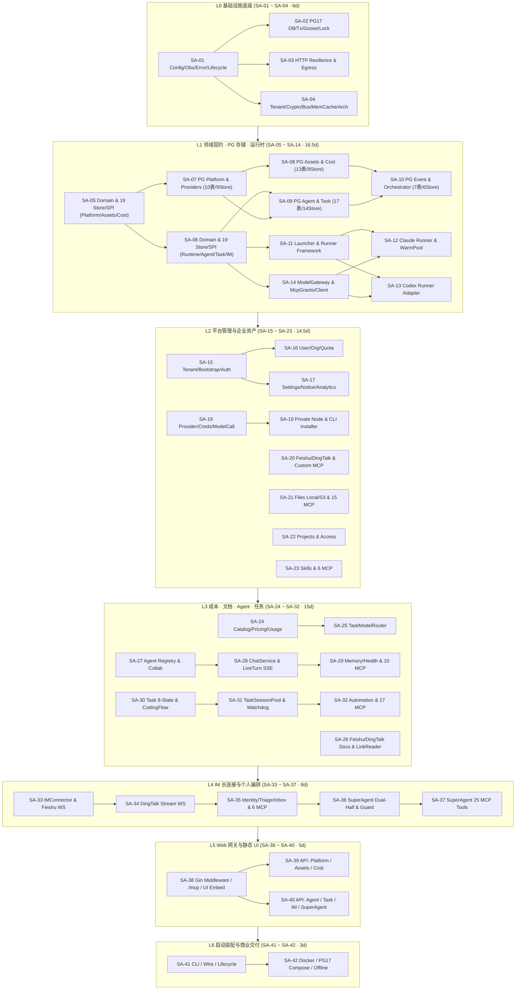

# SuperAgent Go 版（商业私有化 V1）— L0–L6 细粒度开发 Spec 总控看板（42 PR）

> **用途**：本目录将 [../README.md](../README.md) 的 Go 架构设计与归档的 14 篇模块总设（[_epic/README.md](./_epic/README.md)）进一步拆细为 **42 篇单人可逐行 Review、每篇约 1–2 人天工作量（约 500–1,200 LOC 含单测）的 PR 级开发 Spec**，按 **`L0` 基础设施底座 → `L6` 装配与商业交付** 严格单向分层组织。  
> **模版依据**：全部 42 篇严格遵循 `spec-template.md` 规范（元数据头 + `§1 背景与范围` + `§2 交付物表` + `§3 数据库设计` + `§4 冻结契约` + `§5 行为语义与 Java→Go 伪代码` + `§6 TDD 任务清单` + `§7 文档同步` + `§8 测试清单` + `§9 验收门` + `§10 可提交节点`）。  
> **重构参照**：所有 Spec 均逐文件扫描 Java 参考源码 `/Users/gaorenjie/Documents/Coding/aiops-workspace/orgin/SuperAgent`，标注精确的 Java 类/方法/行号路径，并显式标出 V1 商业私有化裁剪点与原版缺陷修复点。

---

## 1. 工程红线与 V1 商业私有化锁定边界（全部 42 篇共同遵守）

1. **目标工程**：`synapse-server`（`module github.com/Karlsk/synapse-os`，`go 1.26.1`），核心技术栈：**Go 1.26 + Gin + PostgreSQL 17 (`pgx/v5` + `goose`) + 标准库 `crypto/aes` / `slog` + `sony/gobreaker/v2` + `robfig/cron/v3` + `embed.FS`**。
2. **严格单向分层防循环**：
   `L6(cmd) → L5(web/ui) → L4(orchestrator/event) → L3(agent/task/cost/docs) → L2(platform/files/project/skills) → L1(core contracts / storage / runtime) → L0(infra / core primitives)`
   - 同层禁止循环依赖（`internal/agent/*` 与 `internal/task/*` 绝不可互引）；
   - 由 `L0/spec_04` 的 `internal/arch_test.go` 在 CI 阶段做 Go AST 静态强制拦截。
3. **零外部冗余中间件（零 Redis、零 ClickHouse）**：
   - 原版 Java SuperAgent **零 Redis**，V1 商业私有化部署最小依赖为 **单 Go 二进制 + 单库 PostgreSQL 17**；
   - 进程内短期缓存/去重/限流统一使用 `L0/spec_04` `internal/infra/memcache`（纯内存分片 TTL 缓存）；
   - 定时任务并发防重使用 `L0/spec_02` `internal/infra/db` 提供的 PG17 原生 `AdvisoryLock`；
   - 明确**不引入 Redis 客户端、不预留冗余分布式缓存抽象**，待未来多副本演进有真实需求时再引入。
4. **公用底座先行（L0 统一封装）**：
   - **配置/观测/错误/协程托管**（`SA-01`）：YAML+Env 强校验、统一 `apperror`、敏感字段脱敏 `slog` + Prometheus、`BackgroundGroup` 与 30s 分阶段优雅停机；
   - **数据库底座**（`SA-02`）：`pgxpool`、`context` 透传 `TxManager`、`goose` 嵌入迁移、PG 错误映射、慢查询追踪、临时 Schema 测试 Harness；
   - **出站 HTTP 底座**（`SA-03`）：`TrustedClient`（代理+私有 CA+熔断+退避重试）与 `UntrustedEgressClient`（`DialContext` 抗 SSRF/DNS Rebinding + 重定向复查 + 响应体限流）严格分离；区分 SSE 流式超时；**业务降级策略由调用方决定，HTTP 包仅返回结构化错误分类**；
   - **租户与密码学**（`SA-04`）：`TenantContext`/`TenantPaths`、每租户 AES-256-GCM DEK 信封加密与 KEK 轮换、进程内 `EventBus`。
5. **V1 业务裁剪与原版 Bug 修复清单**：
   - **保留多租户隔离，关闭公网自助注册**（改为 `bootstrap-org` CLI / 超管开户，`GET /api/v1/orgs/registration -> false`）；
   - **执行引擎接口化**，V1 正式交付 **Claude Code（含热进程池）** 与 **Codex** 两套 GA 适配器；
   - **内置集成/连接器仅保留飞书与钉钉生态**（`feishu`、`dingtalk` 企业集成；`feishu-docs` OAuth、`dingtalk-tools`）+ **通用自定义 MCP**，移除 GitHub/Gitee/Notion/Confluence 4 套 SaaS 预置；
   - **移除 24 套内置 `AgentCharacters` 性格预设**（`GET /api/v1/agents/characters -> []`）、**移除 3 个消费级 `SkillSeeds`**、**移除微信/Google/GitHub/匿名飞书公网定向爬虫**（保留飞书授权直读 + `GenericSource` over `UntrustedEgressClient`）；
   - **PG17 单库修复**：全量 **47 张表 / 41 条索引 / 38 个 Store**，补齐 `agent_event` `BIGSERIAL` 主键、新增 `user_session` 表、清理 `*.tier`/`character_key`/`tracked_json`/`event_source` 5 废弃列与 `MaterialPrompt` 死代码、严禁迁移脚本 `DROP TABLE`；
   - **原版缺陷修复**：补齐 `TaskModelRouter` 固定模型模式与单候选跳裁判；修复 `TaskSessionPool` 跨模型轮换与 `TaskService.Recover`；MCP 工具领域错误统一返回 `isError: true`；共享 Agent 发言人前缀覆盖项目成员；`AgentService.MergeUpdate` 补接 `runLog` 审计；
   - **一期预留二期扩展 SPI**：`ProcessLauncher`（沙箱/远程 Worker）、`ModelGateway`（集中代理网关）、`Authenticator`（OIDC/LDAP）、`IMConnector`（企微）、`OwnerTransferHook`（离职交接）、`LicenseQuotaHook`（商业授权配额）。

---

## 2. L0–L6 分层实施 DAG 总览

---

## 3. 全量 42 篇细粒度 Spec 实施看板（每篇 1–2 人天）

### L0 — 基础设施底座层（4 篇，合计 6 人天）

| 篇号 | PR | Spec 文档 | 目标 Go 包 | 预估 | 对应 Epic 归档 | 状态 |
|:---:|:---:|---|---|:---:|---|:---:|
| 01 | `SA-01` | [L0/spec_01_config_obs_error_lifecycle.md](./L0/spec_01_config_obs_error_lifecycle.md) | `internal/infra/{config,obs,lifecycle}`, `internal/core/apperror` | 1.5d | [_epic/L1/spec_01](./_epic/L1/spec_01_core_tenant_crypto_egress.md) / [_epic/L6/spec_14](./_epic/L6/spec_14_server_bootstrap_lifecycle_docker_delivery.md) | `draft` |
| 02 | `SA-02` | [L0/spec_02_db_pgx_tx_migration.md](./L0/spec_02_db_pgx_tx_migration.md) | `internal/infra/db` | 1.5d | [_epic/L1/spec_02](./_epic/L1/spec_02_storage_postgres_migrations.md) | `draft` |
| 03 | `SA-03` | [L0/spec_03_httpclient_resilience_egress.md](./L0/spec_03_httpclient_resilience_egress.md) | `internal/infra/httpclient`, `internal/core/egress` | 1.5d | [_epic/L1/spec_01](./_epic/L1/spec_01_core_tenant_crypto_egress.md) | `draft` |
| 04 | `SA-04` | [L0/spec_04_tenant_crypto_bus_archguard.md](./L0/spec_04_tenant_crypto_bus_archguard.md) | `internal/core/{tenant,crypto,eventbus}`, `internal/infra/memcache`, `internal/arch_test.go` | 1.5d | [_epic/L1/spec_01](./_epic/L1/spec_01_core_tenant_crypto_egress.md) | `draft` |

### L1 — 核心契约、PG17 存储与执行运行时层（10 篇，合计 16.5 人天）

| 篇号 | PR | Spec 文档 | 目标 Go 包 | 预估 | 对应 Epic 归档 | 状态 |
|:---:|:---:|---|---|:---:|---|:---:|
| 05 | `SA-05` | [L1/spec_05_core_domain_platform_assets_contracts.md](./L1/spec_05_core_domain_platform_assets_contracts.md) | `internal/core/{model,store,spi}`（平台/资产/成本/通知：19 Store + 平台 SPI） | 1.5d | [_epic/L1/spec_01](./_epic/L1/spec_01_core_tenant_crypto_egress.md) | `draft` |
| 06 | `SA-06` | [L1/spec_06_core_domain_runtime_agent_task_contracts.md](./L1/spec_06_core_domain_runtime_agent_task_contracts.md) | `internal/core/{model,store,spi}`（运行/Agent/Task/IM/编排：19 Store + 运行 SPI） | 1.5d | [_epic/L1/spec_01](./_epic/L1/spec_01_core_tenant_crypto_egress.md) | `draft` |
| 07 | `SA-07` | [L1/spec_07_pg_storage_platform_providers.md](./L1/spec_07_pg_storage_platform_providers.md) | `internal/storage/postgres`（`00001`–`00002`：10 表 / 9 Store + `guard_test.go`） | 2.0d | [_epic/L1/spec_02](./_epic/L1/spec_02_storage_postgres_migrations.md) | `draft` |
| 08 | `SA-08` | [L1/spec_08_pg_storage_assets_cost.md](./L1/spec_08_pg_storage_assets_cost.md) | `internal/storage/postgres`（`00003`：13 表 / 9 Store） | 1.5d | [_epic/L1/spec_02](./_epic/L1/spec_02_storage_postgres_migrations.md) | `draft` |
| 09 | `SA-09` | [L1/spec_09_pg_storage_agent_task.md](./L1/spec_09_pg_storage_agent_task.md) | `internal/storage/postgres`（`00004`–`00005`：17 表 / 14 Store） | 2.0d | [_epic/L1/spec_02](./_epic/L1/spec_02_storage_postgres_migrations.md) | `draft` |
| 10 | `SA-10` | [L1/spec_10_pg_storage_event_orchestrator.md](./L1/spec_10_pg_storage_event_orchestrator.md) | `internal/storage/postgres`（`00006`：7 表 / 6 Store + 47 表全量装配 E2E） | 1.5d | [_epic/L1/spec_02](./_epic/L1/spec_02_storage_postgres_migrations.md) | `draft` |
| 11 | `SA-11` | [L1/spec_11_runtime_launcher_runner_framework.md](./L1/spec_11_runtime_launcher_runner_framework.md) | `internal/runtime/{launcher,runner}` | 1.5d | [_epic/L1/spec_03](./_epic/L1/spec_03_runtime_launcher_claude_codex_mcp.md) | `draft` |
| 12 | `SA-12` | [L1/spec_12_runtime_claude_adapter_warmpool.md](./L1/spec_12_runtime_claude_adapter_warmpool.md) | `internal/runtime/claude` | 2.0d | [_epic/L1/spec_03](./_epic/L1/spec_03_runtime_launcher_claude_codex_mcp.md) | `draft` |
| 13 | `SA-13` | [L1/spec_13_runtime_codex_adapter.md](./L1/spec_13_runtime_codex_adapter.md) | `internal/runtime/codex` | 1.5d | [_epic/L1/spec_03](./_epic/L1/spec_03_runtime_launcher_claude_codex_mcp.md) | `draft` |
| 14 | `SA-14` | [L1/spec_14_runtime_model_gateway_mcp_client.md](./L1/spec_14_runtime_model_gateway_mcp_client.md) | `internal/runtime/{gateway,mcp}` | 1.5d | [_epic/L1/spec_03](./_epic/L1/spec_03_runtime_launcher_claude_codex_mcp.md) | `draft` |

### L2 — 平台管理与企业资产层（9 篇，合计 14.5 人天）

| 篇号 | PR | Spec 文档 | 目标 Go 包 | 预估 | 对应 Epic 归档 | 状态 |
|:---:|:---:|---|---|:---:|---|:---:|
| 15 | `SA-15` | [L2/spec_15_platform_tenant_bootstrap_auth.md](./L2/spec_15_platform_tenant_bootstrap_auth.md) | `internal/platform/{tenant,auth}` | 1.5d | [_epic/L2/spec_04](./_epic/L2/spec_04_platform_tenant_auth_user_settings_notice.md) | `draft` |
| 16 | `SA-16` | [L2/spec_16_platform_user_org_quota.md](./L2/spec_16_platform_user_org_quota.md) | `internal/platform/user` | 1.5d | [_epic/L2/spec_04](./_epic/L2/spec_04_platform_tenant_auth_user_settings_notice.md) | `draft` |
| 17 | `SA-17` | [L2/spec_17_platform_settings_notice_analytics.md](./L2/spec_17_platform_settings_notice_analytics.md) | `internal/platform/{settings,notice,analytics}` | 1.5d | [_epic/L2/spec_04](./_epic/L2/spec_04_platform_tenant_auth_user_settings_notice.md) | `draft` |
| 18 | `SA-18` | [L2/spec_18_platform_provider_credentials_modelcall.md](./L2/spec_18_platform_provider_credentials_modelcall.md) | `internal/platform/provider` | 2.0d | [_epic/L2/spec_05](./_epic/L2/spec_05_platform_provider_node_credentials_connectors.md) | `draft` |
| 19 | `SA-19` | [L2/spec_19_platform_private_node_cli_installer.md](./L2/spec_19_platform_private_node_cli_installer.md) | `internal/platform/provider/installer` | 1.5d | [_epic/L2/spec_05](./_epic/L2/spec_05_platform_provider_node_credentials_connectors.md) | `draft` |
| 20 | `SA-20` | [L2/spec_20_platform_feishu_dingtalk_connectors.md](./L2/spec_20_platform_feishu_dingtalk_connectors.md) | `internal/platform/{integration,connector}` | 2.0d | [_epic/L2/spec_05](./_epic/L2/spec_05_platform_provider_node_credentials_connectors.md) | `draft` |
| 21 | `SA-21` | [L2/spec_21_assets_files_storage_mcp.md](./L2/spec_21_assets_files_storage_mcp.md) | `internal/files`（Local/S3 + 15 File MCP） | 2.0d | [_epic/L2/spec_06](./_epic/L2/spec_06_assets_files_projects_skills.md) | `draft` |
| 22 | `SA-22` | [L2/spec_22_assets_projects_access.md](./L2/spec_22_assets_projects_access.md) | `internal/project` | 1.0d | [_epic/L2/spec_06](./_epic/L2/spec_06_assets_files_projects_skills.md) | `draft` |
| 23 | `SA-23` | [L2/spec_23_assets_skills_mcp.md](./L2/spec_23_assets_skills_mcp.md) | `internal/skills`（+ 6 Skill MCP） | 1.5d | [_epic/L2/spec_06](./_epic/L2/spec_06_assets_files_projects_skills.md) | `draft` |

### L3 — 核心业务域层（9 篇，合计 15 人天）

| 篇号 | PR | Spec 文档 | 目标 Go 包 | 预估 | 对应 Epic 归档 | 状态 |
|:---:|:---:|---|---|:---:|---|:---:|
| 24 | `SA-24` | [L3/spec_24_cost_catalog_pricing_usage.md](./L3/spec_24_cost_catalog_pricing_usage.md) | `internal/cost`（Catalog / `models.dev` / Usage） | 1.5d | [_epic/L3/spec_07](./_epic/L3/spec_07_cost_catalog_router_usage.md) | `draft` |
| 25 | `SA-25` | [L3/spec_25_cost_task_model_router.md](./L3/spec_25_cost_task_model_router.md) | `internal/cost/router`（修复版裁判与阶梯路由） | 1.5d | [_epic/L3/spec_07](./_epic/L3/spec_07_cost_catalog_router_usage.md) | `draft` |
| 26 | `SA-26` | [L3/spec_26_docs_feishu_dingtalk_link_reader.md](./L3/spec_26_docs_feishu_dingtalk_link_reader.md) | `internal/docs`（飞书 6 + 钉钉 5 + 精简 `read_link`） | 2.0d | [_epic/L3/spec_08](./_epic/L3/spec_08_docs_feishu_dingtalk_link_reader.md) | `draft` |
| 27 | `SA-27` | [L3/spec_27_agent_registry_collab.md](./L3/spec_27_agent_registry_collab.md) | `internal/agent`（CRUD / 共享协作 / 日志） | 1.5d | [_epic/L3/spec_09](./_epic/L3/spec_09_agent_chat_liveturn_memory_collab.md) | `draft` |
| 28 | `SA-28` | [L3/spec_28_agent_chat_liveturn_sse.md](./L3/spec_28_agent_chat_liveturn_sse.md) | `internal/agent/chat`（17 步管线 / LiveTurn SSE / TurnTimer） | 2.0d | [_epic/L3/spec_09](./_epic/L3/spec_09_agent_chat_liveturn_memory_collab.md) | `draft` |
| 29 | `SA-29` | [L3/spec_29_agent_memory_health_mcp.md](./L3/spec_29_agent_memory_health_mcp.md) | `internal/agent/{memory,mcp}`（记忆循环 / 会话健康 / 10 MCP） | 1.5d | [_epic/L3/spec_09](./_epic/L3/spec_09_agent_chat_liveturn_memory_collab.md) | `draft` |
| 30 | `SA-30` | [L3/spec_30_task_state_codingflow_complex.md](./L3/spec_30_task_state_codingflow_complex.md) | `internal/task`（8 态 / CodingFlow / ComplexTask / Tagger） | 2.0d | [_epic/L3/spec_10](./_epic/L3/spec_10_task_codingflow_pool_watchdog_automation.md) | `draft` |
| 31 | `SA-31` | [L3/spec_31_task_session_pool_watchdog.md](./L3/spec_31_task_session_pool_watchdog.md) | `internal/task/{pool,watchdog}`（修复版会话池与恢复看门狗） | 1.5d | [_epic/L3/spec_10](./_epic/L3/spec_10_task_codingflow_pool_watchdog_automation.md) | `draft` |
| 32 | `SA-32` | [L3/spec_32_task_automation_mcp.md](./L3/spec_32_task_automation_mcp.md) | `internal/task/{automation,mcp}`（Cron+PG 锁 / Webhook / 17 MCP） | 1.5d | [_epic/L3/spec_10](./_epic/L3/spec_10_task_codingflow_pool_watchdog_automation.md) | `draft` |

### L4 — IM 长连接与个人编排层（5 篇，合计 8 人天）

| 篇号 | PR | Spec 文档 | 目标 Go 包 | 预估 | 对应 Epic 归档 | 状态 |
|:---:|:---:|---|---|:---:|---|:---:|
| 33 | `SA-33` | [L4/spec_33_event_im_connector_feishu.md](./L4/spec_33_event_im_connector_feishu.md) | `internal/event/{im,feishu}` | 1.5d | [_epic/L4/spec_11](./_epic/L4/spec_11_event_feishu_dingtalk_inbox_triage.md) | `draft` |
| 34 | `SA-34` | [L4/spec_34_event_dingtalk_connector.md](./L4/spec_34_event_dingtalk_connector.md) | `internal/event/dingtalk` | 1.5d | [_epic/L4/spec_11](./_epic/L4/spec_11_event_feishu_dingtalk_inbox_triage.md) | `draft` |
| 35 | `SA-35` | [L4/spec_35_event_identity_triage_inbox.md](./L4/spec_35_event_identity_triage_inbox.md) | `internal/event/inbox`（绑定 / 7 步分诊 / 6 Inbox MCP） | 1.5d | [_epic/L4/spec_11](./_epic/L4/spec_11_event_feishu_dingtalk_inbox_triage.md) | `draft` |
| 36 | `SA-36` | [L4/spec_36_orchestrator_superagent_dual_half.md](./L4/spec_36_orchestrator_superagent_dual_half.md) | `internal/orchestrator`（双半核心 / 审批门禁 / 防注入隔离） | 2.0d | [_epic/L4/spec_12](./_epic/L4/spec_12_orchestrator_superagent_dual_half.md) | `draft` |
| 37 | `SA-37` | [L4/spec_37_orchestrator_mcp_tools.md](./L4/spec_37_orchestrator_mcp_tools.md) | `internal/orchestrator/mcp`（25 Orchestrator MCP） | 1.5d | [_epic/L4/spec_12](./_epic/L4/spec_12_orchestrator_superagent_dual_half.md) | `draft` |

### L5 — Web 网关、API 端点与静态 UI 层（3 篇，合计 5 人天）

| 篇号 | PR | Spec 文档 | 目标 Go 包 | 预估 | 对应 Epic 归档 | 状态 |
|:---:|:---:|---|---|:---:|---|:---:|
| 38 | `SA-38` | [L5/spec_38_web_gateway_mcp_ui_embed.md](./L5/spec_38_web_gateway_mcp_ui_embed.md) | `internal/web/server`, `internal/ui`（6 级中间件 / `/mcp` / 静态 UI 嵌入与 4 处适配） | 2.0d | [_epic/L5/spec_13](./_epic/L5/spec_13_web_gateway_mcp_endpoint_ui_embed.md) | `draft` |
| 39 | `SA-39` | [L5/spec_39_web_api_platform_assets_cost.md](./L5/spec_39_web_api_platform_assets_cost.md) | `internal/web/handler`（平台 / 供应商 / 连接器 / 资产 / 成本端点） | 1.5d | [_epic/L5/spec_13](./_epic/L5/spec_13_web_gateway_mcp_endpoint_ui_embed.md) | `draft` |
| 40 | `SA-40` | [L5/spec_40_web_api_agent_task_event_orchestrator.md](./L5/spec_40_web_api_agent_task_event_orchestrator.md) | `internal/web/handler`（Agent / SSE 对话 / 任务 / IM / SuperAgent 端点） | 1.5d | [_epic/L5/spec_13](./_epic/L5/spec_13_web_gateway_mcp_endpoint_ui_embed.md) | `draft` |

### L6 — Server 装配、生命周期与商业交付层（2 篇，合计 3 人天）

| 篇号 | PR | Spec 文档 | 目标 Go 包 / 目录 | 预估 | 对应 Epic 归档 | 状态 |
|:---:|:---:|---|---|:---:|---|:---:|
| 41 | `SA-41` | [L6/spec_41_server_cli_wire_lifecycle.md](./L6/spec_41_server_cli_wire_lifecycle.md) | `cmd/synapse-server/*`（CLI / Wire 装配 / 7 步启动 / 30s 优雅停机） | 1.5d | [_epic/L6/spec_14](./_epic/L6/spec_14_server_bootstrap_lifecycle_docker_delivery.md) | `draft` |
| 42 | `SA-42` | [L6/spec_42_docker_compose_offline_delivery.md](./L6/spec_42_docker_compose_offline_delivery.md) | `synapse-build/*`（非 root 安全镜像 / 单库 PG17 Compose / 离线交付包） | 1.5d | [_epic/L6/spec_14](./_epic/L6/spec_14_server_bootstrap_lifecycle_docker_delivery.md) | `draft` |

---

## 4. Review 与逐 PR 实施约定

1. **单 PR 单 Spec**：每篇 Spec 对应 1 个独立 PR（`SA-01`–`SA-42`），总工作量约 **68 人天**（平均 **1.62 人天/篇**），保证单人评审耗时可控在 30–60 分钟内。
2. **TDD 红绿推进**：实施任意一篇时，严格按 `§6 任务清单` 先写同包 `*_test.go` 复现红灯，再补全生产实现；合入前必须逐项通过 `§9 验收门`（含 `go test -race ./...`、`internal/arch_test.go` 分层守卫与 `internal/storage/postgres/guard_test.go` 租户守卫）。
3. **归档总设定位**：[_epic/](./_epic/README.md) 保留原 14 篇模块总设作为跨 PR 全景上下文对照，实际契约冻结、代码落位与验收判卷均以本目录 `L0/`–`L6/` 下 42 篇细粒度 Spec 为唯一准绳。
