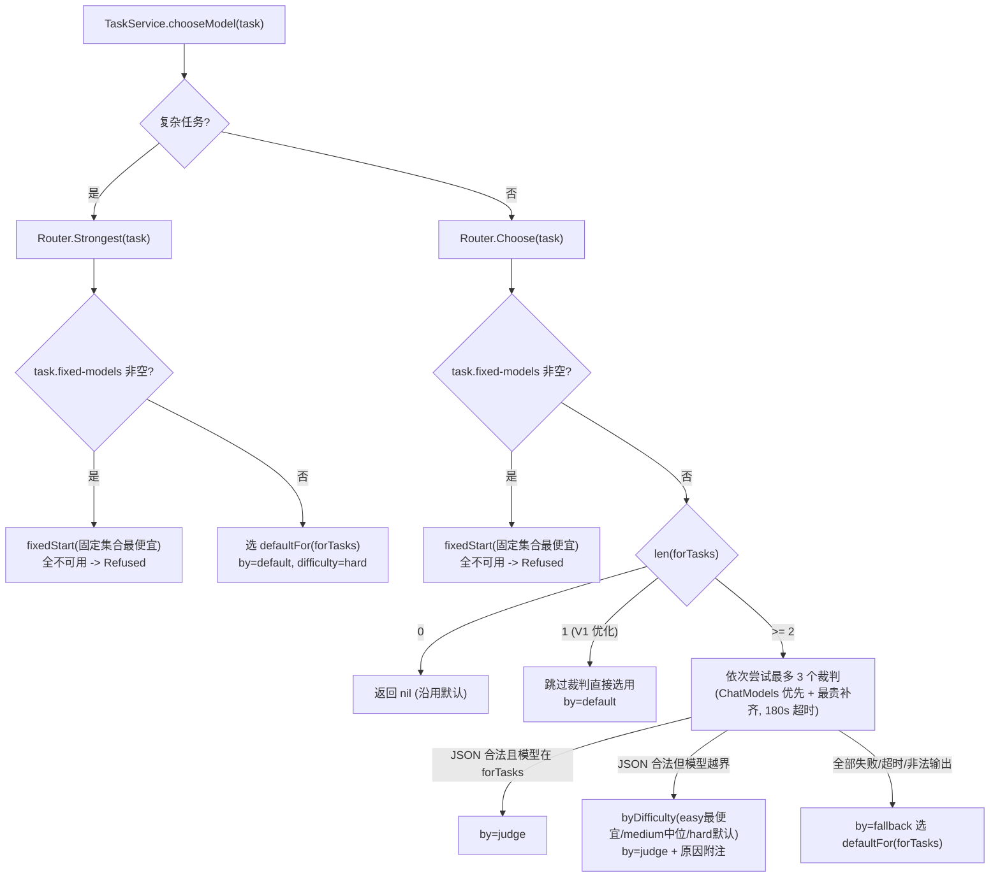

# spec 07 | Cost — 模型价格目录、修复版智能路由与五维 Token 计费

- **状态**：`draft`
- **篇号顺序**：07（L3 业务域首篇；与 `spec_08`、`spec_09` 同层并行、互不引用）
- **对应 PR**：[../README.md](../README.md) §3 看板中的 `SA-07`
- **上位契约**：
  - [../../04_核心业务域Go并发设计_对话_任务_编排_IM与成本路由.md](../../04_核心业务域Go并发设计_对话_任务_编排_IM与成本路由.md) §4（模型供应商托管与智能成本路由）
  - [../../02_PostgreSQL存储层与Store接口设计.md](../../02_PostgreSQL存储层与Store接口设计.md) §1–§4（PG17 迁移与 `UsageStore` / `TaskModelChoiceStore`）
  - [../README.md](../README.md) §1（V1 商业私有化锁定裁剪与缺陷修复红线）
- **前置依赖**：
  - `L1/spec_01`（`SA-01`：`internal/core/{domain,spi,store,tenant,eventbus,apperror,api}`）
  - `L1/spec_02`（`SA-02`：PostgreSQL 17 `UsageStore` / `TaskModelChoiceStore` / `SystemSettingStore` / `AgentStore` / `UserStore` / `TaskStore` / `TaskLinkStore`）
  - `L2/spec_04`（`SA-04`：`CompanyService` 租户轮转、`SettingsService`、`NoticeEvents.DefaultModelChanged`）
  - `L2/spec_05`（`SA-05`：`ProviderCatalog`、`ProviderService`、`ModelCall`）
- **下游消费者**：
  - `L3/spec_09`（`SA-09`：`ChatService` 消费 `spi.ModelRouter`；`AgentMemoryService`/`FileTagger` 消费 `Cheapest()`；全回合消费 `spi.UsageRecorder`）
  - `L3/spec_10`（`SA-10`：`TaskService` 消费 `spi.TaskModelSelector` 与 `spi.UsageRecorder`；`TaskTagger` 消费 `Cheapest()`）
  - `L4/spec_12`（`SA-12`：`SuperAgentService` 消费 `spi.ModelRouter` 与 `spi.UsageRecorder`）
  - `L5/spec_13`（`SA-13`：`ModelPriceHandler`、`UsageHandler` 挂载 HTTP 路由）
  - `L6/spec_14`（`SA-14`：`cmd/synapse-server/wire.go` 装配与优雅启停）
- **目标 Go 包**：`github.com/Karlsk/synapse-os/internal/cost`（`synapse-server/internal/cost/*`）
- **Java 参考基线**：
  - `superagent-cost/src/main/java/com/superagent/cost/ModelCatalog.java`（L1–98）
  - `superagent-cost/src/main/java/com/superagent/cost/ModelPriceService.java`（L1–408）
  - `superagent-cost/src/main/java/com/superagent/cost/routing/TaskModelRouter.java`（L1–249）
  - `superagent-cost/src/main/java/com/superagent/cost/usage/TokenUsageService.java`（L1–229）
  - `superagent-cost/src/main/resources/model-catalog-snapshot.json`（14 厂商、339 条模型快照，28,424 bytes）
  - `superagent-cost/src/test/java/com/superagent/cost/routing/TaskModelRouterTest.java`（L1–114，核验固定模型语义）
  - `superagent-cost/src/test/java/com/superagent/cost/ModelPriceServiceTest.java`（L1–125）
  - `superagent-cost/src/test/java/com/superagent/cost/usage/TokenUsageServiceTest.java`（L1–113）
  - `superagent-web/src/main/java/com/superagent/web/model/ModelPriceController.java`（L1–46）
  - `superagent-web/src/main/java/com/superagent/web/usage/UsageController.java`（L1–74）

---

## 1. 背景与范围

在商业私有化场景下，企业往往同时接入多家模型供应商或自建中转网关（Relay），既要保证交互对话使用高能力模型且故障无感切替，又要控制后台异步任务、长期记忆蒸馏与文件打标的 Token 成本，并对每个员工、Agent、任务与系统探活提供可核对的美元费用估算与明细账单。本篇将原版 `superagent-cost` 模块完整重构为 Go `internal/cost` 包，对外实现 `spi.ModelRouter`、`spi.TaskModelSelector` 与 `spi.UsageRecorder` 三大核心 SPI，做到「对话优先高能且故障自动降级、任务按需选最便宜够用模型并失败阶梯升档、系统小活走最便宜模型、每次 CLI 尝试按五维不重叠桶精确落账」。

### 1.1 V1 商业私有化锁定改进与原版缺陷修复清单

| 维度 | Java 原版现状（源码核验） | Go V1 锁定决策 |
|---|---|---|
| **原版编译阻断缺陷修复：固定模型模式** | `TaskModelRouter.java:68, 98` 调用了 `fixedStart()` / `fixedNext()`，但两方法在 HEAD（`1553fcb`）中缺失未定义，且 `strongest()`（L121–131）漏掉了固定模型短路，违背 `TaskModelRouterTest.java:74–94` 断言 | **完整补齐 `fixedStart()`、`fixedNext()` 并在 `Strongest()` 中增加固定模型短路**：仅在 `task.fixed-models` 中按混合价由低到高执行与升档，绝不越界回退；全部不可用或已无更贵模型时返回 `Refused()`（`Model == ""`、`By == "fixed"`）令任务明确失败 |
| **V1 成本与延迟优化：单候选跳过裁判** | `TaskModelRouter.java:70–88` 即使 `forTasks` 仅有 1 个可用模型仍发起 180s 超时的 LLM 裁判调用，白耗一次模型费用与延迟 | **新增单候选短路**：普通模式中若 `len(forTasks) == 1`，直接返回该唯一模型（`By = "default"`），零 LLM 调用开销 |
| **目录同步网络适配** | `ModelPriceService.java:303` 每次下载新建无代理/无自定义 CA 的 `HttpClient` | 复用统一出站 `*http.Client`（注入企业 `network.http_proxy`/`https_proxy`/`ca_bundle_file`），同时通过 `//go:embed model-catalog-snapshot.json` 内嵌 339 条离线快照保证纯内网开箱可用 |
| **存储去 ClickHouse 双写** | `JdbcUsageStore.java:44–51` 维护 MySQL + ClickHouse 双 DDL | 首期统一落库 PostgreSQL 17 `token_usage` 与 `task_model_choice`（见 `SA-02`），业务层完全面向 `store.UsageStore` 抽象接口 |
| **层级边界** | `ModelPriceService` 依赖 `ProviderService`/`SettingsService`/`CompanyService`；`TokenUsageService` 依赖 `AgentStore`/`UserStore`/`TaskStore`/`TaskLinkStore` | 严格遵守 L3 仅依赖 L0/L1/L2，绝不反向依赖 `internal/agent` 或 `internal/task` 具体实现包 |

### 1.2 本篇边界

- **本篇负责**：`internal/cost` 全部核心领域逻辑（`ModelCatalog`、`ModelPriceService`、`TaskModelRouter`、`TokenUsageService`）、内嵌快照文件、以及上述服务的完整单测与并发竞态测试。
- **本篇不负责**：
  - `token_usage` / `task_model_choice` 建表 SQL 与 `pgx` Store 实现归属 `L1/spec_02`（本篇 §3 冻结消费的 DDL 与查询契约）；
  - HTTP Handler 挂载至 Gin 路由归属 `L5/spec_13`（本篇 §4.2 冻结全部请求/响应契约）；
  - 进程启动调度器与优雅停机连线归属 `L6/spec_14`（本篇提供 `Start(ctx)` / `Close()` 生命周期方法）。

---

## 2. 本篇交付物表

| # | 交付物 | 落位（`synapse-server/`） | 类型 | Java 源码参照 |
|---|---|---|---|---|
| 1 | 内嵌 `models.dev` 离线快照（14 厂商 339 条） | `internal/cost/model-catalog-snapshot.json` | 新增 | `superagent-cost/src/main/resources/model-catalog-snapshot.json` |
| 2 | 目录解析器、ID 规范化、厂商优先级/中位数择优与混合价 | `internal/cost/catalog.go` | 新增 | `ModelCatalog.java`（L1–98） |
| 3 | 模型价格服务、4 级价格优先级、冷却表、`ModelRouter` 实现与后台刷新循环 | `internal/cost/price_service.go` | 新增 | `ModelPriceService.java`（L1–408） |
| 4 | 任务智能选模路由器（补齐 `fixedStart`/`fixedNext`/`Strongest` 固定短路 + 单候选跳裁判 + LLM-as-Judge + 价格阶梯升档） | `internal/cost/router.go` | 新增 | `TaskModelRouter.java`（L1–249）+ `TaskModelRouterTest.java`（L73–94） |
| 5 | 五维不重叠 Token 计费、`UsageRecorder` 实现与任务/个人/公司/系统汇总报表 | `internal/cost/usage_service.go` | 新增 | `TokenUsageService.java`（L1–229） |
| 6 | 时段窗口解析工具（`month` / `1..366` 天 + IANA 时区回退）供 L5 Handler 复用 | `internal/cost/period.go` | 新增 | `UsageController.java`（L50–73） |
| 7 | `ModelCatalog` 单测（含真实 339 条内嵌快照加载校验） | `internal/cost/catalog_test.go` | 新增 | `ModelCatalog.java` |
| 8 | `ModelPriceService` 单测（4 级价格、冷却恢复、租户隔离、管理员通知去重） | `internal/cost/price_service_test.go` | 新增 | `ModelPriceServiceTest.java`（L1–125） |
| 9 | `TaskModelRouter` 单测（固定模型全路径、单候选跳裁判、3 裁判降级、难度兜底、价格阶梯升档） | `internal/cost/router_test.go` | 新增 | `TaskModelRouterTest.java`（L1–114） |
| 10 | `TokenUsageService` 单测（5 维计费精度、1h 缓存、未定价 `costPartial`、复杂任务子任务汇总、系统探活隔离） | `internal/cost/usage_service_test.go` | 新增 | `TokenUsageServiceTest.java`（L1–113） |

---

## 3. 数据库设计

本篇不新增独立表，严格复用 `L1/spec_02`（`00003_init_task_and_automation.sql`、`00005_init_assets_and_platform.sql`、`00006_init_usage_and_timing.sql`）已定义的 3 张租户表。为确保 SQL 与字段契约在 L3 独立可审，下面冻结本篇强依赖的 PG17 表结构与 `system_setting` 键值规范。

### 3.1 `token_usage`（落位于 `migrations/00006_init_usage_and_timing.sql`）

只追加写（Append-only），单条记录对应一次 CLI 执行中单个模型的 Token 消耗与快照美元成本：

```sql
CREATE TABLE token_usage (
    company_id     VARCHAR(64)      NOT NULL,
    id             VARCHAR(64)      NOT NULL,
    at             TIMESTAMPTZ      NOT NULL,
    user_name      VARCHAR(128),               -- 实际存不可变 User.ID，系统探活为 'system'
    source         VARCHAR(32)      NOT NULL,  -- task|chat|superagent|superagent_background|model_choice|memory|file_tags|task_tags|model_check|key_check
    agent_id       VARCHAR(64),
    task_id        VARCHAR(64),
    session_id     VARCHAR(64),
    cli            VARCHAR(32),
    model          VARCHAR(128),
    input_tokens   BIGINT           NOT NULL,
    cache_read     BIGINT           NOT NULL,
    cache_write    BIGINT           NOT NULL,
    cache_write_1h BIGINT           NOT NULL,
    output_tokens  BIGINT           NOT NULL,
    reasoning      BIGINT           NOT NULL,
    cost_usd       DOUBLE PRECISION,           -- 落库时刻按目录/手工价快照，NULL 表示未定价
    cli_cost_usd   DOUBLE PRECISION,           -- CLI 自报费用（如 Claude Code），可为 NULL
    PRIMARY KEY (company_id, id)
);
CREATE INDEX idx_token_usage_task    ON token_usage (company_id, task_id);
CREATE INDEX idx_token_usage_user_at ON token_usage (company_id, user_name, at);
CREATE INDEX idx_token_usage_at      ON token_usage (company_id, at);
```

- **时间规范**：全部使用 `TIMESTAMPTZ NOT NULL`，Go 层写入前统一 `time.Now().UTC().Truncate(time.Millisecond)`。
- **不重叠桶语义**：`total = input_tokens + cache_read + cache_write + output_tokens`；`cache_write_1h` 为 `cache_write` 子集、`reasoning` 为 `output_tokens` 子集，永不重复计入总数。

### 3.2 `task_model_choice`（落位于 `migrations/00003_init_task_and_automation.sql`）

由 `TaskModelRouter` 构造、`TaskService`（`SA-10`）通过 `TaskModelChoiceStore` 追加落库：

```sql
CREATE TABLE task_model_choice (
    company_id VARCHAR(64)  NOT NULL,
    task_id    VARCHAR(64)  NOT NULL,
    seq        INTEGER      NOT NULL,
    decided_by VARCHAR(16)  NOT NULL, -- judge | user | fallback | escalation | default | fixed
    difficulty VARCHAR(16),           -- easy | medium | hard | NULL
    model      VARCHAR(128),          -- 仅 decided_by='fixed' 且无可用模型时为 NULL/空串（refused）
    cli        VARCHAR(32),
    judge      VARCHAR(128),
    candidates TEXT,
    reasoning  TEXT,
    created_at TIMESTAMPTZ  NOT NULL,
    PRIMARY KEY (company_id, task_id, seq)
);
```

> **V1 去债注记**：原版 `JdbcTaskModelChoiceStore.java:21` 中的历史残留列 `tier VARCHAR(16)` 在 `TaskModelRouter` 中永远写入 `null`，V1 领域对象与 PG17 迁移不再写入非空 `tier`（若前端 DTO 需兼容，序列化固定为 `null`）。

### 3.3 `system_setting` 键值契约（`ModelPriceService` 专属键族）

租户隔离键值表 `system_setting(company_id, setting_key, setting_value)`，本篇读写 3 组前缀键（空值 / `nil` 代表删除该键）：

| Key 模式 | 编码格式 | 语义与兼容规则 |
|---|---|---|
| `cost.price.<modelId>` | `<in>\|<out>\|\|manual\|<cacheRead>\|<cacheWrite>` | 管理员手工覆盖价（USD / 1M tokens）；`<cacheRead>`、`<cacheWrite>` 可为空串；置空删除即回退目录价 |
| `cost.fact.<modelId>` | `<in>\|<out>\|<released>\|<source>\|<cacheRead>\|<cacheWrite>` | 公司在用模型目录价持久化缓存（离线重启保底）；解码兼容历史 4 段格式（缺省 cache 列视为 `nil`） |
| `cost.task-off.<modelId>` | `"true"` 或删除 | 禁止后台任务调度使用该模型（不影响对话默认模型与作为裁判使用） |

---

## 4. 冻结契约

### 4.1 导出符号（Go Structs / Interfaces / 常量）

#### A. L0 契约引用（定义于 `internal/core/spi` 与 `internal/core/domain`，本篇严格实现）

```go
// internal/core/spi/cost.go (由 SA-01 冻结，SA-07 实现)
package spi

type ModelChoice struct {
	Model string
	CLI   string
}

type ModelRouter interface {
	Cheapest(ctx context.Context) (ModelChoice, bool)
	ChatModels(ctx context.Context) []string
	ReportFailure(ctx context.Context, model, errMsg string)
}

type TaskModelSelector interface {
	Enabled() bool
	Choose(ctx context.Context, task domain.Task) (*domain.TaskModelChoice, error)
	Escalate(ctx context.Context, task domain.Task, failure string) (*domain.TaskModelChoice, error)
	Strongest(ctx context.Context, task domain.Task) (*domain.TaskModelChoice, error)
}

type UsageRecorder interface {
	// Record 解析 CLI 发出的 TokenUsage JSON 数组并落库，返回本次有定价记录的估算美元之和（均无定价时返回 nil）。
	Record(ctx context.Context, uctx domain.UsageContext, tokensJSON string) *float64
}
```

#### B. `internal/cost` 导出类型与构造函数

```go
package cost

const (
	SettingPrefixFact    = "cost.fact."
	SettingPrefixManual  = "cost.price."
	SettingPrefixTaskOff = "cost.task-off."

	DefaultCatalogURL          = "https://models.dev/api.json"
	DefaultCatalogCheckSeconds = 600
	FullRefreshInterval        = 24 * time.Hour
	RetryUnpricedInterval      = 1 * time.Hour
	ModelCoolDown              = 10 * time.Minute

	DefaultCacheReadFactor    = 0.10
	DefaultCacheWriteFactor   = 1.25
	DefaultCacheWrite1hFactor = 2.00
	SystemUsageUser           = "system"
)

// Fact 描述公共目录（或手工配置）中单个模型的标价与发布日期（USD / 1M tokens）。
type Fact struct {
	Input      float64
	Output     float64
	Released   string   // ISO 日期，如 "2026-05-01"，未知为空
	Source     string   // 厂商 slug（如 "anthropic"）或 "manual"
	CacheRead  *float64 // nil 表示目录未列出，计费回退 0.1 * Input
	CacheWrite *float64 // nil 表示目录未列出，计费回退 1.25 * Input
}

func (f Fact) Blended() float64 { return (3*f.Input + f.Output) / 4 }

// Candidate 表示当前租户下通过推理探活的可运行模型及其价格/任务开关状态。
type Candidate struct {
	ID         string
	CLI        string
	Input      *float64
	Output     *float64
	CacheRead  *float64
	CacheWrite *float64
	Released   string
	Source     string
	Manual     bool
	ForTasks   bool
}

func (c Candidate) Priced() bool { return c.Input != nil && c.Output != nil }
func (c Candidate) Blended() float64 {
	if !c.Priced() {
		return math.MaxFloat64
	}
	return (3*(*c.Input) + (*c.Output)) / 4
}

// Price 为外部计费查询返回的确定标价。
type Price struct {
	Input      float64
	Output     float64
	CacheRead  *float64
	CacheWrite *float64
	Source     string
}

// 窄依赖接口：解耦 L2 具体实现，便于同包纯内存单测。
type CompanyRunner interface {
	ForEachEnabled(ctx context.Context, fn func(ctx context.Context))
}

type ProviderLookup interface {
	StoredModels(ctx context.Context, providerKey string) []api.ProviderModelDTO
	CLIFor(ctx context.Context, modelID string) (string, bool)
}

type SettingsReader interface {
	AgentDefaultModel(ctx context.Context) string
	BackupModels(ctx context.Context) []string
	TaskFixedModels(ctx context.Context) []string
}

type ModelAsker interface {
	Ask(ctx context.Context, modelID, prompt string, timeout time.Duration, uctx domain.UsageContext) (string, error)
}

// ModelCatalog
type ModelCatalog struct { /* 不可变 map[canonicalKey]Fact */ }
func ParseModelCatalog(r io.Reader) (*ModelCatalog, error)
func CanonicalModelKey(modelID string) string
func (c *ModelCatalog) Find(modelID string) (Fact, bool)
func (c *ModelCatalog) Size() int

// ModelPriceService（实现 spi.ModelRouter）
type PriceConfig struct {
	CatalogURL          string
	CatalogCheckSeconds int
	HTTPClient          *http.Client // 可选；默认复用带企业代理/CA 的客户端（Connect 10s / Timeout 60s）
	Clock               func() time.Time
}
type ModelPriceService struct { /* ... */ }
func NewModelPriceService(companies CompanyRunner, providers ProviderLookup, settings SettingsReader,
	store store.SystemSettingStore, bus eventbus.Publisher, cfg PriceConfig) (*ModelPriceService, error)
func (s *ModelPriceService) Start(ctx context.Context)
func (s *ModelPriceService) Close()
func (s *ModelPriceService) Candidates(ctx context.Context) []Candidate
func (s *ModelPriceService) Price(ctx context.Context, model string) (Price, bool)
func (s *ModelPriceService) Cheapest(ctx context.Context) (spi.ModelChoice, bool)
func (s *ModelPriceService) ChatModels(ctx context.Context) []string
func (s *ModelPriceService) ReportFailure(ctx context.Context, model, errMsg string)
func (s *ModelPriceService) Refresh(ctx context.Context) error
func (s *ModelPriceService) Overview(ctx context.Context) api.ModelPricesDTO
func (s *ModelPriceService) SetPrice(ctx context.Context, model string, input, output, cacheRead, cacheWrite *float64) (api.ModelPricesDTO, error)
func (s *ModelPriceService) SetForTasks(ctx context.Context, model string, on bool) (api.ModelPricesDTO, error)

// TaskModelRouter（实现 spi.TaskModelSelector）
type TaskModelRouter struct { /* ... */ }
func NewTaskModelRouter(prices *ModelPriceService, settings SettingsReader, asker ModelAsker) *TaskModelRouter
func (r *TaskModelRouter) Enabled() bool
func (r *TaskModelRouter) Choose(ctx context.Context, task domain.Task) (*domain.TaskModelChoice, error)
func (r *TaskModelRouter) Escalate(ctx context.Context, task domain.Task, failure string) (*domain.TaskModelChoice, error)
func (r *TaskModelRouter) Strongest(ctx context.Context, task domain.Task) (*domain.TaskModelChoice, error)

// TokenUsageService（实现 spi.UsageRecorder）
type TokenUsageService struct { /* ... */ }
func NewTokenUsageService(usage store.UsageStore, prices *ModelPriceService, agents store.AgentStore,
	users store.UserStore, tasks store.TaskStore, links store.TaskLinkStore) *TokenUsageService
func (s *TokenUsageService) Record(ctx context.Context, uctx domain.UsageContext, tokensJSON string) *float64
func (s *TokenUsageService) Cost(ctx context.Context, u domain.TokenUsage) *float64
func (s *TokenUsageService) ForTask(ctx context.Context, taskID string) (api.TaskUsageDTO, error)
func (s *TokenUsageService) Summary(ctx context.Context, userID string, from, to time.Time, loc *time.Location) (api.UsageSummaryDTO, error)

// 时段窗口解析（供 SA-13 UsageHandler 复用）
func ParseUsageWindow(period, tz string, now time.Time) (from, to time.Time, loc *time.Location, err error)
```

### 4.2 路由契约（HTTP 端点规格，Handler 接线落位 `L5/spec_13`）

所有接口返回统一信封 `{"code":"ok","message":null,"data":...}`（对齐原版 `ApiResponse` 与 `01` 号设计 §5.2）：

| HTTP 方法 | 路径 | 权限与中间件 | Query / Body 契约 | 响应 `data` DTO |
|---|---|---|---|---|
| `GET` | `/api/v1/admin/model-prices` | Auth + Tenant + `ROLE_ADMIN` | 无 | `ModelPricesDTO{models, pricesReadAt, pricesError}` |
| `POST` | `/api/v1/admin/model-prices/refresh` | Auth + Tenant + `ROLE_ADMIN` | 无 | 立即触发 `Refresh(ctx)` 后返回 `ModelPricesDTO` |
| `PUT` | `/api/v1/admin/model-prices/price?model=<id>` | Auth + Tenant + `ROLE_ADMIN` | Query `model`（因模型 ID 可含 `/`）；Body `{input, output, cacheRead, cacheWrite}`（`input` 或 `output` 为 `null` 则清除手工价） | `ModelPricesDTO` |
| `PUT` | `/api/v1/admin/model-prices/tasks?model=<id>` | Auth + Tenant + `ROLE_ADMIN` | Query `model`；Body `{forTasks: bool}` | `ModelPricesDTO` |
| `GET` | `/api/v1/tasks/:id/usage` | Auth + Tenant（校验任务创建者可见，否则 404） | Path `id` | `TaskUsageDTO{rows, byModel, total, byTask}` |
| `GET` | `/api/v1/usage` | Auth + Tenant | Query `period`（默认 `"month"` 或正整数天数 `1..366`）、`tz`（可选 IANA 时区） | `UsageSummaryDTO`（仅当前用户，`byUser: []`） |
| `GET` | `/api/v1/admin/usage` | Auth + Tenant + `ROLE_ADMIN` | Query `period`、`tz` | `UsageSummaryDTO`（全公司，含 `byUser`、`systemTotal`、`system`） |

> **JSON 字段严格对齐原版前端（`model-prices.js`、`usage.js`、`tasks.js`）**：
> - `ModelPricesDTO`：`models[]`（`id`, `cli`, `input`, `output`, `cacheRead`, `cacheWrite`, `released`, `source`, `manual`, `forTasks`）、`pricesReadAt`、`pricesError`。
> - `UsageDtos.Total`：`key`, `label`, `input`, `cacheRead`, `cacheWrite`, `output`, `reasoning`, `total`, `costUsd`, `costPartial`, `runs`, `models`, `lastAt`。
> - `UsageDtos.Summary`：`from`, `to`, `total`, `taskTotal`, `agentTotal`, `byDay`, `tasks`, `agents`, `byModel`, `byUser`, `systemTotal`, `system`（空切片一律序列化为 `[]`，禁止 `null`）。

### 4.3 错误语义

| 场景 | 返回错误类型 | HTTP 状态 / 处理语义 |
|---|---|---|
| `SetPrice` / `SetForTasks` 中 `model` 为空 | `apperror.InvalidArg("A model is required")` | `400 invalid_argument` |
| `SetPrice` 任意价格字段 `< 0` | `apperror.InvalidArg("A price can't be negative")` | `400 invalid_argument` |
| `ParseUsageWindow` 中 `period` 非 `"month"` 且非整数 | `apperror.InvalidArg("period is \"month\" or a number of days: ...")` | `400 invalid_argument` |
| `TaskModelRouter` 固定模式无可用模型 / 升档耗尽 | **不抛错**，返回 `TaskModelChoice{Model: "", By: "fixed", Reasoning: "..."}`（`choice.Refused() == true`） | 由调用方 `TaskService` 落库选型记录并将任务直接置为 `ERROR` |
| `ModelPriceService` 下载 `models.dev` 失败 | **不抛错**，记录 `catalogError` 并保留既有内存/落库/内嵌快照 | 管理页展示 `pricesError`，1 小时后自动重试 |
| `TokenUsageService.Record` 收到非法 JSON | 记录 `slog.Warn` 并返回 `nil`，**永不中断主业务回合** | 旁路容错 |
| 缺失租户上下文调用任意租户方法 | `tenant.ErrMissingTenantContext`（Fail-Closed） | `500 internal_error`（内部编程错误防线） |

### 4.4 SQL 契约

本篇通过 `store.UsageStore` 与 `store.SystemSettingStore` 间接执行 SQL（实现在 `SA-02`），关键查询语义冻结如下：

```sql
-- 1. UsageStore.Save (只追加写，绝不回溯改写历史 cost_usd)
INSERT INTO token_usage (
    company_id, id, at, user_name, source, agent_id, task_id, session_id, cli, model,
    input_tokens, cache_read, cache_write, cache_write_1h, output_tokens, reasoning, cost_usd, cli_cost_usd
) VALUES ($1,$2,$3,$4,$5,$6,$7,$8,$9,$10,$11,$12,$13,$14,$15,$16,$17,$18);

-- 2. UsageStore.ForTask (按时间正序)
SELECT id, at, user_name, source, agent_id, task_id, session_id, cli, model,
       input_tokens, cache_read, cache_write, cache_write_1h, output_tokens, reasoning, cost_usd, cli_cost_usd
FROM token_usage
WHERE company_id = $1 AND task_id = $2
ORDER BY at ASC;

-- 3. UsageStore.Between (userID == "" 时查全公司；否则按 user_name 过滤)
SELECT id, at, user_name, source, agent_id, task_id, session_id, cli, model,
       input_tokens, cache_read, cache_write, cache_write_1h, output_tokens, reasoning, cost_usd, cli_cost_usd
FROM token_usage
WHERE company_id = $1 AND at >= $2 AND at < $3
  AND ($4 = '' OR user_name = $4)
ORDER BY at ASC;
```

---

## 5. 行为语义与 Java→Go 详细伪代码

### 5.1 `ModelCatalog`：ID 规范化、厂商优先级与中位数择优

> 参照：`ModelCatalog.java:38–97`

1. **ID 规范化 (`CanonicalModelKey`)**：
   - `strings.TrimSpace` + `strings.ToLower`；
   - 截去最后一个 `/` 及其之前前缀（`siliconflow/deepseek-v3.2` → `deepseek-v3.2`）；
   - 若 `[` 出现位置 `> 0`，截去 `[variant]` 后缀；
   - 正则去除末尾日期或 `-latest`：``reDateSuffix = regexp.MustCompile(`-(\d{8}|\d{4}-\d{2}-\d{2}|latest)$`)``；
   - 将所有 `.` 替换为 `-`（统一 `claude-sonnet-4.5` 与 `claude-sonnet-4-5`）。
2. **多渠道同模型择优 (`bestOffer`)**：
   - 优先按官方厂商顺序精确命中 14 个 slug：
     `openai`, `anthropic`, `deepseek`, `moonshotai`, `moonshotai-cn`, `zai`, `zhipuai`, `alibaba`, `alibaba-cn`, `google`, `xai`, `mistral`, `minimax`, `minimax-cn`；
   - 若无官方厂商条目，将所有报价按 `Blended()` 升序排序，取中位数 `sorted[len(sorted)/2]`。

```go
// internal/cost/catalog.go
//go:embed model-catalog-snapshot.json
var bundledSnapshotJSON []byte

var canonicalVendors = []string{
	"openai", "anthropic", "deepseek", "moonshotai", "moonshotai-cn",
	"zai", "zhipuai", "alibaba", "alibaba-cn", "google", "xai", "mistral", "minimax", "minimax-cn",
}

var reDateSuffix = regexp.MustCompile(`-(\d{8}|\d{4}-\d{2}-\d{2}|latest)$`)

func CanonicalModelKey(modelID string) string {
	k := strings.ToLower(strings.TrimSpace(modelID))
	if idx := strings.LastIndexByte(k, '/'); idx >= 0 {
		k = k[idx+1:]
	}
	if bracket := strings.IndexByte(k, '['); bracket > 0 {
		k = k[:bracket]
	}
	k = reDateSuffix.ReplaceAllString(k, "")
	return strings.ReplaceAll(k, ".", "-")
}

func ParseModelCatalog(r io.Reader) (*ModelCatalog, error) {
	var raw map[string]struct {
		Models map[string]struct {
			ReleaseDate string `json:"release_date"`
			Cost        *struct {
				Input      *float64 `json:"input"`
				Output     *float64 `json:"output"`
				CacheRead  *float64 `json:"cache_read"`
				CacheWrite *float64 `json:"cache_write"`
			} `json:"cost"`
		} `json:"models"`
	}
	if err := json.NewDecoder(r).Decode(&raw); err != nil {
		return nil, fmt.Errorf("parse model catalog: %w", err)
	}
	offers := make(map[string][]Fact)
	// 为确定性测试结果，对 provider key 排序遍历
	providers := slices.Sorted(maps.Keys(raw))
	for _, pSlug := range providers {
		p := raw[pSlug]
		for mID, m := range p.Models {
			if m.Cost == nil || m.Cost.Input == nil || m.Cost.Output == nil {
				continue
			}
			key := CanonicalModelKey(mID)
			offers[key] = append(offers[key], Fact{
				Input:      *m.Cost.Input,
				Output:     *m.Cost.Output,
				Released:   strings.TrimSpace(m.ReleaseDate),
				Source:     pSlug,
				CacheRead:  m.Cost.CacheRead,
				CacheWrite: m.Cost.CacheWrite,
			})
		}
	}
	facts := make(map[string]Fact, len(offers))
	for k, list := range offers {
		facts[k] = bestOffer(list)
	}
	return &ModelCatalog{facts: facts}, nil
}

func bestOffer(offers []Fact) Fact {
	for _, vendor := range canonicalVendors {
		for _, f := range offers {
			if f.Source == vendor {
				return f
			}
		}
	}
	sorted := slices.Clone(offers)
	slices.SortFunc(sorted, func(a, b Fact) int { return cmp.Compare(a.Blended(), b.Blended()) })
	return sorted[len(sorted)/2]
}
```

### 5.2 `ModelPriceService`：4 级价格、冷却与 `DefaultModelChanged` 去重通知

> 参照：`ModelPriceService.java:131–395`

1. **4 级价格解析优先级 (`resolveFact`)**：
   1. 管理员手工覆盖：`saved["cost.price." + id]`（`Manual = true`）；
   2. 内存最新下载目录：`s.downloaded.Find(id)`（全局共享，一次下载服务全部租户）；
   3. 租户持久化缓存：`saved["cost.fact." + id]`（离线重启保底）；
   4. 内嵌二进制快照：`s.bundled.Find(id)`（339 条）。
2. **目录刷新时机 (`due`)**：
   - 后台单 goroutine 启动即执行首轮检查，之后按 `CatalogCheckSeconds`（默认 600s）轮询；
   - 遍历全部启用租户检查是否存在 `!c.Priced()`；
   - 若从未下载成功或距离 `downloadedAt` 超 24h（`FullRefreshInterval`），只要距上次尝试超 1h（`RetryUnpricedInterval`）即触发下载；
   - 若 24h 内有未定价模型且距上次尝试超 1h，也触发重试下载；
   - 下载成功后遍历全部启用租户执行 `saveFacts(ctx, fresh)`，仅当编码值与原 `cost.fact.<id>` 不同时写库。
3. **对话模型列表 (`ChatModels`) 与 10 分钟租户隔离冷却**：
   - 冷却键严格为 `companyID + "/" + modelID`（公司 A 的 Key/中转故障绝不影响公司 B）；
   - `coolingDown` 检测到期时就地删除冷却项，自动恢复尝试；
   - `agentDefaultModel == ""` 时：全部可运行模型按 `Blended DESC`（最贵/最强优先），优先返回非冷却子集，全冷却则回退原序；
   - `agentDefaultModel != ""` 时：按 `[def (if usable)]` → `[backupModels 按配置顺序 (if usable, 去重)]` → `[其余 runnable 按 Blended DESC (if usable, 去重)]`；全不可用时保底返回 `[def]`；
   - 调用 `noteStandIn(ctx, def, out[0])`：按 `companyID` 记录 `standingIn[companyID] = def`。仅在「首次离开默认模型」或「恢复回默认模型」状态边沿发布一次 `NoticeEvents.DefaultModelChanged{DefaultModel, InUse, Down, Reason}`，防止每轮对话重复轰炸管理员通知。

```go
// internal/cost/price_service.go
func (s *ModelPriceService) Candidates(ctx context.Context) []Candidate {
	saved, err := s.store.All(ctx)
	if err != nil {
		slog.WarnContext(ctx, "read system settings for candidates failed", "err", err)
		saved = map[string]string{}
	}
	clis := make(map[string]string)
	var order []string
	for _, entry := range provider.CatalogAll() {
		for _, m := range s.providers.StoredModels(ctx, entry.Key) {
			if !m.CanInfer() {
				continue
			}
			if _, seen := clis[m.ID]; seen {
				continue
			}
			if cli, ok := s.providers.CLIFor(ctx, m.ID); ok {
				clis[m.ID] = cli
				order = append(order, m.ID)
			}
		}
	}
	out := make([]Candidate, 0, len(order))
	for _, id := range order {
		manualFact, hasManual := decodeFact(saved[SettingPrefixManual+id])
		fact, hasFact := manualFact, hasManual
		if !hasFact {
			fact, hasFact = s.lookupFact(id, saved)
		}
		forTasks := saved[SettingPrefixTaskOff+id] != "true"
		c := Candidate{ID: id, CLI: clis[id], Manual: hasManual, ForTasks: forTasks}
		if hasFact {
			in, outP := fact.Input, fact.Output
			c.Input, c.Output = &in, &outP
			c.CacheRead, c.CacheWrite = fact.CacheRead, fact.CacheWrite
			c.Released, c.Source = fact.Released, fact.Source
		}
		out = append(out, c)
	}
	slices.SortFunc(out, func(a, b Candidate) int {
		if c := cmp.Compare(a.Blended(), b.Blended()); c != 0 {
			return c
		}
		return cmp.Compare(a.ID, b.ID)
	})
	return out
}

func (s *ModelPriceService) ChatModels(ctx context.Context) []string {
	def := ""
	if s.settings != nil {
		def = strings.TrimSpace(s.settings.AgentDefaultModel(ctx))
	}
	runnable := s.Candidates(ctx)
	inRunnable := make(map[string]bool, len(runnable))
	for _, c := range runnable {
		inRunnable[c.ID] = true
	}
	usable := func(id string) bool { return inRunnable[id] && !s.coolingDown(ctx, id) }

	// 按 Blended 降序排列（最强/最贵优先；原 Candidates 为升序，直接克隆逆序排）
	byStrongest := slices.Clone(runnable)
	slices.SortFunc(byStrongest, func(a, b Candidate) int {
		// 对齐 Java Comparator.comparingDouble(Candidate::blended).reversed()
		return cmp.Compare(b.Blended(), a.Blended())
	})

	if def == "" {
		strongest := make([]string, 0, len(byStrongest))
		live := make([]string, 0, len(byStrongest))
		for _, c := range byStrongest {
			strongest = append(strongest, c.ID)
			if usable(c.ID) {
				live = append(live, c.ID)
			}
		}
		if len(live) > 0 {
			return live
		}
		return strongest
	}

	out := make([]string, 0, len(runnable)+1)
	seen := make(map[string]bool)
	addIfUsable := func(id string) {
		if id != "" && !seen[id] && usable(id) {
			seen[id] = true
			out = append(out, id)
		}
	}
	addIfUsable(def)
	if s.settings != nil {
		for _, b := range s.settings.BackupModels(ctx) {
			addIfUsable(b)
		}
	}
	for _, c := range byStrongest {
		addIfUsable(c.ID)
	}
	if len(out) == 0 {
		out = append(out, def) // 全部不可用时仍尝试默认模型
	}
	s.noteStandIn(ctx, def, out[0])
	return out
}

func (s *ModelPriceService) noteStandIn(ctx context.Context, def, inUse string) {
	companyID, err := tenant.Require(ctx)
	if err != nil {
		return
	}
	s.standInMu.Lock()
	was, hadWas := s.standingIn[companyID]
	down := def != inUse
	if down == hadWas && (!down || def == was) {
		s.standInMu.Unlock()
		return
	}
	if down {
		s.standingIn[companyID] = def
	} else {
		delete(s.standingIn, companyID)
	}
	s.standInMu.Unlock()

	why := ""
	if down {
		why = s.failureReason(companyID, def)
		if why == "" {
			why = "没通过可用性检查"
		}
	}
	if s.bus != nil {
		s.bus.Publish(ctx, eventbus.DefaultModelChanged{
			DefaultModel: def,
			InUse:        inUse,
			Down:         down,
			Reason:       why,
		})
	}
}
```

### 5.3 `TaskModelRouter`：修复版固定模型、单候选短路、LLM 裁判与价格阶梯升档

> 参照：`TaskModelRouter.java:65–249` + `TaskModelRouterTest.java:48–104`



#### 关键修复与完整 Go 伪代码

```go
// internal/cost/router.go
const (
	maxJudges     = 3
	judgeTimeout  = 180 * time.Second
	briefMaxRunes = 4000
)

func (r *TaskModelRouter) Choose(ctx context.Context, task domain.Task) (*domain.TaskModelChoice, error) {
	if fixed := r.settings.TaskFixedModels(ctx); len(fixed) > 0 {
		return r.fixedStart(ctx, task, fixed, "不判断难度，"), nil
	}
	all := r.prices.Candidates(ctx)
	forTasks := filterForTasks(all)
	if len(forTasks) == 0 {
		return nil, nil
	}
	listed := describeCandidates(forTasks)

	// [V1 优化] 单候选直接短路，省去无意义的 LLM 裁判耗时与费用
	if len(forTasks) == 1 {
		only := forTasks[0]
		return &domain.TaskModelChoice{
			TaskID:     task.ID,
			By:         domain.ChoiceByDefault,
			Model:      only.ID,
			CLI:        only.CLI,
			Candidates: listed,
			Reasoning:  fmt.Sprintf("当前仅有一个可用于任务的模型 %s，跳过难度判断直接选用。", only.ID),
			CreatedAt:  time.Now().UTC(),
		}, nil
	}

	fallback := r.defaultFor(ctx, forTasks)
	var problems []string
	for _, judge := range r.judges(ctx, all) {
		answer, err := r.asker.Ask(ctx, judge.ID, buildJudgePrompt(task, listed), judgeTimeout, domain.UsageContext{
			User:   task.CreatedBy,
			Source: domain.UsageSourceModelChoice,
			TaskID: task.ID,
		})
		if err != nil {
			slog.WarnContext(ctx, "judge failed", "judge", judge.ID, "task", task.ID, "err", err)
			problems = append(problems, judge.ID+"："+clipRunes(err.Error(), 200))
			continue
		}
		choice, vErr := r.parseVerdict(task, forTasks, fallback, listed, judge.ID, answer)
		if vErr != nil {
			slog.WarnContext(ctx, "judge verdict invalid", "judge", judge.ID, "task", task.ID, "err", vErr)
			problems = append(problems, judge.ID+"："+clipRunes(vErr.Error(), 200))
			continue
		}
		return choice, nil
	}
	reasonDetail := "没有可用来判断的模型"
	if len(problems) > 0 {
		reasonDetail = strings.Join(problems, "；")
	}
	label := "最贵的 "
	if fallback.ID == r.settings.AgentDefaultModel(ctx) {
		label = "默认模型 "
	}
	return &domain.TaskModelChoice{
		TaskID:     task.ID,
		By:         domain.ChoiceByFallback,
		Model:      fallback.ID,
		CLI:        fallback.CLI,
		Candidates: listed,
		Reasoning:  fmt.Sprintf("没能判断这个任务（%s），用%s%s。", reasonDetail, label, fallback.ID),
		CreatedAt:  time.Now().UTC(),
	}, nil
}

func (r *TaskModelRouter) Strongest(ctx context.Context, task domain.Task) (*domain.TaskModelChoice, error) {
	// [V1 修复] 复杂任务同样受管理员固定模型约束，对齐 TaskModelRouterTest.java:82
	if fixed := r.settings.TaskFixedModels(ctx); len(fixed) > 0 {
		return r.fixedStart(ctx, task, fixed, "复杂任务，"), nil
	}
	forTasks := filterForTasks(r.prices.Candidates(ctx))
	top := r.defaultFor(ctx, forTasks)
	if top == nil {
		return nil, nil
	}
	label := "最贵的 "
	if top.ID == r.settings.AgentDefaultModel(ctx) {
		label = "默认模型 "
	}
	return &domain.TaskModelChoice{
		TaskID:     task.ID,
		By:         domain.ChoiceByDefault,
		Difficulty: "hard",
		Model:      top.ID,
		CLI:        top.CLI,
		Candidates: describeCandidates(forTasks),
		Reasoning:  fmt.Sprintf("复杂任务：拆分子任务和最后汇总决定整体质量，不按难度省钱，直接用%s%s；子任务各自按难度选最便宜够用的模型。", label, top.ID),
		CreatedAt:  time.Now().UTC(),
	}, nil
}

func (r *TaskModelRouter) Escalate(ctx context.Context, task domain.Task, failure string) (*domain.TaskModelChoice, error) {
	if fixed := r.settings.TaskFixedModels(ctx); len(fixed) > 0 {
		return r.fixedNext(ctx, task, fixed, failure), nil
	}
	forTasks := filterForTasks(r.prices.Candidates(ctx))
	top := r.defaultFor(ctx, forTasks)
	if top == nil || top.ID == task.Model {
		return nil, nil // 已达默认上限，不再升档
	}
	current := findCandidate(forTasks, task.Model)
	next := *top
	if current != nil && current.Priced() && top.Priced() {
		found := false
		for _, c := range forTasks {
			if c.Priced() && c.Blended() > current.Blended() && c.Blended() <= top.Blended() {
				if !found || c.Blended() < next.Blended() {
					next = c
					found = true
				}
			}
		}
	}
	if next.ID == task.Model {
		return nil, nil
	}
	capNote := ""
	if next.ID == top.ID {
		capNote = "（默认模型，再失败就不再换）"
	}
	return &domain.TaskModelChoice{
		TaskID:     task.ID,
		By:         domain.ChoiceByEscalation,
		Model:      next.ID,
		CLI:        next.CLI,
		Candidates: describeCandidates(forTasks),
		Reasoning:  fmt.Sprintf("在 %s 上失败：%s。换下一个更贵的 %s%s 重新执行。", task.Model, clipRunes(failure, 300), next.ID, capNote),
		CreatedAt:  time.Now().UTC(),
	}, nil
}

// [V1 补齐缺失实现] fixedStart: 仅从管理员固定模型中选最便宜可用者，全部不可用则返回 Refused。
func (r *TaskModelRouter) fixedStart(ctx context.Context, task domain.Task, fixed []string, prefix string) *domain.TaskModelChoice {
	usable, skipped := r.partitionFixed(ctx, fixed)
	listed := describeCandidates(usable)
	if len(usable) == 0 {
		return &domain.TaskModelChoice{
			TaskID:     task.ID,
			By:         domain.ChoiceByFixed,
			Model:      "", // Refused() == true
			Candidates: listed,
			Reasoning:  fmt.Sprintf("管理员指定的固定任务模型（%s）当前都用不了（未通过探活或已禁止用于任务），不回退到其他模型，任务终止。", strings.Join(fixed, "、")),
			CreatedAt:  time.Now().UTC(),
		}
	}
	pick := usable[0] // usable 已按 Blended ASC, ID ASC 排序
	skipNote := ""
	if len(skipped) > 0 {
		skipNote = fmt.Sprintf("（跳过不可用/禁用于任务的固定模型：%s）", strings.Join(skipped, "、"))
	}
	return &domain.TaskModelChoice{
		TaskID:     task.ID,
		By:         domain.ChoiceByFixed,
		Model:      pick.ID,
		CLI:        pick.CLI,
		Candidates: listed,
		Reasoning:  fmt.Sprintf("固定模型模式：%s从最便宜的 %s 开始执行%s。", prefix, pick.ID, skipNote),
		CreatedAt:  time.Now().UTC(),
	}
}

// [V1 补齐缺失实现] fixedNext: 仅在固定模型列表内向下一个更贵可用模型升档，耗尽返回 Refused。
func (r *TaskModelRouter) fixedNext(ctx context.Context, task domain.Task, fixed []string, failure string) *domain.TaskModelChoice {
	usable, _ := r.partitionFixed(ctx, fixed)
	listed := describeCandidates(usable)
	current := findCandidate(usable, task.Model)

	var next *Candidate
	if current != nil && current.Priced() {
		for i := range usable {
			c := &usable[i]
			if c.ID != task.Model && c.Priced() && c.Blended() > current.Blended() {
				next = c // usable 已按 Blended 升序，首个即最小严格更贵模型
				break
			}
		}
		if next == nil {
			// 若存在未定价固定模型排在末尾且未尝试过，允许作为兜底最后一步
			for i := range usable {
				if usable[i].ID != task.Model && !usable[i].Priced() {
					next = &usable[i]
					break
				}
			}
		}
	} else {
		// 当前模型已从固定列表失效或无价格：取排序后紧随其后的首个不同可用模型
		seenCurrent := current == nil
		for i := range usable {
			if usable[i].ID == task.Model {
				seenCurrent = true
				continue
			}
			if seenCurrent {
				next = &usable[i]
				break
			}
		}
	}

	if next == nil {
		return &domain.TaskModelChoice{
			TaskID:     task.ID,
			By:         domain.ChoiceByFixed,
			Model:      "", // Refused() == true
			Candidates: listed,
			Reasoning:  fmt.Sprintf("在固定模型 %s 上失败：%s。固定列表中没有更贵的可用模型了，不回退到集合外模型。", task.Model, clipRunes(failure, 300)),
			CreatedAt:  time.Now().UTC(),
		}
	}
	return &domain.TaskModelChoice{
		TaskID:     task.ID,
		By:         domain.ChoiceByFixed,
		Model:      next.ID,
		CLI:        next.CLI,
		Candidates: listed,
		Reasoning:  fmt.Sprintf("在固定模型 %s 上失败：%s。换固定列表中下一个更贵的 %s 重新执行。", task.Model, clipRunes(failure, 300), next.ID),
		CreatedAt:  time.Now().UTC(),
	}
}

func (r *TaskModelRouter) partitionFixed(ctx context.Context, fixed []string) (usable []Candidate, skipped []string) {
	all := r.prices.Candidates(ctx)
	byID := make(map[string]Candidate, len(all))
	for _, c := range all {
		byID[c.ID] = c
	}
	seen := make(map[string]bool, len(fixed))
	for _, raw := range fixed {
		id := strings.TrimSpace(raw)
		if id == "" || seen[id] {
			continue
		}
		seen[id] = true
		c, ok := byID[id]
		if !ok || !c.ForTasks {
			skipped = append(skipped, id)
			continue
		}
		usable = append(usable, c)
	}
	slices.SortFunc(usable, func(a, b Candidate) int {
		if c := cmp.Compare(a.Blended(), b.Blended()); c != 0 {
			return c
		}
		return cmp.Compare(a.ID, b.ID)
	})
	return usable, skipped
}
```

### 5.4 `TokenUsageService`：五维不重叠计费、子任务汇总与多维报表

> 参照：`TokenUsageService.java:83–228`

1. **五维美元估算公式 (`Cost`)**：
   - 未查到标价直接返回 `nil`（不编造 0 美元）；
   - `readRate = p.CacheRead ?? p.Input * 0.10`；
   - `writeRate = p.CacheWrite ?? p.Input * 1.25`；
   - `hourWrite = min(u.CacheWrite1h, u.CacheWrite)`（防 CLI 上报异常值超过总写缓存）；
   - $\text{costUsd} = \frac{\text{input}\cdot P_{\text{in}} + \text{cacheRead}\cdot R_{\text{read}} + (\text{cacheWrite} - \text{hourWrite})\cdot R_{\text{write}} + \text{hourWrite}\cdot P_{\text{in}}\cdot 2.0 + \text{output}\cdot P_{\text{out}}}{10^6}$。
2. **单任务账单 (`ForTask`)**：
   - 若为复杂任务，合并本任务记录 + `links.Children(ctx, taskID)` 全部子任务记录，按 `At ASC` 排序；
   - `byTask` 仅当 `len(kids) > 0` 时填充（父任务自身行 `label = ""`，子任务行 `label = task.Title` 或回退 ID）。
3. **周期汇总报表 (`Summary`)**：
   - 按 `r.User == "system"` 切分 `forSystem` 与 `people`；
   - `people` 按 `r.TaskID != ""` 切分 `forTasks`（通过 `rootTask()` 将子任务归并到顶层复杂任务，按 `LastAt DESC` 排序）与 `forAgents`（按 `AgentID` 分组，空字符串归入无 Agent 桶）；
   - `byDay` 按查看者 `loc`（IANA 时区）切日并按日期升序排列；
   - `byModel` 汇总全记录（含 `forSystem`），按 `Total DESC` 排列；
   - `byUser` 仅在管理视图（`userID == ""`）返回 `people` 维度统计（显示名优先 `DisplayName`，回退 `Username`，再回退 `UserID`）；
   - `systemTotal` / `system` 按 `r.Source + "|" + r.Model` 分组；
   - 每个 `Total` 的 `CostPartial` 在任意组成记录缺少 `CostUSD` 时为 `true`；全部记录无价时 `CostUSD = nil`；`Models` 为该分组内按 Token 总量降序排列的模型 ID 列表。

```go
// internal/cost/usage_service.go
func (s *TokenUsageService) Cost(ctx context.Context, u domain.TokenUsage) *float64 {
	p, ok := s.prices.Price(ctx, u.Model)
	if !ok {
		return nil
	}
	readRate := p.Input * DefaultCacheReadFactor
	if p.CacheRead != nil {
		readRate = *p.CacheRead
	}
	writeRate := p.Input * DefaultCacheWriteFactor
	if p.CacheWrite != nil {
		writeRate = *p.CacheWrite
	}
	hourWrite := min(u.CacheWrite1h, u.CacheWrite)
	usd := (float64(u.Input)*p.Input +
		float64(u.CacheRead)*readRate +
		float64(u.CacheWrite-hourWrite)*writeRate +
		float64(hourWrite)*p.Input*DefaultCacheWrite1hFactor +
		float64(u.Output)*p.Output) / 1_000_000.0
	return &usd
}

func (s *TokenUsageService) Record(ctx context.Context, uctx domain.UsageContext, tokensJSON string) *float64 {
	var used []domain.TokenUsage
	if err := json.Unmarshal([]byte(tokensJSON), &used); err != nil {
		slog.WarnContext(ctx, "unreadable token usage json", "source", uctx.Source, "err", err)
		return nil
	}
	now := time.Now().UTC().Truncate(time.Millisecond)
	var totalUSD *float64
	for _, u := range used {
		if u.NothingUsed() {
			continue
		}
		usd := s.Cost(ctx, u)
		rec := domain.UsageRecord{
			ID: uuid.NewString(), At: now, User: uctx.User, Source: uctx.Source,
			AgentID: uctx.AgentID, TaskID: uctx.TaskID, SessionID: uctx.SessionID, CLI: uctx.CLI,
			Model: u.Model, Input: u.Input, CacheRead: u.CacheRead, CacheWrite: u.CacheWrite,
			CacheWrite1h: u.CacheWrite1h, Output: u.Output, Reasoning: u.Reasoning,
			CostUSD: usd, CLICostUSD: u.CLICostUSD,
		}
		if err := s.usage.Save(ctx, rec); err != nil {
			slog.WarnContext(ctx, "save token usage failed", "err", err)
			continue
		}
		if usd != nil {
			if totalUSD == nil {
				v := *usd
				totalUSD = &v
			} else {
				*totalUSD += *usd
			}
		}
	}
	return totalUSD
}
```

---

## 6. 任务清单（TDD 粒度）

- [ ] T1：拷贝 `superagent-cost/src/main/resources/model-catalog-snapshot.json` 至 `internal/cost/model-catalog-snapshot.json`，编写 `catalog_test.go`（红灯：校验 339 条加载、ID 规范化 5 规则、厂商优先与中位数兜底、混合价公式）并实现 `catalog.go`。
- [ ] T2：编写 `price_service_test.go`（红灯：4 级价格优先级、手工价设定与清除、负数拒止、`forTasks` 开关、10m 冷却与租户隔离、`DefaultModelChanged` 边沿去重、24h/1h 刷新时机与 `httptest` 下载），实现 `price_service.go`。
- [ ] T3：编写 `router_test.go`（红灯：覆盖 `TaskModelRouterTest` 全部场景 + **固定模型 `Choose`/`Strongest`/`Escalate`/`Refused`** + **单候选跳裁判短路** + 3 裁判依次降级 + 越界模型按 `easy/medium/hard` 回退 + 价格阶梯升档到顶停止），实现 `router.go`。
- [ ] T4：编写 `usage_service_test.go`（红灯：五维计费精度对照 Claude Code 实测 `0.0458055`、1h 缓存 2x、`cacheRead` 0.1x、`costPartial`、零用量过滤、复杂任务父子归并、系统探活隔离、时区切日与 `ParseUsageWindow`），实现 `usage_service.go` 与 `period.go`。
- [ ] T5：执行 `go test -race -cover ./internal/cost/...` 与 `go test ./internal/arch_test.go`（确认 L3 零反向/同层依赖）。

---

## 7. 文档同步

- [ ] `docs/SuperAgent-Go/DDD/README.md` §3 看板：合入后将 `SA-07` 状态从 `draft` 更新为 `已实施（commit ...）`。
- [ ] `configs/config.example.yaml`：确认列出 `cost.catalog_url`（默认 `https://models.dev/api.json`）与 `cost.catalog_check_seconds`（默认 `600`）。
- [ ] `internal/arch_test.go`：验证 `internal/cost` 仅允许 import `internal/core/*` 与 `internal/platform/{provider,settings,tenant}` 的窄接口/包，禁止引入 `internal/agent`、`internal/task`、`internal/storage/postgres`。

---

## 8. 测试清单

| 测试点 | 落位 | 关键断言 |
|---|---|---|
| 内嵌 339 条快照加载与厂商择优 | `internal/cost/catalog_test.go` | `ParseModelCatalog` 载入 `bundledSnapshotJSON` 成功，`Size() > 0`；同模型存在官方厂商与第三方中转时官方胜出；无官方厂商时取 `Blended()` 中位数 |
| 模型 ID 5 步规范化 | `internal/cost/catalog_test.go` | `siliconflow/DeepSeek-V3.2[fp8]-20260501` → `deepseek-v3-2`；`claude-sonnet-4.5-latest` → `claude-sonnet-4-5` |
| 4 级价格优先级与手工价清除 | `internal/cost/price_service_test.go` | 手工价 > 在线目录 > 落库 `cost.fact.` > 内嵌快照；`SetPrice(id, nil, nil, ...)` 清除后立即回退目录价；负数报错 `InvalidArg` |
| 4 段历史编码兼容解码 | `internal/cost/price_service_test.go` | `1.0|5.0|2026-01-01|anthropic` 正确解码为 `CacheRead=nil, CacheWrite=nil` |
| 10m 冷却、租户隔离与管理员通知边沿去重 | `internal/cost/price_service_test.go` | `acme` 报告 `mid` 失败后 `ChatModels` 切至 `[backup, strong]` 并仅发 1 次 `DefaultModelChanged(down=true)`；`globex` 租户仍返回 `mid`；拨快虚拟时钟 >10m 后恢复 `mid` 并再发 1 次 `down=false` |
| 固定模型模式全链路（修复验收） | `internal/cost/router_test.go` | `fixed=["sonnet","gpt-big","glm","gone"]`：`Choose` 选 `glm`（`By="fixed"`、`Reasoning` 含 `gpt-big` 与 `gone`）、`Strongest` 亦选 `glm`、零 `ModelAsker` 调用；`Escalate(glm)` → `sonnet`；`Escalate(sonnet)` → `Refused()==true` 且含 `"没有更贵的"`；`fixed=["gpt-big"]` → `Refused()==true` 且含 `"都用不了"` |
| 单候选跳裁判优化（V1 新增） | `internal/cost/router_test.go` | `forTasks` 仅含 1 个模型时 `Choose` 直接返回该模型（`By="default"`）且 `ModelAsker` 调用次数为 `0` |
| 3 裁判冗余、越界回退与全失败兜底 | `internal/cost/router_test.go` | 裁判 1 抛错后裁判 2（含 `forTasks=false` 的最贵模型）接棒；裁判选出禁用于任务的模型按 `easy`/`medium`/`hard` 回退；全部返回非法 JSON 后 `By="fallback"` 选默认模型 |
| 价格阶梯逐级升档与封顶停止 | `internal/cost/router_test.go` | `haiku -> glm -> sonnet -> opus`，已在 `opus` 时 `Escalate` 返回 `nil` |
| 五维不重叠计费与精度验收 | `internal/cost/usage_service_test.go` | `haiku(1,5)` 跑 `in=908, cw=35266, out=163, reasoning=149` 估算为 `0.0458055`（误差 `<1e-9`）；`cacheWrite1h` 按 `2.0x` 计且上限钳位至 `cacheWrite`；`NothingUsed()` 跳过不落库 |
| 复杂任务归并、部分未定价与系统隔离 | `internal/cost/usage_service_test.go` | `ForTask("main")` 含 `sub1/sub2` 且 `byTask` 有 3 项；`Summary` 中子任务归入 `main`、`system` 记录不进入 `byUser/tasks/agents`、未知模型使 `costPartial=true` |
| 时段窗口与时区切日 | `internal/cost/usage_service_test.go` | `period="month"` 对齐目标时区当月 1 日 00:00；`period="7"` 含今天共 7 天；`period="999"` 钳位 366；非法 `tz` 回退本机时区 |

---

## 9. 验收门

- [ ] `go build ./... && go test -race ./internal/cost/...` 全绿，零竞态告警
- [ ] §2 交付物表全部 10 个文件逐项落位且命名一致
- [ ] §8 全部 12 项测试点在同包 `*_test.go` 落地，零真实外网请求（目录下载测试使用 `httptest.NewServer`）
- [ ] 代码覆盖率 `go test -cover ./internal/cost/...` ≥ 85%
- [ ] `internal/arch_test.go` 通过（无 `cost <-> task` 或 `cost <-> agent` 循环依赖）
- [ ] 人工核验：对比 `TaskModelRouterTest.java:74–94` 所有断言在 `router_test.go` 中 100% 镜像覆盖；`synapse-server` 启动离线断网环境下 `GET /api/v1/admin/model-prices` 能从内嵌快照正确展示 339 条目录匹配价

---

## 10. 可提交节点

- 建议 commit：`feat(cost): implement model catalog, fixed-mode task router and 5-bucket usage billing (spec 07, PR SA-07)`
- 推荐原子拆分顺序：
  1. `feat(cost): add models.dev catalog parser and embedded 339-model snapshot`
  2. `feat(cost): implement ModelPriceService with 4-tier pricing and per-tenant cooldown`
  3. `feat(cost): implement fixed-mode and single-candidate optimized TaskModelRouter`
  4. `feat(cost): implement 5-bucket TokenUsageService and multi-dimension reporting`
