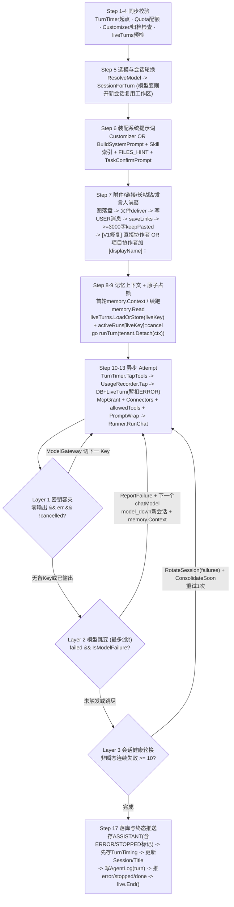

# spec 09 | Agent — Agent 管理、17 步对话引擎、LiveTurn 广播、长期记忆与协作工具

- **状态**：`draft`
- **篇号顺序**：09（L3 业务域第三篇；与 `spec_07`、`spec_08`、`spec_10` 同层并行、严禁与 `internal/task` 互引）
- **对应 PR**：[../README.md](../README.md) §3 看板中的 `SA-09`
- **上位契约**：
  - [../../04_核心业务域Go并发设计_对话_任务_编排_IM与成本路由.md](../../04_核心业务域Go并发设计_对话_任务_编排_IM与成本路由.md) §1（Agent 管理、对话引擎与 `LiveTurn` SSE 扇出）
  - [../../02_PostgreSQL存储层与Store接口设计.md](../../02_PostgreSQL存储层与Store接口设计.md) §2–§3（`agent` 去 `tier`/`character_key`、`agent_event` 补 `BIGSERIAL` 主键、`agent_log`/`turn_timing` 迁 PG17）
  - [../../03_核心抽象与插件化引擎_Runtime_MCP与ModelGateway.md](../../03_核心抽象与插件化引擎_Runtime_MCP与ModelGateway.md) §1–§3（`AgentRunner`、`ModelGateway`、`McpGrants`）
  - [../README.md](../README.md) §1（V1 商业私有化锁定裁剪与原版缺陷修复红线）
- **前置依赖**：
  - `L1/spec_01`（`SA-01`：`internal/core/{domain,spi,store,tenant,eventbus,apperror,api,timing}`）
  - `L1/spec_02`（`SA-02`：PG17 `AgentStore`/`AgentParentStore`/`AgentMemberStore`/`AgentInviteStore`/`AgentMemoryStateStore`/`AgentLogStore`/`ChatStore`/`TurnTimingStore`/`TaskAgentStore`/`UserStore`）
  - `L1/spec_03`（`SA-03`：`RunnerRegistry`、`AgentRunner`、`ModelGateway`、`McpGrants`、`ImageAttachmentStore`）
  - `L2/spec_04`（`SA-04`：`CompanyService`、`PeopleDirectory`、`QuotaService`、`SettingsService`、`NoticeEvents`）
  - `L2/spec_05`（`SA-05`：`ProviderService`、`ConnectorService`、`EndpointFailures`）
  - `L2/spec_06`（`SA-06`：`FileService`、`FileFolderService`、`spi.ProjectAccess`、`SkillService`）
  - `L3/spec_07`（`SA-07`：`spi.ModelRouter`、`spi.UsageRecorder` — 仅经 L0 SPI 注入，零 L3 互引）
- **下游消费者**：
  - `L3/spec_10`（`SA-10`：消费 `spi.TaskDoers` 并通过 `eventbus` 发布 `TaskStatusChanged` 给 `ChatTaskResults` — 零包级互引）
  - `L4/spec_12`（`SA-12`：`SuperAgentChat` 实现 `AgentTurnCustomizer`；`SuperAgentService` 调用 `AgentService` 雇佣与设上下级）
  - `L5/spec_13`（`SA-13`：`AgentHandler`/`AgentInviteHandler`/`AgentMemoryHandler`/`AgentLogHandler`/`ChatHandler` + `/mcp` 注册 5 个 `McpToolProvider`）
  - `L6/spec_14`（`SA-14`：`cmd/synapse-server/wire.go` 装配与后台循环优雅停机）
- **目标 Go 包**：
  - `github.com/Karlsk/synapse-os/internal/agent`（`synapse-server/internal/agent/*`）
  - `github.com/Karlsk/synapse-os/internal/core/timing`（`TurnTimer` 与 `TurnTiming` 落位 L0 供 `agent` 与 `task` 共用，避免 L3 互引）
- **Java 参考基线（全部 23 个主类 + 2 个 Timing 类 + 5 个 Controller）**：
  - Root（9）：`AgentService.java`（L1–516）、`AgentInviteService.java`（L1–135）、`AgentTaskDoers.java`（L1–37）、`AgentCollabMcpTools.java`（L1–104）、`AgentCreateMcpTools.java`（L1–90）、`AgentUpdateMcpTools.java`（L1–102）、`AgentSkillMcpTools.java`（L1–104）、`AgentForbiddenException.java`（L1–11）、`AgentNotFoundException.java`（L1–11）
  - `chat/`（8）：`ChatService.java`（L1–1089）、`AgentTurnCustomizer.java`（L1–34）、`ChatBusyException.java`（L1–11）、`ChatHistoryMcpTools.java`（L1–143）、`ChatTaskResults.java`（L1–119）、`MaterialPrompt.java`（L1–30，**V1 删除死代码**）、`SessionNotFoundException.java`（L1–11）、`TaskConfirmPrompt.java`（L1–74）
  - `files/`（1）：`FileTagger.java`（L1–316）
  - `log/`（1）：`AgentLogService.java`（L1–112）
  - `memory/`（4）：`AgentMemoryLoop.java`（L1–69）、`AgentMemoryRules.java`（L1–163）、`AgentMemoryService.java`（L1–489）、`SessionHealth.java`（L1–29）
  - Core Timing：`TurnTimer.java`（L1–134）、`TurnTiming.java`（L1–31）
  - Web Controllers：`AgentController.java`（L1–113）、`ChatController.java`（L1–118）、`AgentInviteController.java`（L1–39）、`AgentMemoryController.java`（L1–42）、`AgentLogController.java`（L1–43）

---

## 1. 背景与范围

Agent 与对话引擎是 SuperAgent 的日常协作核心：员工既可以和自己的专属 Agent 或个人主管 `SuperAgent` 对话，也可以邀请同事或通过项目空间共享 Agent 实现多人同屏协作；所有对话在单 Agent 互斥保护下流式输出 SSE，客户端刷新或同事中途围观均通过 `LiveTurn` 原子无缝接管；跨模型切换或连续会话故障时无感轮换 `ChatSession`（复用工作区、结转 60,000 字原文 + 长期记忆 + 最近文件摘要）；后台定时蒸馏 5 节 Markdown 长期记忆、自动修剪运行日志并批量为未归类文件打标归档。

### 1.1 V1 商业私有化锁定裁剪与原版缺陷修复清单

| 类别 | Java 原版现状（源码核验） | Go V1 锁定决策 |
|---|---|---|
| **裁剪 1：砍 24 内置性格预设与 24 头像白名单** | `AgentCharacters.java` 内置 24 套硬编码性格；`AgentService.java:61–64, 319–324` 强制校验 24 个 Emoji 白名单；`agent.character_key` 入库 | **彻底移除 `AgentCharacters` 24 预设与 24 头像硬白名单**：纯自定义 `persona`（系统提示词统一由 `BuildSystemPrompt(agent)` 装配）；`avatar` 允许任意合法短字符串/Emoji（`<= 32` rune，留空按推荐池随机赋默认值，`SUPER` 默认 `"🦸"`）；`agent` 表删 `character_key`；MCP `agent_create`/`agent_update` 删 `character` 参数；`GET /api/v1/agents/characters` 返 `[]` 兼容旧前端 |
| **修复 (a)：共享 Agent 发言人前缀覆盖项目成员** | `ChatService.java:591` 仅检查 `!members.members(agent.id()).isEmpty()`，通过项目共享的协作者发言时缺失 `"[<displayName>]："` 前缀 | **修复为双路判定**：当 `len(members.Members(ctx, agent.ID)) > 0` **OR** `projects != nil && projects.HasOtherMembers(ctx, agent.ID, agent.Owner)` 时统一拼接 `"[<displayName>]："` |
| **修复 (b)：补齐 `AgentService.MergeUpdate` 审计日志** | `AgentService.java:80` 声明 `private AgentLogService runLog;` 但无构造函数/Setter 注入，`mergeUpdate`（L280–283）中 `SETTINGS` 审计日志从未触发 | **正式通过 `NewAgentService` 构造函数注入 `runLog`**，每次 `MergeUpdate` 真实写入 `category="settings"` 审计日志 |
| **修复 (c)：清除死代码与废弃列** | `MaterialPrompt.java`（L1–30）全局零引用；`agent.tier` 被 `AgentService.update()`（L223–231）静默重置为 `null` | **彻底删除 `MaterialPrompt`、`agent.tier` 与 `agent.character_key`**，保留实际生效的链接自动收藏（`saveLinks`）与 `>= 3,000` 字长粘贴自动存 `.md`（`keepPasted`） |
| **修复 (d)：补齐 `ProjectAccess.PlaceAgent` 契约** | `AgentService.java:149`（`createChild`）调用 `projects.placeAgent(...)`，但原版 `ProjectAccess` 未声明该方法 | 在 `SA-01`/`SA-06` 的 `spi.ProjectAccess` 正式冻结 `PlaceAgent(ctx, agentID, owner, projectID)` 与 `HasOtherMembers(ctx, agentID, owner)` |
| **修复 (e)：消除中途中转会话旋转导致 `activeRuns` 键漂移** | `ChatService.java:602, 783` 用初始 `sessionId` 存 `activeRuns`，Layer 2/3 旋转会话后新 `sessionId` 找不到取消句柄 | `activeRuns` 统一与 `liveTurns` 保持一致以 **`liveKey`（`agent.ID` 或 `sessionID`）** 索引 `context.CancelFunc`，任何旋转后 `StopGeneration` 均可 100% 命中取消 |
| **预留二期接口：离职交接** | `Agent.withOwner` 全局零调用 | 保留 `Agent.WithOwner` 与 `spi.OwnerTransferHook` 接口契约，供二期离职交接平滑接入 |

### 1.2 本篇边界

- **本篇负责**：`internal/agent` 全部领域服务、对话引擎、`LiveTurn` 广播器、记忆/健康度/蒸馏循环、运行日志与清理器、`FileTagger`、10 个 Agent MCP 工具，以及 `internal/core/timing/turn_timer.go`。
- **本篇不负责**：
  - `SuperAgentChat`（`AgentTurnCustomizer` 实现）与 `SuperAgentService` 归属 `L4/spec_12`；
  - `TaskService` 异步任务执行与 `create_task` 等 14 个任务 MCP 工具归属 `L3/spec_10`；
  - Gin HTTP 路由与 SSE Flush 包装归属 `L5/spec_13`；
  - PG17 Store 具体实现归属 `L1/spec_02`（本篇 §3 冻结消费的 10 张表结构与索引）。

---

## 2. 本篇交付物表

| # | 交付物 | 落位（`synapse-server/`） | 类型 | Java 源码参照 |
|---|---|---|---|---|
| 1 | 7 阶段耗时计时器与 FIFO 工具调用统计（供 `agent` 与 `task` 共用） | `internal/core/timing/turn_timer.go` | 新增 | `TurnTimer.java`（L1–134）+ `TurnTiming.java`（L1–31） |
| 2 | Agent 生命周期管理、上下级环检测、协作员管理、纯自定义 `BuildSystemPrompt` | `internal/agent/agent_service.go` | 新增 | `AgentService.java`（L1–516） |
| 3 | 对话内协作邀请提案、确认与取消服务（`PENDING`/`CONFIRMED`/`CANCELLED`） | `internal/agent/invite_service.go` | 新增 | `AgentInviteService.java`（L1–135） |
| 4 | 任务执行者桥接（实现 `spi.TaskDoers`，注入人设与长期记忆） | `internal/agent/task_doers.go` | 新增 | `AgentTaskDoers.java`（L1–37） |
| 5 | 17 步对话引擎、3 层容灾（Key/Model/Session）、会话轮换与消息管理 | `internal/agent/chat_service.go` | 新增 | `ChatService.java`（L1–965, L1048–1089）+ `AgentTurnCustomizer.java`（L1–34） |
| 6 | Go 原生多端同屏 `LiveTurn` SSE 广播器（`Mutex` + 原子快照回放 + 有界 channel） | `internal/agent/live_turn.go` | 新增 | `ChatService.java`（L974–1046） |
| 7 | 任务状态回传对话监听与 `TaskConfirmPrompt` 任务确认提示词 | `internal/agent/task_results.go` | 新增 | `ChatTaskResults.java`（L1–119）+ `TaskConfirmPrompt.java`（L1–74） |
| 8 | 长期记忆服务、60k 原文结转 + Top20 文件/Top3 摘要、会话健康度计数与后台循环 | `internal/agent/memory_service.go` | 新增 | `AgentMemoryService.java`（L1–489）+ `AgentMemoryLoop.java`（L1–69） |
| 9 | 记忆触发/结转/5 节蒸馏提示词/解析规则 + 28 模式瞬态故障分类器 | `internal/agent/memory_rules.go` | 新增 | `AgentMemoryRules.java`（L1–163）+ `SessionHealth.java`（L1–29） |
| 10 | Agent 运行日志服务（5 分类、旁路容错、30 天/5000 条按小时清理） | `internal/agent/log_service.go` | 新增 | `AgentLogService.java`（L1–112） |
| 11 | 后台文件自动归档与自动打标器（90s/60s、批次 20、租户 10m 熔断） | `internal/agent/file_tagger.go` | 新增 | `FileTagger.java`（L1–316） |
| 12 | 5 组共 10 个 Agent MCP 工具提供者（协作 4 + 创建 1 + 更新 1 + 技能 2 + 历史 2） | `internal/agent/mcp_tools.go` | 新增 | `AgentCollabMcpTools.java`、`AgentCreateMcpTools.java`、`AgentUpdateMcpTools.java`、`AgentSkillMcpTools.java`、`ChatHistoryMcpTools.java` |
| 13 | 同包单元测试套件（覆盖 Agent/Invite/Chat/LiveTurn/Failover/Memory/Health/Log/Timer/FileTagger/10 MCP） | `internal/agent/*_test.go` + `internal/core/timing/turn_timer_test.go` | 新增 | 对应 12 个 Java 测试类 |

---

## 3. 数据库设计

本篇不新增表定义（全部落位于 `L1/spec_02` 的 `migrations/00002_init_agent_and_chat.sql` 与 `00006_init_usage_and_timing.sql`），以下冻结本篇强依赖的 **10 张租户表** PG17 规格（全部表均含 `company_id VARCHAR(64) NOT NULL` 主键首列、时间列统一 `TIMESTAMPTZ NOT NULL`）：

```sql
-- 1. agent：[V1 净化] 已删 character_key 与 tier
CREATE TABLE agent (
    company_id VARCHAR(64)  NOT NULL,
    id         VARCHAR(64)  NOT NULL,
    name       VARCHAR(255) NOT NULL,
    avatar     VARCHAR(32)  NOT NULL DEFAULT '',
    persona    TEXT         NOT NULL DEFAULT '',
    model      VARCHAR(128) NOT NULL DEFAULT '',
    status     VARCHAR(32)  NOT NULL,            -- ACTIVE | DELETED
    owner      VARCHAR(255) NOT NULL DEFAULT '', -- 不可变 User.ID
    kind       VARCHAR(16)  NOT NULL DEFAULT 'STANDARD', -- STANDARD | SUPER
    managed_by VARCHAR(64)  NOT NULL DEFAULT '',
    created_at TIMESTAMPTZ  NOT NULL,
    updated_at TIMESTAMPTZ  NOT NULL,
    PRIMARY KEY (company_id, id)
);
CREATE INDEX idx_agent_updated ON agent (company_id, updated_at DESC);

-- 2. agent_parent：汇报上下级（无上级则 DELETE 行）
CREATE TABLE agent_parent (
    company_id VARCHAR(64) NOT NULL,
    agent_id   VARCHAR(64) NOT NULL,
    parent_id  VARCHAR(64) NOT NULL,
    updated_at TIMESTAMPTZ NOT NULL,
    PRIMARY KEY (company_id, agent_id)
);

-- 3. agent_member：直接协作者（username 列实际存 User.ID，移除置 active=FALSE）
CREATE TABLE agent_member (
    company_id VARCHAR(64)  NOT NULL,
    agent_id   VARCHAR(64)  NOT NULL,
    username   VARCHAR(128) NOT NULL,
    added_by   VARCHAR(128) NOT NULL DEFAULT '',
    active     BOOLEAN      NOT NULL DEFAULT TRUE,
    created_at TIMESTAMPTZ  NOT NULL,
    updated_at TIMESTAMPTZ  NOT NULL,
    PRIMARY KEY (company_id, agent_id, username)
);
CREATE INDEX idx_agent_member_user ON agent_member (company_id, username);

-- 4. agent_invite：对话内邀请确认卡（PENDING -> CONFIRMED | CANCELLED）
CREATE TABLE agent_invite (
    company_id VARCHAR(64)   NOT NULL,
    id         VARCHAR(64)   NOT NULL,
    agent_id   VARCHAR(64)   NOT NULL,
    owner      VARCHAR(190)  NOT NULL,
    usernames  VARCHAR(2048) NOT NULL, -- 逗号分隔 User.ID 列表
    session_id VARCHAR(64)   NOT NULL DEFAULT '',
    message_id VARCHAR(64)   NOT NULL DEFAULT '',
    status     VARCHAR(16)   NOT NULL, -- PENDING | CONFIRMED | CANCELLED
    created_at TIMESTAMPTZ   NOT NULL,
    updated_at TIMESTAMPTZ   NOT NULL,
    PRIMARY KEY (company_id, id)
);
CREATE INDEX idx_agent_invite_agent ON agent_invite (company_id, agent_id, created_at);

-- 5. agent_memory：纯库 Markdown 长期记忆 + 会话模型/故障状态
CREATE TABLE agent_memory (
    company_id       VARCHAR(64)  NOT NULL,
    agent_id         VARCHAR(64)  NOT NULL,
    owner            VARCHAR(255) NOT NULL DEFAULT '',
    summarized_until TIMESTAMPTZ,
    last_model       VARCHAR(128),               -- '-' 表示 CLI 默认，NULL 表示未记录
    session_failures INTEGER      NOT NULL DEFAULT 0,
    memory           TEXT,                       -- NULL 表示暂无记忆
    updated_at       TIMESTAMPTZ  NOT NULL,
    PRIMARY KEY (company_id, agent_id)
);

-- 6. agent_log：Agent 运行日志（30 天 & 每 Agent 5000 条自动修剪）
CREATE TABLE agent_log (
    company_id VARCHAR(64)   NOT NULL,
    id         VARCHAR(64)   NOT NULL,
    agent_id   VARCHAR(64)   NOT NULL,
    owner      VARCHAR(255)  NOT NULL DEFAULT '',
    at_time    TIMESTAMPTZ   NOT NULL,
    level      VARCHAR(8)    NOT NULL,           -- info | warn | error
    category   VARCHAR(16)   NOT NULL,           -- session | turn | memory | superagent | settings
    summary    VARCHAR(1024) NOT NULL,
    detail     TEXT,
    PRIMARY KEY (company_id, id)
);
CREATE INDEX idx_agent_log_agent_at ON agent_log (company_id, agent_id, at_time DESC);

-- 7. chat_session
CREATE TABLE chat_session (
    company_id       VARCHAR(64)   NOT NULL,
    id               VARCHAR(64)   NOT NULL,
    title            VARCHAR(255)  NOT NULL DEFAULT '',
    agent_type       VARCHAR(32)   NOT NULL,     -- CLAUDE | CODEX | ...
    agent_session_id VARCHAR(64),
    workspace_dir    VARCHAR(1024) NOT NULL DEFAULT '',
    agent_id         VARCHAR(64),
    status           VARCHAR(32)   NOT NULL,     -- ACTIVE | CLOSED | DELETED
    created_at       TIMESTAMPTZ   NOT NULL,
    updated_at       TIMESTAMPTZ   NOT NULL,
    model            VARCHAR(128),
    reason           VARCHAR(32),                -- first | model | model_down | failures
    cli_restarts     INTEGER       NOT NULL DEFAULT 0,
    PRIMARY KEY (company_id, id)
);
CREATE INDEX idx_chat_session_updated ON chat_session (company_id, updated_at DESC);
CREATE INDEX idx_chat_session_agent   ON chat_session (company_id, agent_id, created_at);

-- 8. chat_message
CREATE TABLE chat_message (
    company_id VARCHAR(64)  NOT NULL,
    id         VARCHAR(64)  NOT NULL,
    session_id VARCHAR(64)  NOT NULL,
    role       VARCHAR(16)  NOT NULL,            -- USER | ASSISTANT | SYSTEM
    content    TEXT         NOT NULL DEFAULT '',
    author     VARCHAR(128),                     -- USER 存 User.ID；任务回传存 "task:<taskId>"；普通回复 NULL
    created_at TIMESTAMPTZ  NOT NULL,
    PRIMARY KEY (company_id, id)
);
CREATE INDEX idx_chat_message_session ON chat_message (company_id, session_id, created_at);

-- 9. agent_event：[V1 修复] 补齐 BIGSERIAL 主键
CREATE TABLE agent_event (
    id         BIGSERIAL    NOT NULL,
    company_id VARCHAR(64)  NOT NULL,
    session_id VARCHAR(64)  NOT NULL,
    message_id VARCHAR(64)  NOT NULL DEFAULT '',
    seq        BIGINT       NOT NULL,
    type       VARCHAR(32)  NOT NULL,
    payload    TEXT         NOT NULL DEFAULT '',
    created_at TIMESTAMPTZ  NOT NULL,
    PRIMARY KEY (company_id, id)
);
CREATE INDEX idx_agent_event_session ON agent_event (company_id, session_id, created_at, seq, id);

-- 10. turn_timing：7 阶段耗时与工具耗时统计
CREATE TABLE turn_timing (
    company_id  VARCHAR(64) NOT NULL,
    message_id  VARCHAR(64) NOT NULL,
    session_id  VARCHAR(64) NOT NULL,
    label       VARCHAR(32) NOT NULL DEFAULT '',
    started_at  TIMESTAMPTZ NOT NULL,
    finished_at TIMESTAMPTZ NOT NULL,
    prep_ms     BIGINT      NOT NULL,
    startup_ms  BIGINT      NOT NULL,
    model_ms    BIGINT      NOT NULL,
    tools_ms    BIGINT      NOT NULL,
    output_ms   BIGINT      NOT NULL,
    retry_ms    BIGINT      NOT NULL,
    save_ms     BIGINT      NOT NULL,
    attempts    INTEGER     NOT NULL,
    tools       TEXT        NOT NULL DEFAULT '', -- 每行 "name\tcount\tms"
    PRIMARY KEY (company_id, message_id)
);
CREATE INDEX idx_turn_timing_session ON turn_timing (company_id, session_id, started_at);
```

---

## 4. 冻结契约

### 4.1 导出符号（Go Structs / Interfaces / 常量）

```go
// internal/core/timing/turn_timer.go
package timing

type ToolTime struct {
	Name  string
	Count int
	MS    int64
}

type TurnTiming struct {
	SessionID  string
	MessageID  string
	Label      string
	StartedAt  time.Time
	FinishedAt time.Time
	PrepMS     int64
	StartupMS  int64
	ModelMS    int64
	ToolsMS    int64
	OutputMS   int64
	RetryMS    int64
	SaveMS     int64
	Attempts   int
	Tools      []ToolTime
}

type TurnTimer struct { /* sync.Mutex 保护 */ }
func NewTurnTimer() *TurnTimer
func NewTurnTimerWithClock(clock func() int64) *TurnTimer
func (t *TurnTimer) AttemptStarted()
func (t *TurnTimer) AttemptEnded()
func (t *TurnTimer) Tap(next spi.EventSink) spi.EventSink
func (t *TurnTimer) TapTools(next spi.EventSink) spi.EventSink
func (t *TurnTimer) Finish(sessionID, messageID, label string) TurnTiming
```

```go
// internal/agent/types.go
package agent

const (
	SuperAgentName   = "SuperAgent"
	SuperAgentAvatar = "🦸"
	MaxAgentsPerUser = 50
	MaxAvatarRunes   = 32

	LongPasteRunes = 3_000
	ModelHops      = 2
	ErrorMark      = "⚠️ 出错了："
	StoppedMark    = "⏸ 回复被中断"

	TaskReportAuthorPrefix = "task:"

	LogCategorySession    = "session"
	LogCategoryTurn       = "turn"
	LogCategoryMemory     = "memory"
	LogCategorySuperAgent = "superagent"
	LogCategorySettings   = "settings"
)

// DefaultAvatars 仅作新建未填头像时的随机建议与前端推荐展示，不再作为硬性白名单校验。
var DefaultAvatars = []string{
	"🧑‍💻", "👩‍💻", "👨‍💻", "🧑‍🔬", "👩‍🔬", "👨‍🔬", "🧑‍🎨", "👩‍🎨",
	"🧑‍🚀", "👩‍🚀", "🧑‍🏫", "👩‍🏫", "🧑‍💼", "👩‍💼", "👨‍💼", "🧑‍🔧",
	"👩‍🔧", "🧑‍⚕️", "🧑‍🍳", "🧑‍🎓", "🕵️", "🧙", "🦸", "🥷",
}

// AgentTurnCustomizer 允许上层（L4 SuperAgentChat）定制特定 Agent 的提示词、工具集、Grant 与首尾上下文。
type AgentTurnCustomizer interface {
	Handles(agent domain.Agent) bool
	SystemPrompt(ctx context.Context, agent domain.Agent) string
	RunsCommands(agent domain.Agent) bool
	Tools(agent domain.Agent) []string
	OpenGrant(ctx context.Context, agent domain.Agent, userID string, session domain.ChatSession, messageID string) (*mcp.Grant, error)
	Prompt(ctx context.Context, agent domain.Agent, session domain.ChatSession, userPrompt string) (string, error)
}

// LiveTurn 多订阅者并发 SSE 广播器（Go 原生 Mutex + buffered chan）。
type LiveTurn struct {
	mu        sync.Mutex
	By        string
	ByName    string
	StartedAt time.Time
	SessionID string
	text      strings.Builder
	activity  string
	events    []api.StreamEventDTO
	ended     bool
	subs      map[uint64]chan api.StreamEventDTO
	nextSubID uint64
}

func NewLiveTurn(by, byName string, startedAt time.Time, sessionID string) *LiveTurn
func (l *LiveTurn) Publish(ev api.StreamEventDTO)
func (l *LiveTurn) Subscribe() (snapshot []api.StreamEventDTO, ch <-chan api.StreamEventDTO, unsub func(), ended bool)
func (l *LiveTurn) End()
func (l *LiveTurn) ToDTO(sessionID string) api.LiveTurnDTO

// 核心服务导出方法（摘要）
type AgentService struct { /* ... */ }
func BuildSystemPrompt(a domain.Agent) string
func (s *AgentService) Create(ctx context.Context, req *api.CreateAgentRequest, owner string) (api.AgentDTO, error)
func (s *AgentService) CreateTeamMember(ctx context.Context, owner, superAgentID, name, avatar, persona, model string, skillIDs []string) (domain.Agent, error)
func (s *AgentService) CreateChild(ctx context.Context, owner, fromAgentID, name, persona, model string, skillIDs []string) (domain.Agent, error)
func (s *AgentService) List(ctx context.Context, owner string) ([]api.AgentDTO, error)
func (s *AgentService) Owned(ctx context.Context, owner string) ([]domain.Agent, error)
func (s *AgentService) EnsureSuperAgent(ctx context.Context, owner string) (domain.Agent, error)
func (s *AgentService) Get(ctx context.Context, id, user string) (api.AgentDTO, error)
func (s *AgentService) Require(ctx context.Context, id, owner string) (domain.Agent, error)
func (s *AgentService) RequireViewer(ctx context.Context, id, user string) (domain.Agent, error)
func (s *AgentService) Update(ctx context.Context, id string, req api.UpdateAgentRequest, owner string) (api.AgentDTO, error)
func (s *AgentService) MergeUpdate(ctx context.Context, owner, id string, name, persona, model *string, skillIDs []string, skillsSent bool) (string, error)
func (s *AgentService) Delete(ctx context.Context, id, owner string) error
func (s *AgentService) SetParent(ctx context.Context, agentID, owner, parentID string) error
func (s *AgentService) ParentOf(ctx context.Context, agentID string) string
func (s *AgentService) Invite(ctx context.Context, id, owner string, usernames []string) (api.AgentDTO, error)
func (s *AgentService) RemoveMember(ctx context.Context, id, caller, who string) error
func (s *AgentService) Memory(ctx context.Context, id, user string) (api.AgentMemoryDTO, error)
func (s *AgentService) EditMemory(ctx context.Context, id, user, text string) (api.AgentMemoryDTO, error)
func (s *AgentService) DistillMemory(ctx context.Context, id, user string) (api.AgentMemoryDTO, error)
func (s *AgentService) History(ctx context.Context, id, user string) ([]api.ChatSegmentDTO, error)
func (s *AgentService) Timings(ctx context.Context, id, user string) ([]api.TurnTimingDTO, error)
func (s *AgentService) Sessions(ctx context.Context, id string) ([]api.AgentSessionDTO, error)
func (s *AgentService) Model(ctx context.Context, id, user string) string

type ChatService struct { /* ... */ }
func (s *ChatService) CreateSession(ctx context.Context, req *api.CreateSessionRequest) (api.SessionDTO, error)
func (s *ChatService) CreateSessionFor(ctx context.Context, req *api.CreateSessionRequest, user string) (api.SessionDTO, error)
func (s *ChatService) EnsureDetachedSession(ctx context.Context, id, title string) (domain.ChatSession, error)
func (s *ChatService) RequireAccess(ctx context.Context, sessionID, user string) error
func (s *ChatService) SendMessage(ctx context.Context, requestedSessionID, content string, uploads []api.ImageUploadDTO, fileIDs []string, user string) (*LiveTurn, error)
func (s *ChatService) Live(ctx context.Context, sessionID string) (api.LiveTurnDTO, error)
func (s *ChatService) WatchLive(ctx context.Context, sessionID string) (*LiveTurn, bool, error)
func (s *ChatService) StopGeneration(ctx context.Context, sessionID string)
func (s *ChatService) EditMessage(ctx context.Context, sessionID, messageID, content string) error
func (s *ChatService) ResolveModel(ctx context.Context, a *domain.Agent) string
func (s *ChatService) SessionForTurn(ctx context.Context, a domain.Agent, model string) (domain.ChatSession, error)
func (s *ChatService) RotateSession(ctx context.Context, a domain.Agent) (domain.ChatSession, error)
func (s *ChatService) Close()
```

### 4.2 路由契约与 10 个 Agent MCP 工具契约

#### A. HTTP / SSE 路由契约（Handler 落位 `L5/spec_13`，全部要求 Auth + Tenant 中间件）

| 组 | 方法与路径 | 访问控制（无权限一律 404 防 ID 探测，已可见但越权返 403） |
|---|---|---|
| Agent CRUD | `GET/POST /api/v1/agents`，`GET/PUT/DELETE /api/v1/agents/:id` | `GET /agents`（本人+协作+项目）；`GET /:id`（Viewer）；`PUT/DELETE`（Owner，非 SUPER） |
| 目录兼容 | `GET /api/v1/agents/avatars`、`GET /api/v1/agents/characters` | 返回 `DefaultAvatars` 推荐列表与空数组 `[]`（兼容原前端无报错） |
| 历史/模型/计时/任务 | `GET /api/v1/agents/:id/{history,model,timings,tasks}` | Viewer（Owner / Direct Member / Project Member） |
| 协作者 | `POST /api/v1/agents/:id/members`、`DELETE /api/v1/agents/:id/members/:username` | `POST` Owner（非 SUPER）；`DELETE` Owner 删任意人或协作者退自己（否则 403） |
| 邀请卡 | `GET /api/v1/agents/:id/invites`、`POST /api/v1/agents/:id/invites/:inviteId/{confirm,cancel}` | `GET` Viewer；`confirm`/`cancel` Owner（否则 403） |
| 长期记忆 | `GET/PUT /api/v1/agents/:id/memory`、`POST /api/v1/agents/:id/memory/distill` | `GET` Viewer（`canEdit = isOwner`）；`PUT`/`distill` Owner |
| 运行日志/会话 | `GET /api/v1/agents/:id/logs?category=&limit=300`、`GET /api/v1/agents/:id/sessions` | 严格 Owner Only |
| 会话管理 | `POST/GET /api/v1/sessions`、`GET/DELETE /api/v1/sessions/:id`、`PUT /api/v1/sessions/:id/title` | `POST` Owner；其余 Session Viewer（无 `agentId` 的遗留会话拒绝 404） |
| 流式对话与同屏 | `POST /api/v1/sessions/:id/messages`（SSE）、`GET /api/v1/sessions/:id/live`、`GET /api/v1/sessions/:id/live/stream`（SSE）、`POST /api/v1/sessions/:id/stop`、`PUT /api/v1/sessions/:id/messages/:messageId`、`GET /api/v1/sessions/:id/messages/:messageId/images/:index` | Session Viewer；发送流并发冲突返 HTTP `409 busy`；编辑仅限 `USER` 消息且记录级不重跑 |

- **SSE 帧格式**：`event: <type>\ndata: {"type":"<type>","seq":<n>,"payload":<str|null>}\n\n`；事件类型枚举：`system`, `thinking`, `text`, `tool_use`, `tool_result`, `result`, `usage`, `error`(`seq=-1`), `stopped`(`seq=-1`), `done`(`seq=-1`), `idle`(`seq=-1`, `payload=null`)。**`TOKENS` 永不落 `agent_event` 表、永不推 SSE**。

#### B. 全部 10 个 Agent MCP 工具契约（5 个 `McpToolProvider`）

| # | Provider | 工具名 (`mcp__superagent__*`) | Scopes | 输入 Schema（粗体必填） | 权限与精确行为 |
|---|---|---|---|---|---|
| 1 | `AgentCollabMcpTools` | `collab_find_people` | `CHAT` | **`query`** (string) | `InviteService.FindPeople(user, query)`：不区分大小写匹配启用同事 `username`/`displayName`/`phone`，排除自己，上限 10 |
| 2 | `AgentCollabMcpTools` | `collab_list_members` | `CHAT` | `{}` | 列出当前 Agent 的所有者和活跃协作者（`- <username> \| <displayName> \| <role>`） |
| 3 | `AgentCollabMcpTools` | `collab_invite` | `CHAT` | **`usernames`** (`[]string`) | Owner Only、非 SUPER；生成 `PENDING` `AgentInvite` 绑定至当前 `grant.MessageID`，不立即加人，提示所有者点「确认邀请」 |
| 4 | `AgentCollabMcpTools` | `collab_remove` | `CHAT` | **`username`** (string) | 立即生效（无确认卡）；Owner 移任意协作者，协作者仅可退自己 |
| 5 | `AgentCreateMcpTools` | `agent_create` | `CHAT` | **`name`**, **`persona`**, `model`, `skill_ids` *(V1 移除 `character`)* | 描述保留精确短语 **`确认创建吗？`**（触发前端快捷按钮）；上限 50 个、不区分大小写重名拒止；若当前 Agent 归发起人所有且非 SUPER，设其为上级并置入同项目 |
| 6 | `AgentUpdateMcpTools` | `agent_update` | `CHAT` | `agent_id`, `name`, `persona`, `model`, `skill_ids` *(V1 移除 `character`)* | 描述保留精确短语 **`确认修改吗？`**；Owner Only；至少传 1 字段；局部合并更新并写 `SETTINGS` 运行日志；拒改 SUPER 的 `name` |
| 7 | `AgentSkillMcpTools` | `skill_attach` | `CHAT, SUPER` | **`skill_id`**, `agent_id`（`CHAT` 默认当前，`SUPER` 必填） | `SUPER` 后台（`SessionID==""`）拒止；Owner Only；禁挂 SUPER；幂等追加并下一轮生效 |
| 8 | `AgentSkillMcpTools` | `skill_detach` | `CHAT, SUPER` | **`skill_id`**, `agent_id` | 同上；幂等解绑但不删除 Skill 本体 |
| 9 | `ChatHistoryMcpTools` | `chat_history_search` | `CHAT, TASK` | `query`, `limit`（默认 10，钳位 1..30） | 跨当前 Agent 全部未删会话搜索（Task 经 `TaskAgentStore.AgentOf` 解析 + `RequireViewer`）；返回最新在前、160 rune 片段（匹配处前移 53 rune，换行转空格） |
| 10 | `ChatHistoryMcpTools` | `chat_history_read` | `CHAT, TASK` | **`message_id`**, `offset`（默认 0） | 按 20,000 rune 分段读取原消息全文，附 `offset=<to>` 续读提示 |

### 4.3 错误语义

| 领域错误 | `apperror` 类型 | HTTP 状态 / `code` | 典型触发点 |
|---|---|---|---|
| Agent / Session 不存在或无查看权 | `apperror.NotFound` | `404 not_found` | `AgentService.Require`/`RequireViewer`、`ChatService.RequireAccess` |
| 协作者越权执行所有者操作 | `apperror.Forbidden` | `403 forbidden` | 移除他人、提案/确认/取消邀请 |
| 单 Agent 回合并发冲突 | `apperror.Busy` | `409 busy` | `liveTurns` 已被占用（含 `"<byName> 触发的回复正在进行中，请稍候"`） |
| 参数非法 / 项目已归档 / 环依赖 / 超 50 上限 / 编助手消息 | `apperror.InvalidArg` | `400 invalid_argument` | `SetParent` 环检测、`CreateChild` 上限、归档项目发消息、`EditMessage` 编非 USER 消息 |
| 租户月度 Token 配额耗尽 | `apperror.Forbidden` | `403 forbidden` | `SendMessage` Step 2 `quotas.CheckTokens(ctx)` |
| 全部 10 个 Agent MCP 工具内捕获预期异常 | `mcp.NewToolError(msg)` | JSON-RPC 200 + `isError: true` | 统一透传清晰中文原因给模型 |

### 4.4 SQL 契约（关键查询与清理）

```sql
-- 1. AgentLogStore.Prune (小时级清理：保留 retention-days=30 天 & 每 Agent 至多 5000 条)
DELETE FROM agent_log WHERE company_id = $1 AND at_time < $2;

-- 找出超过 keepPerAgent 条的 agent，定位第 keepPerAgent 条的时间戳并删除更早记录
WITH over_limit AS (
    SELECT agent_id FROM agent_log WHERE company_id = $1 GROUP BY agent_id HAVING COUNT(*) > $2
)
DELETE FROM agent_log l
USING (
    SELECT o.agent_id,
           (SELECT at_time FROM agent_log x
            WHERE x.company_id = $1 AND x.agent_id = o.agent_id
            ORDER BY at_time DESC LIMIT 1 OFFSET $2 - 1) AS cutoff
    FROM over_limit o
) c
WHERE l.company_id = $1 AND l.agent_id = c.agent_id AND l.at_time < c.cutoff;

-- 2. AgentMemoryStateStore.Save (PG17 Upsert，替代 MySQL ON DUPLICATE KEY)
INSERT INTO agent_memory (company_id, agent_id, owner, summarized_until, last_model, session_failures, memory, updated_at)
VALUES ($1,$2,$3,$4,$5,$6,$7,$8)
ON CONFLICT (company_id, agent_id) DO UPDATE SET
    owner = EXCLUDED.owner, summarized_until = EXCLUDED.summarized_until,
    last_model = EXCLUDED.last_model, session_failures = EXCLUDED.session_failures,
    memory = EXCLUDED.memory, updated_at = EXCLUDED.updated_at;
```

---

## 5. 行为语义与 Java→Go 详细伪代码

### 5.1 `AgentService`：纯自定义人设、上下级环检测、修复 `MergeUpdate` 审计日志与 `CreateChild`

> 参照：`AgentService.java:95–515`

```go
// internal/agent/agent_service.go
// [V1 裁剪] 去除 24 内置性格预设：有 persona 即拼标准模板，否则返空串沿用 CLI 默认
func BuildSystemPrompt(a domain.Agent) string {
	p := strings.TrimSpace(a.Persona)
	if p == "" {
		return ""
	}
	return fmt.Sprintf("Your name is %s.\n\n%s\n\nAlways reply in the language the user writes in.", a.Name, p)
}

func normalizeAvatar(raw string, fallbackRandom bool) (string, error) {
	v := strings.TrimSpace(raw)
	if v == "" {
		if !fallbackRandom {
			return "", nil
		}
		return DefaultAvatars[rand.IntN(len(DefaultAvatars))], nil
	}
	if utf8.RuneCountInString(v) > MaxAvatarRunes {
		return "", apperror.InvalidArg(fmt.Sprintf("头像不能超过 %d 个字符", MaxAvatarRunes))
	}
	return v, nil
}

func (s *AgentService) SetParent(ctx context.Context, agentID, owner, parentID string) error {
	agent, err := s.Require(ctx, agentID, owner)
	if err != nil {
		return err
	}
	if agent.IsSuper() {
		return apperror.InvalidArg("SuperAgent 不能有上级")
	}
	parent := strings.TrimSpace(parentID)
	if parent != "" {
		above, err := s.Require(ctx, parent, owner)
		if err != nil {
			return err
		}
		if above.IsSuper() {
			return apperror.InvalidArg("SuperAgent 本来就带领所有 Agent，不用设为上级；不设上级即可")
		}
		// 环检测：沿祖先链向上追溯，防止出现环
		for at := parent; at != ""; at = s.ParentOf(ctx, at) {
			if at == agentID {
				return apperror.InvalidArg(fmt.Sprintf("「%s」是「%s」的下级，不能反过来做它的上级", above.Name, agent.Name))
			}
		}
	}
	return s.parents.Set(ctx, agentID, parent)
}

// [V1 修复 (b)] MergeUpdate 真实触发 runLog SETTINGS 审计日志；移除废弃 character 字段
func (s *AgentService) MergeUpdate(ctx context.Context, owner, id string, name, persona, model *string,
	skillIDs []string, skillsSent bool) (string, error) {
	agent, err := s.Require(ctx, id, owner)
	if err != nil {
		return "", err
	}
	if name == nil && persona == nil && model == nil && !skillsSent {
		return "", apperror.InvalidArg("没有要修改的字段")
	}
	blockedName := agent.IsSuper() && name != nil
	effective := persona != nil || model != nil || skillsSent || (name != nil && !agent.IsSuper())
	if !effective {
		return "SuperAgent 的名称是平台固定的，不能修改。", nil
	}
	req := api.UpdateAgentRequest{
		Name:    agent.Name,
		Persona: agent.Persona,
		Model:   agent.Model,
		Avatar:  agent.Avatar,
	}
	if name != nil {
		req.Name = strings.TrimSpace(*name)
	}
	if persona != nil {
		req.Persona = *persona
	}
	if model != nil {
		req.Model = *model
	}
	if skillsSent {
		req.SkillIDs = &skillIDs
	}
	dto, err := s.Update(ctx, id, req, owner)
	if err != nil {
		return "", err
	}
	var changed []string
	if name != nil && !agent.IsSuper() && agent.Name != dto.Name {
		changed = append(changed, "名称")
	}
	if persona != nil && !agent.IsSuper() && agent.Persona != dto.Persona {
		changed = append(changed, "人设")
	}
	if model != nil && agent.Model != dto.Model {
		changed = append(changed, "模型")
	}
	if skillsSent {
		changed = append(changed, "技能")
	}
	// [Bug Fix (b)] 注入后的 runLog 正式落库 SETTINGS 审计日志
	if s.runLog != nil {
		what := "设定"
		if len(changed) > 0 {
			what = strings.Join(changed, "、")
		}
		s.runLog.Info(ctx, &agent, LogCategorySettings, owner+" 修改了 "+what, "")
	}
	var sb strings.Builder
	if len(changed) == 0 {
		sb.WriteString("设定没有变化。")
	} else {
		sb.WriteString("已修改" + strings.Join(changed, "、") + "。")
	}
	if blockedName {
		sb.WriteString("SuperAgent 的名称不能修改。")
	}
	sb.WriteString("用一两句话告诉用户改了什么。")
	return sb.String(), nil
}
```

### 5.2 Go 原生 `LiveTurn` 多订阅者并发 SSE 广播器

> 参照：`ChatService.java:974–1046` 与 `04` 号设计 §1.2

```go
// internal/agent/live_turn.go
const liveSubBufferSize = 256

func NewLiveTurn(by, byName string, startedAt time.Time, sessionID string) *LiveTurn {
	return &LiveTurn{
		By: by, ByName: byName, StartedAt: startedAt, SessionID: sessionID,
		subs: make(map[uint64]chan api.StreamEventDTO),
	}
}

// Publish 合并连续 text/thinking 增量以压缩回放体积，并向所有观看者非阻塞投递（慢客户端绝不阻塞 CLI stdout）。
func (l *LiveTurn) Publish(ev api.StreamEventDTO) {
	l.mu.Lock()
	defer l.mu.Unlock()
	if ev.Type == "text" && ev.Payload != "" {
		l.text.WriteString(ev.Payload)
	} else if ev.Type == "tool_use" && ev.Payload != "" {
		l.activity = clipRunes(ev.Payload, 200)
	}
	if n := len(l.events); n > 0 && ev.Payload != "" &&
		(ev.Type == "text" || ev.Type == "thinking") && l.events[n-1].Type == ev.Type {
		l.events[n-1].Seq = ev.Seq
		l.events[n-1].Payload += ev.Payload
	} else {
		l.events = append(l.events, ev)
	}
	for _, ch := range l.subs {
		select {
		case ch <- ev:
		default: // 慢客户端丢弃而非死锁或阻塞上游
		}
	}
}

// Subscribe 在同一把锁内原子返回历史快照 + 实时 channel，保证零丢帧、零重复。
func (l *LiveTurn) Subscribe() ([]api.StreamEventDTO, <-chan api.StreamEventDTO, func(), bool) {
	l.mu.Lock()
	defer l.mu.Unlock()
	snapshot := slices.Clone(l.events)
	if l.ended {
		return snapshot, nil, func() {}, true
	}
	id := l.nextSubID
	l.nextSubID++
	ch := make(chan api.StreamEventDTO, liveSubBufferSize)
	l.subs[id] = ch
	unsub := func() {
		l.mu.Lock()
		if c, ok := l.subs[id]; ok {
			delete(l.subs, id)
			close(c)
		}
		l.mu.Unlock()
	}
	return snapshot, ch, unsub, false
}

func (l *LiveTurn) End() {
	l.mu.Lock()
	defer l.mu.Unlock()
	if l.ended {
		return
	}
	l.ended = true
	for id, ch := range l.subs {
		close(ch)
		delete(l.subs, id)
	}
}
```

### 5.3 `ChatService` 完整 17 步回合执行流水线与 3 层容灾

> 参照：`ChatService.java:512–891`



```go
// internal/agent/chat_service.go (核心同步 + 异步伪代码)
func (s *ChatService) SendMessage(ctx context.Context, requestedSessionID, content string,
	uploads []api.ImageUploadDTO, fileIDs []string, user string) (*LiveTurn, error) {
	// Step 1-2: 启动计时器 & 租户月度 Token 配额检查
	timer := timing.NewTurnTimer()
	if s.quotas != nil {
		if err := s.quotas.CheckTokens(ctx); err != nil {
			return nil, err
		}
	}
	// Step 3: 解析会话、Agent、AgentTurnCustomizer 与归档保护
	session, err := s.requireSession(ctx, requestedSessionID)
	if err != nil {
		return nil, err
	}
	var agent *domain.Agent
	if session.AgentID != "" {
		agent, _ = s.agentStore.Find(ctx, session.AgentID)
	}
	var special AgentTurnCustomizer
	if agent != nil {
		for _, c := range s.customizers {
			if c.Handles(*agent) {
				special = c
				break
			}
		}
		if agent.IsSuper() && special == nil {
			return nil, fmt.Errorf("SuperAgent chat is not available")
		}
		if s.projects != nil && s.projects.Archived(ctx, agent.ID) {
			return nil, apperror.InvalidArg("这个 Agent 所在的项目已归档，只能查看，不能再对话")
		}
	}
	// Step 4: 并发锁预检
	liveKey := session.ID
	if agent != nil {
		liveKey = agent.ID
	}
	if v, busy := s.liveTurns.Load(liveKey); busy {
		return nil, apperror.Busy(v.(*LiveTurn).ByName + " 触发的回复正在进行中，请稍候")
	}
	// Step 5: 解析对话模型、按需轮换会话、定位 Runner
	model := s.ResolveModel(ctx, agent)
	if agent != nil {
		session, err = s.SessionForTurn(ctx, *agent, model)
		if err != nil {
			return nil, err
		}
	}
	agentType := s.resolveAgentType(ctx, model, session.AgentType)
	runner, ok := s.runners.Get(agentType)
	if !ok {
		return nil, fmt.Errorf("no runner for agent type %s", agentType)
	}
	// Step 6: 系统提示词（Customizer 整段替换；普通 Agent 按四段拼接，已彻底移除 MaterialPrompt）
	systemPrompt := s.buildTurnSystemPrompt(ctx, agent, special, session.WorkspaceDir)

	// Step 7: 图片/附件交付、写 USER 消息、saveLinks、>=3000 字 keepPasted、[V1修复] 双路共享发言人前缀
	userMsgID := uuid.NewString()
	attached, err := s.images.Save(ctx, session.ID, userMsgID, uploads)
	if err != nil {
		return nil, err
	}
	var delivered *files.Delivered
	if len(fileIDs) > 0 {
		workFiles, err := s.files.Attach(ctx, fileIDs, user, session.ID, userMsgID)
		if err != nil {
			return nil, err
		}
		delivered, err = s.files.Deliver(workFiles, session.WorkspaceDir)
		if err != nil {
			return nil, err
		}
		attached = append(attached, delivered.Images...)
	}
	if err := s.store.AppendMessage(ctx, domain.ChatMessage{
		ID: userMsgID, SessionID: session.ID, Role: domain.RoleUser,
		Content: content, Author: user, CreatedAt: time.Now().UTC(),
	}); err != nil {
		return nil, err
	}
	keptAs := ""
	if agent != nil {
		s.files.SaveLinks(ctx, user, agent.ID, "", session.ID, userMsgID, content)
		if utf8.RuneCountInString(strings.TrimSpace(content)) >= LongPasteRunes {
			if kept, err := s.files.KeepPasted(ctx, user, agent.ID, session.ID, userMsgID, content); err == nil {
				keptAs = fmt.Sprintf("（系统：这段长文已自动存为文件「%s」，id %s。开任务要用它时，在任务说明里写上这个文件 id，不要只说「用户发的内容」。）", kept.Name, kept.ID)
			}
		}
	}
	prompt := assembleUserPrompt(content, attached, keptAs, delivered)
	// [Bug Fix (a)] 直接协作者 OR 项目协作者，均加发言人前缀
	if agent != nil && s.isSharedAgent(ctx, *agent) {
		prompt = "[" + s.displayName(ctx, user) + "]：" + prompt
	}

	// Step 8: 准备记忆上下文（新 CLI 会话传完整 Context；续跑仅传长期记忆兜底）
	agentMemory := ""
	if agent != nil {
		if session.AgentSessionID == "" {
			agentMemory = s.memory.Context(ctx, *agent, map[string]bool{userMsgID: true}, user)
		} else {
			agentMemory = s.memory.Read(ctx, *agent)
		}
	}

	// Step 9: 原子占锁 + 脱离 HTTP 取消的租户上下文启动异步回合
	live := NewLiveTurn(user, s.displayName(ctx, user), time.Now().UTC(), session.ID)
	if _, loaded := s.liveTurns.LoadOrStore(liveKey, live); loaded {
		return nil, apperror.Busy("另一条消息刚刚触发了回复，请稍候")
	}
	turnCtx, cancel := context.WithCancel(tenant.Detach(ctx))
	s.activeRuns.Store(liveKey, cancel) // [Fix (e)] 统一按 liveKey 索引取消函数，无会话旋转漂移

	assistantMsgID := uuid.NewString()
	go func() {
		defer func() {
			cancel()
			s.activeRuns.CompareAndDelete(liveKey, cancel)
			s.liveTurns.CompareAndDelete(liveKey, live)
			live.End()
		}()
		s.runTurn(turnCtx, turnParams{
			agent: agent, session: session, agentType: agentType, runner: runner, model: model,
			systemPrompt: systemPrompt, agentMemory: agentMemory, prompt: prompt, attached: attached,
			user: user, userMsgID: userMsgID, assistantMsgID: assistantMsgID,
			live: live, special: special, timer: timer,
		})
	}()
	return live, nil
}

func (s *ChatService) isSharedAgent(ctx context.Context, a domain.Agent) bool {
	if ms, err := s.members.Members(ctx, a.ID); err == nil && len(ms) > 0 {
		return true
	}
	return s.projects != nil && s.projects.HasOtherMembers(ctx, a.ID, a.Owner)
}
```

**异步 3 层容灾顺序（Step 14–17 精确契约）**：
1. **Layer 1（同模型 Key 切换，位于 `attempt` 内）**：仅当 `nothingSaid`（`textAccumulator.Len() == 0 && resultText == ""`）且 `attemptErr != ""` 且 `ctx.Err() == nil` 时，调用 `gateway.ReportEndpointFailure(ctx, cli, ep, attemptErr)`；若返回下一个可用端点，清错并立即再调一次 `runOnce`。
2. **Layer 2（模型跳变，最多 `ModelHops = 2` 次，位于 `runTurn`）**：若 `agent != nil && modelRouter != nil && attempt.Failed() && ctx.Err() == nil && provider.IsModelFailure(attempt.Err)`，调用 `modelRouter.ReportFailure(model, attempt.Err)`，取 `modelRouter.ChatModels()` 中首个不同且具备已注册 `Runner` 的备选模型，调 `sessionForTurn(ctx, *agent, next, true)` 开 `reason="model_down"` 新会话并携带完整 `memory.Context(...)` 重试。
3. **Layer 3（会话健康度轮换，位于 `runTurn`）**：若 `agent != nil && ctx.Err() == nil`：成功则调 `memory.RecordSuccess`；失败则调 `memory.RecordFailure(ctx, *agent, attempt.Err)`（28 模式瞬态故障不计数；非瞬态连续达 `failureLimit=10` 归零并返 `true`）→ 调 `RotateSession`（`reason="failures"` + `ConsolidateSoon`）并重试 1 次、记录二次成败。
4. **Step 17 落库与终态顺序（严格保序）**：
   1. `store.AppendMessage(ASSISTANT, storedReply(text, err, cancelled))`；
   2. **`saveTiming`（必须先于 `"done"` 落库，前端收到 `"done"` 立即拉取 `/timings`）**；
   3. `persistSessionUpdate`（仅当 `title == "New chat"` 时按首行压缩空白截 48 rune + `"…"` 命名）；
   4. `logTurn` 写 1 条 `AgentLogService`（`TURN`）；
   5. 依次向 `live.Publish` 发送：`error`（非取消且有错）→ `stopped`（被取消）→ **`done`（必发）**。

### 5.4 `AgentMemoryService`、`AgentMemoryLoop`、`AgentMemoryRules` 与 `SessionHealth`

> 参照：`AgentMemoryService.java:144–489`、`AgentMemoryRules.java:19–163`、`AgentMemoryLoop.java:22–69`、`SessionHealth.java:11–29`

1. **首轮上下文组装 (`Context`)**：三段以 `"\n\n"` 拼接（全空返 `""`）：
   - Part 1：`agent_memory.memory` 长期记忆正文；
   - Part 2：`CarryOver(all, loc, carryChars=60000)`：从最新倒推打包，完整消息优先装入；装不下时对最老一条消息按 `room = max(4000, left - headLen - 120)` 做首 2/3 + 尾 1/3 中间截断并插指针 `…（中间省略 N 字；完整原文用 chat_history_read 读取消息 <msgId>）…`；
   - Part 3：`filesSection(ctx, agent, user)`：最新 `CARRIED_FILES = 20` 个文件列表（文件名、id、`MM-dd HH:mm`、来源标签、标签）+ 前 `EXCERPTED_FILES = 3` 个可读文本文件各 `EXCERPT_CHARS = 6000` rune 开头摘录。
2. **后台定时蒸馏 (`AgentMemoryLoop`) 与单工位立即蒸馏 (`ConsolidateSoon`)**：
   - `AgentMemoryLoop`：单 goroutine `time.NewTicker(interval=5m)`，经 `companies.ForEachEnabled` 公平轮转每家租户调用 `ConsolidateDue(ctx, now)`；
   - `Due(fresh, now, minMessages=10, settle=2m, idle=30m)`：`len(fresh) > 0 && last.Add(settle) <= now && (len(fresh) >= minMessages || last.Add(idle) <= now)`；
   - 每轮每租户上限 `perTick = 3`；`inFlight sync.Map` 保证定时与 `ConsolidateSoon`（单 goroutine 有界 channel 队列）永不对同一 Agent 重入；
   - 蒸馏模型走 `modelRouter.Cheapest()` 回退 `settings.AgentDefaultModel()`，无工具、临时目录 `os.MkdirTemp("", "sa-memory-*")`（`defer os.RemoveAll`），计费至 `agent.Owner` / `SOURCE_MEMORY`；
   - 5 节 Markdown 约束（`## 关于用户` / `## 目标与项目` / `## 决定与约定` / `## 进行中与待办` / `## 关键事实`，3,000 rune 上限）；`ParseOutcome` 剥围栏后判定 `NO_CHANGE`（精确匹配或 `<40` 字符含 `NO_CHANGE`）、`INVALID`（非 `# ` 开头或不足 2 行，绝不覆盖旧记忆）、`UPDATED`；仅 `NO_CHANGE`/`UPDATED` 推进水位 `summarized_until` 并清退避；失败或 `INVALID` 写 `backoff[agentID] = now + idle`。
3. **28 模式瞬态分类器 (`SessionHealth.IsTransient`)**：
   - 空串返 `false`（计为会话故障）；非空转为 `" " + strings.ToLower(err)` 匹配精确 28 个子串：
     `"network"`, `"econnreset"`, `"econnrefused"`, `"etimedout"`, `"enotfound"`, `"eai_again"`, `"socket hang up"`, `"connection reset"`, `"connection refused"`, `"connection closed"`, `"fetch failed"`, `"timed out"`, `"timeout"`, `"overloaded"`, `"rate limit"`, `"rate_limit"`, `"too many requests"`, `"service unavailable"`, `"bad gateway"`, `"gateway timeout"`, `"internal server error"`, `" 429"`, `" 500"`, `" 502"`, `" 503"`, `" 504"`, `" 529"`。

### 5.5 `TurnTimer`、`AgentLogService`、`ChatTaskResults` 与 `FileTagger`

- **`TurnTimer`**（`TurnTimer.java:45–133`）：`sync.Mutex` 保护 7 个连续可加阶段：
  - `AttemptStarted()`：首次记录 `prepEnd = now`，后续重试将 `now - attemptStart` 累加至 `retryMS` 并重置末轮 `firstEvent`/`firstOutput`/`runEnd`/`open`/`tools`/`toolsTotal`，`attempts++`；
  - `TapTools(next)`：`TOOL_USE` 压入 FIFO 切片队尾 `{name (空则"tool"), now}`；`TOOL_RESULT` 弹出队头累加该工具 `count++` / `ms += max(0, now - start)` 与 `toolsTotal`；`AttemptEnded()` 强制结算未返回的工具；
  - `Finish(...)`：输出 `prepMS`, `startupMS`, `modelMS`, `toolsMS = min(toolsTotal, max(0, ran - firstOutput))`, `outputMS = max(0, ran - firstOutput - toolsTotal)`, `retryMS`, `saveMS = max(0, end - ran)`，`Tools` 按 `MS DESC` 排序。
- **`AgentLogService`**（`AgentLogService.java:64–111`）：`Info`/`Warn`/`Error` 捕获存储异常降级 `slog.Warn`（绝不影响主链路）；`List` 将 `limit` 钳位 `[1, 1000]`；后台单 goroutine 延迟 1 分钟启动、此后每 60 分钟按租户调用 `store.Prune(now - retentionDays, maxPerAgent)`（默认 30 天 / 5000 条）。
- **`ChatTaskResults`**（`ChatTaskResults.java:56–118`）：订阅 `eventbus.TaskStatusChanged`，仅处理 `done`（结果截 1500 rune）、`error`（错误截 1500 rune）、`needs_confirmation`，忽略非 `SUPER` 以外或无 `sessionId` 的任务；追加 `ASSISTANT` 消息（`author = "task:" + taskID`）至 Agent 最新未删会话；下轮对话倒序采集自上次正常回复以来的任务通知前置注入 `TaskConfirmPrompt.TurnCheck("create_task")`。
- **`FileTagger`**（`FileTagger.java:97–315`）：单 goroutine 启动延迟 90s、此后固定 60s 间隔经 `companies.ForEachEnabled` 轮转；单租户出错置 `pausedUntil[companyID] = now + 10m` 熔断隔离；每轮执行两阶段（批次 `20`）：
  1. **自动归档 (`fileIntoFolders`)**：仅处理已建有个人目录的 owner，取其目录创建后新产生且未归档的文件，无工具调 `cheapModel()`（`modelRouter.Cheapest()` → claude haiku → `agentDefaultModel`）返回 `{fileId: pathOrNull}`，调用 `folders.AutoFile`（永不覆盖 `user`/`agent` 放置）；
  2. **自动打标**：取 20 个未打标文件，按 `owner + "/" + agentID` 分组共享 Top-60 既有词表，提示模型输出 1–3 个 2–8 字主题标签，经 `WorkFile.CleanTags` 截前 3 个调用 `files.AutoTag`（即使被模型跳过也写 `[]` 置 `auto` 防每分钟重复消费）；计费至文件 owner / `SOURCE_FILE_TAGS`。

---

## 6. 任务清单（TDD 粒度）

- [ ] T1：编写 `internal/core/timing/turn_timer_test.go`（红灯：7 阶段可加性、重试时间归入 `retryMs`、FIFO 工具统计与未关闭工具结算、0 次尝试边界），实现 `turn_timer.go`。
- [ ] T2：编写 `internal/agent/agent_service_test.go` 与 `invite_service_test.go`（红灯：纯自定义 persona、自由头像校验、无 24 预设、上下级环检测、`CreateChild` 50 上限+同项目继承、`MergeUpdate` 真实落 `SETTINGS` 日志、404/403 权限矩阵、`PENDING -> CONFIRMED/CANCELLED`），实现 `agent_service.go`、`invite_service.go`、`task_doers.go`。
- [ ] T3：编写 `internal/agent/live_turn_test.go` 与 `memory_test.go`（红灯：`LiveTurn` 连续 `text`/`thinking` 合并、多订阅者并发原子回放+不阻塞慢消费者；`AgentMemoryRules` 60k 结转中间截断、5 节解析/去围栏/`INVALID` 拒写；`SessionHealth` 全部 28 瞬态模式；`AgentMemoryService` 10 次失败轮换、`inFlight` 互斥与 `backoff`），实现 `live_turn.go`、`memory_rules.go`、`memory_service.go`、`log_service.go`。
- [ ] T4：编写 `internal/agent/chat_service_test.go`（红灯：17 步全链路、双路共享发言人前缀覆盖项目成员、>=3000 字长粘贴存文件、`saveLinks`、Layer 1/2/3 三层容灾、`saveTiming` 先于 `done`、旋转后 `StopGeneration` 命中取消、`ChatTaskResults` 通知回写与前置拼接），实现 `chat_service.go`、`task_results.go`。
- [ ] T5：编写 `internal/agent/file_tagger_test.go` 与 `mcp_tools_test.go`（红灯：`FileTagger` 自动归档+按人分组打标+10m 租户熔断；全部 10 个 Agent MCP 工具入参/权限/输出/快捷按钮短语），实现 `file_tagger.go`、`mcp_tools.go`。
- [ ] T6：运行 `go test -race -cover ./internal/core/timing/... ./internal/agent/...` 与 `internal/arch_test.go`。

---

## 7. 文档同步

- [ ] `docs/SuperAgent-Go/DDD/README.md` §3 看板：合入后将 `SA-09` 状态更新为 `已实施（commit ...）`。
- [ ] `configs/config.example.yaml`：核对全部 17 个 Agent/Chat/Memory/Log/FileTagger 配置项及默认值（`workspace_dir`, `default_model`, `allowed_tools`, `skip_permissions`, `session_failure_limit=10`, `sse_timeout_ms=600000`, `mcp_enabled_in_chat=true`, `files_auto_tag=true`, `memory.{enabled,interval_minutes=5,min_messages=10,settle_minutes=2,idle_minutes=30,agents_per_tick=3,timezone=Asia/Shanghai,carry_chars=60000}`, `agent_log.{retention_days=30,max_per_agent=5000}`）。
- [ ] `internal/arch_test.go`：强约束 `internal/agent` 严禁 import `internal/task`、`internal/orchestrator`、`internal/event`、`internal/storage/postgres`。

---

## 8. 测试清单

| 测试点 | 落位 | 关键断言 |
|---|---|---|
| `TurnTimer` 7 阶段与 FIFO 工具计时 | `internal/core/timing/turn_timer_test.go` | 固定时钟推进断言 `prep+startup+model+tools+output+retry+save == total`；二次尝试将首轮计入 `retryMs`；未闭工具按 `attemptEnded` 结算并按 `ms` 降序 |
| 纯自定义人设、自由头像与废弃列清理 | `internal/agent/agent_service_test.go` | 自定义任意短 Emoji/文字头像通过，超 32 rune 报错；`BuildSystemPrompt` 仅拼 `name`+`persona`+语言规则；无 `AgentCharacters` 校验 |
| 上下级环检测与 `CreateChild` 规则 | `internal/agent/agent_service_test.go` | A→B→A 报环错；SUPER 不能设/作上级；超 50 个拒止；重名（大小写无关）拒止；创建者自有父 Agent 时自动设上级并调 `ProjectAccess.PlaceAgent` |
| `MergeUpdate` 修复审计日志与 SUPER 保护 | `internal/agent/agent_service_test.go` | 仅改 `persona` 保留原 `name`/`model` 并真实写入 `AgentLogStore` 一条 `category="settings"` 记录；改 SUPER `name` 返回固定文案不落库 |
| 邀请提案、确认与权限矩阵 | `internal/agent/invite_service_test.go` | 协作者调 `Propose`/`Confirm`/`Cancel` 报 403；Owner 确认后成员生效并发布 `AgentShared` 通知；重复确认报 400 |
| `LiveTurn` 并发安全与慢客户端隔离 | `internal/agent/live_turn_test.go` | `-race` 下 10 并发订阅者中途 `Subscribe` 拿到合并后历史快照 + 完整后续帧（无重复/丢失）；阻塞读的慢订阅者不拖慢 `Publish` |
| 17 步对话与修复点 (a)/(e) | `internal/agent/chat_service_test.go` | **项目唯一协作者（无直接 `AgentMember`）发言也带 `"[名字]："` 前缀**；>=3000 字长粘贴存 `.md` 并附 id 提示；`liveTurns` 并发冲突返 `409 busy`；客户端断连不取消后端回合；模型跳变旋转后 `StopGeneration` 仍可中止 CLI |
| 3 层容灾全路径与落库保序 | `internal/agent/chat_service_test.go` | Layer 1 零输出触发 Key 切换重试；Layer 2 `503`/`model_not_found` 跳至备选模型开 `model_down` 会话（最多 2 跳）；Layer 3 连续 10 次非瞬态失败触发 `failures` 旋转并重试；`TurnTimingStore.Save` 严格早于 `"done"` 事件发布 |
| 长期记忆结转、蒸馏与 28 模式瞬态分类 | `internal/agent/memory_test.go` | 60k 预算下超长消息中间 2/3+1/3 截断并附 `chat_history_read` 提示；`ParseOutcome` 去围栏/`NO_CHANGE`/`INVALID` 不覆盖旧记忆；28 瞬态错误不计 `sessionFailures`；非瞬态达 10 次归零返 `true`；`inFlight` 阻止定时与手动重叠 |
| `AgentLogService` 旁路容错与小时清理 | `internal/agent/log_service_test.go` | Store 报错不影响调用方；`limit` 钳位 `[1,1000]`；`Prune` 传 `now-30d` 与 `5000` |
| `FileTagger` 自动归档/打标与租户熔断 | `internal/agent/file_tagger_test.go` | 按 `(owner, agentID)` 分组带 Top-60 词表，清理并截前 3 标签；跳过文件写 `[]` 置 `auto`；公司 A 异常暂停 10m 不影响公司 B |
| 全部 10 个 Agent MCP 工具契约 | `internal/agent/mcp_tools_test.go` | `agent_create`/`agent_update` 描述含精确 `"确认创建吗？"`/`"确认修改吗？"` 且无 `character` 字段；`skill_attach`/`detach` 拦截 `SUPER` 后台轮次；`chat_history_search`（160 rune）/ `read`（20k rune 分段）权限隔离 |

---

## 9. 验收门

- [ ] `go build ./... && go test -race ./internal/core/timing/... ./internal/agent/...` 全绿，零数据竞争
- [ ] §2 交付物表全部 13 项逐一存在，仓库内无 `AgentCharacters` 24 预设与 `MaterialPrompt` 死代码残留
- [ ] §8 全部 12 项测试点落地且覆盖 3 项原版修复 + 2 项工程强化点
- [ ] 代码覆盖率 `go test -cover ./internal/agent/...` ≥ 80%
- [ ] `internal/arch_test.go` 通过（确认 `internal/agent` 与 `internal/task` 零直接依赖）
- [ ] 人工冒烟：两浏览器窗口登录不同账号共享同一项目 Agent，窗口 A 发起对话、窗口 B 打开同页自动接管实时流式输出，且模型提示词日志确认携带 `"[A显示名]："` 前缀；点击停止按钮立即杀掉底层 CLI 进程组并在聊天记录保留 `⏸ 回复被中断`

---

## 10. 可提交节点

- 建议 commit：`feat(agent): implement agent lifecycle, 17-step chat engine, LiveTurn SSE, memory and 10 MCP tools (spec 09, PR SA-09)`
- 推荐原子拆分顺序：
  1. `feat(timing): implement 7-phase TurnTimer and FIFO tool timing tracker`
  2. `feat(agent): implement AgentService (custom persona, runLog fix), InviteService and TaskDoers`
  3. `feat(agent): implement LiveTurn SSE broadcaster, AgentLogService and AgentMemory/SessionHealth`
  4. `feat(agent): implement 17-step ChatService with 3-layer failover and ChatTaskResults`
  5. `feat(agent): implement FileTagger and all 10 Agent MCP tool providers`
