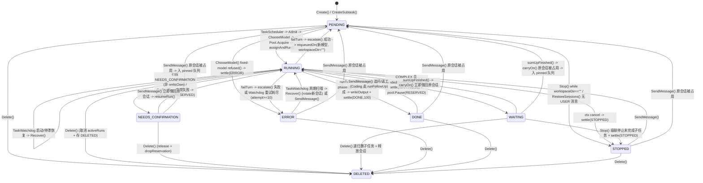

# spec 10 | 任务引擎与自动化 — 8 态任务状态机、编码三步流、会话池、看门狗与定时/API 自动化

- **状态**：`draft`
- **篇号顺序**：10（L3 业务域第 4 篇；与 `spec_09` 同层但严格零互引）
- **对应 PR**：`SA-10`（见 `docs/SuperAgent-Go/DDD/README.md` §3）
- **上位契约**：
  - `docs/SuperAgent-Go/01_Go工程架构_目录结构与核心底座设计.md` §1–§2、§5
  - `docs/SuperAgent-Go/02_PostgreSQL存储层与Store接口设计.md` §2–§4（`00003_init_task_and_automation.sql`）
  - `docs/SuperAgent-Go/03_核心抽象与插件化引擎_Runtime_MCP与ModelGateway.md` §1、§3
  - `docs/SuperAgent-Go/04_核心业务域Go并发设计_对话_任务_编排_IM与成本路由.md` §2
  - `docs/SuperAgent/05_异步任务引擎_研发三步流与自动化调度.md` §1–§5
  - `docs/SuperAgent/09_数据存储模型全量设计.md` §2.4（表 17–25）
  - `docs/SuperAgent/10_外部API与实时通信协议全量契约.md`（`/api/v1/tasks*`、`/api/v1/automations*`）
- **Java 参考源码**（逐文件扫描核验，根目录 `/Users/gaorenjie/Documents/Coding/aiops-workspace/orgin/SuperAgent`）：
  - `superagent-task/src/main/java/com/superagent/task/TaskService.java`（L1–L2248）
  - `superagent-task/src/main/java/com/superagent/task/CodingFlow.java`（L1–L162）+ `superagent-task/src/main/resources/flows/coding.md`（L1–L19）
  - `superagent-task/src/main/java/com/superagent/task/TaskSessionPool.java`（L1–L254）
  - `superagent-task/src/main/java/com/superagent/task/TaskScheduler.java`（L1–L75）
  - `superagent-task/src/main/java/com/superagent/task/TaskWatchdog.java`（L1–L141）
  - `superagent-task/src/main/java/com/superagent/task/TaskRecovery.java`（L1–L23）
  - `superagent-task/src/main/java/com/superagent/task/TaskTagger.java`（L1–L158）
  - `superagent-task/src/main/java/com/superagent/task/ComplexTaskPrompts.java`（L1–L135）
  - `superagent-task/src/main/java/com/superagent/task/TaskKinds.java`（L1–L40）
  - `superagent-task/src/main/java/com/superagent/task/TaskMcpTools.java`（L1–L114）
  - `superagent-task/src/main/java/com/superagent/task/ComplexTaskMcpTools.java`（L1–L81）
  - `superagent-task/src/main/java/com/superagent/task/TaskBusyException.java`（L1–L11）
  - `superagent-task/src/main/java/com/superagent/task/TaskNotFoundException.java`（L1–L11）
  - `superagent-task/src/main/java/com/superagent/task/automation/AutomationService.java`（L1–L429）
  - `superagent-task/src/main/java/com/superagent/task/automation/AutomationScheduler.java`（L1–L71）
  - `superagent-task/src/main/java/com/superagent/task/automation/AutomationTasks.java`（L1–L32）
  - `superagent-task/src/main/java/com/superagent/task/automation/AutomationMcpTools.java`（L1–L193）
  - `superagent-task/src/main/java/com/superagent/task/automation/AutomationForbiddenException.java`（L1–L11）
  - `superagent-task/src/main/java/com/superagent/task/automation/AutomationNotFoundException.java`（L1–L11）
  - 参照路由：`superagent-web/src/main/java/com/superagent/web/task/TaskController.java`（L1–L159）、`superagent-web/src/main/java/com/superagent/web/automation/AutomationController.java`（L1–L106）
- **前置依赖**：`spec_01`（Core/Tenant/AppError/EventBus）、`spec_02`（PG17 Store）、`spec_03`（Runtime Runner/McpGrants/Attachment）、`spec_04`（Tenant FairRunner/Quota/Settings/Notice）、`spec_05`（Provider/ModelGateway/Connectors）、`spec_06`（Files/Project/Skills）、`spec_07`（ModelRouter/TaskModelSelector/UsageRecorder）、`spec_08`（LinkReader）
- **下游消费者**：`spec_11`（`UserInboxService.ToTask` 创建收件箱来源任务）、`spec_12`（`SuperAgentService.Dispatch`/`ReplyToTask` 及 `SuperAgentAutomationTools` 复用 `AutomationMcpTools`）、`spec_13`（Gin `TaskController`/`AutomationController` 与 `/mcp` 端点注册）、`spec_14`（`wire.go` 装配与优雅停机编排）

---

## 1. 背景与范围

异步任务引擎（`internal/task`）与自动化引擎（`internal/task/automation`）承担 SuperAgent 全部长耗时、可中断、可追问、可分治与可定时调度的后台执行能力：当对话中需要阅读多份资料、编写代码、产出交付文档或拆分并行研究时，任务脱离 SSE 连接在后台持久运行，通过事件流轮询、人类确认门禁（`NEEDS_CONFIRMATION`）、复杂任务扇出/扇入与三路事件通知形成完整闭环；自动化引擎则将已保存的 Prompt 转化为支持 5 段 Cron（DST 安全）、一次性预约与外部 API Webhook 触发的无人值守周期任务。

**本篇（`SA-10`）边界与 V1 商业私有化锁定决策**：
1. **完整 1:1 业务保真**：8 态 `TaskStatus` 状态机、三路 `TaskStatusChanged` 事件扇出、创建前 8 链接 90s 并发预读、`continuesFrom` 5 代前情链、`CodingFlow` 三步流（`prd`→`dev`→`accept` + 门禁 + 完结后 `runFollowUp`）、`COMPLEX` 分治（上限 10 子任务 / 5 并行 / 3 轮汇总 / 60k 预算 / 失败补派额度）、`TaskTagger` 完结自动打标、`AutomationService` + `AutomationScheduler` + 全部 **17 个 MCP 工具**。
2. **修复原版 Java 3 处关键缺陷**：
   - **修复 #1（`TaskSessionPool.Acquire` 跨模型污染）**：原版 `TaskSessionPool.java:80-91` 注释声称跨模型复用空闲槽位时应轮换会话，实际代码遗漏 `s.model` 比较，导致不同模型续跑同一 CLI 会话触发 thinking block 签名校验失败。Go 版显式检查 `s.Model == model`，模型不一致时在**同一 `workspaceDir` 内轮换全新 `sessionID`** 并置 `initialized = false`。
   - **修复 #2（`TaskService.RestoreSessions` & `Recover` 编译/恢复断链）**：原版 `TaskService.java:309-321` 残留未声明变量 `running`/`restored` 与过期 5 参重载调用，且 `TaskService.java:1479` 在 `recover()` 中误引用未声明变量 `prompt` 而未调用下方 `recoverRun()`（L1494–L1509）。Go 版完整实现无缺陷的启动池恢复（去重重建 `IDLE`/`RESERVED` 并重新排队重启前追问任务）与看门狗恢复（30s 间隔 / 120s 停滞 / `MAX_ATTEMPTS=10` / `ROTATE_AFTER=1`，正确调用 `recoverRun` 拼接 `CodingFlow.ResumePrompt` / `RESUME_NOTE` / `FRESH_NOTE`）。
   - **修复 #3（`TaskMcpTools` 与 `ComplexTaskMcpTools` 异常泄漏）**：原版 `TaskMcpTools.java:60-113` 仅捕获 `UnreadableMaterialsException`，`TaskNotFoundException`/`TaskBusyException`/`IllegalArgumentException` 直接上抛为 JSON-RPC `-32603`。Go 版统一将领域错误转换为工具级 `McpToolError`（`isError: true`，前缀 `"错误："`），供 Agent 自主纠错。
3. **V1 裁剪与分层红线**：
   - 彻底移除 `task.tier` 与 `automation.tier` 废弃列（领域模型与 PG17 DDL 均不含 `tier`；API DTO 如为前端向后兼容保留可空字段则恒输出 `nil`）。
   - `internal/task` 严禁 import `internal/agent`、`internal/event`、`internal/orchestrator` 或 `internal/web`；通过 `internal/core/spi`（`TaskDoers`、`TaskModelSelector`、`ModelRouter`、`ModelCall`、`ProjectAccess`、`LinkReader`、`UsageRecorder`、`ModelGateway`）与 `internal/core/eventbus` 解耦。
   - HTTP Gin Handler 落位 `L5/spec_13`；本篇冻结所有 Service 签名、DTO、错误码、17 个 MCP 工具、9 张 PG17 表与对应 Store 接口契约。

---

## 2. 本篇交付物表

| # | 交付物 | 落位 | 类型 | Java 参照 |
|---|---|---|---|---|
| 1 | Task & Automation 领域模型与枚举 | `internal/core/domain/task.go`、`internal/core/domain/automation.go` | 新增/完善 | `core/task/*`、`core/automation/*` |
| 2 | Task & Automation Store 接口与事件/SPI | `internal/core/store/task_store.go`、`internal/core/spi/task.go`、`internal/core/eventbus/notice_events.go` | 新增/完善 | `Task*Store`、`AutomationStore`、`TaskDoers`、`TaskModelSelector`、`NoticeEvents` |
| 3 | Task & Automation API DTO | `internal/core/api/task.go`、`internal/core/api/automation.go`、`internal/core/api/timing.go` | 新增/完善 | `api/task/*`、`api/automation/*`、`api/timing/*` |
| 4 | PG17 迁移脚本（9 张表）与 Store 实现 | `internal/storage/postgres/migrations/00003_init_task_and_automation.sql`、`internal/storage/postgres/store_task.go`、`store_automation.go` | 新增/对齐 `spec_02` | `MysqlTask*Store`、`MysqlAutomationStore` |
| 5 | 编码三步流模板内嵌与状态机 | `internal/task/flows/coding.md`、`internal/task/coding_flow.go` | 新增 | `flows/coding.md`、`CodingFlow.java` |
| 6 | 任务类型校验与复杂任务提示词 | `internal/task/kinds.go`、`internal/task/complex_prompts.go` | 新增 | `TaskKinds.java`、`ComplexTaskPrompts.java` |
| 7 | 会话复用池（含跨模型轮换修复） | `internal/task/session_pool.go` | 新增 | `TaskSessionPool.java` |
| 8 | 核心任务引擎（8 态、预读、编码流、分治、追问、恢复） | `internal/task/service.go`、`internal/task/service_query.go`、`internal/task/service_exec.go`、`internal/task/service_recover.go` | 新增 | `TaskService.java`、`TaskRecovery.java` |
| 9 | 异步任务调度器与看门狗 | `internal/task/scheduler.go`、`internal/task/watchdog.go` | 新增 | `TaskScheduler.java`、`TaskWatchdog.java` |
| 10 | 完结自动打标器 | `internal/task/tagger.go` | 新增 | `TaskTagger.java` |
| 11 | 任务与复杂任务 MCP 工具集（6 + 3 = 9 工具） | `internal/task/mcp_tools.go`、`internal/task/complex_mcp_tools.go` | 新增 | `TaskMcpTools.java`、`ComplexTaskMcpTools.java` |
| 12 | 自动化调度引擎、Cron 引擎与 Webhook 验签 | `internal/task/automation/schedule.go`、`internal/task/automation/service.go`、`internal/task/automation/scheduler.go`、`internal/task/automation/tasks.go` | 新增 | `AutomationSchedule.java`、`AutomationService.java`、`AutomationScheduler.java`、`AutomationTasks.java` |
| 13 | 自动化 MCP 工具集（8 工具） | `internal/task/automation/mcp_tools.go` | 新增 | `AutomationMcpTools.java` |
| 14 | 全量同包单元测试（含 `-race` 并发与缺陷回归） | `internal/task/*_test.go`、`internal/task/automation/*_test.go` | 新增 | `TaskKindTest.java`、`TaskServiceTest.java`、`AutomationServiceTest.java` + 新增修复用例 |

---

## 3. 数据库设计

本篇对应迁移文件 `internal/storage/postgres/migrations/00003_init_task_and_automation.sql`（由 `spec_02` 统一内嵌并通过 `goose` 执行），包含 **9 张租户隔离表**。所有表严格遵守：`company_id VARCHAR(64) NOT NULL` 位于主键首列、全时间列使用 UTC `TIMESTAMPTZ`、金额列使用 `NUMERIC(16,6)`、JSON 载荷使用 `JSONB`、零物理外键、彻底移除原版 `task.tier` 与 `automation.tier`。

### 3.1 `task`（任务主表）

```sql
CREATE TABLE task (
    company_id    VARCHAR(64)    NOT NULL,
    id            VARCHAR(64)    NOT NULL,
    title         VARCHAR(512)   NOT NULL,
    brief         TEXT           NOT NULL DEFAULT '',
    source        VARCHAR(16)    NOT NULL, -- WEB_CHAT | TASK_FORM | AUTOMATION | INBOX
    repo          VARCHAR(512)   NOT NULL DEFAULT '',
    branch        VARCHAR(255)   NOT NULL DEFAULT '',
    flow          VARCHAR(32)    NOT NULL DEFAULT 'general', -- coding | general | complex
    status        VARCHAR(32)    NOT NULL, -- PENDING | RUNNING | NEEDS_CONFIRMATION | WAITING | DONE | ERROR | STOPPED | DELETED
    progress      INTEGER        NOT NULL DEFAULT 0,
    spend         NUMERIC(16,6)  NOT NULL DEFAULT 0,
    model         VARCHAR(128)   NOT NULL DEFAULT '',
    agent_type    VARCHAR(32)    NOT NULL DEFAULT 'CLAUDE',
    workspace_dir VARCHAR(1024)  NOT NULL DEFAULT '',
    created_by    VARCHAR(255)   NOT NULL DEFAULT '',
    error         TEXT           NOT NULL DEFAULT '',
    created_at    TIMESTAMPTZ    NOT NULL,
    started_at    TIMESTAMPTZ,
    finished_at   TIMESTAMPTZ,
    updated_at    TIMESTAMPTZ    NOT NULL,
    PRIMARY KEY (company_id, id)
);
CREATE INDEX idx_task_created ON task (company_id, created_at DESC);
CREATE INDEX idx_task_status  ON task (company_id, status);
CREATE INDEX idx_task_owner   ON task (company_id, created_by, created_at DESC);
```

- **说明**：原版 `tier` 列已删除；执行流消息与事件仍复用 `spec_02` 的 `chat_message` 与 `agent_event`（以 `session_id = task.id` 索引）；`spend` 领域层使用 `shopspring/decimal.Decimal` 杜绝浮点累加误差。

### 3.2 `task_phase`（编码三步流状态表）

```sql
CREATE TABLE task_phase (
    company_id  VARCHAR(64) NOT NULL,
    task_id     VARCHAR(64) NOT NULL,
    phases_json JSONB       NOT NULL DEFAULT '[]'::jsonb,
    updated_at  TIMESTAMPTZ NOT NULL,
    PRIMARY KEY (company_id, task_id)
);
```

- **JSONB 结构**：`[{"key":"prd","name":"PRD","status":"pending|running|done","content":"...","evidence":""}, ...]`；出口恒归一化为 JSON 数组 `[]`，禁止 `null`。

### 3.3 `task_run_state`（看门狗恢复游标表）

```sql
CREATE TABLE task_run_state (
    company_id       VARCHAR(64) NOT NULL,
    task_id          VARCHAR(64) NOT NULL,
    agent_session_id VARCHAR(64) NOT NULL,
    failure_count    INTEGER     NOT NULL DEFAULT 0,
    attempt_count    INTEGER     NOT NULL DEFAULT 0,
    updated_at       TIMESTAMPTZ NOT NULL,
    PRIMARY KEY (company_id, task_id)
);
```

### 3.4 `task_agent`（任务来源 Agent/消息映射表）

```sql
CREATE TABLE task_agent (
    company_id VARCHAR(64) NOT NULL,
    task_id    VARCHAR(64) NOT NULL,
    agent_id   VARCHAR(64) NOT NULL,
    session_id VARCHAR(64) NOT NULL DEFAULT '',
    message_id VARCHAR(64) NOT NULL DEFAULT '',
    created_at TIMESTAMPTZ NOT NULL,
    PRIMARY KEY (company_id, task_id)
);
CREATE INDEX idx_task_agent_origin ON task_agent (company_id, agent_id, created_at DESC);
```

### 3.5 `task_link`（复杂子任务与续做关联表）

```sql
CREATE TABLE task_link (
    company_id     VARCHAR(64) NOT NULL,
    task_id        VARCHAR(64) NOT NULL,
    parent_id      VARCHAR(64) NOT NULL DEFAULT '',
    continues_from VARCHAR(64) NOT NULL DEFAULT '',
    created_at     TIMESTAMPTZ NOT NULL,
    PRIMARY KEY (company_id, task_id)
);
CREATE INDEX idx_task_link_parent ON task_link (company_id, parent_id) WHERE parent_id <> '';
CREATE INDEX idx_task_link_from   ON task_link (company_id, continues_from) WHERE continues_from <> '';
```

### 3.6 `task_tag`（任务主题标签表）

```sql
CREATE TABLE task_tag (
    company_id VARCHAR(64) NOT NULL,
    task_id    VARCHAR(64) NOT NULL,
    tags       TEXT        NOT NULL DEFAULT '', -- 换行 \n 分隔，最多 8 个标签
    updated_at TIMESTAMPTZ NOT NULL,
    PRIMARY KEY (company_id, task_id)
);
```

### 3.7 `task_model_choice`（模型选型与升档审计表）

```sql
CREATE TABLE task_model_choice (
    company_id VARCHAR(64)  NOT NULL,
    task_id    VARCHAR(64)  NOT NULL,
    seq        INTEGER      NOT NULL, -- 1-based
    decided_by VARCHAR(16)  NOT NULL, -- judge | user | fallback | escalation | default | fixed
    difficulty VARCHAR(16)  NOT NULL DEFAULT '', -- easy | medium | hard | ''
    model      VARCHAR(128) NOT NULL DEFAULT '', -- fixed 拒止时为 ''
    cli        VARCHAR(32)  NOT NULL DEFAULT '',
    judge      VARCHAR(128) NOT NULL DEFAULT '',
    candidates TEXT         NOT NULL DEFAULT '',
    reasoning  TEXT         NOT NULL DEFAULT '',
    created_at TIMESTAMPTZ  NOT NULL,
    PRIMARY KEY (company_id, task_id, seq)
);
```

### 3.8 `automation`（自动化定义表）

```sql
CREATE TABLE automation (
    company_id     VARCHAR(64)  NOT NULL,
    id             VARCHAR(64)  NOT NULL,
    name           VARCHAR(255) NOT NULL,
    prompt         TEXT         NOT NULL,
    type           VARCHAR(16)  NOT NULL, -- RECURRING | ONCE | API
    cron           VARCHAR(128) NOT NULL DEFAULT '',
    run_at         TIMESTAMPTZ,
    timezone       VARCHAR(64)  NOT NULL DEFAULT 'Asia/Shanghai',
    model          VARCHAR(128) NOT NULL DEFAULT '',
    overlap_policy VARCHAR(16)  NOT NULL DEFAULT 'SKIP', -- SKIP | PARALLEL
    enabled        BOOLEAN      NOT NULL DEFAULT TRUE,
    source         VARCHAR(16)  NOT NULL DEFAULT 'manual', -- manual | chat
    owner          VARCHAR(255) NOT NULL,
    api_token_hash VARCHAR(128) NOT NULL DEFAULT '',
    next_run_at    TIMESTAMPTZ,
    last_run_at    TIMESTAMPTZ,
    last_task_id   VARCHAR(64)  NOT NULL DEFAULT '',
    created_at     TIMESTAMPTZ  NOT NULL,
    updated_at     TIMESTAMPTZ  NOT NULL,
    PRIMARY KEY (company_id, id)
);
CREATE INDEX idx_automation_next  ON automation (company_id, next_run_at) WHERE enabled = TRUE AND next_run_at IS NOT NULL;
CREATE INDEX idx_automation_owner ON automation (company_id, owner, created_at DESC);
```

### 3.9 `automation_run`（自动化触发历史表）

```sql
CREATE TABLE automation_run (
    company_id     VARCHAR(64)  NOT NULL,
    id             VARCHAR(64)  NOT NULL,
    automation_id  VARCHAR(64)  NOT NULL,
    trigger_kind   VARCHAR(16)  NOT NULL, -- schedule | api | manual
    task_id        VARCHAR(64)  NOT NULL DEFAULT '',
    skipped_reason VARCHAR(512) NOT NULL DEFAULT '',
    fired_at       TIMESTAMPTZ  NOT NULL,
    PRIMARY KEY (company_id, id)
);
CREATE INDEX idx_automation_run_auto ON automation_run (company_id, automation_id, fired_at DESC);
CREATE INDEX idx_automation_run_task ON automation_run (company_id, task_id) WHERE task_id <> '';
```

---

## 4. 冻结契约

### 4.1 导出符号（Go 公共结构体、枚举、接口与服务签名）

#### 4.1.1 领域模型（`internal/core/domain`）

```go
package domain

import (
	"strings"
	"time"

	"github.com/shopspring/decimal"
)

type TaskStatus string

const (
	TaskStatusPending           TaskStatus = "PENDING"
	TaskStatusRunning           TaskStatus = "RUNNING"
	TaskStatusNeedsConfirmation TaskStatus = "NEEDS_CONFIRMATION"
	TaskStatusWaiting           TaskStatus = "WAITING"
	TaskStatusDone              TaskStatus = "DONE"
	TaskStatusError             TaskStatus = "ERROR"
	TaskStatusStopped           TaskStatus = "STOPPED"
	TaskStatusDeleted           TaskStatus = "DELETED"
)

type TaskKind string

const (
	TaskKindCoding  TaskKind = "coding"
	TaskKindGeneral TaskKind = "general"
	TaskKindComplex TaskKind = "complex"
)

func ParseTaskKindStorage(v string) TaskKind {
	switch strings.ToLower(strings.TrimSpace(v)) {
	case string(TaskKindCoding):
		return TaskKindCoding
	case string(TaskKindComplex):
		return TaskKindComplex
	default:
		return TaskKindGeneral
	}
}

type TaskSource string

const (
	TaskSourceWebChat    TaskSource = "WEB_CHAT"
	TaskSourceTaskForm   TaskSource = "TASK_FORM"
	TaskSourceAutomation TaskSource = "AUTOMATION"
	TaskSourceInbox      TaskSource = "INBOX"
)

type Task struct {
	ID           string
	Title        string
	Brief        string
	Source       TaskSource
	Repo         string
	Branch       string
	Flow         string // "coding" | "general" | "complex"
	Status       TaskStatus
	Progress     int // 0..100
	Spend        decimal.Decimal
	Model        string
	AgentType    AgentType
	WorkspaceDir string
	CreatedBy    string
	Error        string
	CreatedAt    time.Time
	StartedAt    *time.Time
	FinishedAt   *time.Time
	UpdatedAt    time.Time
}

func ClampProgress(p int) int {
	if p < 0 {
		return 0
	}
	if p > 100 {
		return 100
	}
	return p
}

func (t Task) Started(now time.Time) Task {
	ts := now.UTC()
	t.Status = TaskStatusRunning
	t.StartedAt = &ts
	t.UpdatedAt = ts
	return t
}

func (t Task) Finished(terminal TaskStatus, progress int, errMsg string, now time.Time) Task {
	ts := now.UTC()
	t.Status = terminal
	t.Progress = ClampProgress(progress)
	t.Error = errMsg
	t.FinishedAt = &ts
	t.UpdatedAt = ts
	return t
}

func (t Task) RequeuedOn(newModel string, newType AgentType, now time.Time) Task {
	ts := now.UTC()
	t.Status = TaskStatusPending
	t.Progress = 0
	t.Model = newModel
	t.AgentType = newType
	t.WorkspaceDir = ""
	t.Error = ""
	t.StartedAt = nil
	t.FinishedAt = nil
	t.UpdatedAt = ts
	return t
}

type TaskPhaseStatus string

const (
	TaskPhasePending TaskPhaseStatus = "pending"
	TaskPhaseRunning TaskPhaseStatus = "running"
	TaskPhaseDone    TaskPhaseStatus = "done"
)

type TaskPhase struct {
	Key      string          `json:"key"`
	Name     string          `json:"name"`
	Status   TaskPhaseStatus `json:"status"`
	Content  string          `json:"content,omitempty"`
	Evidence string          `json:"evidence,omitempty"`
}

type TaskRunState struct {
	TaskID         string
	AgentSessionID string
	FailureCount   int
	AttemptCount   int
	UpdatedAt      time.Time
}

func InitialTaskRunState(taskID, sessionID string, now time.Time) TaskRunState {
	return TaskRunState{TaskID: taskID, AgentSessionID: sessionID, FailureCount: 0, AttemptCount: 1, UpdatedAt: now.UTC()}
}
func (s TaskRunState) FailedOnSameSession(now time.Time) TaskRunState {
	s.FailureCount++
	s.AttemptCount++
	s.UpdatedAt = now.UTC()
	return s
}
func (s TaskRunState) RotatedTo(newSessionID string, now time.Time) TaskRunState {
	s.AgentSessionID = newSessionID
	s.FailureCount = 0
	s.AttemptCount++
	s.UpdatedAt = now.UTC()
	return s
}
func (s TaskRunState) Resumed(now time.Time) TaskRunState {
	s.AttemptCount++
	s.UpdatedAt = now.UTC()
	return s
}

type TaskOrigin struct {
	TaskID    string
	AgentID   string
	SessionID string
	MessageID string
	CreatedAt time.Time
}

type TaskLink struct {
	TaskID        string
	ParentID      string
	ContinuesFrom string
	CreatedAt     time.Time
}

const (
	ModelChoiceByJudge      = "judge"
	ModelChoiceByUser       = "user"
	ModelChoiceByFallback   = "fallback"
	ModelChoiceByEscalation = "escalation"
	ModelChoiceByDefault    = "default"
	ModelChoiceByFixed      = "fixed"
)

type TaskModelChoice struct {
	TaskID     string
	Seq        int
	By         string
	Difficulty string
	Model      string
	CLI        string
	Judge      string
	Candidates string
	Reasoning  string
	CreatedAt  time.Time
}

func (c TaskModelChoice) Refused() bool { return c.Model == "" && c.By == ModelChoiceByFixed }

// --- Automation 领域模型 ---

type AutomationType string

const (
	AutomationTypeRecurring AutomationType = "RECURRING"
	AutomationTypeOnce      AutomationType = "ONCE"
	AutomationTypeAPI       AutomationType = "API"
)

type OverlapPolicy string

const (
	OverlapPolicySkip     OverlapPolicy = "SKIP"
	OverlapPolicyParallel OverlapPolicy = "PARALLEL"
)

type Automation struct {
	ID           string
	Name         string
	Prompt       string
	Type         AutomationType
	Cron         string
	RunAt        *time.Time
	Timezone     string
	Model        string
	Overlap      OverlapPolicy
	Enabled      bool
	Source       string // "manual" | "chat"
	Owner        string
	APITokenHash string
	NextRunAt    *time.Time
	LastRunAt    *time.Time
	LastTaskID   string
	CreatedAt    time.Time
	UpdatedAt    time.Time
}

func (a Automation) Fired(now time.Time, taskID string) Automation {
	ts := now.UTC()
	a.LastRunAt = &ts
	if taskID != "" {
		a.LastTaskID = taskID
	}
	a.UpdatedAt = ts
	return a
}

type AutomationRun struct {
	ID            string
	AutomationID  string
	Trigger       string // "schedule" | "api" | "manual"
	TaskID        string // 空串表示跳过或启动失败
	SkippedReason string
	FiredAt       time.Time
}
```

#### 4.1.2 Store 接口与跨模块 SPI（`internal/core/store` & `internal/core/spi`）

```go
package store

type TaskStore interface {
	Save(ctx context.Context, t domain.Task) error
	FindTask(ctx context.Context, id string) (*domain.Task, error) // 不存在返回 nil, nil
	ListTasks(ctx context.Context) ([]domain.Task, error)
}

type TaskPhaseStore interface {
	FindPhasesJSON(ctx context.Context, taskID string) (string, bool, error)
	Save(ctx context.Context, taskID, phasesJSON string) error
	Delete(ctx context.Context, taskID string) error
}

type TaskRunStateStore interface {
	Find(ctx context.Context, taskID string) (*domain.TaskRunState, error)
	Save(ctx context.Context, state domain.TaskRunState) error
	Delete(ctx context.Context, taskID string) error
}

type TaskAgentStore interface {
	Link(ctx context.Context, origin domain.TaskOrigin) error
	AgentOf(ctx context.Context, taskID string) (string, bool, error)
	OriginOf(ctx context.Context, taskID string) (*domain.TaskOrigin, error)
	OriginsForAgent(ctx context.Context, agentID string) ([]domain.TaskOrigin, error)
}

type TaskLinkStore interface {
	Save(ctx context.Context, link domain.TaskLink) error
	Find(ctx context.Context, taskID string) (*domain.TaskLink, error)
	All(ctx context.Context) ([]domain.TaskLink, error)
	Children(ctx context.Context, parentID string) ([]string, error)  // 按 created_at ASC
	FollowUps(ctx context.Context, taskID string) ([]string, error)   // 按 created_at ASC
}

type TaskTagStore interface {
	Set(ctx context.Context, taskID string, tags []string) error
	Tags(ctx context.Context, taskID string) ([]string, error)
	All(ctx context.Context) (map[string][]string, error)
}

type TaskModelChoiceStore interface {
	Save(ctx context.Context, choice domain.TaskModelChoice) error
	List(ctx context.Context, taskID string) ([]domain.TaskModelChoice, error) // 按 seq ASC
}

type AutomationStore interface {
	List(ctx context.Context) ([]domain.Automation, error)
	Find(ctx context.Context, id string) (*domain.Automation, error)
	Save(ctx context.Context, a domain.Automation) error
	Delete(ctx context.Context, id string) error // 保留 automation_run 与历史 task
	AppendRun(ctx context.Context, run domain.AutomationRun) error
	ListRuns(ctx context.Context, automationID string, limit int) ([]domain.AutomationRun, error) // fired_at DESC
	FindRunByTask(ctx context.Context, taskID string) (*domain.AutomationRun, error)
}
```

```go
package spi

// TaskDoer 表示任务的执行 Agent 身份（仅非 SuperAgent 返回，由 internal/agent 实现）
type TaskDoer struct {
	Name    string
	Persona string
	Memory  string
}

type TaskDoers interface {
	Doer(ctx context.Context, agentID string) (*TaskDoer, bool, error)
	Name(ctx context.Context, agentID string) (string, bool, error)
}

// TaskModelSelector 由 internal/cost (spec_07) 的 TaskModelRouter 实现
type TaskModelSelector interface {
	Enabled(ctx context.Context) bool
	Choose(ctx context.Context, task domain.Task) (*domain.TaskModelChoice, error)
	Strongest(ctx context.Context, task domain.Task) (*domain.TaskModelChoice, error)
	Escalate(ctx context.Context, task domain.Task, failure string) (*domain.TaskModelChoice, error)
}

// TaskRecovery 看门狗驱动的窄接缝（由 internal/task.Service 实现）
type TaskRecovery interface {
	ActiveTaskIDs() map[string]struct{}
	Recover(ctx context.Context, taskID string) error
}
```

```go
package eventbus

// TaskStatusChanged 非子任务状态变更事件，由 TaskService 发布，触发 3 路监听：
// 1) NoticeService.OnTask (spec_04)
// 2) ChatTaskResults.OnTaskStatus (spec_09)
// 3) TaskTagger.OnTaskStatus (spec_10)
type TaskStatusChanged struct {
	TaskID  string
	Owner   string
	Title   string
	Source  string // lowercase: web_chat | task_form | automation | inbox
	Status  string // lowercase: pending | running | needs_confirmation | waiting | done | error | stopped | deleted
	Error   string
	AgentID string // 仅创建时非空
	Result  string // 仅 done 时携带最后一次回复全文
}
```

#### 4.1.3 核心导出服务签名（`internal/task` & `internal/task/automation`）

```go
package task

type Config struct {
	WorkspaceDir          string        // 默认 "./data/tasks"
	DefaultModel          string        // 默认 ""
	AllowedTools          []string      // 基础 CLI 工具白名单
	SkipPermissions       bool          // 默认 false（true 时打印高危安全告警）
	MaxParallelPerOwner   int           // 默认 50
	DefaultOwner          string        // 默认 "local"
	SchedulerSweep        time.Duration // 默认 30s，最小 1s
	WatchdogEnabled       bool          // 默认 true
	WatchdogInterval      time.Duration // 默认 30s，最小 5s
	WatchdogStall         time.Duration // 默认 120s，最小 30s
}

type CreateOptions struct {
	Owner     string
	AgentID   string
	SessionID string
	MessageID string
	Materials []string // nil = 扫描 brief 中全部 URL；非 nil = 仅预读指定列表
}

type PageFilter struct {
	Status    string // "" | "all" | "active" | TaskStatus
	Tag       string
	AgentID   string
	Source    string
	ProjectID string
	Page      int
	Size      int // clamp 1..100
}

// Service 对外暴露给 L4 (event/orchestrator) 与 L5 (web) 的完整方法集
func NewService(cfg Config, deps Deps) *Service
func (s *Service) RestoreSessions(ctx context.Context) error // 响应 CompanyStarted
func (s *Service) RunnableAgents() []domain.AgentType
func (s *Service) Create(ctx context.Context, req api.CreateTaskRequest, opts CreateOptions) (api.TaskDto, error)
func (s *Service) CreateSubtask(ctx context.Context, parentID, owner, title, brief string) (api.TaskDto, error)
func (s *Service) List(ctx context.Context, owner string) ([]api.TaskDto, error)
func (s *Service) ListForAgent(ctx context.Context, agentID string) ([]api.TaskDto, error)
func (s *Service) Page(ctx context.Context, owner string, f PageFilter) (api.TaskPageDto, error)
func (s *Service) Facets(ctx context.Context, owner string) (api.TaskFacetsDto, error)
func (s *Service) Stats(ctx context.Context, owner string) (api.TaskStatsDto, error)
func (s *Service) Detail(ctx context.Context, id, owner string) (api.TaskDetailDto, error)
func (s *Service) EventsFrom(ctx context.Context, id, owner string, offset int) ([]api.TaskEventDto, error)
func (s *Service) Status(ctx context.Context, id, owner string) (api.TaskDto, error)
func (s *Service) Relations(ctx context.Context, id, owner string) (api.TaskRelationsDto, error)
func (s *Service) ModelChoices(ctx context.Context, id, owner string) ([]api.TaskModelChoiceDto, error)
func (s *Service) Timing(ctx context.Context, id, owner string) (api.TaskTimingDto, error)
func (s *Service) SubtaskOutput(ctx context.Context, parentID, childID, owner string) (string, error)
func (s *Service) SetTags(ctx context.Context, id, owner string, tags []string) (api.TaskDto, error)
func (s *Service) SendMessage(ctx context.Context, id, owner, text string, uploads []api.ImageUploadDto, fileIDs []string) error
func (s *Service) Stop(ctx context.Context, id, owner string) error
func (s *Service) Delete(ctx context.Context, id, owner string) error
func (s *Service) ActiveTaskIDs() map[string]struct{}
func (s *Service) Recover(ctx context.Context, id string) error
func (s *Service) Close() error // 取消在途任务并等待 worker 收敛

// 供跨包共享的辅助函数
func RequireKind(args map[string]any) (string, error) // 对应 TaskKinds.require
func KindLabel(stored string) string                  // "编码" | "复杂" | "普通"
func CleanTags(given []string) []string               // 去重/截断 <=20 字 / 上限 8 个
```

```go
package automation

type Config struct {
	SchedulerEnabled  bool          // 默认 true
	SchedulerInterval time.Duration // 默认 30s，最小 5s
}

func NewService(store store.AutomationStore, tasks TaskBridge, providers ProviderResolver, settings SettingsReader) *Service
func (s *Service) List(ctx context.Context, user string, isAdmin bool) ([]api.AutomationDto, error)
func (s *Service) Detail(ctx context.Context, id, user string, isAdmin bool) (api.AutomationDetailDto, error)
func (s *Service) ForTask(ctx context.Context, taskID, user string, isAdmin bool) (*api.AutomationDto, error)
func (s *Service) Create(ctx context.Context, req api.SaveAutomationRequest, owner, source string) (api.AutomationDto, error)
func (s *Service) Update(ctx context.Context, id string, req api.SaveAutomationRequest, user string, isAdmin bool) (api.AutomationDto, error)
func (s *Service) SetEnabled(ctx context.Context, id string, enabled bool, user string, isAdmin bool) (api.AutomationDto, error)
func (s *Service) Delete(ctx context.Context, id, user string, isAdmin bool) error
func (s *Service) RunNow(ctx context.Context, id, user string, isAdmin bool) (api.AutomationRunDto, error)
func (s *Service) Trigger(ctx context.Context, id, token, input string) (api.AutomationRunDto, error)
func (s *Service) RegenerateToken(ctx context.Context, id, user string, isAdmin bool) (api.AutomationDto, error)
func (s *Service) Preview(ctx context.Context, req api.SaveAutomationRequest) ([]time.Time, error)
func (s *Service) FireDue(ctx context.Context, now time.Time) (int, error)
```

### 4.2 路由与 MCP 工具契约

#### 4.2.1 REST 路由契约（Controller 实现在 `spec_13`，本篇冻结路径、权限与 Service 映射）

**任务端点（前缀 `/api/v1/tasks`，全部经 Auth + Tenant + PasswordChange 中间件，响应统一 `{"code":"ok","message":"","data":...}`）**：

| Method | Path | Service 方法 | 访问控制 |
|---|---|---|---|
| `POST` | `/api/v1/tasks` | `TaskService.Create` | 登录用户（Owner = `principal.UserID`） |
| `GET` | `/api/v1/tasks/agents` | `TaskService.RunnableAgents` + `ProviderService.StoredModels` | 登录用户 |
| `GET` | `/api/v1/tasks` | `TaskService.Page`（`page=1,size=20,status,tag,agent,source,project`） | 仅本人或项目成员可见 |
| `GET` | `/api/v1/tasks/facets` | `TaskService.Facets` | 仅本人 |
| `GET` | `/api/v1/tasks/stats` | `TaskService.Stats` | 仅本人 |
| `GET` | `/api/v1/tasks/:id` | `TaskService.Detail` | Owner 或项目成员（否则 404） |
| `GET` | `/api/v1/tasks/:id/events` | `TaskService.EventsFrom`（`offset=0`） | Owner 或项目成员 |
| `GET` | `/api/v1/tasks/:id/status` | `TaskService.Status` | Owner 或项目成员 |
| `GET` | `/api/v1/tasks/:id/relations` | `TaskService.Relations` | Owner 或项目成员 |
| `PUT` | `/api/v1/tasks/:id/tags` | `TaskService.SetTags`（body `{"tags":[...]}`） | 仅 Owner（否则 404） |
| `GET` | `/api/v1/tasks/:id/model-choices` | `TaskService.ModelChoices` | Owner 或项目成员 |
| `GET` | `/api/v1/tasks/:id/timing` | `TaskService.Timing` | Owner 或项目成员 |
| `POST` | `/api/v1/tasks/:id/messages` | `TaskService.SendMessage`（`content,images,fileIds`） | 仅 Owner（运行中/未启动/已排队返 409） |
| `GET` | `/api/v1/tasks/:id/messages/:messageId/images/:index` | `TaskService.Status` 鉴权 + `ImageAttachmentStore.Read` | Owner 或项目成员，二进制图像响应 |
| `POST` | `/api/v1/tasks/:id/stop` | `TaskService.Stop` | 仅 Owner |
| `DELETE` | `/api/v1/tasks/:id` | `TaskService.Delete` | 仅 Owner |

**自动化端点（前缀 `/api/v1/automations`）**：

| Method | Path | Service 方法 | 访问控制 |
|---|---|---|---|
| `GET` | `/api/v1/automations` | `AutomationService.List` | 本人（Admin 见全公司） |
| `POST` | `/api/v1/automations` | `AutomationService.Create(..., "manual")` | 登录用户（`apiToken` 仅此响应明文返回一次） |
| `POST` | `/api/v1/automations/preview` | `AutomationService.Preview` | 登录用户 |
| `GET` | `/api/v1/automations/by-task/:taskId` | `AutomationService.ForTask` | 本人或 Admin（否则 `data: null`） |
| `GET` | `/api/v1/automations/:id` | `AutomationService.Detail` | 本人或 Admin（他人返 404 防探测） |
| `PUT` | `/api/v1/automations/:id` | `AutomationService.Update` | 本人或 Admin（他人返 403） |
| `POST` | `/api/v1/automations/:id/enabled` | `AutomationService.SetEnabled`（query `value=true\|false`） | 本人或 Admin（403） |
| `POST` | `/api/v1/automations/:id/run` | `AutomationService.RunNow` | 本人或 Admin（403） |
| `POST` | `/api/v1/automations/:id/token` | `AutomationService.RegenerateToken` | 本人或 Admin（403，返回新明文一次） |
| `DELETE` | `/api/v1/automations/:id` | `AutomationService.Delete` | 本人或 Admin（403） |
| `POST` | `/api/v1/automations/:id/trigger` | `AutomationService.Trigger`（Header `X-Automation-Token`，body `{input}`） | **公开白名单路由**，凭 `<company>.<64-hex>` 令牌路由租户并常时校验 |

#### 4.2.2 全部 17 个 MCP 工具契约

**A. `TaskMcpTools`（6 个工具，Grant Scope = `CHAT`，`TaskMcpTools.java:27-114`）**

| # | 工具名 | 必填参数 | 可选参数 | 行为与副作用 |
|---|---|---|---|---|
| 1 | `create_task` | `title`, `brief`, `kind`（`coding\|general\|complex`） | `repo`, `branch`, `continues_from`, `materials`（换行分隔 URL） | 以 `source="web_chat"` 创建任务并绑定 `grant.AgentID`/`SessionID`/`MessageID`；触发资料预读（失败返 `McpToolError` 并明示切勿宣称已创建）；返回 ID/类型/状态，指示模型结束本轮 |
| 2 | `list_tasks` | 无 | 无 | 列出 `grant.Owner` 的全部非删顶层任务（`id \| title \| status \| progress%`） |
| 3 | `get_task` | `id` | 无 | 查询任务标题、状态、进度与错误信息 |
| 4 | `send_task_message` | `id`, `content` | 无 | 向非运行中任务发送追问/确认答复，在原会话恢复执行或排队 |
| 5 | `stop_task` | `id` | 无 | 取消运行中任务、移出排队或级联停止 `WAITING` 复杂任务及未完成子任务 |
| 6 | `delete_task` | `id` | 无 | 软删任务（含子任务）、取消执行并释放会话/预留 |

**B. `ComplexTaskMcpTools`（3 个工具，Grant Scope = `TASK` + CLI 白名单仅对 `COMPLEX` 任务开启，`ComplexTaskMcpTools.java:23-81`）**

- 运行时前置守卫：`grant.TaskID == ""` 时返回 `McpToolError("只有任务里能用")`。
- CLI 白名单常量：`ComplexAllowedTools = []string{"mcp__superagent__create_subtask", "mcp__superagent__list_subtasks", "mcp__superagent__subtask_output"}`。

| # | 工具名 | 必填参数 | 可选参数 | 行为与副作用 |
|---|---|---|---|---|
| 7 | `create_subtask` | `title`, `brief` | 无 | 校验父任务为 `COMPLEX`、`summaryRounds < 3`、`subtaskRoom > 0`；创建 `GENERAL` 子任务（继承父 `source`/`agentType`/`agentId`/项目，跳过资料预读），返回子任务 ID 与剩余额度 |
| 8 | `list_subtasks` | 无 | 无 | 列出父任务全部非删子任务（`- id \| title \| status`，按 `created_at` 升序） |
| 9 | `subtask_output` | `id` | 无 | 校验归属后返回子任务最后一条非空助手回复全文，或 `"失败：<error>"`，或状态提示 |

**C. `AutomationMcpTools`（8 个工具，Grant Scope = `CHAT`，始终 `isAdmin = false`，`AutomationMcpTools.java:35-193`）**

| # | 工具名 | 必填参数 | 可选参数 | 行为与副作用 |
|---|---|---|---|---|
| 10 | `create_automation` | `prompt` | `name`, `type`(`recurring\|once\|api`), `cron`, `run_at`(`YYYY-MM-DDTHH:mm`), `timezone`(`Asia/Shanghai`), `model`, `overlap`(`skip\|parallel`) | `source="chat"` 创建自动化；返回含未来 3 次运行时间的详情描述；`type="api"` 时**严禁在对话文本中回显明文令牌** |
| 11 | `list_automations` | 无 | 无 | 列出当前用户自动化 ID、名称、计划、启停、下次运行与上次状态 |
| 12 | `get_automation` | `id` | 无 | 返回计划、时区、状态、模型、未来 3 次运行、API 触发路径、最近 5 次运行与 Prompt |
| 13 | `update_automation` | `id` | `prompt`, `name`, `type`, `cron`, `run_at`, `timezone`, `model`, `overlap` | 仅更新传入的非 nil 字段，重算 `next_run_at` |
| 14 | `set_automation_enabled` | `id`, `enabled`(bool) | 无 | 显式校验参数存在 `enabled` 键；启停并重算 `next_run_at`（拒绝启用已过期 `ONCE`） |
| 15 | `run_automation_now` | `id` | 无 | 以 `trigger="manual"` 立即触发一次，不改动调度计划 |
| 16 | `delete_automation` | `id` | 无 | 删除自动化定义，保留历史 `automation_run` 与已生成任务 |
| 17 | `get_current_time` | 无 | `timezone`（默认 `Asia/Shanghai`） | 返回 `yyyy-MM-dd HH:mm (EEE) <ZoneId>` 供 Agent 换算相对时间 |

### 4.3 错误语义

| 错误场景 | Go 领域错误 (`apperror`) | HTTP 状态码 & `code` | MCP 工具返回（**修复 #3**） |
|---|---|---|---|
| 任务不存在 / 非本人且非项目可见 / 已软删 | `apperror.NotFound("No such task: " + id)` | `404 not_found` | `McpToolError` (`isError: true`, `"错误：..."`) |
| 追问时任务处于 `RUNNING` / `workspaceDir==""` / 已在队列中 | `apperror.Busy("Task is running: " + id)` | `409 busy` | `McpToolError` (`isError: true`) |
| 资料预读任一链接失败或 90s 超时 | `domain.UnreadableMaterialsError`（归属 `Conflict`） | `409 conflict` | `McpToolError` + 附“不要说任务已创建”指令 |
| 非法 `kind`/无可用 Runner/超子任务上限/Cron 语法错/过期 `ONCE`/未过探活模型/暂停的 API 自动化触发 | `apperror.InvalidArg(...)` | `400 invalid_argument` | `McpToolError` (`isError: true`) |
| 自动化不存在或非本人读取（防探测） | `apperror.NotFound("No such automation: " + id)` | `404 not_found` | `McpToolError` (`isError: true`) |
| 非本人且非 Admin 修改自动化 / 缺失或错误 `X-Automation-Token` / 非 API 类型触发 | `apperror.Forbidden("Invalid automation id or token")` | `403 forbidden` | `McpToolError` (`isError: true`) |
| 租户月度 Token 配额耗尽 | `apperror.Forbidden("quota exceeded")` | `403 forbidden` | `McpToolError` (`isError: true`) |

### 4.4 SQL 契约

- 所有 Store 方法第一行必调 `companyID, err := tenant.Require(ctx)`；全部参数使用 `$1, $2, ...` 占位符。
- Upsert 统一使用 PG17 `ON CONFLICT (...) DO UPDATE SET ...`，绝不用 `REPLACE INTO`：
  - `task`: `INSERT INTO task (...) VALUES (...) ON CONFLICT (company_id, id) DO UPDATE SET title=EXCLUDED.title, brief=EXCLUDED.brief, ..., updated_at=EXCLUDED.updated_at`
  - `task_phase`: `INSERT INTO task_phase (company_id, task_id, phases_json, updated_at) VALUES ($1,$2,$3::jsonb,$4) ON CONFLICT (company_id, task_id) DO UPDATE SET phases_json=EXCLUDED.phases_json, updated_at=EXCLUDED.updated_at`
  - `task_run_state`: `ON CONFLICT (company_id, task_id) DO UPDATE SET agent_session_id=EXCLUDED.agent_session_id, failure_count=EXCLUDED.failure_count, attempt_count=EXCLUDED.attempt_count, updated_at=EXCLUDED.updated_at`
  - `task_tag`: `ON CONFLICT (company_id, task_id) DO UPDATE SET tags=EXCLUDED.tags, updated_at=EXCLUDED.updated_at`
  - `automation`: `ON CONFLICT (company_id, id) DO UPDATE SET name=EXCLUDED.name, ..., next_run_at=EXCLUDED.next_run_at, last_run_at=EXCLUDED.last_run_at, last_task_id=EXCLUDED.last_task_id, updated_at=EXCLUDED.updated_at`
- `automation_run` 仅追加 `INSERT INTO automation_run (...) VALUES (...)`；`FindRunByTask` 按 `WHERE company_id=$1 AND task_id=$2 ORDER BY fired_at DESC LIMIT 1` 查询。

---

## 5. 行为语义与 Java→Go 详细伪代码

### 5.1 完整 8 态 `TaskStatus` 状态机与 3 路事件扇出

参照 `TaskService.java:645-821, 1028-1407, 1519-1907`：



- **3 路 `TaskStatusChanged` 事件扇出（`TaskService.java:1896-1907`）**：
  - 仅对**非子任务**（`!s.isSubtask(ctx, t.ID)`）发布 `eventbus.TaskStatusChanged`；
  - 若任务已进入非 `PENDING`/`RUNNING` 状态，读取并清除内存 `lastReply[taskID]`（仅 `DONE` 时填充 `Result`）；
  - 下游 3 个监听器并发或同步消费：
    1. `NoticeService.OnTask`（`spec_04`）：`pending`→`TRACK`、`running`→降级 `CONFIRM` 为 `TRACK`、`needs_confirmation`/`error`→`CONFIRM`、`done`→`DONE`、`stopped`/`deleted`→`IGNORED`、`waiting`→no-op；
    2. `ChatTaskResults.OnTaskStatus`（`spec_09`）：`done`/`error`（1,500 字截断）与 `needs_confirmation` 向源 Agent 最新会话追加 `author="task:<taskID>"` 助手消息；
    3. `TaskTagger.OnTaskStatus`（本篇 §5.6）：`done` 时异步用最便宜模型自动打 2–4 个标签。

### 5.2 任务创建、8 链接 90s 并发预读与 `continuesFrom` 5 代前情链

参照 `TaskService.java:645-722, 754-834, 1973-2005`：

```go
const (
	materialMaxLinks = 8
	materialWait     = 90 * time.Second
	maxCarryOnDepth  = 5
)

// withMaterials 并发预读最多 8 个外部链接，共享 90s 超时；任一失败立即终止建任务（零 DB 写入）。
// 参照 TaskService.java:656-721
func (s *Service) withMaterials(ctx context.Context, req api.CreateTaskRequest, opts CreateOptions) (api.CreateTaskRequest, error) {
	var urls []string
	if opts.Materials != nil {
		urls = distinctLinkURLs(opts.Materials...)
	} else {
		urls = linkurls.Extract(req.Brief)
	}
	if s.linkReader == nil || len(urls) == 0 {
		return req, nil
	}
	checked := urls
	if len(checked) > materialMaxLinks {
		checked = urls[:materialMaxLinks]
	}

	readCtx, cancel := context.WithTimeout(ctx, materialWait)
	defer cancel()

	type readRes struct {
		content *domain.LinkContent
		err     *domain.UnreadableLinkError
	}
	results := make([]readRes, len(checked))
	g, gCtx := errgroup.WithContext(readCtx)
	for i, rawURL := range checked {
		idx, u := i, rawURL
		g.Go(func() error {
			// 注意：单条失败不取消其他并发预读，以便一次性向用户汇报所有不可读链接（与 Java 一致）
			c, err := s.linkReader.Read(readCtx, u, opts.Owner)
			if err != nil {
				var ul *domain.UnreadableLinkError
				switch {
				case errors.As(err, &ul):
					results[idx].err = ul
				case errors.Is(err, context.DeadlineExceeded) || errors.Is(gCtx.Err(), context.DeadlineExceeded):
					results[idx].err = &domain.UnreadableLinkError{URL: u, Reason: "读取超时", Fix: "稍后再试，或把内容导出成文件发过来"}
				default:
					results[idx].err = &domain.UnreadableLinkError{URL: u, Reason: "读取出错：" + err.Error(), Fix: "稍后再试"}
				}
				return nil
			}
			results[idx].content = c
			return nil
		})
	}
	_ = g.Wait()

	var unreadable []*domain.UnreadableLinkError
	var okList []*domain.LinkContent
	for _, r := range results {
		if r.err != nil {
			unreadable = append(unreadable, r.err)
		} else if r.content != nil {
			okList = append(okList, r.content)
		}
	}
	if len(unreadable) > 0 {
		return req, &domain.UnreadableMaterialsError{Items: unreadable} // HTTP 409，零 DB 写入
	}

	var note strings.Builder
	note.WriteString("\n\n## 已读取的外部资料\n建任务时已经读好下面这些链接")
	if s.files != nil {
		note.WriteString("，存进了 Files：用 file_get 取到工作区再看，不用再去抓链接。\n")
	} else {
		note.WriteString("。\n")
	}
	for _, c := range okList {
		note.WriteString("- " + c.Title + "（" + c.URL + "）")
		if s.files != nil {
			wf, err := s.files.WriteText(ctx, files.Origin{
				Owner: opts.Owner, AgentID: opts.AgentID, SessionID: opts.SessionID,
				MessageID: opts.MessageID, Origin: domain.FileOriginTask,
			}, materialFileName(c), formatMaterialMarkdown(c), nil)
			if err == nil {
				note.WriteString(" → 文件 " + wf.ID + "（" + wf.Name + "）")
			}
		}
		if !c.Complete {
			note.WriteString("，注意只读到了一部分")
		}
		note.WriteByte('\n')
	}
	if len(urls) > len(checked) {
		fmt.Fprintf(&note, "链接较多，只预读了前 %d 个，其余的用 read_link 读。\n", len(checked))
	}
	req.Brief += note.String()
	return req, nil
}

// carryOnFrom 沿 continuesFrom 向前追溯最多 5 代（环保护），最新前序截断 10,000 字并附工作目录，更早截断 1,200 字。
// 参照 TaskService.java:1989-2005 & ComplexTaskPrompts.java:99-116
func (s *Service) carryOnFrom(ctx context.Context, task domain.Task) string {
	if s.links == nil {
		return ""
	}
	link, _ := s.links.Find(ctx, task.ID)
	if link == nil || link.ContinuesFrom == "" {
		return ""
	}
	var chain []ComplexResult
	seen := map[string]struct{}{}
	from := link.ContinuesFrom
	for from != "" && len(chain) < maxCarryOnDepth {
		if _, dup := seen[from]; dup {
			break
		}
		seen[from] = struct{}{}
		before, _ := s.tasks.FindTask(ctx, from)
		if before == nil {
			break
		}
		chain = append(chain, ComplexResult{Task: *before, Output: s.lastAnswer(ctx, before.ID), Error: before.Error})
		prevLink, _ := s.links.Find(ctx, before.ID)
		if prevLink == nil {
			break
		}
		from = prevLink.ContinuesFrom
	}
	return FormatCarryOn(chain)
}
```

- **Kind 判定规则（`TaskService.java:828-834`）**：`parentID != ""` 强制 `TaskKindGeneral`；否则若 `req.Kind` 非空且非 `"auto"` 则走 `ParseTaskKindStorage`；否则**仅当 `req.Repo != ""` 时为 `TaskKindCoding`**，绝不按自然语言关键词猜测。

### 5.3 `CodingFlow` 三步流（`prd` → `dev` → `accept`）与完结后 `runFollowUp`

参照 `CodingFlow.java:23-162`、`flows/coding.md:1-19`、`TaskService.java:1519-1538, 1687-1703, 1744-1818`：

- 模板内嵌：`//go:embed flows/coding.md` 静态嵌入 `codingTemplate string`。
- 三阶段里程碑：
  - Index 0：`key="prd"`, `name="PRD"`, `running=10%`, `done=33%`，产出存 `phase.Content`；
  - Index 1：`key="dev"`, `name="开发"`, `running=33%`, `done=66%`；
  - Index 2：`key="accept"`, `name="验收"`, `running=66%`, `done=100%`，产出存 `phase.Evidence` 并写入 `<workspaceDir>/output.md`。
- **PRD 标题门禁（`CodingFlow.java:147-153`）**：抽取所有去除首尾空白后以 `#` 开头的行，必须同时匹配 `"背景"`、`"需求"`、`"技术思路"`；首轮未过立即在同一会话执行 **1 次自动重试**（`PRD_RETRY_PROMPT`），累加成本；重试仍失败则调用 `pauseForGate(task, phases, 0, "第1步未产出 PRD")`——保持阶段 `RUNNING`，向事件流和消息表写入 `"NEEDS_CONFIRMATION: 第1步未产出 PRD"` 并结算为 `NEEDS_CONFIRMATION`（进度 `10%`）。
- **验收证据门禁（`TaskService.java:1787-1794`）**：`strings.TrimSpace(turn.FinalText) == ""` 时调用 `pauseForGate(task, phases, 2, "缺少验收证据")`，暂停在 `66%`。
- **完结后返工（`runFollowUp`，`TaskService.java:1524-1527, 1687-1703`）**：当 `Coding` 任务全部 3 阶段均已 `DONE` 且用户追问（`wrapBriefPrompt == false`）时，走单回合 `runFollowUp`，不修改 `task_phase` 状态且**不覆盖** `<workspaceDir>/output.md`。

```go
// runCoding 驱动编码任务三步流，每步在同一 CLI 会话续跑，含 PRD 自动重试与双门禁。
// 参照 TaskService.java:1744-1808
func (s *Service) runCoding(ctx context.Context, task domain.Task, resumePrompt, agentSessionID string, sessionFirstTurn bool) {
	phases := s.codingFlow.Load(ctx, task.ID)
	start := CurrentPhaseIndex(phases)
	firstTurn := sessionFirstTurn

	for i := start; i < len(phases); i++ {
		phases[i].Status = domain.TaskPhaseRunning
		s.codingFlow.Persist(ctx, task.ID, phases)
		s.persistProgress(ctx, task.ID, RunningPhaseProgress(i))

		prompt := s.codingFlow.Prompt(phases[i].Key, task.Brief)
		if i == start && resumePrompt != "" {
			prompt = resumePrompt
		}
		turn, err := s.executeTurn(ctx, task, prompt, agentSessionID, firstTurn, false, nil, phases[i].Key)
		if err != nil {
			s.codingFlow.Persist(ctx, task.ID, phases)
			s.failTurn(ctx, task, task.Progress, err)
			return
		}
		firstTurn = false
		s.addSpend(ctx, task.ID, turn.Cost)

		if turn.Cancelled {
			s.settle(ctx, task, domain.TaskStatusStopped, RunningPhaseProgress(i), "", decimal.Zero)
			return
		}
		if turn.NeedsConfirmation() {
			s.settle(ctx, task, domain.TaskStatusNeedsConfirmation, RunningPhaseProgress(i), "", decimal.Zero)
			return // 保持当前阶段 RUNNING，待用户回复续跑
		}

		switch phases[i].Key {
		case PhasePRD:
			prd := ""
			if IsPrd(turn.FinalText) {
				prd = turn.FinalText
			} else {
				retry, retryErr := s.executeTurn(ctx, task, PRDRetryPrompt, agentSessionID, false, false, nil, phases[i].Key)
				if retryErr != nil {
					s.codingFlow.Persist(ctx, task.ID, phases)
					s.failTurn(ctx, task, task.Progress, retryErr)
					return
				}
				s.addSpend(ctx, task.ID, retry.Cost)
				if retry.Cancelled {
					s.settle(ctx, task, domain.TaskStatusStopped, RunningPhaseProgress(i), "", decimal.Zero)
					return
				}
				if IsPrd(retry.FinalText) {
					prd = retry.FinalText
				} else {
					s.pauseForGate(ctx, task, phases, i, "第1步未产出 PRD")
					return
				}
			}
			phases[i].Content = prd
		case PhaseAccept:
			if strings.TrimSpace(turn.FinalText) == "" {
				s.pauseForGate(ctx, task, phases, i, "缺少验收证据")
				return
			}
			phases[i].Evidence = turn.FinalText
		}

		phases[i].Status = domain.TaskPhaseDone
		s.codingFlow.Persist(ctx, task.ID, phases)
		s.persistProgress(ctx, task.ID, DonePhaseProgress(i))
	}

	s.writeOutput(task, phases[len(phases)-1].Evidence)
	s.settle(ctx, task, domain.TaskStatusDone, 100, "", decimal.Zero)
}
```

### 5.4 `COMPLEX` 扇出/扇入引擎与模型升档

参照 `TaskService.java:727-752, 844-1022, 1048-1192`、`ComplexTaskPrompts.java:12-131`：

- **配额与轮次上限**：
  - `maxSubtasks` 默认 `10`（读 `SettingsService.ComplexMaxSubtasks()`，范围 `1..50`）；
  - `maxParallel` 默认 `5`（读 `SettingsService.ComplexMaxParallel()`，范围 `1..20`）；
  - `MAX_ROUNDS = 3`：统计 `chat_message` 中 `role == USER` 且内容以 `SUMMARY_MARK = "【子任务汇总】"` 开头的条数；达到 3 轮时 `CreateSubtask` 拒绝并返回工具错误；
  - **失败补派额度**：`subtaskRoom(parentID) = max(0, maxSubtasks + count(ERROR|STOPPED children) - totalChildren)`；
  - **子任务完结判定 `finished(k)`（`TaskService.java:949-955`）**：`DONE`/`STOPPED`/`DELETED` 为真；`ERROR` 仅当 `runStates.Find(k.ID).AttemptCount >= MAX_ATTEMPTS (10)` 时为真（仍在看门狗重试期内的失败子任务继续令父任务保持 `WAITING`）。
- **扇出（Plan）与扇入（SumUp）**：
  - 父任务选用 `selector.Strongest(task)`（失败退回 `selector.Choose(task)`），子任务各自走 `selector.Choose(subtask)`；
  - `runTurn` 结束时若 `isComplex(task) && handedOutWork(task)`（存在晚于最近一次 `SUMMARY_MARK` 创建的非删子任务），结算至 `WAITING`（进度 50%，会话 `RESERVED`）并唤醒 `TaskScheduler`；
  - `TaskScheduler` 每次巡检先跑 `sumUpFinished()`：当 `WAITING` 父任务的全部子任务满足 `finished(k)` 时，按总预算 `ALL_RESULTS_CHARS = 60_000`、单条上限 `min(12_000, 60_000 / max(1, count))`（失败原因截断 500 字）拼装 `SUMMARY_MARK` 提示词，追加 `SYSTEM` 事件与 `USER` 汇总消息，经 `carryOn()` 在原预留会话恢复（若会话忙则置 `PENDING` 入 pinned 队列）。
- **失败自动升档（`escalate`，`TaskService.java:1140-1192`）**：
  - `settle` 进入 `ERROR` 前先尝试 `escalate`；若用户手选模型（存在 `BY_USER` 记录）或已 `Refused()` 则跳过；
  - 升档成功时：记录新 `TaskModelChoice`、释放会话、删除 `TaskRunState`、若为 `CODING` 重置 `task_phase` 为 3 个 `PENDING`、追加 `SYSTEM` 升档事件、保存 `task.RequeuedOn(up.Model, up.CLI)`（保留已累计 `spend`）、清 `admitted` 并唤醒调度器。

### 5.5 核心修复 #1 & #2：`TaskSessionPool` 跨模型轮换、`RestoreSessions` 与 `TaskWatchdog`/`Recover`

#### 修复 #1：`TaskSessionPool.Acquire` 跨模型同工作区轮换（修复 `TaskSessionPool.java:80-91` 缺陷）

```go
// Acquire 优先复用同 owner、同 CLI、同租户的 IDLE 槽位。
// 【V1 修复 #1】显式比对 s.Model == model：
//   - 若模型相同：沿用原 sessionID 与 CLI 对话（firstTurn = !s.Initialized），并由调用方注入 NEW_TASK_NOTE 避免误做旧任务；
//   - 若模型不同：严禁跨模型 --resume（thinking block 签名不兼容），在【同一 workspaceDir】内轮换全新 sessionID，
//     重置 Initialized = false、s.Model = model，返回 firstTurn = true。
func (p *SessionPool) Acquire(ctx context.Context, owner string, agentType domain.AgentType, taskID, model string) (*Lease, error) {
	companyDir, err := tenant.Path(ctx, p.workspaceRoot)
	if err != nil {
		return nil, err
	}
	sessions := p.sessionsOf(owner)
	for _, s := range sessions {
		if s.State == StateIdle && s.AgentType == agentType &&
			s.WorkspaceDir != "" && isSubPath(s.WorkspaceDir, companyDir) {
			if s.Model != model {
				// 跨模型轮换：保留 workspaceDir 磁盘成果，开启全新 CLI conversation ID
				newID := uuid.NewString()
				log.Info("task rotating idle workspace onto fresh session due to model change",
					"task_id", taskID, "old_session", s.ID, "new_session", newID,
					"old_model", s.Model, "new_model", model, "workspace", s.WorkspaceDir)
				s.ID = newID
				s.Model = model
				s.Initialized = false
				p.bind(s, taskID, StateBusy)
				return &Lease{Session: s, FirstTurn: true, ReusedConversation: false}, nil
			}
			p.bind(s, taskID, StateBusy)
			return &Lease{Session: s, FirstTurn: !s.Initialized, ReusedConversation: s.Initialized}, nil
		}
	}
	busy := 0
	for _, s := range sessions {
		if s.State == StateBusy {
			busy++
		}
	}
	if busy >= p.maxParallelPerOwner {
		return nil, nil // 满额，调用方入队
	}
	id := uuid.NewString()
	wsDir, err := p.createWorkspace(companyDir, id)
	if err != nil {
		return nil, err
	}
	s := &Session{ID: id, Owner: owner, AgentType: agentType, WorkspaceDir: wsDir, Model: model, State: StateIdle}
	p.byOwner[owner] = append(p.byOwner[owner], s)
	p.bind(s, taskID, StateBusy)
	return &Lease{Session: s, FirstTurn: true, ReusedConversation: false}, nil
}
```

#### 修复 #2：`TaskService.RestoreSessions` 与 `TaskService.Recover`（修复 `TaskService.java:306-322` 与 `L1479` 缺陷）

```go
// RestoreSessions 在每个租户 CompanyStarted 时执行：
// 1) 识别 RUNNING / NEEDS_CONFIRMATION / WAITING 占用的工作区（不参与 IDLE 恢复）；
// 2) 对其余每个 workspaceDir 仅恢复 updatedAt 最新任务对应的会话为 IDLE（含正确 model，避免旧会话污染）；
// 3) 对 NEEDS_CONFIRMATION / WAITING 任务恢复为 RESERVED（持有 reservedFor = t.ID，含正确 model）；
// 4) 对重启前已在追问排队（status == PENDING && workspaceDir != ""）的任务重建内存队列与 nextTurnImages，
//    若查无最后一条 USER 消息则收敛为 STOPPED。
func (s *Service) RestoreSessions(ctx context.Context) error {
	allTasks, err := s.tasks.ListTasks(ctx)
	if err != nil {
		return err
	}
	var started []domain.Task
	busyWorkspaces := map[string]struct{}{}
	latestIdleByWS := map[string]domain.Task{}

	for _, t := range allTasks {
		if t.WorkspaceDir == "" || t.Status == domain.TaskStatusDeleted {
			continue
		}
		started = append(started, t)
		if t.Status == domain.TaskStatusRunning || holdsSession(t.Status) {
			busyWorkspaces[t.WorkspaceDir] = struct{}{}
		}
	}
	for _, t := range started {
		if _, busy := busyWorkspaces[t.WorkspaceDir]; busy {
			continue
		}
		if prev, ok := latestIdleByWS[t.WorkspaceDir]; !ok || t.UpdatedAt.After(prev.UpdatedAt) {
			latestIdleByWS[t.WorkspaceDir] = t
		}
	}

	s.schedMu.Lock()
	// 1. 恢复空闲工作区（每个目录仅恢复最新一条）
	for _, t := range latestIdleByWS {
		sid := s.boundSessionID(ctx, t)
		s.pool.Restore(t.CreatedBy, t.AgentType, sid, t.WorkspaceDir, t.Model, "")
	}
	// 2. 恢复 NEEDS_CONFIRMATION / WAITING 的 RESERVED 槽位（6 参完整传递 model 与 reservedFor）
	for _, t := range started {
		if holdsSession(t.Status) {
			sid := s.boundSessionID(ctx, t)
			s.pool.Restore(t.CreatedBy, t.AgentType, sid, t.WorkspaceDir, t.Model, t.ID)
		}
	}
	s.schedMu.Unlock()

	s.requeueWaitingSteering(ctx, started)
	return nil
}

const (
	rotateAfterFailures = 1  // 任何 ERROR 立即轮换新会话（同工作区保留磁盘成果）
	maxRecoverAttempts  = 10 // 总恢复预算上限
)

// Recover 由 TaskWatchdog 驱动（启动恢复全部 RUNNING + 每 30s 巡检 120s 停滞孤儿与 ERROR 任务）。
// 【V1 修复 #2】正确调用 s.recoverRun(bgCtx, running, sid, firstTurn) 构造编码/复杂/通用恢复提示词！
func (s *Service) Recover(ctx context.Context, id string) error {
	t, err := s.tasks.FindTask(ctx, id)
	if err != nil || t == nil || (t.Status != domain.TaskStatusRunning && t.Status != domain.TaskStatusError) {
		return err
	}
	if _, active := s.activeRuns.Load(id); active {
		return nil // 当前进程正在活跃执行，健康
	}

	now := time.Now().UTC()
	state, err := s.runStates.Find(ctx, id)
	if err != nil {
		return err
	}
	if state == nil {
		initState := domain.InitialTaskRunState(id, deriveSessionID(*t), now)
		state = &initState
	}
	if state.AttemptCount >= maxRecoverAttempts {
		if t.Status != domain.TaskStatusError {
			failed := t.Finished(domain.TaskStatusError, t.Progress,
				fmt.Sprintf("retry budget exhausted after %d attempts", maxRecoverAttempts), now)
			_ = s.tasks.Save(ctx, failed)
			s.publish(ctx, failed, "")
		}
		slog.WarnContext(ctx, "task recovery budget exhausted", "task_id", id, "attempts", state.AttemptCount)
		return nil
	}

	isFailure := t.Status == domain.TaskStatusError
	rotate := isFailure && (state.FailureCount+1 >= rotateAfterFailures)

	var sessionID string
	var firstTurn bool
	s.schedMu.Lock()
	bound := s.pool.SessionForTask(id)
	switch {
	case bound != nil && !rotate:
		s.pool.ResumeBusy(bound) // 同进程停滞：续用原绑定会话
		sessionID = bound.ID
		firstTurn = false
	case rotate:
		sessionID = uuid.NewString() // ERROR 轮换：同 workspaceDir 启全新会话
		firstTurn = true
		sess := s.pool.Adopt(t.CreatedBy, t.AgentType, id, sessionID, t.WorkspaceDir, false)
		sess.Model = t.Model
	default:
		sessionID = s.boundSessionID(ctx, *t) // 进程重启恢复：续跑原 CLI 会话
		firstTurn = false
		sess := s.pool.Adopt(t.CreatedBy, t.AgentType, id, sessionID, t.WorkspaceDir, true)
		sess.Model = t.Model
	}
	s.schedMu.Unlock()

	var nextState domain.TaskRunState
	switch {
	case rotate:
		nextState = state.RotatedTo(sessionID, now)
	case isFailure:
		nextState = state.FailedOnSameSession(now)
	default:
		nextState = state.Resumed(now)
	}
	if err := s.runStates.Save(ctx, nextState); err != nil {
		return err
	}

	running := *t
	running.Status = domain.TaskStatusRunning
	running.UpdatedAt = now
	if err := s.tasks.Save(ctx, running); err != nil {
		return err
	}
	s.publish(ctx, running, "")

	bgCtx := tenant.Detach(ctx)
	s.wg.Add(1)
	go func() {
		defer s.wg.Done()
		s.recoverRun(bgCtx, running, sessionID, firstTurn)
	}()
	return nil
}

// recoverRun 根据任务类型与是否轮换新会话，构造准确的续跑提示词。
// 参照 TaskService.java:1494-1509 & CodingFlow.java:124-144
func (s *Service) recoverRun(ctx context.Context, task domain.Task, sessionID string, freshSession bool) {
	if domain.ParseTaskKindStorage(task.Flow) == domain.TaskKindCoding {
		phases := s.codingFlow.Load(ctx, task.ID)
		if p := s.codingFlow.ResumePrompt(phases, task.Brief, freshSession); p != "" {
			s.run(ctx, task, p, sessionID, freshSession, false)
			return
		}
	}
	switch {
	case !freshSession:
		s.run(ctx, task, ResumeNote, sessionID, false, false)
	case isComplex(task):
		// 复杂任务轮换新会话：wrapBrief=false，防止重新触发拆分计划
		s.run(ctx, task, FreshNote+"\n\n任务说明：\n"+task.Brief, sessionID, true, false)
	default:
		s.run(ctx, task, FreshNote+"\n\n任务说明：\n"+task.Brief, sessionID, true, true)
	}
}
```

- **`TaskScheduler` Go 并发模型（`TaskScheduler.java:22-75`）**：
  - 使用容量为 1 的非阻塞信号通道 `wakeCh chan struct{}`（发送端 `select { case wakeCh <- struct{}{}: default: }` 自动合并多次唤醒，等价原版 `Semaphore` + `drainPermits`）；
  - 单 goroutine 循环：`select { case <-ctx.Done(): return; case <-wakeCh:; case <-ticker.C: }`，每轮经 `FairRunner.ForEachEnabled(ctx, ...)` 轮转租户，依次调用 `sumUpFinished` → `awaitingAdmission` → `admit`；
  - `awaitingAdmission` 强制 FIFO（按 `createdAt` 升序）、清理已离开等待状态的 `admitted` 映射、限制单复杂父任务并发 `<= complexMaxParallel`（5）、受 `QuotaService.CanStartTask` 租户并发限流；
  - `admit` 若需 LLM 选型，在异步 goroutine（`tenant.Detach(ctx)`）中跑 `chooseModel`，避免阻塞调度循环。

- **`TaskWatchdog` Go 并发模型（`TaskWatchdog.java:42-141`）**：
  - `Start(ctx)` 时先立即同步/异步遍历所有启用租户执行 `recoverInterruptedAfterRestart`（将进程启动前遗留的所有 `RUNNING` 任务提交 `Recover`）；
  - 此后按 `interval`（默认 30s，最小 5s）定期扫描：
    - `RUNNING` 且 `!active[id]` 且 `updatedAt < now - stall`（默认 120s，最小 30s）→ `Recover(id)`；
    - `ERROR` → `Recover(id)`（由 `Recover` 内部的 `attemptCount < 10` 封顶）。

### 5.6 `TaskTagger` 完结自动打标

参照 `TaskTagger.java:33-158`：
- 订阅 `eventbus.TaskStatusChanged`，仅在 `e.Status == "done"` 且 `tagStore`/`router`/`modelCall` 均已装配时投递至单 worker 有界通道（带 `tenant.Detach(ctx)`）；
- 跳过已存在标签的任务（尊重人工手动标签或历史打标）；子任务因 `publish` 跳过天然不触发；
- 通过 `ModelRouter.Cheapest(ctx)` 选最便宜模型，拉取该用户历史 Top 40 高频标签（`KNOWN_TAGS = 40`），传入标题 + `brief`（截断 1,500 字）+ 结论（截断 2,500 字），超时 `120s`，计费归因 `UsageSourceTaskTags`；
- 解析首 `[` 到末 `]` 的 JSON 字符串数组，经 `CleanTags` 清洗后保存最多 **4** 个标签。

### 5.7 `AutomationService` & `AutomationScheduler`（DST 安全 5 段 Cron + 至多一次 + 外部 Token 鉴权）

参照 `AutomationService.java:50-429`、`AutomationScheduler.java:23-71`、`AutomationSchedule.java`：

- **5 段 Cron 解析与 DST 安全计算（`robfig/cron/v3`）**：
  - 解析器：`cron.NewParser(cron.Minute | cron.Hour | cron.Dom | cron.Month | cron.Dow)`（严禁 6 段秒级语法）；`NormalizeCron` 折叠连续空白并校验恰好 5 段；
  - 时区解析：`time.LoadLocation(tz)`（空默认 `"Asia/Shanghai"`），非法时区返 `apperror.InvalidArg("Unknown time zone: " + tz)`；
  - `NextCron(expr, tz, after)`: 先 `locAfter := after.In(loc)`，调用 `sched.Next(locAfter).UTC()`——由 `robfig/cron/v3` 在目标时区 `time.Location` 下推进墙钟时间，天然 DST 安全；
  - `ParseLocal(raw, tz)`: 按 `2006-01-02T15:04` 或 `2006-01-02T15:04:05` 在 `loc` 下用 `time.ParseInLocation` 转 UTC。

```go
// FireDue 先持久化推进下一次执行时间（或禁用 ONCE），再触发任务：
// 1) 崩溃安全“至多一次”（宁可少跑一次绝不重复连跑）；
// 2) nextCron 基于 now 计算，停机期间错过的多次触发自动折叠为单次补跑。
// 参照 AutomationService.java:213-253
func (s *Service) FireDue(ctx context.Context, now time.Time) (int, error) {
	s.mu.Lock()
	defer s.mu.Unlock()

	list, err := s.store.List(ctx)
	if err != nil {
		return 0, err
	}
	fired := 0
	for _, a := range list {
		if !a.Enabled || a.NextRunAt == nil || a.NextRunAt.After(now) {
			continue
		}
		advanced := a
		if a.Type == domain.AutomationTypeOnce {
			advanced.Enabled = false
			advanced.NextRunAt = nil
		} else {
			next, err := NextCron(a.Cron, a.Timezone, now)
			if err != nil {
				slog.WarnContext(ctx, "invalid cron in stored automation", "id", a.ID, "err", err)
				continue
			}
			advanced.NextRunAt = &next
		}
		advanced.UpdatedAt = now.UTC()
		if err := s.store.Save(ctx, advanced); err != nil {
			return fired, err
		}
		s.fireLocked(ctx, advanced, "schedule", "")
		fired++
	}
	return fired, nil
}

// Trigger 处理公开 Webhook POST /api/v1/automations/:id/trigger：
// 从 X-Automation-Token (<company>.<64-hex>) 解析租户，再常时校验 SHA-256 摘要，统一 403 防探测。
// 参照 AutomationService.java:163-185, 397-411
func (s *Service) Trigger(ctx context.Context, id, token, input string) (api.AutomationRunDto, error) {
	dot := strings.IndexByte(token, '.')
	if dot <= 0 {
		return api.AutomationRunDto{}, apperror.Forbidden("Invalid automation id or token")
	}
	companyID := token[:dot]
	tenantCtx, err := tenant.WithCompany(ctx, companyID)
	if err != nil {
		return api.AutomationRunDto{}, apperror.Forbidden("Invalid automation id or token")
	}
	s.mu.Lock()
	defer s.mu.Unlock()

	a, err := s.store.Find(tenantCtx, id)
	if err != nil {
		return api.AutomationRunDto{}, err
	}
	tokenHash := sha256Hex(token)
	if a == nil || a.Type != domain.AutomationTypeAPI || a.APITokenHash == "" ||
		subtle.ConstantTimeCompare([]byte(a.APITokenHash), []byte(tokenHash)) != 1 {
		return api.AutomationRunDto{}, apperror.Forbidden("Invalid automation id or token")
	}
	if !a.Enabled {
		return api.AutomationRunDto{}, apperror.InvalidArg("This automation is paused")
	}
	run := s.fireLocked(tenantCtx, *a, "api", input)
	return s.toRunDto(tenantCtx, run), nil
}

// stillRunning 重叠检查：仅 PENDING/RUNNING 视为仍在运行；
// NEEDS_CONFIRMATION 与 WAITING 明确忽略，防止暂停任务永久阻塞后续定时触发。
// 参照 AutomationService.java:266-272
func (s *Service) stillRunning(ctx context.Context, lastTaskID string) bool {
	if lastTaskID == "" {
		return false
	}
	st, ok := s.tasks.Status(ctx, lastTaskID)
	return ok && (st == domain.TaskStatusPending || st == domain.TaskStatusRunning)
}
```

- **任务映射（`AutomationService.java:255-264`）**：
  - `Title`：`a.Name + " · " + now.In(loc).Format("01-02 15:04")`；
  - `Brief`：`a.Prompt` +（非空 `input` 时追加 `"\n\n## 本次输入\n" + strings.TrimSpace(input)`）+ `"\n\n（这是由自动化触发的任务，执行时无人值守：不要停下来等待确认，遇到不确定的地方请做出合理假设，并在最终总结中说明。）"`；
  - `Source = "automation"`，创建任务失败时捕获错误记为跳过原因 `"启动任务失败：" + err.Error()` 写入 `automation_run`，不抛出中断同批次其他到期自动化。
- **`AutomationScheduler`（`AutomationScheduler.java:48-70`）**：启动后**立即执行第 1 轮**（`initialDelay = 0`，完成停机补跑），此后每 `30s`（最小 `5s`）经 `FairRunner.ForEachEnabled` 扫描全租户。

### 5.8 修复 #3：`TaskMcpTools` 与 `ComplexTaskMcpTools` 工具级错误归一化

参照 `TaskMcpTools.java:60-113` 与 `ComplexTaskMcpTools.java:52-80`，Go 版统一封装 `wrapMcpErr(err)`：
- 若 `err` 为 `UnreadableMaterialsError`：返回 `mcp.ToolError(err.Error() + "\n把读不到的资料、原因和解决办法照实告诉用户，等用户处理好（授权、改成公开或直接发文件）再重新确认建任务；不要说任务已创建。")`；
- 若 `err` 为 `apperror.NotFound`、`apperror.Busy`、`apperror.Conflict`、`apperror.InvalidArg`、`apperror.Forbidden` 或 `mcp.ToolError`：全部包装为 `mcp.ToolResult{IsError: true, Text: "错误：" + err.Error()}`，**严禁泄露 JSON-RPC `-32603`**。

---

## 6. 任务清单（TDD 粒度）

- [ ] T1：补齐 `internal/core/domain/{task,automation}.go`、`internal/core/store/task_store.go`、`internal/core/spi/task.go`、`internal/core/api/{task,automation,timing}.go` 及 `00003_init_task_and_automation.sql`（去除 `tier`）与 PG17 Store 实现。
- [ ] T2：先写 `coding_flow_test.go` 与 `session_pool_test.go`（含跨模型同目录轮换红灯用例），落地 `internal/task/flows/coding.md`、`coding_flow.go`、`session_pool.go`、`kinds.go`、`complex_prompts.go`。
- [ ] T3：先写 `service_test.go`（覆盖 8 态流转、8 链接 90s 预读失败 409 零落库、`continuesFrom` 5 代链、CodingFlow PRD 重试与门禁、`runFollowUp`、COMPLEX 扇出/扇入/3 轮上限/失败补派、自动升档、`RestoreSessions`、`Recover` 调用 `recoverRun`），落地 `service*.go`。
- [ ] T4：先写 `scheduler_watchdog_tagger_test.go`，落地 `scheduler.go`、`watchdog.go`、`tagger.go`（含 `TaskStatusChanged` 3 路扇出验证）。
- [ ] T5：先写 `mcp_tools_test.go`（覆盖 6+3=9 工具及 `NotFound`/`Busy`/`InvalidArg` 均返 `isError: true`），落地 `mcp_tools.go` 与 `complex_mcp_tools.go`。
- [ ] T6：先写 `internal/task/automation/{schedule,service,mcp_tools}_test.go`（覆盖 DST 5 段 Cron、先推后跑崩溃安全、`SKIP` 忽略 `NEEDS_CONFIRMATION`/`WAITING`、`X-Automation-Token` 常时校验与防探测、8 个 MCP 工具），落地 `internal/task/automation/*.go`。
- [ ] T7：全量验证 `go build ./... && go test -race ./internal/task/... ./internal/storage/postgres/...` 及架构依赖守卫 `internal/arch_test.go`。

---

## 7. 文档同步

- [ ] `docs/SuperAgent-Go/DDD/README.md` §3 看板：实施完成后将 `SA-10` 状态更新为 `已实施`。
- [ ] `CLAUDE.md`：模块目录表登记 `internal/task/` 与 `internal/task/automation/` 职责及严禁互引 `internal/agent` 红线。
- [ ] `docs/SuperAgent-Go/05_前端兼容策略_部署运维与分期研发实施路线.md`：核对 `/api/v1/tasks*`、`/api/v1/automations*` 与 17 个 MCP 工具验收项。

---

## 8. 测试清单

| 测试点 | 落位 | 关键断言 |
|---|---|---|
| `SessionPool` 跨模型复用轮换（**修复 #1**） | `internal/task/session_pool_test.go` | 同 CLI 不同 `model` 复用 IDLE 槽位时：`workspaceDir` 不变、`sessionID` 变为新 UUID、`firstTurn == true`、`s.Model == newModel`；同 `model` 复用时 `sessionID` 不变且 `firstTurn == false` |
| `SessionPool` `RESERVED` 槽位让渡与归还 | `internal/task/session_pool_test.go` | `NEEDS_CONFIRMATION` 置 `RESERVED` 不占并行额度；旧任务追问借用后 `Release` 归还 `RESERVED` 给原 `reservedFor` |
| 8 链接 90s 并发预读全成/单失败/超时 | `internal/task/service_test.go` | 9 个链接仅预读前 8 个并落 `WorkFile`；任一失败或超时返回 `UnreadableMaterialsError`（409）且 `TaskStore` 写入 0 条 |
| `continuesFrom` 5 代前情链与环保护 | `internal/task/service_test.go` | 6 代链只截前 5 代；最新前序保留 10,000 字 + `workspaceDir`，更早 1,200 字；自环不死循环 |
| `CodingFlow` PRD 门禁自动重试 + Accept 门禁 | `internal/task/coding_flow_test.go` | 首轮无三标题自动触发 1 次 `PRD_RETRY_PROMPT`；重试通过进入 `dev`(33%)；重试仍无则暂停 `NEEDS_CONFIRMATION`(10%)；`accept` 空回复暂停 66%；全完成后追问走 `runFollowUp` 不改阶段不覆写 `output.md` |
| `COMPLEX` 扇出/扇入/并发上限/补派/3 轮封顶 | `internal/task/service_test.go` | 最多 5 子任务并行；失败子任务计入 `subtaskRoom` 补派额度；未耗尽 10 次重试的 `ERROR` 子任务不触发父 `sumUp`；60k 总预算按子任务均分截断；第 3 轮拒绝 `create_subtask` |
| `RestoreSessions` 重启恢复（**修复 #2a**） | `internal/task/service_recover_test.go` | `RUNNING` 不恢复为 `IDLE`；`NEEDS_CONFIRMATION`/`WAITING` 恢复为 `RESERVED`；同目录多历史任务仅恢复最新 `model`；重启前 `PENDING` 追问重新入队（无 `USER` 消息置 `STOPPED`） |
| `Watchdog` + `Recover` 恢复提示词（**修复 #2b**） | `internal/task/service_recover_test.go` | `RUNNING` 停滞 120s 且不在 `activeRuns` 续跑同会话（`RESUME_NOTE`）；`ERROR` 立即轮换新 `sessionID` 同目录（`CodingFlow.ResumePrompt` 带 PRD / `COMPLEX` 不重拆）；第 10 次耗尽预算置 `ERROR` |
| 失败自动模型升档与 `BY_USER` 保护 | `internal/task/service_test.go` | 升档重置 `CodingFlow` 阶段、清 `TaskRunState`、回 `PENDING` 保留 `spend`；`BY_USER` 或固定模型拒止不升档 |
| `TaskStatusChanged` 3 路扇出 + `TaskTagger` | `internal/task/tagger_test.go` | 子任务不发事件；顶层任务 `done` 触发自动打标（≤4 标签、复用 Top 40 已有标签）；已人工打标跳过 |
| 17 个 MCP 工具与错误归一化（**修复 #3**） | `internal/task/mcp_tools_test.go`、`internal/task/automation/mcp_tools_test.go` | `TaskMcpTools` 遇 `NotFound`/`Busy`/`InvalidArg`/`UnreadableMaterials` 全部返回 `isError: true`；`ComplexTaskMcpTools` 拒绝非 `TASK` grant；`create_automation(type=api)` 不回显明文 token |
| 自动化 DST Cron + 至多一次 + 折叠补跑 | `internal/task/automation/schedule_test.go` | 5 段 Cron 跨 DST 保持本地墙钟时间；`FireDue` 先存新 `next_run_at` 再触发；停机错过 5 次只补跑 1 次；`ONCE` 触发后自禁 |
| 自动化 `SKIP` 重叠策略与 Webhook 常时鉴权 | `internal/task/automation/service_test.go` | 上次 `RUNNING` 跳过，上次 `NEEDS_CONFIRMATION`/`WAITING` 正常触发；`X-Automation-Token` 解析租户并常时比对 SHA-256，不存在 ID 与错 Token 均返 403；暂停态返 400 |
| 并发竞态检测 | `go test -race ./internal/task/...` | 并发 `Create`/`SendMessage`/`Stop`/`Delete`/`Recover`/`FireDue` 零 data race |

---

## 9. 验收门

- [ ] `go build ./... && go test -race ./internal/task/... ./internal/storage/postgres/...` 全绿。
- [ ] `internal/arch_test.go` 通过：`internal/task` 零引用 `internal/agent`/`internal/event`/`internal/orchestrator`/`internal/web`。
- [ ] `internal/storage/postgres/guard_test.go` 通过：`00003_init_task_and_automation.sql` 9 张表全部含 `company_id` 复合主键首列且无 `tier` 列。
- [ ] §2 交付物表 14 项逐一存在，17 个 MCP 工具名称、Grant Scope、参数 Schema 100% 对齐。
- [ ] 原版 3 处缺陷修复点（`SessionPool.Acquire` 跨模型轮换、`RestoreSessions` & `Recover` 调用 `recoverRun`、`TaskMcpTools` 工具级 `isError: true`）均有独立回归测试保真通过。
- [ ] `internal/task` 与 `internal/task/automation` 单元测试行覆盖率 ≥ 80%。
- [ ] 人工冒烟：创建 Coding 任务观察 `prd(10%->33%) -> dev(33%->66%) -> accept(66%->100%)`；模拟进程重启验证 `RUNNING` 自动恢复；配置 API 自动化并用 `curl -H "X-Automation-Token: <company>.<hex>"` 验证触发与错 Token 403。

---

## 10. 可提交节点

- 建议 commit 1（契约与存储）：`feat(task): add task & automation domain models, PG17 migrations and stores (spec 10, PR SA-10)`
- 建议 commit 2（核心任务引擎与修复）：`feat(task): implement 8-state task engine, CodingFlow, model-safe SessionPool, Scheduler, Watchdog and TaskTagger (spec 10, PR SA-10)`
- 建议 commit 3（自动化与 17 个 MCP 工具）：`feat(task): implement DST-safe automation engine and 17 task/complex/automation MCP tools (spec 10, PR SA-10)`
