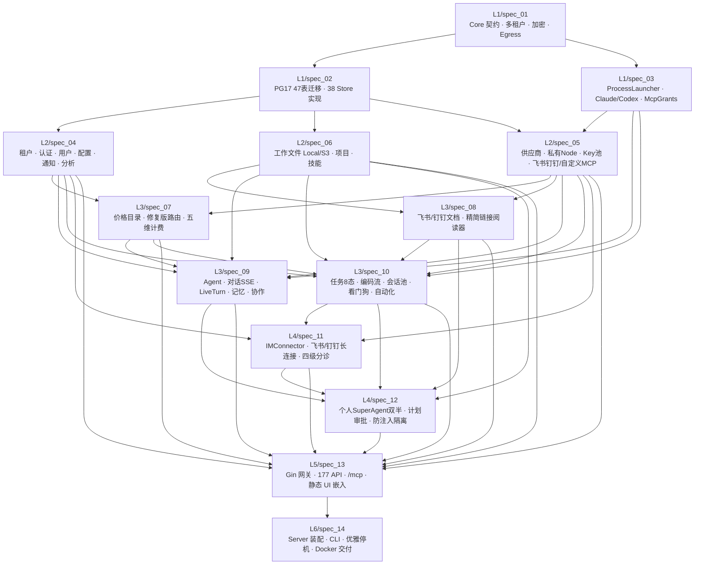

# SuperAgent Go 版（商业私有化 V1）— L1–L6 模块总设归档（Epic 级）

> **归档说明**：本目录保留早期按 14 篇模块总设（Epic 级）编写的设计文档作为上位参照；实际逐 PR 实施与 Review 请以细粒度（1–2 人天/篇、L0–L6 共 42 篇）开发 Spec 看板 [../README.md](../README.md) 为准。  
> **架构总览**：参见 [../../README.md](../../README.md)。  
> **模版依据**：严格遵循 `spec-template.md` 规范（元数据头 + §1 背景与范围 + §2 交付物表 + §3 数据库设计 + §4 冻结契约 + §5 行为语义与 Java→Go 详细伪代码 + §6 TDD 任务清单 + §7 文档同步 + §8 测试清单 + §9 验收门 + §10 可提交节点）。  
> **重构参照**：所有 Spec 均逐文件扫描 Java 参考源码 `/Users/gaorenjie/Documents/Coding/aiops-workspace/orgin/SuperAgent`，标注精确的 Java 类/方法/行号参考路径，并对照给出 V1 商业私有化裁剪点与原版缺陷修复说明。

---

## 1. 工程与 V1 裁剪红线（全部 14 篇共同遵守）

1. **目标工程**：`synapse-server`（`module github.com/Karlsk/synapse-os`，`go 1.26.1`），技术栈为 **Go 1.26 + Gin + PostgreSQL 17 (`pgx/v5` + `goose`) + 标准库 `crypto/aes`/`slog` + `robfig/cron/v3` + `embed.FS`**。
2. **严格分层防循环**：`L6(cmd) → L5(web/ui) → L4(orchestrator/event) → L3(agent/task/cost/docs) → L2(platform/files/project/skills) → L1(storage/runtime) → L0(core)`；同层模块禁止互引（尤其 `internal/agent` 与 `internal/task` 绝不互引）。
3. **V1 锁定裁剪与修复清单**：
   - **保留多租户隔离，砍掉公网自助注册**（改为 `bootstrap-org` CLI / 超管开户）；
   - **执行引擎接口化**，V1 正式实现 **`Claude Code`（含热进程池）** 与 **`Codex`** 两套 GA 适配器；
   - **预置连接器仅保留飞书/钉钉生态**（`feishu`、`dingtalk` 企业集成；`feishu-docs` OAuth、`dingtalk-tools` 连接器）+ **通用自定义 MCP**，砍掉 GitHub/Gitee/Notion/Confluence 4 套 SaaS 预置；
   - **Agent 砍掉 24 个内置性格预设**，纯自定义 `persona`；**技能砍掉 3 个消费级种子**；**链接阅读砍掉微信/Google/飞书匿名网页爬虫**，保留飞书授权直读 + 通用 HTML/PDF；
   - **存储抽象 Store 接口，首期单库 PostgreSQL 17**（砍 ClickHouse 双写、删 `*.tier`/`tracked_json`/`event_source` 5 废弃列与 `MaterialPrompt` 死代码、为 `agent_event` 补主键 `BIGSERIAL`、新增 `user_session` 持久化会话表、使用 `goose` 版本迁移杜绝删表）；
   - **V1 修复原版缺陷**：补齐 `TaskModelRouter` 固定模型模式与单候选跳裁判；修复 `TaskSessionPool` 跨模型轮换与 `TaskService.Recover`；MCP 工具领域异常统一返回 `isError: true`；`EgressGuard` 升级至 `DialContext` 级抗 DNS Rebinding；共享发言人前缀覆盖项目成员；
   - **一期预留二期接口**：`ProcessLauncher`（沙箱）、`ModelGateway`（集中网关）、`Authenticator`（OIDC/LDAP）、`IMConnector`（企微）、`OwnerTransferHook`（离职交接）。

---

## 2. L1–L6 Spec 实施 DAG 依赖拓扑

---

## 3. L1–L6 Spec 全量实施看板与 Java 模块对照

| 篇号 | 层级 | PR 编号 | Spec 文档 | 目标 Go 包 | 对应 Java 原版参考模块 | 里程碑 | 状态 |
|:---:|:---:|:---:|---|---|---|:---:|:---:|
| 01 | L1 (含L0) | `SA-01` | [L1/spec_01_core_tenant_crypto_egress.md](./L1/spec_01_core_tenant_crypto_egress.md) | `internal/core/*` | `superagent-core`, `superagent-api` | M0 | `draft` |
| 02 | L1 | `SA-02` | [L1/spec_02_storage_postgres_migrations.md](./L1/spec_02_storage_postgres_migrations.md) | `internal/storage/postgres/*` | `superagent-storage` | M0 | `draft` |
| 03 | L1 | `SA-03` | [L1/spec_03_runtime_launcher_claude_codex_mcp.md](./L1/spec_03_runtime_launcher_claude_codex_mcp.md) | `internal/runtime/*` | `superagent-runtime` | M1 | `draft` |
| 04 | L2 | `SA-04` | [L2/spec_04_platform_tenant_auth_user_settings_notice.md](./L2/spec_04_platform_tenant_auth_user_settings_notice.md) | `internal/platform/{tenant,user,auth,settings,notice,analytics}` | `superagent-platform/{tenant,user,org,settings,notice,analytics}` | M0/M3 | `draft` |
| 05 | L2 | `SA-05` | [L2/spec_05_platform_provider_node_credentials_connectors.md](./L2/spec_05_platform_provider_node_credentials_connectors.md) | `internal/platform/{provider,integration,connector}` | `superagent-platform/{provider,integration,connector}` | M1/M4 | `draft` |
| 06 | L2 | `SA-06` | [L2/spec_06_assets_files_projects_skills.md](./L2/spec_06_assets_files_projects_skills.md) | `internal/{files,project,skills}` | `superagent-files`, `superagent-project`, `superagent-skills` | M2 | `draft` |
| 07 | L3 | `SA-07` | [L3/spec_07_cost_catalog_router_usage.md](./L3/spec_07_cost_catalog_router_usage.md) | `internal/cost/*` | `superagent-cost` | M3 | `draft` |
| 08 | L3 | `SA-08` | [L3/spec_08_docs_feishu_dingtalk_link_reader.md](./L3/spec_08_docs_feishu_dingtalk_link_reader.md) | `internal/docs/*` | `superagent-docs` | M3/M4 | `draft` |
| 09 | L3 | `SA-09` | [L3/spec_09_agent_chat_liveturn_memory_collab.md](./L3/spec_09_agent_chat_liveturn_memory_collab.md) | `internal/agent/*` | `superagent-agent` | M2 | `draft` |
| 10 | L3 | `SA-10` | [L3/spec_10_task_codingflow_pool_watchdog_automation.md](./L3/spec_10_task_codingflow_pool_watchdog_automation.md) | `internal/task/*` | `superagent-task` | M3 | `draft` |
| 11 | L4 | `SA-11` | [L4/spec_11_event_feishu_dingtalk_inbox_triage.md](./L4/spec_11_event_feishu_dingtalk_inbox_triage.md) | `internal/event/*` | `superagent-event` | M4 | `draft` |
| 12 | L4 | `SA-12` | [L4/spec_12_orchestrator_superagent_dual_half.md](./L4/spec_12_orchestrator_superagent_dual_half.md) | `internal/orchestrator/*` | `superagent-orchestrator` | M4 | `draft` |
| 13 | L5 | `SA-13` | [L5/spec_13_web_gateway_mcp_endpoint_ui_embed.md](./L5/spec_13_web_gateway_mcp_endpoint_ui_embed.md) | `internal/web/*`, `internal/ui/*` | `superagent-web`, `superagent-ui` | M0–M4 | `draft` |
| 14 | L6 | `SA-14` | [L6/spec_14_server_bootstrap_lifecycle_docker_delivery.md](./L6/spec_14_server_bootstrap_lifecycle_docker_delivery.md) | `cmd/synapse-server/*`, `synapse-build/*` | `superagent-server`, `docker/` | M0/M5 | `draft` |

---

## 4. Review 与验收统一约定

- **每篇 Spec 均独立可审**：评审重点核对 `§2 交付物表`（边界无漂移）、`§3 数据库设计`（PG17 DDL 与索引）、`§4 冻结契约`（导出符号、HTTP 路由、错误码、SQL）、`§5 行为语义与 Java→Go 伪代码`（1:1 逻辑保真与裁剪修复）及 `§8/§9 测试与验收门`。
- **编码阶段铁律**：进入实施后，每一篇按 `§6 TDD 任务清单` 先写同包 `*_test.go` 验证红灯再落地实现，合入前必须全量满足 `§9 验收门`（含 `go test -race ./...` 与包依赖/租户守卫测试）。
