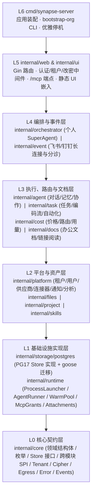

# SuperAgent Go 版（商业私有化 V1）架构设计与实施总览

> **产品定位**：面向企业私有化部署（允许联网）的商业化 AI 协作工作系统。  
> **参考基线**：[../SuperAgent/README.md](../SuperAgent/README.md)（完整保留原版 13 篇技术栈无关规格，本目录聚焦 **Go 1.26 + PostgreSQL 17 商业私有化 V1** 的架构落地、范围裁剪、缺陷修复与分期研发蓝图）。  
> **工程位置**：后端 Go 模块位于 `synapse-server`（`module github.com/Karlsk/synapse-os`，`go 1.26.1`）；前端过渡期复用并微调原版静态 UI（内嵌单二进制），后续按需在 `synapse-web` 演进独立现代前端。

---

## 1. V1 商业私有化最终功能边界

相较原版全量规格，V1 针对**“企业私有化商业售卖 + 允许联网”**做了精准裁剪、去债与架构预留：

| 类别 | V1 精确范围决策 |
|---|---|
| **保留核心 + 商业卖点** | • **基础多租户隔离**：`company_id` 全表强隔离 + 每租户 AES-256-GCM DEK 信封加密 + 租户目录隔离（满足集团多子公司与未来 SaaS 演进） • **插件化执行运行时**：接口化 `AgentRunner` + `StreamParser` + `ProcessLauncher`，**V1 正式落地 `Claude Code`（含长驻热进程池）与 `Codex`** • **内置 MCP 网关与连接器**：`POST /mcp`（Per-Turn 48 位随机令牌 + `CHAT`/`TASK`/`SUPER` 裁剪）、通用自定义 MCP（STDIO/HTTP/SSE），以及**飞书/钉钉相关预置集成与连接器**（飞书 IM + `feishu-docs` OAuth、钉钉 IM + 钉钉文档 + `dingtalk-tools`） • **Agent、任务与个人编排**：Agent 多轮对话/协作/记忆/`LiveTurn` 同屏旁观/7 阶段耗时埋点；异步任务 8 态/编码三步流/复杂分治/会话池/看门狗/自动化；个人 SuperAgent 双半隔离 + 计划审批门禁 + 飞书/钉钉长连接四级分诊 • **模型治理与成本**：私有 Node.js 托管 + 在线 CLI 安装升级（增补企业代理与 npm 镜像源配置）；多 Key 容灾；`models.dev` 定价同步 + `TaskModelRouter` + 五维用量与运营分析 • **资产与精简链接阅读**：工作文件（Local/S3 多渠道路由 + 3 层个人目录 + 自动打标）、项目空间、技能库（个人/企业两级 + 渐进披露）、精简 `LinkReaderService`（`EgressGuard` + HTML/PDF/纯文本 + 飞书 OAuth 授权文档直读） |
| **明确裁剪（不搬运）** | • 公开自助注册企业（改为部署初始化 CLI / 平台超管创建，便于挂接商业 License） • GitHub / Gitee / Notion / Confluence 4 套预置 SaaS 连接器与对应 OAuth 客户端 • 24 个内置性格预设（`AgentCharacters`）与固定头像白名单限制（全按需自定义 `persona`） • 3 个消费级内容运营/写作种子技能 • 微信公众号 / Google Docs / 飞书匿名网页 BFS 爬虫 • ClickHouse 双写分析库（V1 统一单库 PostgreSQL，通过 Store 接口保留未来拆分能力） • 原版死代码与废弃列（`MaterialPrompt`、`*.tier`、`superagent_state.tracked_json`、`event_source` 5 个空列） |
| **V1 同步修复的原版缺陷** | 1. 补全 `TaskModelRouter` 缺失的管理员固定模型模式（`fixedStart`/`fixedNext`），新增“单候选模型自动跳过 LLM 裁判”优化 2. 完整实现 `TaskService` 重启恢复与看门狗会话轮换恢复，修复 `TaskSessionPool` 跨模型复用未轮换会话的缺陷 3. 统一将所有 MCP 工具领域异常包装为 `isError: true` 工具级错误 4. 为 `agent_event` 增加物理主键；用版本化 Schema Migration 替代原版缺列删表逻辑 5. 共享 Agent 发言人前缀覆盖项目协作者；补齐 Agent 设置变更审计日志 |
| **一期预留抽象 · 二期交付** | • **一期建接口、二期落实现**：`ProcessLauncher`（Docker/gVisor/K8s 沙箱与独立 Worker）、`ModelGateway`（集中式 3 协议透传网关，密钥彻底离开沙箱）、`Authenticator`（企业 OIDC/LDAP SSO 与组织同步）、`IMConnector`（企业微信扩展）、`OwnerTransferHook`（员工离职一键转交名下 Agent/任务/自动化） |

---

## 2. Go 1.26 核心技术栈选型

严格遵循**“少依赖、强并发、单二进制、接口隔离、长期可维护”**原则：

| 层次 | 推荐选型 | 选型依据 |
|---|---|---|
| **语言与运行时** | **Go 1.26.1** | 单静态二进制、低内存、原生 goroutine/channel 完美契合 SSE 旁观、多租户调度循环与 CLI 子进程流控 |
| **HTTP / SSE 网关** | **`github.com/gin-gonic/gin`** | 团队既有生态统一，中间件链清晰，原生支持流式 SSE 写入、Multipart 50MB 上传与静态资源路由 |
| **数据库（V1 单库）** | **PostgreSQL 17** + **`jackc/pgx/v5`** (`pgxpool`) | 强一致性、原生 `TIMESTAMPTZ`/`JSONB`、高性能连接池；所有业务逻辑只面向 `internal/core/store` 接口编程，不耦合 `pgx` 细节，未来可零侵入补 MySQL 实现 |
| **Schema 迁移** | **`pressly/goose/v3`** + `//go:embed` | 版本化 SQL 迁移文件直接编译进二进制，支持私有化客户跨版本平滑升级与回滚 |
| **定时调度** | **`robfig/cron/v3`** | 原生支持标准 5 字段 Cron + IANA `time.LoadLocation` DST 安全推算 |
| **加密与认证** | 标准库 `crypto/aes`, `crypto/cipher`, `crypto/sha256`, `crypto/subtle` + `golang.org/x/crypto/bcrypt` | 零第三方重依赖实现 AES-256-GCM 租户信封加密、Webhook 常量时间校验与密码哈希 |
| **对象存储（可选）** | **`aws/aws-sdk-go-v2/service/s3`** | 兼容 AWS S3、MinIO、Cloudflare R2、阿里云 OSS、腾讯云 COS |
| **IM 长连接与文档** | 飞书官方 Go SDK / 钉钉 Stream WebSocket (`coder/websocket`) + `golang.org/x/net/html` + PDF 提取库 | 稳定维持每公司独立出站 WebSocket 与企业代理兼容 |
| **可观测性** | 标准库 **`log/slog`** + **`prometheus/client_golang`** | 零额外日志框架实现结构化 JSON/文本日志与 `traceId`/`companyId`/`userId` 上下文透传，直接暴露 `/actuator/prometheus` |
| **前端打包** | 标准库 **`embed.FS`**（开发期支持 `--ui-dir` 直读热刷新） | 商业交付真正实现“一个 Go 二进制 + 一个配置文件”即启即用 |

---

## 3. L0–L6 包依赖架构全景

借助 Go 的 `internal/` 可见性边界与编译期防循环引用约束，严格落实 7 层单向向下依赖：

---

## 4. 分册设计文档导航

| 编号 | 文档链接 | 核心设计内容 |
|---|---|---|
| **01** | [01_Go工程架构_目录结构与核心底座设计.md](./01_Go工程架构_目录结构与核心底座设计.md) | `synapse-server` 完整包目录树与编译期/测试期依赖守卫、`context.Context` 多租户传递、`Authenticator` 认证与会话/改密中间件、超管/CLI 开户、AES-256-GCM 信封加密、防 DNS-Rebinding 的 `EgressGuard`、配置与代理/自签 CA、日志/指标/优雅停机 |
| **02** | [02_PostgreSQL存储层与Store接口设计.md](./02_PostgreSQL存储层与Store接口设计.md) | 抽象 `Store` 接口体系、从 46 表精简重构后的 **40 张 PostgreSQL 17 表全量 DDL**（含补主键、去废弃列、索引与 `ON CONFLICT` 幂等规范）、`pgxpool` 与租户强校验、`goose` 内嵌版本迁移与多库扩展边界 |
| **03** | [03_核心抽象与插件化引擎_Runtime_MCP与ModelGateway.md](./03_核心抽象与插件化引擎_Runtime_MCP与ModelGateway.md) | 四大核心可插拔接口（`ProcessLauncher`、`AgentRunner`/`StreamParser`、`ModelGateway`、`McpToolProvider`）、`Claude`（含 Go 并发热进程池）与 `Codex` 适配器详设、内置 `/mcp` 端点与 `McpGrants`、自定义 MCP 与飞书/钉钉预置连接器 |
| **04** | [04_核心业务域Go并发设计_对话_任务_编排_IM与成本路由.md](./04_核心业务域Go并发设计_对话_任务_编排_IM与成本路由.md) | `LiveTurn` 多订阅者 SSE 扇出广播器、三层容灾与记忆蒸馏、任务调度/会话池/看门狗/自动化、SuperAgent 双半与防注入隔离、`IMConnector` 接口与飞书/钉钉长连接、私有 Node/CLI 在线安装、修复后的 `TaskModelRouter` 与资产/链接阅读模块 |
| **05** | [05_前端兼容策略_部署运维与分期研发实施路线.md](./05_前端兼容策略_部署运维与分期研发实施路线.md) | `/api/v1` 契约对齐与原版静态 UI 4 处精准微调清单、向 `synapse-web` 现代前端演进路径、商业私有化单二进制与 Docker 交付规范，以及 **M0–M5 六阶段可验收研发施工路线图** |
