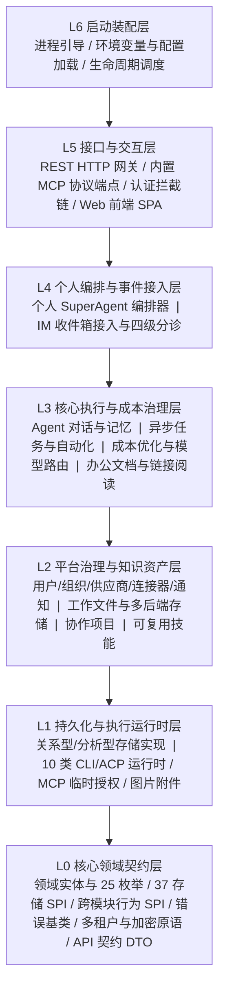
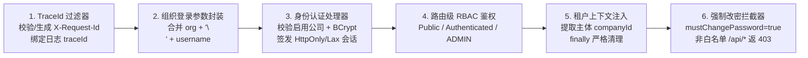

# 01. 系统架构与多租户安全底座

> 本文档定义 SuperAgent 的基础设施与横切治理架构，涵盖逻辑分层与依赖规则、Fail-Closed 多租户强隔离、身份认证与强制改密流程、RBAC 权限体系、信封加密与出口 SSRF 防护、租户配额、用户/组织/品牌/系统配置、统一待办通知中心，以及可观测性与运行时配置清单。全文严格保持技术栈无关。

---

## 1. 逻辑分层与模块解耦规则

SuperAgent 将全部业务划分为 **7 个逻辑层级（L0–L6）**，严格强制**单向向下依赖**（上层可依赖下层，同层平行模块间禁止相互依赖），通过核心层 SPI（服务提供方接口）与领域事件实现倒置解耦：



**关键架构边界**：
1. **对话与任务平级隔离**：`Agent 对话` 与 `异步任务` 处于同一 L3 层级且**永不互相依赖**；二者共用的能力（技能、文件）下沉至 L2，同时需要二者的能力（个人 SuperAgent 编排器、收件箱分诊）上浮至 L4，跨模块协作通过 L0 的 `TaskDoers`、`ProjectAccess`、`ModelRouter`、`TaskModelSelector`、`InboxProcessor` 等 SPI 及领域事件完成。
2. **协议层零业务逻辑**：L5 网关层只负责 HTTP 路由、鉴权、参数反序列化、SSE/二进制响应封装与全局异常映射，所有业务规则均内聚在领域模块。
3. **MCP 工具就近贡献**：每个领域模块在服务旁声明自己的 `McpToolProvider` 插件；L5 的 `/mcp` 端点只负责 JSON-RPC 2.0 协议编解码、令牌鉴权与按 `GrantKind` 路由分发，不感知任何具体工具的业务实现。

---

## 2. Fail-Closed 多租户强隔离体系

### 2.1 租户模型与生命周期

- **无内置特殊租户**：系统采用完全平等的多组织模型，所有企业均通过自助注册（或初始化导入）成为全局 `company` 表中的独立行；每个企业拥有独立的用户、密钥池、集成配置、Agent、任务、文件与配额。
- **租户标识 (`company_id`) 规范**：即企业注册时填写的英文简称（slug），规范化为小写，必须满足正则 `[a-z][a-z0-9-]{1,30}[a-z0-9]`（3–32 字符，字母开头、字母或数字结尾），严禁使用 **12 个平台保留字**：`admin`、`api`、`www`、`root`、`system`、`login`、`mcp`、`static`、`support`、`help`、`default`、`platform`。
- **平台哨兵上下文 (`DEFAULT_ID = "superagent"`)**：**不是真实企业**，仅用于登录前无租户上下文的公共能力（如登录页企业 Logo 兜底与启动期 `/mcp` 探活自检）。
- **公司启动事件 (`CompanyStarted`)**：应用启动就绪时遍历所有已启用公司，以及新公司注册成功瞬间，均在对应租户上下文中发布 `CompanyStarted(companyId)`，驱动各领域模块执行每公司初始化（内置连接器种子、3 个默认技能种子、通知回填、任务会话池恢复、历史工作补录、遗留秘书 Agent 清理、开启飞书/钉钉长连接）。

### 2.2 Fail-Closed 上下文传播与存储强校验

- **调用链上下文 (`TenantContext`)**：
  - `require()`：读取当前执行上下文中的 `companyId`；**若缺失立即抛出异常中止操作（Fail-Closed）**，杜绝跨租户裸查。
  - `run(companyId, work)` / `call(companyId, work)`：拒绝空/空白租户 ID，压入目标租户并在 `finally` 中严格恢复前值或清空。
  - `wrap(work)`：在向异步线程池提交任务前于提交线程**立即捕获当前租户 ID** 并包装闭包，确保异步线程与回调不丢租户。
- **全入口上下文注入矩阵**：

| 流量入口 | 租户确立方式 |
|---|---|
| 已登录 HTTP 请求 | 认证过滤器之后的租户过滤器从登录主体读取 `companyId` 注入上下文，请求结束在 `finally` 清除 |
| 账号密码登录 | 登录过滤器将表单 `org` 与 `username` 合并；校验目标公司处于启用态后切入该租户查询用户 |
| 内置 `/mcp` 调用 | 按 `Authorization: Bearer <token>` 查找内存授权令牌所绑定的 `companyId` 切入执行 |
| 外部自动化 Webhook | 跳过会话认证，从 `X-Automation-Token` 请求头首个 `.` 之前解析 `<companyId>` 切入校验 |
| 后台定时/巡检循环 | 通过全局公平轮转器（`CompanyService.forEach`）每轮递增起始偏移轮询全部启用公司，单公司异常隔离 |
| IM 长连接推送 | 每公司维护独立 WebSocket 连接，所有回调消息在对应连接绑定的 `companyId` 上下文中入池处理 |

- **数据层强制约束**：46 张逻辑表中仅 `company` 为全局表，其余 **45 张业务表全部以 `company_id` 作为主键与二级索引的首列**，每一条读写 SQL 强制拼接 `company_id = <TenantContext.require()>`。

### 2.3 文件系统多租户目录布局 (`TenantPaths`)

所有租户磁盘路径在使用瞬间动态解析为 `<root>/<companyId>`，且强制校验 `companyId` 匹配 `[A-Za-z0-9][A-Za-z0-9_.-]{0,127}` 并禁止包含 `..`：

```text
<DATA_ROOT>/
├── secret.key                                  # [平台全局] 32 字节 AES-256 主密钥 (Base64, 权限 0600)
├── runtime/
│   ├── node/                                   # [平台全局] 平台托管私有 Node.js LTS 运行时
│   ├── glm/                                    # [平台全局] GLM 隔离 CLI 配置目录
│   └── kimi/                                   # [平台全局] Kimi CLI 配置目录
├── workspaces/<companyId>/<sessionId>/         # [租户隔离] Agent 对话工作区（跨会话复用）
├── tasks/<companyId>/<sessionId>/              # [租户隔离] 任务会话池工作区
├── files/<companyId>/                          # [租户隔离] 本地工作文件字节、.staging 上传暂存、.cache 远端缓存
├── attachments/<companyId>/<ownerId>/<msgId>/  # [租户隔离] 对话/任务内联图片附件
├── avatars/<companyId>/<sha256(userId)>        # [租户隔离] 用户头像位图
├── branding/<companyId>/logo                   # [租户隔离] 企业自定义 Logo
└── skills/<companyId>/<skillId>/images/        # [租户隔离] 技能文档内嵌图片
```

### 2.4 平台全局 vs 单公司边界

| 作用域 | 归属资源 |
|---|---|
| **平台全局** | `company` 表、主加密密钥（KEK）、宿主机 CLI 可执行文件与私有 Node.js 运行时、开放注册开关 `registration.enabled`、默认租户配额配置、外部 `models.dev` 公开价格目录缓存、全局进程并发上限 `task.max-parallel`、内置 `/mcp` 监听地址与内存令牌映射（带租户标签）、运维健康与基础指标 |
| **每公司独立** | 其余全部 45 张业务与分析表、每公司独立数据加密密钥（DEK）、每公司配额覆写值、全部 7 棵本地数据目录树、所有系统设置/集成配置/模型密钥池/连接器/存储渠道、独立飞书与钉钉长连接 |

---

## 3. 认证、授权与安全护栏架构

### 3.1 身份模型与企业自助注册

- **预置账号制（Preprovision-Only）**：仅存在于当前公司 `app_user` 且 `enabled = true` 的账号允许登录。
- **不可变主键原则**：每个员工分配全局不可变 UUID `user.id`；全系统所有表中的 `owner`、`created_by`、`author`、`username`（成员表）均持久化 **`user.id`** 而非可变登录名 `username`，确保同名新员工永不继承离职者资产。
- **登录来源 (`UserSource`)**：数据模型预留 `LOCAL`、`PHONE`、`SSO`、`WECHAT` 四种来源（且网关预留相应路径放行），**当前完整落地的是 `LOCAL`（组织 + 用户名 + BCrypt 密码）**。
- **自助注册流程 (`POST /api/v1/orgs`)**：
  1. 校验开关 `registration.enabled == true`（否则 403 `RegistrationClosed`）；
  2. 校验公司显示名（1–64 字）与英文简称格式/保留字/唯一性（冲突返回 409）；
  3. 用密码学安全随机数从 55 个无歧义字符集（剔除 `I/O/l/0/1`）生成 **14 位一次性初始密码**；
  4. 创建 `company` 并发布 `CompanyStarted`，同时在该租户内创建初始管理员：`username = <org>`、`displayName = "<公司名> 管理员"`、`roles = ["ADMIN"]`、`source = LOCAL`、BCrypt 密码哈希、**`mustChangePassword = true`**；
  5. 响应返回一次明文初始密码，服务端绝不落盘明文。

### 3.2 请求安全过滤链与强制首次改密

HTTP 请求严格按以下 6 级顺序经过网关管道：



- **会话安全策略**：服务端会话 Cookie 开启 `HttpOnly = true`、`SameSite = Lax`；同源部署无跨域 CORS；响应头设 `X-Frame-Options: SAMEORIGIN`（允许文件抽屉内嵌同源 PDF 预览 iframe，防止跨站点击劫持）。
- **未认证响应差异**：访问 `/api/*` 或 `/mcp` 返回 HTTP `401` JSON（`{"code":"unauthorized","message":"请先登录"}`）；访问前端页面路径返回 HTTP `302` 重定向至 `/login`。
- **强制改密规则**：组织初始管理员、管理员新建带密码账号或管理员重置密码后，均置 `mustChangePassword = true`。除 `/api/v1/auth/*`、`/api/v1/account/password`、`/api/v1/meta`、`/api/v1/branding*`、`/api/v1/orgs*` 外，所有 `/api/*` 请求被拦并返回 HTTP `403`（`code: "password_change_required"`）。一旦检测到无需改密，在当前会话中缓存 `sa.passwordOk = true` 避免每次查库；新密码要求长度 **≥ 8 位**且不得与旧密码相同。

### 3.3 两层角色与资源权限体系

- **基础角色**：所有认证用户隐式具备 `USER`，管理员具备 `ADMIN`。
- **路由级门禁**：
  - **公开免登**：登录页与静态资产、`/api/v1/meta`、`/actuator/health`、`/api/v1/branding/logo`、注册与登录端点、`/mcp`（令牌鉴权）、`POST /api/v1/automations/*/trigger`（Webhook 令牌鉴权）。
  - **管理员专属 (`ADMIN`)**：`/api/v1/users/**`、`/api/v1/admin/**`、`/api/v1/providers/**`、连接器管理写接口、系统设置写接口。
  - **普通已认证用户**：个人工作台、Agent/对话/任务/自动化/文件/项目/技能/收件箱/待办/个人用量、连接器读取与个人授权、只读系统设置。
- **最小管理员保护**：禁止删除、禁用或剥夺公司最后一个启用状态管理员的 `ADMIN` 角色。

### 3.4 信封加密方案 (`SecretCipher`)

所有敏感凭据（连接器 OAuth/API 令牌、模型 API Key、外部集成密钥、S3 密钥）均采用 **AES-256-GCM 双层信封加密**（96 位随机 IV + 128 位认证标签）：

1. **主密钥（KEK，32 字节）**：优先读取配置 `secret.key`（Base64）；未配置时读取 `secret.key-file`（默认 `./data/secret.key`）；文件不存在时自动安全随机生成并以 `0600` 权限落盘。
2. **每公司数据密钥（DEK，32 字节）**：首次在某租户内加解密时懒生成随机 32 字节 DEK，用主密钥以 AAD = `"company:<companyId>"` 加密包裹为 `v1:<base64(iv||ct||tag)>` 写入 `company.data_key_cipher` 并内存缓存。
3. **密文格式与跨租户密码学拒止**：
   - 租户内密文：`v2:<companyId>:<base64(iv||ct||tag)>`，以该公司 DEK 加密且 GCM AAD 绑定 `<companyId>`。
   - **解密强校验**：解析 `v2:` 前缀中的 `<companyId>`，若与当前 `TenantContext` 不一致，**直接抛出异常拒绝解密**——即便数据库发生意外串库，也无法跨租户解出明文。
   - 无租户场景兜底格式：`v1:<base64(iv||ct||tag)>`（主密钥直加密，无 AAD）。

### 3.5 出站 SSRF 防护 (`EgressGuard`)

服务端代用户或 Agent 访问外部 URL（如通用链接阅读器）时，强制经过公网出口守卫校验：
1. **协议与端口白名单**：仅允许 `http` / `https`，仅放行默认端口及 `80`、`443`、`8080`、`8443`。
2. **本地域名后缀拦截**：拒绝 `localhost`、`*.localhost`、`*.local`、`*.internal`（支持管理员显式配置精确域名或 `.suffix` 白名单例外）。
3. **全量 DNS 解析与公网 IP 强校验**：解析目标主机名对应的**全部 A/AAAA 记录**，要求**每一个 IP 均必须为公网地址**（或命中管理员配置的 IPv4 CIDR 白名单），严格封禁：
   - IPv4：`0.0.0.0/8`、`10.0.0.0/8`、`100.64.0.0/10`（CGNAT）、`127.0.0.0/8`、`169.254.0.0/16`（云元数据/链路本地）、`172.16.0.0/12`、`192.168.0.0/16`、`198.18.0.0/15`（基准测试）、`224.0.0.0/3+`（组播与保留段）。
   - IPv6：回环 `::1`、链路本地 `fe80::/10`、唯一本地地址 ULA `fc00::/7`、组播地址。
4. **重定向逐跳防绕过**：HTTP 客户端关闭自动重定向，在业务循环中逐跳（上限 6 跳）对 `Location` 再次执行 `EgressGuard` 校验。

---

## 4. 租户配额、用户组织、系统配置与通知中心

### 4.1 三维租户配额体系 (`QuotaService`)

每项配额遵循**“公司表字段优先 -> 全局默认配置兜底 -> `<= 0` 表示不限”**三级解析规则：

| 配额项 | 全局配置键（默认 `0`） | 精准拦截点 | 超限行为 |
|---|---|---|---|
| **最大用户数** (`max-users`) | `tenant.quota.max-users` | 管理员创建用户时（统计全公司含禁用的总账号数） | 拒绝创建，HTTP 403 |
| **最大并发任务** (`max-running-tasks`) | `tenant.quota.max-running-tasks` | 任务调度器准入扫描时（统计 `RUNNING` + 已准入 + 已有工作区的排队任务） | 暂停本次准入，多余任务留在 `PENDING` 等下轮 |
| **月度 Token 上限** (`monthly-tokens`) | `tenant.quota.monthly-tokens` | 创建任务前 与 发送对话消息前（按 UTC 自然月汇总全公司含系统探活的 `UsageRecord.total`，每公司缓存 **1 分钟**且跨月自动失效） | 拒绝发起，HTTP 403 |

### 4.2 组织架构、同事目录与个人账户

- **组织架构 (`OrgService` & `TeamPaths`)**：存储直属汇报线（`user_manager`，每人至多 1 位上级）与多对多部门归属（`user_team`，采用 `/` 分隔物化路径，如 `技术中心/后端组`，单段 ≤64 字、最多 **8 层**，禁止 `.` 开头及 `›`、`\`、控制字符）。系统不设单独部门表，部门树由成员路径及其全部祖先路径动态推导。当前组织服务为只读设计（面向外部通讯录同步），已供收件箱上下级分诊与用户信息接口消费，尚未开放管理端写接口。
- **同事通讯录 (`PeopleDirectory`)**：面向全员提供只读脱敏列表（仅返回启用同事的 `id`、`username`、`displayName`，按显示名排序，隐藏角色与手机号）。
- **个人头像与企业品牌 Logo**：均采用 Base64 上传、上限 **1 MB**、魔数嗅探仅放行 PNG/JPEG/GIF/WebP（禁 SVG）、原子临时文件替换；头像按 `sha256(userId)` 存储并以文件修改毫秒数作缓存版本号；企业 Logo 支持公开获取（未定制时回退系统内置 PNG，返回 `ETag` 与 `nosniff`）。

### 4.3 系统配置全量键表 (`SystemSettingStore`)

`system_setting` 以租户隔离的扁平 KV 结构承载全平台可动态热改的配置（空串视为未设置）：

| 配置键 / 前缀 | 所属能力 | 值格式与约束 | 默认值 |
|---|---|---|---|
| `agent.default-model` | 对话与路由 | 模型 ID（新选须已通过推理探活） | 未设置（按最强可用） |
| `agent.backup-models` | 对话容灾 | 逗号分隔有序模型 ID 列表 | 空 |
| `company.name` / `company.short-name` | 企业品牌 | 显示名 ≤100 字 / 简称 ≤20 字 | 回退 `company.name` / 空 |
| `app.public-url` | 回调地址 | 合法 `http(s)://` URL（无尾斜杠/query/userinfo） | 空（依次回退环境变量与请求头） |
| `task.complex.max-subtasks` / `max-parallel` | 复杂任务 | 整数 `1..50` / `1..20` | `10` / `5` |
| `task.fixed-models.on` / `task.fixed-models` | 固定模型模式 | `"true"` / 逗号分隔模型 ID（开启时不可为空） | 关闭 / 空 |
| `codebuddy.internet-environment` | CodeBuddy 地域 | `internal` \| `public` \| `ioa` \| `cloudhosted` \| `selfhosted` | `internal` |
| `cost.price.<modelId>` / `cost.fact.<modelId>` | 成本定价 | `<in>\|<out>\|<date>\|<src>\|<cacheRead>\|<cacheWrite>` | 目录自动同步 |
| `cost.task-off.<modelId>` | 成本路由 | `"true"` 表示禁止参与任务路由 | 未设（允许参与） |
| `integration.<key>.enabled` / `.<field>` | 企业集成 | 启停与明文/密文字段（6 大集成） | 关闭 |
| `files.storage.active` / `.channels` / `.channel.<id>.*` | 文件存储 | 活跃渠道、渠道列表与加密连接参数 | `internal`（本地磁盘） |
| `connector.seeded.<id>` / `notice.backfilled` / `skill.seeded` | 一次性初始化锁 | `"true"` 幂等标记 | 未设 |

### 4.4 统一待办通知中心 (`NoticeService`)

待办首页将跨模块的 5 类核心领域事件去重汇聚为每用户的结构化卡片（按 `(owner, notice_key)` 幂等 Upsert，同类事件更新同一卡片不刷屏）：
- **5 种类型 (`Notice.Kind`)**：`CONFIRM`（需决策确认）、`ACTION`（待办行动项）、`DONE`（后台完成汇报）、`NOTICE`（系统/协作提醒）、`TRACK`（内部隐藏态，用于在任务运行中记住来源标签，拒绝人工变更）。
- **3 种状态 (`Notice.State`)**：`OPEN`、`DONE`、`IGNORED`（永久忽略）。
- **事件汇聚矩阵**：
  1. `TaskStatusChanged`（key `task:<taskId>`）：`pending` 建 `TRACK` -> `needs_confirmation`/`error` 升为 `CONFIRM` -> `done` 转为带 200 字纯文本摘要的 `DONE` -> `stopped`/`deleted` 置 `IGNORED`；
  2. `PlanChanged`（key `plan:<owner>`）：提案建 `CONFIRM`，审批通过转 `DONE`；
  3. `InboxTodoChanged`（key `todo:<todoId>`）：同步 `ACTION` 状态；反向忽略卡片触发 `NoticeIgnored` 联动忽略收件箱待办；
  4. `AgentShared`（key `shared:<agentId>`）：给受邀同事发 `NOTICE`；
  5. `DefaultModelChanged`（key `default-model`）：向全体启用管理员扇出默认模型降级或恢复的 `NOTICE`。
- **首页统计指标 (`NoticeStats`)**：实时汇总 `OPEN` 的待确认/待办/未读数，并按配置时区（默认 `Asia/Shanghai`）直接统计当前用户任务表中今日、本周（周一起）、本月及累计完成任务数。

---

## 5. 统一错误体系、可观测性与运维部署规范

### 5.1 统一错误分类与 HTTP 状态映射

所有业务领域异常继承自核心层 **4 大基础异常类型**，由全局异常处理器集中捕获、记日志并输出标准错误信封 `{"code": "...", "message": "...", "data": null}`（禁止在抛出点吞异常）：

| 语义错误类 | HTTP 状态码 | 机器错误码 (`code`) | 典型业务场景 |
|---|---|---|---|
| 参数/格式非法 | `400` | `invalid_argument` | 字段校验失败、非法 Cron/时区、魔数不符、删除唯一管理员 |
| 未登录 / 凭证无效 | `401` | `unauthorized` | 未携带有效会话、登录失败、`/mcp` 令牌失效 |
| 需强制改密 | `403` | `password_change_required` | 初始密码或重置密码后未改密 |
| 权限/策略拒绝 | `403` | `forbidden` | 无权编辑、配额超限、注册关闭、未配企业模型密钥、SSRF 拦截、自动化令牌无效 |
| 资源不存在或不可见 | `404` | `not_found` | 资源缺失或无权查看（防 ID 探测统一报 404） |
| 方法不支持 | `405` | `method_not_allowed` | 错误 HTTP 动词、`GET /mcp` |
| 状态冲突 / 唯一冲突 | `409` | `conflict` | 重名组织/用户、资料不可读、重复添加供应商、任务运行中追问 |
| 并发执行忙碌 | `409` | `busy` | 同一 Agent 已有活跃对话回合在进行中 |
| 请求体超限 | `413` | `too_large` | 上传文件超过 50 MB |
| 服务端内部异常 | `500` | `internal_error` | 未预期运行时故障 |

### 5.2 全链路追踪、日志、指标与部署约束

- **TraceID 规范**：入站接收 `X-Request-Id` 仅放行匹配 `[A-Za-z0-9._-]{1,64}` 的安全字符（防日志伪造注入），不合法或缺失则生成 32 位十六进制随机 ID，绑定日志上下文 `traceId` 并通过响应头 `X-Request-Id` 回传。
- **结构化日志行格式**：`yyyy-MM-dd HH:mm:ss.SSS LEVEL [thread] [traceId] logger - message`。
- **运维端点**：健康探针 `/actuator/health` 公开免登（详情仅向认证用户展示），指标抓取端点 `/actuator/prometheus` 等需认证访问；服务支持 `SIGTERM` 优雅停机（默认 30 秒排空在途请求，启停脚本停机宽限 35 秒）。
- **容器与进程运行时要求**：
  - 容器必须以**非 root 用户**运行（如 `uid=10001`），因 Claude Code 明确拒绝在 `root` 身份下启用免确认标志；
  - 需配备轻量 init 进程（如 `tini`）回收大量短生命周期 CLI 子进程僵尸；
  - 需将 CLI 全局安装前缀目录授权给运行用户，以支持在容器内通过管理界面在线升级官方 CLI；
  - 持久化卷需挂载数据目录（工作区/文件/密钥/私有 Node）、日志目录与运行用户家目录，并支持透传 `HTTP_PROXY`/`HTTPS_PROXY`/`NO_PROXY` 访问海外模型 API。
