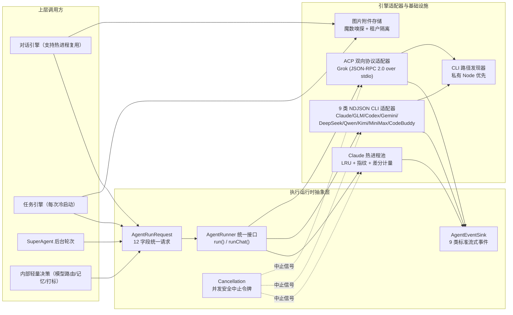
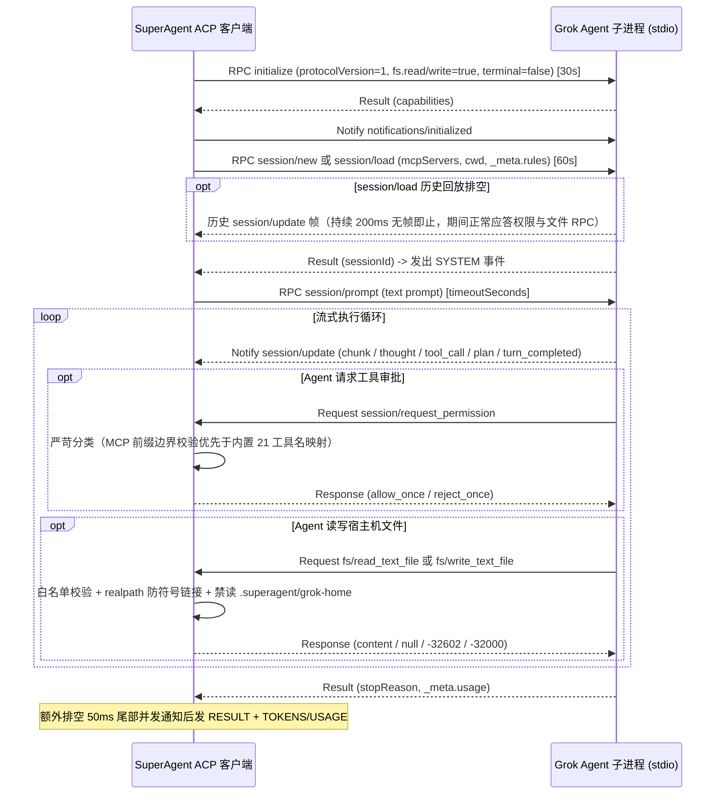

# 02. Agent 执行运行时与 CLI / ACP 协议适配

> 本文档定义 SuperAgent 的底层执行运行时设计，涵盖统一执行抽象、10 类官方 Coding Agent CLI / ACP 引擎适配器、流式输出解析、长驻热进程池、Token 精确计量、可执行文件发现及图片附件子系统。全文严格保持技术栈无关，以协议契约、状态机与进程交互语义为准。

---

## 1. 设计目标与架构定位

SuperAgent 的核心判断之一是**“将智能留给前沿模型与官方 Agent CLI，系统负责治理、编排、隔离与资产沉淀”**。运行时层屏蔽了不同厂商 CLI 在命令行参数、凭证注入、会话持久化、MCP 配置格式、流式输出协议及 Token 计量口径上的巨大差异，向上层（对话引擎、异步任务引擎、个人 SuperAgent 编排器）暴露一套统一的回合执行契约。



---

## 2. 统一运行时核心抽象

### 2.1 执行器接口 (`AgentRunner`)

每个支持的底层引擎实现一个适配器，核心提供两个阻塞式执行入口，按单回合（Turn）粒度运行：

| 操作 | 语义 | 调用方 |
|---|---|---|
| `type()` | 返回适配器对应的引擎枚举 `AgentType` | 运行时路由表 |
| `run(request, sink, cancellation)` | 阻塞执行单个回合，实时向 `sink` 推送标准化 `AgentEvent`；当底层 CLI 分配外部会话 ID 时发出 `SYSTEM` 事件 | 任务引擎、后台轮次、冷启动回退 |
| `runChat(request, sink, cancellation)` | 交互式对话专用入口，默认委托 `run()`；支持长驻热进程的适配器可覆写此方法以消除冷启动延迟 | 对话引擎 |

### 2.2 统一回合请求 (`AgentRunRequest`)

| # | 字段名 | 逻辑类型 | 空值与规范化规则 | 业务语义 |
|---|---|---|---|---|
| 1 | `sessionId` | `STRING` | 非空 UUID | 平台侧逻辑会话或任务会话池 ID，用作首次启动 ID、本地状态文件键与热进程池键 |
| 2 | `agentSessionId` | `STRING` | 首轮为空 | 上一轮通过 `SYSTEM` 事件捕获的底层 CLI 原生会话/线程 ID；非空时触发续跑（Resume） |
| 3 | `workspaceDir` | `STRING` | 绝对路径 | 子进程工作目录（`cwd`），同时承载 `.superagent/` 状态、隔离主目录与已安装技能 |
| 4 | `prompt` | `STRING` | 非空文本 | 本轮用户或系统提示词（按引擎要求通过 `stdin` 或命令行参数传入） |
| 5 | `model` | `STRING` | 可空 | 目标模型 ID；为空时由 CLI 决定默认模型（Qwen、Kimi 例外，必须显式指定） |
| 6 | `allowedTools` | `LIST<STRING>` | 可空 | 统一工具白名单（内置工具 `Read`/`Glob`/`Grep`/`LS`/`Edit`/`Write`/`Bash` 及 `mcp__<server>__*`） |
| 7 | `skipPermissions` | `BOOLEAN` | 默认 `false` | 是否跳过 CLI 内部工具审批与沙箱限制（仅用于受控隔离沙箱） |
| 8 | `mcpConfig` | `STRING` | 可空 JSON | 统一 MCP 配置 JSON（`{"mcpServers": {...}}`），包含平台内置 `/mcp` 与外部连接器 |
| 9 | `systemPrompt` | `STRING` | 可空 | 人设指令 + 技能渐进披露索引 + 文件交付规则 |
| 10 | `images` | `LIST<ImageAttachment>` | 空时归一化为空列表 | 本轮附带的图片列表（本地绝对路径 + 嗅探 MIME 类型） |
| 11 | `memory` | `STRING` | 去首尾空白，空串转 `null` | 长期记忆 Markdown 及最近原文结转；**仅在新会话或恢复失败重开时注入**，正常续跑不注入 |
| 12 | `credential` | `RunCredential` | 可空 | 本轮选中的企业 API 凭证（端点 + 密钥 + 认证方式），严禁出现在命令行参数中 |

**系统提示词与记忆拼接规则 (`systemPromptWithMemory`)**：
当且仅当新会话启动且 `memory` 非空时，在 `systemPrompt` 后以 `\n\n` 追加固定包装块：
```markdown
## 你与用户之前的会话
<memory>

（以上来自你与用户之前的会话：长期记忆是提炼过的，最近对话是原文。可能不完整；若与用户最新的说法冲突，以用户为准。不要向用户提及会话的切换。）
```

### 2.3 运行凭证 (`RunCredential`)

| 字段 | 逻辑类型 | 说明 |
|---|---|---|
| `id` | `STRING` | 凭证池条目 ID，用于精准归因故障与触发故障切换 |
| `baseUrl` | `STRING` | 自定义端点或中转网关 URL；为空时使用厂商默认端点 |
| `apiKey` | `STRING` | 解密后的明文密钥；序列化日志输出时必须脱敏，绝不通过命令行 `argv` 传递（仅通过环境变量或 `0600` 临时文件注入） |
| `bearer` | `BOOLEAN` | `true` 表示使用 `Authorization: Bearer` 认证头（适用于 Claude/GLM 中转网关），`false` 表示使用厂商专用 API-Key 请求头 |

### 2.4 标准化事件模型 (`AgentEvent` & `AgentEventType`)

每条事件包含：`sessionId`、`messageId`（上层落库前填充）、`seq`（单次尝试内单调递增序号）、`type`、`payload`、`createdAt`。共定义 **9 种**标准事件：

| 事件类型 | `payload` 格式 | 持久化与推送语义 |
|---|---|---|
| `SYSTEM` | 底层 CLI 原生会话/线程 ID | 上层捕获并写回会话记录，用于后续回合 `--resume` |
| `THINKING` | 思考/推理增量文本 | 流式推送前端与运行日志；Claude 恢复失败重开新会话时也借此发出提示 |
| `TEXT` | 助手正文增量文本（或 ACP 计划条目） | 累加构成回复正文并实时推送 |
| `TOOL_USE` | 工具名或 `"工具名: 精简摘要"`（摘要截断 120–160 字符） | 流式展示、计入耗时统计与任务进度递增 |
| `TOOL_RESULT` | 工具返回摘要、`"Permission denied: <tool>"` 或 `"Failed: <out>"` | 流式透传，供前端解析生成任务卡片/文件卡片 |
| `RESULT` | 本轮最终完整文本 | 正常终态标记，标志单轮执行成功结束 |
| `USAGE` | CLI 自报美元成本字符串（如 `"0.0123"`） | 仅 Claude 与 Grok 产出；任务输出流中过滤，仅作无单价时的兜底成本 |
| `TOKENS` | `TokenUsage` 对象数组 JSON | 由计费拦截器截获消费，**绝不持久化为对话事件、绝不推送到前端 SSE** |
| `ERROR` | 人类可读错误信息 | 异常终态标记；上层在首次尝试时暂扣不立即推送，以便零输出场景下静默切换密钥或模型 |

### 2.5 并发取消与进程终止 (`Cancellation`)

`Cancellation` 是一个线程安全的单槽位取消令牌，提供 `onCancel(callback)`、`cancel()`、`isCancelled()`：
- **防竞态注册**：若在子进程刚启动、尚未调用 `onCancel` 前用户已点停止，`onCancel` 发现状态已取消会立即同步触发回调，杜绝僵尸进程。
- **热进程防误杀**：长驻热进程每轮结束后必须重置回调为 `null`，避免迟到的取消请求误杀已归还池中的空闲进程。
- **差异化终止策略**：
  - **冷启动 CLI（Claude 冷模式 / Codex / 6 类 NDJSON CLI / Grok ACP）**：直接强制终止子进程（`SIGKILL`）；若 `isCancelled() == true`，忽略非零退出码且不发 `ERROR` 事件。
  - **长驻热进程（Claude Warm）**：先优雅关闭 `stdin` -> 发送 `SIGTERM` -> 最多等待 **2 秒** -> 仍存活则强制 `SIGKILL`，并清理临时配置文件。
- **SSE 断连解耦**：客户端主动断开 SSE 连接**不会**触发 `Cancellation.cancel()`，仅显式调用停止接口才会中止执行，保障长回复在用户切页或刷新后继续完成。

---

## 3. 上下文交付机制（跨引擎通用契约）

在调用任意 `AgentRunner` 前，上层服务按统一约定准备上下文：
1. **工作区目录**：每个子进程以 `workspaceDir` 为当前目录（MiniMax 额外传 `--cwd`，Grok ACP 传 `params.cwd`）。
2. **技能渐进披露**：每次非 SuperAgent 回合前，清空并重建 `<workspaceDir>/.superagent/skills/<skillId>/SKILL.md` 及 `images/*`（先校验 `.superagent` 与 `.superagent/skills` 非符号链接），将一行一条的 `# Skills` 目录索引拼入 `systemPrompt`，让模型按需读取完整文档。
3. **MCP 配置与传输能力边界**：
   - 平台组装统一 `{"mcpServers": {...}}` JSON（含平台内置 `superagent` HTTP 服务及用户已授权的外部连接器）。
   - **重要能力差异**：
     - **完整支持 `HTTP` + `SSE` + `STDIO` 连接器**：`CLAUDE`、`GLM`、`CODEBUDDY`、`GROK`。
     - **仅支持带 `Bearer` 认证的 `HTTP` 连接器**（解析时过滤掉无 `url` 的 `STDIO` 连接器与非 Bearer 自定义请求头）：`CODEX`、`GEMINI`、`DEEPSEEK`、`QWEN`、`KIMI`、`MINIMAX`。
4. **图片附件能力边界**：
   - **支持原生图片输入**：`CLAUDE`、`GLM`（含热进程模式，内联 base64 `stream-json`）、`CODEX`（`--image=<path>`）。
   - **不支持原生 `request.images`**：其余 7 类引擎（`GEMINI`、`DEEPSEEK`、`QWEN`、`KIMI`、`MINIMAX`、`CODEBUDDY`、`GROK`）忽略该字段（需通过工作区 `uploads/` 路径由文件工具间接访问）。

---

## 4. 10 类官方 CLI / ACP 引擎适配器全量规格

### 4.1 全量引擎能力与接入矩阵

所有引擎默认单轮超时均为 **600 秒**（可按引擎单独配置 `agent.<cli>.command` 与 `agent.<cli>.timeout-seconds`）。

| 引擎枚举 (`cliName`) | 默认命令 | 交互模式 | MCP 注入机制 | 系统提示词与记忆注入 | 会话续跑机制 | Token / 成本来源 |
|---|---|---|---|---|---|---|
| `CLAUDE` (`claude`) | `claude` | 冷启动 / 热进程池 | 临时 `--mcp-config` + `--strict-mcp-config` | `--append-system-prompt`（首轮含记忆，续跑不含） | `--session-id` / `--resume`（含自愈重试） | `modelUsage` / `usage` / 异常兜底 + `USAGE` |
| `GLM` (`glm`) | `claude` | 同 Claude（复用） | 同 Claude | 同 Claude | 同 Claude，独立 `CLAUDE_CONFIG_DIR`（`./data/runtime/glm`） | 同 Claude |
| `CODEX` (`codex`) | `codex` | 冷启动 `exec --json` | `-c mcp_servers.<name>.*` + `SUPERAGENT_MCP_TOKEN_<NAME>` 环境变量 | 每轮 `stdin` 前置 `<system>...</system>`（记忆仅首轮） | `.superagent/codex-sessions/<sid>`（严格 UUID 校验）-> `resume <tid>` | `turn.completed/failed` 拆分总量 |
| `GEMINI` (`gemini`) | `gemini` | NDJSON 通用基类 | `<configDir>/settings.json`（`httpUrl`, `trust: true`） | 首轮 `-p` 参数前置 `system + "\n\n---\n\n"` | `.superagent/gemini-session-<sid>` + 隔离 `GEMINI_CONFIG_DIR`/`HOME` -> `--resume` | `stats.models` 或扁平 `stats` |
| `DEEPSEEK` (`deepseek`) | `dsh` | NDJSON 通用基类 | 临时 `--patch <file>.yml`（`@deepseek-ai/dsh-mcp-client`） | 首轮 `stdin` 前置 `system + "\n\n---\n\n"` | `.superagent/deepseek-session-<sid>` -> `--session-id` | 逐 `status/step_end` 累加 |
| `QWEN` (`qwen`) | `qwen` | NDJSON 通用基类 | 临时 `--mcp-config <file>.json`（`httpUrl`, `trust: true`） | 首轮 `--append-system-prompt`（含记忆） | `.superagent/qwen-session-<sid>` -> `-r` | `result.usage` 拆分总量 |
| `KIMI` (`kimi`) | `kimi` | NDJSON 通用基类 | `<home>/mcp.json`（`0600`） | 首轮 `-p` 参数前置 `system + "\n\n---\n\n"` | `.superagent/kimi-session-<sid>` + 共享 `KIMI_CODE_HOME` -> `-S` | 增量偏移读取 `wire.jsonl` |
| `MINIMAX` (`minimax`) | `mcode` | NDJSON 通用基类 | `<dataDir>/mcp.json`（`0600`, `type: http`） | 首轮 `--append-system-prompt`（含记忆） | `.superagent/minimax-session-<sid>` + 隔离 `MINIMAX_DATA_DIR` -> `--session` | `exec.completed` `result.usage` 拆分总量 |
| `CODEBUDDY` (`codebuddy`) | `codebuddy` | NDJSON 通用基类 | 临时 `--strict-mcp-config --mcp-config`（原生 JSON） | 首轮 `--append-system-prompt`（含记忆） | `.superagent/codebuddy-session-<sid>` -> `--resume` | `result.usage` Anthropic 拆分 |
| `GROK` (`grok`) | `grok` | ACP JSON-RPC over stdio | ACP `session/new` & `session/load` 内存传参（不落盘） | ACP `_meta.rules`（首轮与加载均传含记忆版） | 隔离 `HOME`/`.grok` -> ACP `session/load` | `turn_completed`/`usage`/`_meta` + `USAGE` |

### 4.2 通用 NDJSON CLI 执行模板语义

Gemini、DeepSeek、Qwen、Kimi、MiniMax、CodeBuddy 6 类适配器共享统一的 NDJSON 行流式执行生命周期：
1. **前置条件检查**：默认校验 `credential != null`（Qwen 与 Kimi 额外要求 `model` 非空），不满足直接发出 `ERROR`（`seq=0`）返回。
2. **续跑会话读取**：非首轮时从 `<workspaceDir>/.superagent/<cliName>-session-<sessionId>` 读取外部会话 ID。
3. **运行前快照**：钩子允许在启动前记录状态（如 Kimi 记录各 `wire.jsonl` 文件的当前字节长度）。
4. **启动与注入**：通过路径发现器替换可执行文件路径并注入 `PATH`，叠加适配器环境变量；若需标准输入则写入 UTF-8 提示词并立即关闭 `stdin`。
5. **标准错误采集**：独立线程排空 `stderr`，维护 **2048 字符滚动尾部缓冲**，过滤 Node 噪声告警行（含 `NODE_TLS_REJECT_UNAUTHORIZED` 或 `--trace-warnings`）。
6. **标准输出行解析**：逐行喂入行解析器；捕获 `SYSTEM` 事件即写回 `.superagent/<cliName>-session-<sessionId>`；EOF 后调用解析器 `finish()` 冲刷收尾事件。
7. **超时、清理与计费**：等待子进程至多 `timeoutSeconds`（超时强杀并发 `ERROR`）；等待 `stderr` 线程最多 2 秒；非零退出且未收到 `RESULT`/`ERROR` 且未被取消时发出带尾部 `stderr` 的 `ERROR`；在最终收尾中删除全部临时文件，并汇总解析器与日志增量的 Token 发出一条 `TOKENS` 事件。

**写权限判定辅助函数 (`canWrite`)**：当 `skipPermissions == true` 或 `allowedTools` 包含 `Edit`/`Write`/`Bash` 任一项时判定为允许写操作。

### 4.3 各引擎适配器关键实现细节

#### 1. Claude (`CLAUDE`) 与 GLM (`GLM`)
- **命令行模板**：
  ```text
  claude -p --output-format stream-json --include-partial-messages --verbose
    [--model <model>]
    [--append-system-prompt <prompt>]
    [--mcp-config <tmp-mcp.json>] --strict-mcp-config
    [--session-id <sessionId> | --resume <agentSessionId>]
    [--dangerously-skip-permissions | --allowedTools "<空格拼接列表>"]
    [--settings <tmp-settings.json>]
    [--input-format stream-json  |  -- <prompt>]
  ```
  使用 `--` 防止以 `-` 开头的提示词被解析为 CLI 选项。
- **环境变量与 `--settings` 双重覆盖**：
  - 始终注入 `CLAUDE_CODE_DISABLE_NONESSENTIAL_TRAFFIC=1`（跳过更新检查与遥测，实测降低启动耗时约 1.5 秒）。
  - 注入凭证前先显式清除宿主机 `ANTHROPIC_API_KEY`、`ANTHROPIC_AUTH_TOKEN`、`ANTHROPIC_BASE_URL`；按 `bearer` 决定写入 `ANTHROPIC_AUTH_TOKEN` 还是 `ANTHROPIC_API_KEY`。
  - **关键安全细节**：由于 Claude Code 配置文件优先级高于进程环境变量，必须同步写入临时 `0600` 文件并通过 `--settings` 传入 `env` 块（将未使用的另一认证变量置空串 `""`），防止宿主机 `~/.claude/settings.json` 劫持流量；有图片附件时同步写入 `"enableArtifact": false`。临时文件写入失败必须直接中止运行，严禁降级使用宿主机默认配置。
- **图片输入格式**：启用 `--input-format stream-json`，向 `stdin` 发送单行 JSON：`{"type":"user","message":{"role":"user","content":[{"type":"image","source":{"type":"base64","media_type":"...","data":"..."}},{"type":"text","text":"..."}]}}`。
- **双分支自愈重试**：
  - *首次会话已占用*：首轮非零退出且 `stderr` 含 `"is already in use"` -> 自动改用 `--resume <sessionId>` 重试一次。
  - *历史会话丢失*：续跑时收到 `"No conversation found with session ID"` -> 抑制该错误，发出一条 `THINKING` 提示，清空 `agentSessionId` 重开全新会话（自动重注 `memory`）。
- **GLM 差异点**：复用 Claude Code 可执行文件，额外创建并注入 `CLAUDE_CONFIG_DIR=<glmConfigDir>`（默认 `./data/runtime/glm`）与宿主机配置彻底隔离，且强制拒绝无企业凭证运行。

#### 2. Codex (`CODEX`)
- **命令行模板**：
  ```text
  codex exec --json --skip-git-repo-check
    [--dangerously-bypass-approvals-and-sandbox | -s <workspace-write | read-only>]
    [-c model_provider="openai"] [-c openai_base_url="<baseUrl>"]
    [-c mcp_servers.<name>.url="<url>"
     -c mcp_servers.<name>.default_tools_approval_mode="approve"
     -c mcp_servers.<name>.bearer_token_env_var="SUPERAGENT_MCP_TOKEN_<UPPER>"]
    [resume] [-m <model>] [--image=<absPath> ...] [<threadId>] -
  ```
- **安全护栏**：
  - MCP Bearer 令牌不进入 `argv`，而是通过 `SUPERAGENT_MCP_TOKEN_<NAME_UPPER>` 环境变量传递；服务器名校验 `[A-Za-z0-9_-]{1,64}`；模型名禁止以 `-` 开头；图片参数采用 `--image=<path>` 防止参数粘连。
  - 写权限映射：`skipPermissions` -> 跳过全部审批；`allowedTools` 含 `Edit`/`Write`/`MultiEdit`/`NotebookEdit`/`Bash` -> `-s workspace-write`；否则 `-s read-only`。
  - `.superagent/codex-sessions/<sessionId>` 中存储的 `threadId` 读写两端均校验严格 UUID 正则，防止 Agent 篡改工作区文件实现参数注入。
- **系统提示词**：每轮均在 `stdin` 前置 `<system>\n...\n</system>\n\n<prompt>`，确保人设更新对存量线程即时生效，但仅首轮拼接 `memory`。

#### 3. Gemini (`GEMINI`)
- **命令行**：`gemini -p <prompt> --output-format stream-json --skip-trust --approval-mode <yolo|auto_edit|plan> [--model <m>] [--resume <id>]`。
- **隔离目录**：每次回合前写入 `<workspace>/.superagent/gemini-home/<sessionId>/settings.json`（含 HTTP MCP `httpUrl` + `trust: true` + `Authorization` 头），并通过 `GEMINI_CONFIG_DIR` 与 `HOME` 指向该目录，避免污染宿主机 `~/.gemini`。
- **环境变量**：`GEMINI_API_KEY`、可选 `GOOGLE_GEMINI_BASE_URL`。

#### 4. DeepSeek (`DEEPSEEK`)
- **命令行**：`dsh --profile headless [--patch <tmp>.yml] --json [--session-id <id>] --permission-mode <workspace-write|read-only> --approval-policy never -`（提示词走 `stdin`）。
- **YAML 覆盖补丁**：动态生成临时 `.yml`，覆盖 `agent-default-model`（`provider: deepseek-official`）并插入 `@deepseek-ai/dsh-mcp-client`（`transport: streamable-http`），认证头通过表达式读取 `process.env.SUPERAGENT_MCP_TOKEN`。
- **已知参考实现限制**：所有 HTTP MCP 服务器共享同一个环境变量 `SUPERAGENT_MCP_TOKEN`（仅取第一个带令牌的服务器），当同时挂载多个不同 Bearer 令牌的 HTTP MCP 服务器时存在串用缺陷，重建时应按服务器名隔离环境变量。

#### 5. Qwen (`QWEN`)
- **命令行**：`qwen -o stream-json --include-partial-messages --approval-mode <yolo|plan> -m <model> [-r <id> | --append-system-prompt <sys>] [--mcp-config <tmp>.json]`（提示词走 `stdin`）。
- **环境变量**：`OPENAI_API_KEY`、`OPENAI_MODEL`、可选 `OPENAI_BASE_URL`。要求必须显式指定模型。

#### 6. Kimi (`KIMI`)
- **命令行**：`kimi -p <prompt> --output-format stream-json [-S <id>]`（不传权限参数）。
- **配置与 Token 抓取**：在 `KIMI_CODE_HOME`（默认 `./data/runtime/kimi`）中加锁覆写 `0600` 权限的 `config.toml`（配置 `max_context_size = 262144`、默认端点 `https://api.moonshot.cn/v1`）与 `mcp.json`。由于 Kimi 流式输出不含 Token 计数，运行时通过运行前后 `wire.jsonl` 的字节偏移增量扫描 `type == "context.append_message"` 且 `role == "assistant"` 的记录累加用量。
- **已知参考实现并发隐患**：共享单一 `KIMI_CODE_HOME` 在并发启动多个 Kimi 回合时可能互相覆盖 `config.toml`/`mcp.json`，重建时建议改按 `sessionId` 隔离目录。

#### 7. MiniMax (`MINIMAX`)
- **命令行**：`mcode exec --output-format stream-json --permission <full|smart|off> --cwd <workspaceDir> [--model <minimax/model>] [--session <id> | --append-system-prompt <sys>] <prompt>`（模型名不含 `/` 时自动补前缀 `minimax/`）。
- **隔离目录**：`<workspace>/.superagent/mcode-home/<sessionId>`，每轮写入 `0600` 的 `config.yaml` 与 `mcp.json`，注入 `MINIMAX_DATA_DIR`、`MCODE_PROVIDER_API_KEY`、可选 `MCODE_API_BASE_URL`。

#### 8. CodeBuddy (`CODEBUDDY`)
- **命令行**：`codebuddy -p --output-format stream-json --include-partial-messages [--model <m>] [--resume <id> | --append-system-prompt <sys>] [-y | --allowedTools "<list>"] [--strict-mcp-config --mcp-config <tmp>.json]`（支持 HTTP/SSE/STDIO 全部 MCP 传输，提示词走 `stdin`）。
- **地域环境配置**：动态读取租户系统设置 `codebuddy.internet-environment`（合法值 `internal`[默认]/`public`/`ioa`/`cloudhosted`/`selfhosted`）；非 `public` 时注入 `CODEBUDDY_INTERNET_ENVIRONMENT`；`skipPermissions == true` 时注入 `CODEBUDDY_IS_SANDBOX=1`；另有 `CODEBUDDY_API_KEY` 与可选 `CODEBUDDY_BASE_URL`。

#### 9. Grok (`GROK` — ACP 协议)
- **命令行**：`grok agent [--always-approve] [--model <model>] stdio`。
- **目录与端点路由**：`HOME=<workspace>/.superagent/grok-home/<sessionId>`、`GROK_HOME=<home>/.grok`、`XAI_API_KEY=<key>`；若 `baseUrl` 包含 `/chat/completions` 或以 `/compatibility` 结尾则注入 `GROK_MODELS_BASE_URL`，否则注入 `GROK_XAI_API_BASE_URL`。
- **MCP 与人设传递**：直接通过 ACP 协议体传入（不落盘），`SSE` 映射为 `http`，`STDIO` 原样透传；系统提示词与记忆通过 `_meta.rules` 下发。

---

## 5. 长驻热进程池设计 (`ClaudeWarmSessions`)

为消除交互式对话中每次拉起 Node.js + 连接 MCP + 重载历史带来的数秒冷启动延迟，Claude（及复用其机制的 GLM）在 `runChat()` 路径启用长驻热进程池：

- **默认参数**：`warm.enabled = true`、`warm.idle-minutes = 10`、`warm.max = 20`（最小 1）；后台定时清扫线程每 **30 秒** 淘汰超时或已退出进程；进程优雅退出时关闭所有常驻子进程。
- **并发与 LRU 淘汰**：
  - 按 `sessionId` 维护访问序 LRU 映射表。
  - 回合执行期间将该槽位**移出空闲池**，防止并发复用或被空闲清扫线程误杀；成功结束后更新 `lastUsed` 归还，超出 `max` 时淘汰最久未用进程并在锁外关闭。
- **SHA-256 配置指纹校验**：
  每次复用前，对以下 8 项计算 SHA-256 摘要（避免内存中长期留存明文密钥），任一变化即销毁旧进程重建：
  1. `workspaceDir`
  2. `model`
  3. `systemPrompt`（不含 `memory`）
  4. `allowedTools`
  5. `skipPermissions`
  6. 布尔值 `!images.isEmpty()`（影响 `--settings` 中 `enableArtifact` 开关）
  7. 剥离平台自身一次性 Bearer 令牌后的 `mcpConfig`（外部连接器变更会触发重建，而平台每轮换令牌不会）
  8. `credential`（`baseUrl`、`bearer`、`apiKey`）
- **Stand-In 临时授权令牌映射**：
  常驻进程的 `--mcp-config` 永久持有启动时的固定令牌 `standing`。每轮开始时调用授权管理器建立映射 `standing -> currentTurnToken`，回合结束在收尾块立即解除映射。空闲期间 `standing` 失效（返回 401），杜绝空闲进程越权调用 MCP 工具。
- **累计用量差分扣减**：
  长驻 Claude CLI 每次 `result` 帧回报的是**进程生命周期内累计总量**。热进程槽位记录上次已上报的 `reportedCost` 与按模型维度的 `reportedTokens`，每轮扣减前值（下限 0）后再发出本轮增量 `USAGE` 与 `TOKENS`。
- **故障三态与透明冷降级**：
  - `DONE`：收到 `RESULT` 或非会话缺失 `ERROR`，正常归还池。
  - `NOTHING`：尚未输出任何正文前即发生会话不存在错误、EOF 或 I/O 异常 -> 销毁该热进程，返回降级信号，由外层无缝回退到冷启动 `run()`（享受自愈重试）。
  - `BROKEN`：已输出部分正文后发生超时或断流 -> 销毁进程、补记 `unreportedTokens()`、发出错误事件，不再冷重跑（避免重复输出）。

---

## 6. 流式输出解析与 ACP 双向协议

### 6.1 NDJSON 流式解析规范

| 解析器（适用引擎） | 关键帧映射规则 | Token 口径与异常兜底 |
|---|---|---|
| **Claude 流解析器**<br>(Claude / GLM / Qwen / CodeBuddy) | `system(subtype=init)` -> `SYSTEM(session_id)`；`stream_event` 下 `text_delta` -> `TEXT`、`thinking_delta` -> `THINKING`、`content_block_start(tool_use)` -> `TOOL_USE`；`user` 块 `tool_result` -> `TOOL_RESULT`；`result` -> `RESULT`/`ERROR` + 提取 `permission_denials` 转为 `TOOL_RESULT("Permission denied: ...")` | 优先取 `result.modelUsage`（含标题模型等辅助调用），回退 `result.usage`；运行中途按 `assistant.message.id` 去重缓存每步 `usage`，中断/崩溃未见 `result` 时通过 `unreportedTokens()` 补记账。Qwen 覆写为 `fromTotalInput` 拆分；CodeBuddy 为 Anthropic 拆分 |
| **Codex 流解析器** | `thread.started` -> `SYSTEM`；`item.started`/`completed` 去重映射 `command_execution`/`file_change`/`mcp_tool_call`/`web_search` 为带 120 字摘要的 `TOOL_USE`；`agent_message` -> `TEXT`；`reasoning` -> `THINKING`；`turn.completed` -> `RESULT`；`turn.failed`/`error` -> `ERROR` | 跨步累加 `input_tokens`/`cached_input_tokens`/`cache_write_input_tokens`/`output_tokens`/`reasoning_output_tokens`，经 `fromTotalInput` 拆分；无 `USAGE` |
| **Gemini 流解析器** | `init` -> `SYSTEM`；`message(role=assistant)` 对比上次全文计算增量差值发 `TEXT`；`tool_use`/`tool_result`/`error` 一一映射；`result` 按 `status` 发 `RESULT` 或 `ERROR` | `stats.models` 或扁平 `stats` 中 `prompt` 总量减去缓存读/写得未命中输入 |
| **MiniMax 流解析器** | `session.started`/`resumed` -> `SYSTEM`；`item.started`/`updated`/`completed` 处理 `tool_call` 与 `agent_message`；`turn.failed` -> `ERROR`；`exec.completed` -> `RESULT`/`ERROR` | `result.usage` 经 `fromTotalInput` 拆分 |
| **DeepSeek 内联解析** | `session` -> `SYSTEM`；`text` -> `TEXT`；`reasoning`/`thinking` -> `THINKING`；`tool_call`/`tool_result` 一一映射；`final` 按 `reason.kind == "completed"` 发 `RESULT`/`ERROR` | 逐 `status(phase=step_end)` 累加 Anthropic 拆分口径用量 |
| **Kimi 内联解析** | `meta(session.resume_hint)` -> `SYSTEM`；`assistant` 拆文本发 `TEXT`、拆 `tool_calls` 发 `TOOL_USE`；`tool` -> `TOOL_RESULT`；EOF `finish()` 发 `RESULT` | 由 `wire.jsonl` 字节偏移增量统计 |

### 6.2 Token 统一不重叠计费口径

所有引擎产出的 `TokenUsage` 必须满足**不重叠分桶约束**（`cacheWrite1h ⊆ cacheWrite`，`reasoning ⊆ output`）：
- `total = input + cacheRead + cacheWrite + output`
- 对于 OpenAI / Codex / Qwen / MiniMax / Gemini 等将缓存命中计入 `input_tokens` 总量的引擎，统一通过换算函数：`uncachedInput = max(0, totalInput - cacheRead - cacheWrite)` 剥离重叠部分，确保计费层公式全局一致。

### 6.3 ACP（Agent Client Protocol）双向 JSON-RPC 协议 (`Grok`)

ACP 是运行在子进程 `stdin`/`stdout` 上的换行分隔 JSON-RPC 2.0 双向协议（协议版本 `1`）：



**ACP 权限分类安全不变量**：
- 优先识别 MCP 工具调用（展开 `use_tool` 包装参数），严格执行命名空间边界匹配（如允许 `mcp__crm` 仅匹配 `mcp__crm` 与 `mcp__crm__*`，**绝不**匹配 `mcp__crm_admin__*`），防止恶意 MCP 工具（如 `corp__read_file`）伪装内置 `Read` 工具，也防止工具标题包含 `__` 劫持内置工具分类。
- 宿主机文件 RPC（`fs/read_text_file`、`fs/write_text_file`）强制规范化真实路径至 `workspaceDir` 内，并硬性屏蔽 `.superagent/grok-home` 防止跨会话窃取配置与密钥。

---

## 7. CLI 路径发现机制 (`CliPaths`)

为兼容后台守护进程精简 `PATH`、跨平台差异以及平台内置私有 Node.js 运行时，所有 CLI 执行器与 `STDIO` MCP 客户端均通过统一路径发现器定位二进制并构造子进程环境：

1. **有序查找路径（去重保序）**：
   1. 私有 Node.js 目录：`<runtime.node-dir>/current/bin`（默认 `./data/runtime/node/current/bin`，最高优先级，覆盖老旧系统 Node）
   2. 当前服务端进程的 `PATH` 环境变量全部目录
   3. 常见系统与用户兜底目录：`/opt/homebrew/bin`、`/usr/local/bin`、`~/.npm-global/bin`、`~/.local/bin`
2. **跨平台可执行后缀**：在 Windows 环境下依次尝试 `.exe`、`.cmd`、`.bat`、无后缀（避免命中 npm 生成的 Unix shell 包装脚本导致启动失败）；类 Unix 环境直接校验常规可执行文件。
3. **环境注入**：启动子进程前将命令首位替换为解析后的绝对路径，并将拼接后的完整搜索路径写入子进程 `PATH`，确保 `#!/usr/bin/env node` 脚本命中配套的 `node`。

---

## 8. 图片附件存储子系统 (`ImageAttachmentStore`)

| 设计维度 | 规格约束 |
|---|---|
| **存储根目录** | 可配置 `attachments.dir`（默认 `./data/attachments`），按租户动态解析 |
| **目录与路径布局** | `<root>/<companyId>/<ownerId>/<messageId>/<index>.<ext>`（`ownerId` 为 `sessionId` 或 `taskId`，均强制校验 36 位 UUID 正则，且 `<companyId>` 校验 `[A-Za-z0-9][A-Za-z0-9_.-]{0,127}` 禁止 `..`） |
| **工作区隔离目的** | 存储在 Agent 工作区外部，既支持任务排期前（尚无工作区）接收附件，也防止 Agent 篡改历史图片 |
| **数量与体积限制** | 单条消息最多 **5 张**图片，单张解码后上限 **5 MiB**（5,242,880 字节） |
| **安全格式校验** | **完全忽略客户端声明的 `mediaType`**，仅凭文件头魔数嗅探 4 种位图格式：`PNG`（`89 50 4E 47 0D 0A 1A 0A`）、`JPEG`（`FF D8 FF`）、`GIF`（`GIF8`）、`WebP`（`RIFF....WEBP`）；坚决拒绝 SVG 等可携带脚本的格式 |
| **纯图片消息兜底** | 用户仅发图未配文字时，自动填充默认提示 `"See the attached image(s)."` 兼容不接受空提示的 CLI |
| **HTTP 安全下发** | 经会话/任务权限校验后返回，响应头固定 `Content-Type: <嗅探 MIME>`、`X-Content-Type-Options: nosniff`、`Cache-Control: max-age=2592000, private`（30 天私有缓存）；不存在或非法 UUID 返回 `404` |
| **复用与保留策略** | 魔数嗅探器与上限常量被企业 Logo、用户头像、技能图片共同复用；附件一旦落盘即不可变，当前参考实现无自动过期清理（随历史会话长期保留） |
