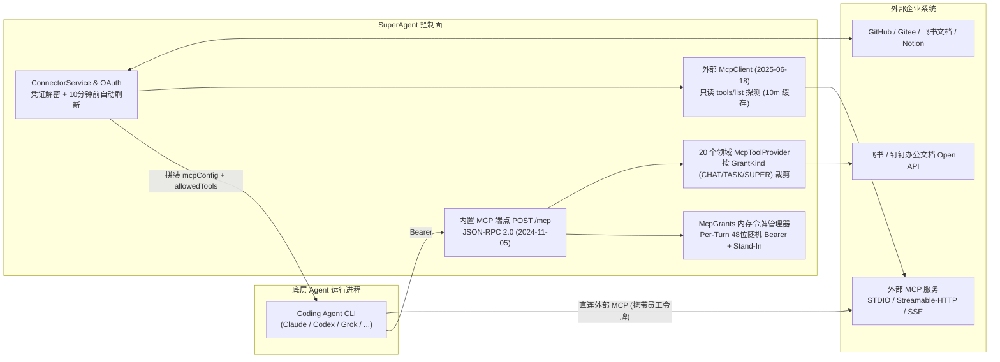

# 03. 内置 MCP 工具网关与外部连接器集成

> 本文档定义 SuperAgent 的双向 MCP（Model Context Protocol）架构及外部企业系统接入体系，涵盖平台内置 MCP Server 协议、Per-Turn 一次性安全令牌授权（`McpGrants`）、企业级外部集成管理（6 大平台）、内置与自定义连接器、员工级 OAuth 2.0 握手与令牌轮换，以及外部 MCP 工具发现客户端与运行期动态注入机制。全文严格保持技术栈无关。

---

## 1. 双向 MCP 集成全景架构

SuperAgent 在 MCP 生态中同时扮演**服务端**（向底层 Agent CLI 暴露平台业务工具）与**客户端**（向外部企业/第三方 MCP 服务器探测工具并按员工权限动态挂载）：

---

## 2. 平台内置 MCP Server 协议规范

### 2.1 传输与 JSON-RPC 2.0 线协议

- **唯一接入端点**：`POST /mcp`（响应 `application/json`）；`GET /mcp` 明确返回 **`405 Method Not Allowed`**（不支持服务端主动推送 SSE）。
- **协议元数据**：
  - `protocolVersion`：`"2024-11-05"`
  - `capabilities`：`{"tools": {}}`
  - `serverInfo`：`{"name": "superagent", "version": "0.1.0"}`
- **认证机制**：在通用 Web 认证层放行 `/mcp`，由 MCP 端点自行解析请求头 `Authorization: Bearer <token>`；请求头缺失、非 Bearer 格式或令牌无效/已回收时直接返回 **`401 Unauthorized`**（空响应体）。
- **通知帧处理**：凡 JSON-RPC 消息缺少 `"id"` 或 `"id": null`（如 `notifications/initialized`），直接返回 **`202 Accepted`** 空体。
- **方法路由表**（所有操作在令牌绑定的 `TenantContext` 中执行）：

| 方法名 | 行为与响应 `result` |
|---|---|
| `initialize` | 返回协议版本、能力声明与服务器信息 |
| `ping` | 返回空对象 `{}`（用于连接与启动自检） |
| `tools/list` | 聚合所有 `kinds()` 包含当前 `grant.kind` 的 `McpToolProvider` 暴露的工具定义（名称、描述、JSON Schema `inputSchema`） |
| `tools/call` | 按 `params.name` 匹配首个有权处理该工具的提供方，执行并返回 `{"content": [{"type": "text", "text": "..."}], "isError": false\|true}` |
| 其他未知方法 | 返回 JSON-RPC 协议错误 `{"code": -32601, "message": "Method not found: <method>"}` |

- **双层错误语义（重要设计）**：
  - **工具级业务错误（`McpToolException` 或未知工具名）**：返回 HTTP 200 的正常 JSON-RPC `result`，其中 `"isError": true`、文本前缀 `"错误：<原因>"`。这使 LLM 能读懂业务报错（如参数非法、Cron 语法错、链接不可读）并自我纠错重试，而不会被 CLI 视为底层 MCP 链路崩塌。
  - **未预期系统异常**：记录服务端告警日志，返回 JSON-RPC `error`（`code: -32603, message: "Internal error: ..."`）。

### 2.2 Per-Turn 临时授权令牌 (`McpGrants`)

每次 Agent 回合启动时在内存中即时签发一枚独立令牌，回合结束在 `finally` 中**确定性立即吊销**（无固定 TTL，生命周期与单回合严格绑定，且不落盘）：

- **令牌生成**：24 字节密码学安全随机数编码为 **48 位小写十六进制字符串**（192 位熵）。
- **令牌上下文 (`Grant`)**：

| 字段 | 语义 |
|---|---|
| `token` | 48 位随机 Bearer 令牌 |
| `kind` | 授权类别枚举：`CHAT`（普通对话）\| `TASK`（异步任务）\| `SUPER`（SuperAgent 对话或后台轮次） |
| `owner` | 归属员工不可变用户 ID（所有工具操作以此员工权限执行） |
| `companyId` | 签发瞬间捕获的租户 ID（存在独立映射中，供 `/mcp` 切回租户上下文） |
| `taskId` | 仅 `TASK` 授权填充，供子任务编排等工具识别父任务 |
| `agentId` | `CHAT` 与 `SUPER` 授权填充，标识当前对话所属 Agent |
| `sessionId` | `CHAT` 与 **实时 `SUPER` 对话** 填充；**`SUPER` 后台轮次为 `null`**（作为区分后台外部消息轮次的关键安全标识！） |
| `messageId` | 当前正在生成的助手回复 ID（用于将创建的文件、任务、邀请卡、技能删除卡精准锚定到该条消息下方） |
| `workspace` | 本回合工作区根目录路径（作为 `file_save`、`skill_add_image` 等工具的沙箱根） |

- **热进程 Stand-In 令牌别名机制**：常驻热进程池（如保活的 Claude 进程）的 `--mcp-config` 永久写入启动时的 `standing` 令牌。每轮开始时建立内存映射 `standing -> currentTurnToken`，回合结束立即解除。因此**空闲热进程在两轮间隙持有的令牌自动失效（401）**，杜绝静默越权。
- **工作区文件防逃逸校验 (`workspaceFile`)**：对 `grant.workspace` 与工具传入的相对文件路径同时求规范化真实路径（解析全部符号链接），强校验 `realPath` 位于 `workspace` 之内且为普通文件，阻断 `../` 与符号链接窃取宿主机敏感文件。
- **办公文档分级守卫 (`requireDocAccess`)**：`CHAT` 与 `TASK` 允许全部读写工具；`SUPER` 后台轮次（`sessionId == null`）**全面禁止**访问办公文档；`SUPER` 实时对话仅放行 **只读** 办公文档工具（写操作强迫委托给任务）。
- **启动自检 (`selfCheck`)**：Web 端口绑定后自动确定 `selfUrl`（优先显式配置 `mcp.self-url`，否则 `http://127.0.0.1:<实际监听端口>/mcp`）；服务就绪后在后台线程签发临时探针令牌（哨兵租户 `superagent`）向 `selfUrl` 发起一次 JSON-RPC `ping`，记录自检状态与错误供连接器页面展示。

### 2.3 工具白名单常量与 20 个插件提供方总览

为了实现最小权限控制，平台除在 `/mcp` 端按 `GrantKind` 过滤外，还在拉起 CLI 时按以下分组常量精细组装 `--allowedTools`：
- **`INBOX_TOOLS`（6）**：`inbox_search`、`inbox_add_todo`、`inbox_notify`、`inbox_mark`、`todo_list`、`todo_update`
- **`FOLDER_TOOLS`（7）**：`file_find`、`file_folders`、`file_move`、`file_create_folder`、`file_rename_folder`、`file_move_folder`、`file_delete_folder`
- **`FILE_TOOLS`（11）**：`file_write`、`file_save`、`file_list`、`file_get` + `FOLDER_TOOLS`
- **`SUPER_FILE_TOOLS`（11）**：`FOLDER_TOOLS` + `file_read`、`file_rename`、`file_set_tags`、`file_delete`
- **`SKILL_TOOLS`（5）** + **`SKILL_CHAT_TOOLS`（1）**：`skill_list/get/create/update/add_image` + 对话专属确认删除 `skill_delete`
- **`DOC_TOOLS`（12）** / **`DOC_READ_TOOLS`（7）**：飞书文档 6 工具 + 钉钉文档 5 工具 + `read_link`（只读子集去掉 create/append/replace）
- **`HISTORY_TOOLS`（2）**：`chat_history_search`、`chat_history_read`
- **`WORK_TOOLS`（30）**：`FILE_TOOLS` + `SKILL_TOOLS` + `DOC_TOOLS` + `HISTORY_TOOLS`

全部 **20 个领域 `McpToolProvider`** 归属与作用域分布见 [10_外部API与实时通信协议全量契约.md](./10_外部API与实时通信协议全量契约.md) 汇总总表。

---

## 3. 企业级外部系统集成 (`IntegrationService`)

外部系统的企业级应用凭据由公司管理员在 **管理后台 -> 系统设置 -> 集成** 中统一配置一次，供全公司连接器与 IM 机器人复用；所有密钥字段经 `SecretCipher` 信封加密存入 `system_setting`，接口返回时永不回显明文（仅返回 `set: true/false`），增量更新时留空密钥字段自动保留原值。

### 3.1 6 大企业级集成定义

| 集成键 (`key`) | 平台名称 | OAuth 回调路径 | 配置字段（`*` 表示加密密文） | 驱动能力与特殊校验 |
|---|---|---|---|---|
| `github` | GitHub | `/api/v1/oauth/github/callback` | `clientId`, `clientSecret*` | 支撑 `github` 个人 OAuth 连接器 |
| `gitee` | Gitee（码云） | `/api/v1/oauth/gitee/callback` | `clientId`, `clientSecret*` | 支撑 `gitee` 个人 OAuth 连接器 |
| `feishu` | 飞书 / Lark | `/api/v1/oauth/feishu-docs/callback` | `domain`(`feishu` 国内默认 \| `lark` 国际), `appId`, `appSecret*` | 同时驱动飞书 IM 长连接机器人与 `feishu-docs` 文档 OAuth |
| `dingtalk` | 钉钉 | *(无 OAuth)* | `clientId`(AppKey), `clientSecret*`(AppSecret) | 同时驱动钉钉 Stream 机器人、`dingtalk_doc_*` 文档工具与 `dingtalk-tools` MCP |
| `notion` | Notion | `/api/v1/oauth/notion/callback` | `clientId`, `clientSecret*` | 支撑 `notion` 个人 OAuth 连接器 |
| `confluence` | Confluence | *(无 OAuth)* | `url`（站点地址，校验 `http(s)://` 并去尾斜杠） | 支撑 `confluence` 个人令牌连接器（自动识别 Cloud 与自建版） |

- **启用与就绪约束**：开启 `enabled = true` 时强制校验所有无默认值必填字段均已配置；`ready(key)` 仅在启用且必填完整时为 `true`。
- **公网回调地址解析优先级 (`AppUrl`)**：企业系统设置 `app.public-url` -> 部署环境变量 `SUPERAGENT_BASE_URL` -> 当前 HTTP 请求的 scheme/host/port。
- **配置热重载与状态跟踪**：保存任意集成即在当前租户内发布 `IntegrationChanged(key)` 事件，触发飞书/钉钉长连接器即时重连或断开；实时连接状态（`connecting` / `connected` / `error` + 错误信息）按 `<companyId>/<key>` 内存维护，禁用时自动清除。

---

## 4. 连接器管理与员工级 OAuth 授权体系

### 4.1 连接器领域模型与认证模式

- **连接器类别 (`ConnectorKind`)**：持久化记录均为 `MCP`；列表展示层在顶部自动合成 3 个虚拟状态行：
  1. `superagent`（`kind = builtin`，展示内置 MCP 自检健康度，管理员可见 `selfUrl`）；
  2. `feishu`（当 `feishu` 集成就绪时展示，呈现长连接状态与当前员工绑定码操作）；
  3. `dingtalk`（当 `dingtalk` 集成就绪时展示，同上）。
- **三种传输协议 (`ConnectorTransport`)**：`STDIO`（本地子进程）、`HTTP`（Streamable-HTTP）、`SSE`（传统 HTTP+SSE）。
- **四种认证模式 (`ConnectorAuthMethod`)**：
  - `NONE`：无需凭证；
  - `SHARED_TOKEN`：公司级共享单密钥（凭证表 `owner = ""`），管理员配置、全员共享；
  - `PERSONAL_TOKEN`：员工个人静态令牌（凭证表 `owner = userId`），员工自行填入并按人隔离；
  - `OAUTH`：员工个人 OAuth 2.0 授权令牌（含加密 `secretCipher`、可选 `refreshCipher`、`expiresAt` 与展示账号标签），仅限内置已注册 OAuth 提供方使用。

### 4.2 6 个预置系统连接器（公司初始化幂等播种）

系统预置连接器禁止编辑和删除（返 403），管理员仅可通过 `PUT /api/v1/connectors/{id}/enabled` 控制启停：

| 连接器 ID | 显示名 | 认证模式 | 默认启用 | 传输方式 | 端点 / 启动命令 | 凭据注入与特殊机制 |
|---|---|:---:|:---:|:---:|---|---|
| `github` | GitHub | `OAUTH` | 是 | `STDIO` | `npx -y @modelcontextprotocol/server-github` | 注入环境变量 `GITHUB_PERSONAL_ACCESS_TOKEN` |
| `gitee` | Gitee（码云） | `OAUTH` | 是 | `HTTP` | `https://api.gitee.com/mcp` | 注入请求头 `Authorization: Bearer <token>` |
| `feishu-docs` | 飞书/Lark 文档 | `OAUTH` | 是 | `HTTP` | `null` | **进程内直服 (`OWN_TOOLS`)**：不作为外部 MCP 进程启动，由内置 `FeishuDocTools` 直接调用该员工 OAuth 令牌 |
| `notion` | Notion | `OAUTH` | 是 | `STDIO` | `npx -y @notionhq/notion-mcp-server` | 注入环境变量 `NOTION_TOKEN` |
| `confluence` | Confluence | `PERSONAL_TOKEN` | 是 | `STDIO` | `uvx mcp-atlassian@0.23.1` | 保存前实时调 `/rest/api/user/current`（15s 超时）验活并拦截匿名态；Cloud（`.atlassian.net/.com/.jira.com`）自动补 `/wiki` 用 Basic `email:apiToken`，自建版用 `Bearer PAT` 注入对应环境变量 |
| `dingtalk-tools` | 钉钉工具 | `NONE` | **否** | `STDIO` | `npx -y dingtalk-mcp@latest` | 依赖 `dingtalk` 集成就绪；注入 `DINGTALK_Client_ID`、`DINGTALK_Client_Secret` 及 `ACTIVE_PROFILES=dingtalk-contacts,dingtalk-department,dingtalk-calendar,dingtalk-tasks,dingtalk-report` |

**管理员自定义 MCP 连接器规则**：
- `STDIO` 需提供可按空白拆分的命令，有令牌认证时需配置合法环境变量名（`[A-Za-z_][A-Za-z0-9_]{0,127}`）；
- `HTTP` / `SSE` 需提供 `http(s)://` URL，令牌统一以 `Authorization: Bearer <token>` 发送（暂不支持多自定义 Header 或多环境变量映射）；
- 修改连接器若切换了 `authMethod`，自动清空该连接器下全部存量凭证，避免格式不匹配。

### 4.3 员工级 OAuth 2.0 握手与安全刷新 (`ConnectorOAuthService`)

- **全页跳转与防 CSRF `state`**：
  - 发起授权 `GET /api/v1/oauth/{provider}/authorize?connectorId=<id>` 生成 32 位十六进制随机 `state`，在内存记录 `(connectorId, owner, redirectUri, createdAt)`，有效期 **10 分钟**。
  - 回调 `GET /api/v1/oauth/{provider}/callback` 原子取出并销毁 `state`（**严格单次消费**），校验未过期、当前已登录用户与发起人一致、且提供方与连接器匹配；换取令牌后拉取账号标识加密落库，重定向至 `/?connected=<id>#connectors`（异常重定向 `/?connect_error=<code>#connectors`）。
- **提前刷新、防并发轮换与失效自清理**：
  - 取用访问令牌时若 `now + 10 分钟 > expiresAt`，按 `<connectorId>/<owner>` 加细粒度互斥锁并双重检查数据库（防止单次有效的 `refresh_token` 被并发请求撞毁）。
  - 刷新成功若上游返回新 `refresh_token` 则轮换存储，否则保留旧值。
  - 若上游刷新返回 **4xx 拒绝（`TokenRejected`）**：**自动删除该员工凭证**，使界面立即显示“未授权”引导重新授权；若遇 5xx 或网络抖动则保留凭证，且只要原令牌未到绝对过期时间仍继续返回使用。

#### 4 大 OAuth 客户端协议细节

| 客户端 | 授权端点与核心 Scope | 换取与刷新特征 | 账号标签 (`accountLabel`) |
|---|---|---|---|
| **GitHub** | `https://github.com/login/oauth/authorize` (`scope=repo read:user`, `allow_signup=false`) | 表单 POST `access_token`；长期有效无需刷新 | `GET /user` -> `login` |
| **Gitee** | `<base>/oauth/authorize` (`scope=user_info projects pull_requests issues notes`) | 表单 POST `/oauth/token`（约 1 天过期，支持 `refresh_token`） | `GET /api/v5/user` -> `login` |
| **Notion** | `<base>/v1/oauth/authorize?owner=user`（用户在授权页勾选页面） | JSON POST `/v1/oauth/token`（HTTP Basic `clientId:secret` + `Notion-Version: 2022-06-28`，支持刷新） | `GET /v1/users/me` -> `<owner> · <workspace>` |
| **Feishu/Lark Docs** | `<feishu/lark>/open-apis/authen/v1/authorize` (`scope=docx:document drive:drive wiki:wiki:readonly search:docs:read offline_access`) | JSON POST `/open-apis/authen/v2/oauth/token`（约 2 小时过期，支持刷新，随集成 `domain` 自动切国内/国际域名） | `GET /open-apis/authen/v1/user_info` -> `data.name` |

---

## 5. 外部 MCP 工具发现客户端与运行期动态装配

### 5.1 只读工具发现客户端 (`McpClient` & `ConnectorToolsService`)

供用户在连接器页面预览可用能力列表（含工具名、标题、描述、只读/破坏性标注与输入参数），**严格只读**（仅执行 `initialize` -> `notifications/initialized` -> 分页 `tools/list`，最多翻 **20 页**，绝不调用 `tools/call`）：
- **协议版本**：`"2025-06-18"`。
- **三种传输实现**：
  1. **`STDIO`**（超时 **120 秒**，容忍首次 `npx -y`/`uvx` 下载依赖）：通过路径发现器启动子进程并注入 `env`，按行读取 JSON-RPC 响应，提前退出检测退出码，`finally` 强杀子进程。
  2. **`HTTP`（Streamable-HTTP）**（超时 **30 秒**）：POST 携带 `MCP-Protocol-Version` 与 `Accept: application/json, text/event-stream`，跟踪并回传 `Mcp-Session-Id` 会话头，兼容直返 JSON 或 SSE 帧匹配 JSON-RPC `id`。
  3. **`SSE`（传统 HTTP+SSE）**（超时 **30 秒**）：GET 建立 `text/event-stream` 等待 `event: endpoint` 获取目标 POST 地址，再通过 POST 发送请求并从 `event: message` 关联 `id` 读回响应。
- **缓存与内置直通**：结果按 `<companyId>|<connectorId>|<viewer>` 内存缓存 **10 分钟**（支持 `?refresh=true` 强刷，出错不缓存）；对 `superagent`、`feishu-docs`、`dingtalk` 直接从进程内 `McpToolProvider` 过滤汇总，不发网络请求。
- **安全边界提示**：管理员配置的外部 MCP 端点默认允许访问企业内网 MCP 服务，因此 `McpClient` **未施加 `EgressGuard` 公网限制**且遵循 HTTP 重定向（与面向用户任意 URL 的链接阅读器截然不同）。

### 5.2 回合运行期动态装配 (`mcpServersFor`)

每次对话或异步任务执行前，平台以**当前发起员工的身份 (`owner`)** 动态解析其可用的外部连接器列表：
1. 过滤掉已禁用、非 `MCP`、无端点、`OWN_TOOLS`（`feishu-docs`）及前置企业集成未就绪的连接器；
2. 个人认证模式读取该员工凭证（OAuth 自动触发提前 10 分钟刷新），共享模式读取公司凭证；**任一连接器未授权、凭证失效或解密失败时静默跳过，绝不阻断正常对话或任务执行**；
3. 生成合法服务器名（原 ID 符合 `[a-z0-9_-]{1,32}` 且非 `"superagent"` 则直用，否则生成 `"c_" + 12位短ID`），合并进 `--mcp-config`（**严禁覆盖保留键 `"superagent"`**），并向 CLI 工具白名单追加 `"mcp__" + serverName` 放行调用。
