# 04. Agent 管理、多轮对话引擎、长期记忆与团队协作

> 本文档定义 SuperAgent 的核心人机协同工作面：Agent 全生命周期与人格体系、多用户协作与权限模型、多轮实时流式对话管道、跨会话长期记忆与健康轮换、以及运行日志与 7 阶段耗时观测。全文严格保持技术栈无关。

---

## 1. Agent 领域模型与生命周期

### 1.1 核心实体属性 (`Agent`)

SuperAgent 将 Agent 视为**持久化、可积累记忆、可多人协作的“数字同事”**而非一次性聊天窗口。

| 字段 | 逻辑类型 | 业务规则与约束 |
|---|---|---|
| `id` | `STRING` (UUID) | 唯一主键，全局不可变 |
| `name` | `STRING` | 展示名称；普通 Agent 留空默认 `"New agent"`；个人主管固定 `"SuperAgent"` |
| `avatar` | `STRING` | 必须取自 24 个内置人物 Emoji 白名单（未传时随机挑选）；`SUPER` 固定 `"🦸"` |
| `character` | `STRING` | 可选内置性格预设键（共 24 种）；为空表示纯自定义人设；`SUPER` 恒为 `null` |
| `persona` | `TEXT` | 自定义人设指令；当同时指定 `character` 时作为 `"Additional instructions"` 追加；`SUPER` 恒为 `null` |
| `model` | `STRING` | 可选存储字段。**关键规则**：当前交互对话路由刻意忽略 `agent.model`，统一采用管理员全局默认/备用对话模型（确保规划与拆解质量），具体低成本模型路由在任务层执行 |
| `status` | `ENUM` | `ACTIVE`（活跃）\| `DELETED`（软删，保留历史对话但 API/UI 不可见） |
| `owner` | `STRING` | 所属员工的不可变用户 UUID |
| `kind` | `ENUM` | `STANDARD`（标准 Agent，默认）\| `SUPER`（每员工唯一内置个人主管） |
| `managedBy` | `STRING` | 若由 SuperAgent 招募则为该 SuperAgent 的 `id`，否则为 `null` |
| `tier` | `STRING` | 历史遗留档位字段（可空；参考实现中更新接口存在将其清零的已知缺陷，重建时应显式决定保留或废弃） |
| `createdAt` / `updatedAt` | `TIMESTAMP_UTC_MS` | 创建与更新时间 |

### 1.2 24 个内置头像与 24 种内置性格预设

- **内置头像白名单（24 个）**：`🧑‍💻 👩‍💻 👨‍💻 🧑‍🔬 👩‍🔬 👨‍🔬 🧑‍🎨 👩‍🎨 🧑‍🚀 👩‍🚀 🧑‍🏫 👩‍🏫 🧑‍💼 👩‍💼 👨‍💼 🧑‍🔧 👩‍🔧 🧑‍⚕️ 🧑‍🍳 🧑‍🎓 🕵️ 🧙 🦸 🥷`。不在白名单内的值直接拒绝。
- **内置性格预设目录**：系统内置 24 种双语性格模板，数据库仅存预设 `key`，使模板优化自动惠及存量 Agent：

| # | 预设键 (`key`) | 图标 | 中文名称 | 核心风格定位 |
|---|---|---|---|---|
| 1 | `rigorous-engineer` | 🔍 | 严谨工程师 | 事实优先，区分事实与假设，结论必附依据 |
| 2 | `proactive-driver` | 🚀 | 主动推进者 | 拆分模糊目标为步骤，主动推进并在结尾给出下一步 |
| 3 | `cautious-guardian` | 🛡️ | 稳妥守门人 | 优先识别风险与边界，不可逆操作前必确认 |
| 4 | `creative-explorer` | 🎨 | 创意探索者 | 提供多套方案（含至少一套非常规思路）并阐明取舍 |
| 5 | `patient-mentor` | 🧑‍🏫 | 耐心导师 | 从已知出发循序渐进举例讲解，确认理解后再推进 |
| 6 | `blunt-critic` | 🗡️ | 直言挑刺者 | 按严重度直指方案薄弱点并给修复建议，不客套不失礼 |
| 7 | `warm-companion` | 🤗 | 温暖伙伴 | 共情体贴、轻松友善的同时把事办成 |
| 8 | `witty-geek` | 🤓 | 幽默极客 | 适度轻松玩梗，但严肃话题不损准确度 |
| 9 | `minimalist` | ▫️ | 极简主义者 | 结论先行、要点化，剔除一切不影响决策的废话 |
| 10 | `senior-architect` | 🏛️ | 资深架构师 | 全局视角、讲清架构取舍，偏好简单可长期维护方案 |
| 11 | `product-manager` | 🧭 | 产品经理 | 聚焦用户价值、严控范围、排优先级并产出验收标准 |
| 12 | `data-analyst` | 📊 | 数据分析师 | 用数据说话、声明口径假设来源与置信度，善用表格 |
| 13 | `researcher` | 🔬 | 研究员 | 多角度调研、注明出处、明确区分已证实与待定内容 |
| 14 | `editor` | ✍️ | 文字编辑 | 优化结构清晰度与措辞精准度，删除冗余 |
| 15 | `project-manager` | 📋 | 项目经理 | 聚焦目标/负责人/截止日/状态/阻塞，早预警排期风险 |
| 16 | `on-call-sre` | 🚨 | 运维值班 | 故障先止血再查根因，给出精确命令与预期输出 |
| 17 | `security-reviewer` | 🔐 | 安全审查员 | 威胁建模、最小权限、标记密钥与敏感数据并定级 |
| 18 | `socratic-tutor` | ❓ | 苏格拉底式老师 | 通过提问和提示引导用户自行得出答案 |
| 19 | `executive-assistant` | 🗂️ | 高效助理 | 预判下一步需求、条理清晰、结尾给精简待办 |
| 20 | `strategy-consultant` | 💼 | 咨询顾问 | MECE 结构化论证、高管摘要风格、给出明确建议 |
| 21 | `formal-official` | 📜 | 正式书面 | 严谨规范的公文/公告语体，禁用俚语与表情 |
| 22 | `cheerleader` | 🎉 | 热情鼓励者 | 积极认可每步进展，坦诚待办同时保持高昂士气 |
| 23 | `calm-steady` | 🍵 | 沉稳淡定 | 一次一件事、温和安抚而不轻视问题 |
| 24 | `storyteller` | 📖 | 讲故事的人 | 用故事与类比解释复杂概念并点出核心结论 |

**人设系统提示词拼接模板**：
当 `character` 与 `persona` 均为空时返回 `null`（使用引擎默认提示）；否则按如下固定格式拼接：
```text
Your name is <agent.name>.

<预设 prompt（若存在）或自定义 persona>
[若两者同时存在则追加：]
Additional instructions:
<persona>

Always reply in the language the user writes in.
```

### 1.3 生命周期操作与汇报层级

1. **创建路径（4 种）**：
   - **界面创建**：创建 `STANDARD` Agent，立即初始化首个 `ChatSession` 与共享工作区目录，并可选绑定技能列表。
   - **SuperAgent 招募**：创建 `STANDARD` Agent，写入 `managedBy = superAgentId`、`character = null`。
   - **对话内派生 (`agent_create` MCP 工具)**：
     - 强制单用户活跃 Agent 上限 **50 个**（防模型循环滥建）与单用户内**大小写不敏感重名校验**。
     - 若触发者拥有当前非 `SUPER` 源 Agent，则自动将其设为新 Agent 的上级并放入同一项目；若协作者在他人 Agent 中触发派生，则新 Agent 归属协作者本人且为独立顶层 Agent。
   - **个人主管懒加载**：列表查询或编排初始化时自动为每位员工幂等创建唯一 `SUPER` Agent（名 `"SuperAgent"`、头像 `"🦸"`），在列表中永远置顶。
2. **汇报层级 (`AgentParent`)**：
   - 独立记录 `agent_id -> parent_id`，与 `managedBy`（招募来源）解耦。
   - **约束**：仅所有者可调整；`SUPER` 既不能有上级也不能被设为上级（它天然统筹全部 Agent）；变更前沿祖先链向上遍历做**严格环路检测**；软删上级时读侧自动过滤失效指针，无需级联删子 Agent。
3. **更新与软删除**：
   - `SUPER` 的名称、性格预设与自定义人设受平台锁定不可改，仅允许改头像、模型字段与技能（且对话内 `skill_attach` 禁止给 `SUPER` 挂技能）。
   - `SUPER` 禁止删除；标准 Agent 删除仅标记 `status = DELETED`，同时永久清除其长期记忆记录与失败退避状态，但完整保留数据库中的历史对话会话。
4. **跨会话共享工作区**：
   - Agent 的首个会话在 `<workspaceRoot>/<companyId>/<firstSessionId>` 创建目录；此后因模型切换、故障容灾或连续失败轮换产生的所有新 `ChatSession` **始终复用同一个 `workspaceDir`**，保证工作产出不因会话切换丢失。
5. **与任务及项目的联动**：
   - **任务执行人设桥接**：标准 Agent 发起的异步任务每轮都会注入该 Agent 的姓名、人设系统提示词与长期记忆，使其在后台任务中保持一致的“同事人格”。
   - **项目归属**：一个标准 Agent 至多归属一个项目；所在项目归档后，该 Agent 变为**只读**，拦截一切新消息发送。
6. **离职交接现状**：参考实现中虽定义了变更 `owner` 的记录拷贝方法，但全系统无任何调用点，亦未提供所有权转移 API 或员工离职交接钩子（重建时如需支持离职交接，可围绕该模型扩展原子转交事务）。

---

## 2. 权限模型与多用户协作

### 2.1 严格访问控制矩阵

系统对个人 Agent 实行**无管理员特权穿透**原则（公司管理员也不能偷看他人私有 Agent），且对无权访问的资源统一返回 **404 Not Found**（防 ID 枚举探测）；对有权查看的协作者发起所有者专属写操作时返回 **403 Forbidden** 或 **404**。

| 操作类别 | 所有者 (`owner`) | 直接协作者 (`AgentMember`) | 项目协作者 (共享项目) | 公司管理员 (非成员) | 其他员工 |
|---|---|---|---|---|---|
| 出现在 Agent 列表 | 是 (`owner`) | 是 (`collaborator`) | 是 (`collaborator`) | 否 | 否 |
| 查看详情 / 历史对话 / 耗时 / 关联任务 | 允许 | 允许 | 允许 | 404 | 404 |
| 发送对话消息 / 观战实时流 / 停止 / 重命名或删会话 / 原地编辑消息 | 允许 | 允许 | 允许（项目归档时禁发消息） | 404 | 404 |
| 修改 Agent 配置 / 删除 Agent / 创建新会话 | 允许 | 404 | 404 | 404 | 404 |
| UI 直接邀请协作者 / 确认或取消对话内邀请卡 | 允许（非 `SUPER`） | 403 / 404 | 403 / 404 | 404 | 404 |
| 移除协作者 / 退出协作 | 可移除任意协作者 | 仅可移除自己（移除他人 403） | 仅可移除自己（无操作） | 404 | 404 |
| 读取长期记忆 | 允许 (`canEdit=true`) | 允许 (`canEdit=false`) | 允许 (`canEdit=false`) | 404 | 404 |
| 编辑长期记忆 / 立即蒸馏 / 查看运行日志与会话列表 | 允许 | 404 | 404 | 404 | 404 |

### 2.2 双路径协作邀请与状态机

`AgentKind.SUPER` 因处理员工私有消息与待办，**禁止共享**；所有标准 Agent（含 SuperAgent 招募的团队成员）均可多人共享，协作者加入后即可查看全部历史对话与只读记忆并参与同一会话。

- **路径 A — 界面直接邀请**：所有者指定同事用户名/ID 列表 -> 校验为活跃启用员工 -> 幂等写入 `agent_member (active = true)` -> 触发 `AgentShared` 事件，向受邀同事的待办通知中心投递一条 `NOTICE` 卡片。
- **路径 B — 对话内确认卡片邀请 (`AgentInvite`)**：为防止 LLM 未经授权把完整历史暴露给第三方，Agent 调用 `collab_invite` 时**绝不直接加人**，而是创建锚定在当前助手回复 `messageId` 上的待确认卡片：
  ```mermaid
  stateDiagram-v2
      [*] --> PENDING : Agent 调用 collab_invite（仅所有者可触发）
      PENDING --> CONFIRMED : 所有者点击「确认邀请」-> 写入成员 + 发 AgentShared 通知
      PENDING --> CANCELLED : 所有者点击「取消」-> 无成员变更
  ```
  - 该状态机为**所有者确认门禁**（无被邀人拒绝态，无自动过期 TTL）。
  - 移除成员（`DELETE /members/{who}` 或 `collab_remove`）立即将 `agent_member.active` 置为 `false`，无需二次确认且不发通知。

---

## 3. 多轮对话执行引擎

### 3.1 逻辑时间线与自动会话轮换

前端呈现给用户的并非割裂的单次会话，而是通过 `GET /api/v1/agents/{id}/history` 将同一 Agent 的全部未删除 `ChatSession` 按**时间正序拼接**而成的连续时间线（`ChatSegment` 列表），会话切换处仅以细微分割线标识。

触发自动开新会话（共享同一 `workspaceDir`）的 **4 种原因 (`reason`)**：
1. `first`：Agent 首次发起对话；
2. `model`：解析出的有效对话模型与 `AgentMemoryState.lastModel` 不一致（管理员切换默认模型）；
3. `model_down`：当前模型突发故障，容灾跳变至备用模型；
4. `failures`：当前会话连续非瞬态 CLI 失败达到上限（默认 `10` 次），自动轮换自愈。

非首次切会话时，系统自动异步触发一次 `consolidateSoon` 记忆蒸馏，并在运行日志记入 `session` 类条目。

### 3.2 单回合 17 步完整执行管道

```mermaid
flowchart TD
    A["1. 接收用户消息<br/>启动 TurnTimer + 检查租户月度 Token 配额"] --> B["2. 校验会话权限 & 项目未归档<br/>加载 AgentTurnCustomizer（如 SuperAgent）"]
    B --> C["3. 单 Agent 并发互斥检查<br/>活跃则立即返回 HTTP 409 ChatBusy"]
    C --> D["4. 模型路由解析 & 自动会话轮换<br/>确定目标 CLI 适配器"]
    D --> E["5. 组装系统提示词<br/>标准: 人设+技能索引+文件规则+任务确认指南<br/>自定义: 由 Customizer 接管"]
    E --> F["6. 落盘图片附件 / 投递上传文件至 uploads/<br/>持久化 USER 消息"]
    F --> G["7. 自动资产沉淀<br/>提取 URL 收藏为 LINK + ≥3000 字长粘贴存为 .md"]
    G --> H["8. 组装用户提示词<br/>多人协作时加 [发言人]：前缀 + 注入长期记忆上下文"]
    H --> I["9. 原子占锁 LiveTurn & 注册 Cancellation<br/>立即返回 SSE 流，后台线程执行回合"]
    I --> J["10. 开启 Per-Turn MCP 令牌 & 解析用户外部连接器<br/>按模型/权限拼装工具白名单与 mcpConfig"]
    J --> K["11. 执行 CLI 回合（runChat）<br/>外包 TurnTimer 与 UsageRecorder 拦截器"]
    K --> L{"12. 零输出且端点错误？"}
    L -- 是 --> M["Layer 1 容灾：CredentialService 切换备用 Key 重试 1 次"]
    L -- 否 --> N{"13. 仍失败且属模型级故障？"}
    M --> N
    N -- 是(最多2跳) --> O["Layer 2 容灾：上报模型冷却，切备用模型开 model_down 新会话重试"]
    N -- 否 --> P{"14. 非瞬态错误累计达 10 次？"}
    O --> P
    P -- 是 --> Q["Layer 3 容灾：开 failures 新会话 + 全量记忆结转重试 1 次"]
    P -- 否 --> R["15. 持久化 ASSISTANT 消息（含中断/报错尾注）<br/>落盘 7 阶段 TurnTiming（先于 done 事件）"]
    Q --> R
    R --> S["16. 更新会话 agentSessionId / 自动标题(≤48字)<br/>写入运行日志"]
    S --> T["17. 推送终态 SSE（error/stopped -> done）<br/>释放 LiveTurn 锁与 MCP 令牌"]
```



**关键业务规则细节**：
- **协作发言人归属**：当 Agent 存在直接协作者时，在发往模型的用户提示前自动加前缀 `"[<显示名>]："`，帮助模型区分不同同事发言（注：参考实现未对纯项目协作者加前缀，重建时可按统一可见协作人数判断）。
- **Token 账单归属**：即便在共享 Agent 中对话，本轮产生的所有 Token 费用（含全部失败重试尝试）均记账到**当前发送消息的员工**名下。
- **异步任务结果回流 (`ChatTaskResults`)**：当该 Agent 创建的后台任务进入 `done`、`error` 或 `needs_confirmation` 时，事件监听器自动向 Agent 最新会话写入一条 `ASSISTANT` 消息（`author = "task:<taskId>"`，摘要截断 1,500 字）；下轮对话前，系统收集自上次正常回复以来的所有任务回流消息拼在用户消息之前，让模型自然知晓任务进展。
- **消息编辑与取消**：
  - `PUT /sessions/{id}/messages/{messageId}` 仅允许原地修改 `USER` 消息正文（拒绝改助手/系统消息），**纯记录修正，不触发对话分叉或重新生成**。
  - `POST /sessions/{id}/stop` 同时查找请求 `sessionId` 与 Agent 当前最新 `sessionId` 的取消令牌（兼容回合中发生会话轮换），确保停止指令必达。

### 3.3 SSE 流式协议与多端重连 / 实时旁观 (`LiveTurn`)

每条 SSE 帧事件名为 `event.type`，载荷为 JSON `{"type": "...", "seq": <int64>, "payload": "..."}`：

| SSE 事件类型 | `seq` | 产生时机与说明 |
|---|---|---|
| `system` | 引擎序号 | 底层 CLI 会话 ID 就绪 |
| `thinking` | 引擎序号 | 增量思考文本（缓冲回放时自动合并相邻帧） |
| `text` | 引擎序号 | 增量正文文本（缓冲回放时自动合并相邻帧） |
| `tool_use` | 引擎序号 | 工具调用摘要（同步更新 `LiveTurn.activity`，截断 200 字） |
| `tool_result` | 引擎序号 | 工具返回结果（驱动前端实时卡片） |
| `result` | 引擎序号 | 引擎本轮最终文本 |
| `usage` | 引擎序号 | 引擎自报成本（注：`TOKENS` 已被计费拦截器剥离，永不推送） |
| `error` | `-1` | 全部重试与容灾耗尽后才发出（尝试期暂扣） |
| `stopped` | `-1` | 用户主动停止时发出，携带已输出的部分文本 |
| `done` | `-1` | 正常收尾事件，前端收到后刷新耗时统计与卡片 |
| `idle` | `-1` | 连接 `/live/stream` 时当前无活跃回合立即返回并关闭 |

**断线重连与多人同屏旁观机制**：
- 内存 `LiveTurn` 映射以 **`agentId`** 为键（而非 `sessionId`），缓冲本轮从起始到当前的所有已发送事件（并对连续 `text`/`thinking` 帧原地拼接压缩内存）。
- 任意有权访问该 Agent 的用户（包括刷新页面的本人与同一共享 Agent 的其他同事）均可通过：
  1. `GET /api/v1/sessions/{id}/live` 轮询获取状态快照（`running`、触发人、开始时间、当前已生成正文、最新工具活动及 Agent 最新 `sessionId`）；
  2. `GET /api/v1/sessions/{id}/live/stream` 建立 SSE 旁观流：在锁内**先完整回放历史缓冲事件，再无缝订阅后续实时增量帧**，直至回合 `done` 自动结束。

---

## 4. 长期记忆与会话健康管理

### 4.1 纯数据库存储模型 (`AgentMemoryState`)

长期记忆以 Markdown 文本形式**完全存储在关系型数据库**（`agent_memory` 表，每 `(company_id, agent_id)` 一行），不再依赖工作区文件：
- `summarizedUntil`：已蒸馏水位线时间戳（仅在蒸馏得到有效结果 `NO_CHANGE` 或 `UPDATED` 后推进，保证崩溃幂等）。
- `lastModel`：当前会话使用的模型（哨兵 `"-"` 表示 CLI 默认，与 `null` 区分）。
- `sessionFailures`：当前会话连续非瞬态失败次数。
- `memory`：提炼后的长期记忆 Markdown 正文。

### 4.2 新会话三段式上下文注入

仅当开启**全新底层 CLI 会话**（首轮、模型切换、模型容灾或连续失败轮换）时，组装三段式记忆上下文注入系统提示词：
1. **长期记忆正文**：`agent_memory.memory` 原文。
2. **最近对话原文结转**（默认预算 `memory.carry-chars = 60,000` 字）：
   - 跨该 Agent 所有未删会话收集历史消息（排除当前正在发送的用户消息），从最新向最旧贪心打包。
   - 若边界单条超长消息放不下，按前 2/3 + 后 1/3 保留（至少保留 4,000 字空间），中间替换为指针 `…（中间省略 N 字；完整原文用 chat_history_read 读取消息 <messageId>）…`，让模型需要时精准回溯。
3. **Agent 最近文件清单与正文摘录**：
   - 列出最多 **20 个**该 Agent 最近更新且对当前用户可见的文件（含 ID、名称、来源、标签）；
   - 对最新 **3 个**可读文本文档内联前 **6,000 字**摘录，减少模型开局盲查。

*注：正常续跑会话仅携带长期记忆正文作为兜底（仅当 CLI 报会话丢失触发自愈重开时才生效）。*

### 4.3 后台周期蒸馏与手动管理

- **调度周期**：后台守护调度器每 **5 分钟**（可配 `memory.interval-minutes`）轮询各租户，每租户每轮最多蒸馏 **3 个** Agent（`memory.agents-per-tick`），控制后台成本。
- **触发条件（全部满足）**：
  1. 水位线之后存在未蒸馏消息；
  2. **静默防抖**：最后一条消息距今 `>= 2 分钟`（`memory.settle-minutes`，避免打断热聊）；
  3. **量或空闲达标**：未蒸馏消息数 `>= 10 条`（`memory.min-messages`）**或** 最后一条消息距今 `>= 30 分钟`（`memory.idle-minutes`）。
- **并发、退避与格式守卫**：
  - 按 `agentId` 加内存 `inFlight` 锁，确保定时蒸馏与会话切换/用户手动点击触发的立即蒸馏（`consolidateSoon`）永不并发冲突。
  - 使用最便宜可用模型、**零工具权限**在临时空目录执行蒸馏；单条输入消息截断 2,000 字，总输入上限 40,000 字。
  - 提示词贯彻“宁缺毋滥”，严格限定 5 个可选二级标题：`## 关于用户` / `## 目标与项目` / `## 决定与约定` / `## 进行中与待办` / `## 关键事实`，总长上限 **3,000 字**；无新增价值时输出 `NO_CHANGE`。
  - **非法输出保护**：剥离可能包裹的代码围栏后，若结果既非 `NO_CHANGE` 也不以 `# ` 开头或不足 2 行，判为 `INVALID`，**拒写数据库且不推进水位线**，并将该 Agent 退避 **30 分钟**（同模型异常退避）。
- **用户直编与手工触发**：所有者可在界面直接查看/编辑记忆（人工编辑上限放宽至 **10,000 字**，清空即置 `null`）或点击「立即蒸馏」绕过静默阈值立即执行；后续蒸馏始终以当前记忆（含人工编辑）为基底演进。

### 4.4 会话健康度与自动轮换 (`SessionHealth`)

系统并非按 Token 占比判断会话饱和度，而是通过**连续非瞬态错误计数**驱动无感会话轮换：
- **28 项瞬态错误分类器**：将错误信息转小写并在首部加空格，匹配网络断开、超时、限流及 HTTP `429/500/502/503/504/529` 等 28 个特征子串（如 `econnreset`、`socket hang up`、`rate limit`、`overloaded`、` 429`、` 502` 等）。
- **状态迁移**：
  - 命中瞬态错误 -> **不递增** `sessionFailures`（归类为外部抖动）。
  - 非瞬态错误（如上下文损坏、超窗、会话不可恢复）-> `sessionFailures + 1`。
  - 任一回合成功 -> `sessionFailures` 清零。
  - 达到阈值 `agent.session-failure-limit`（默认 **10 次**）-> 计数归零，无感轮换至新 `ChatSession`（`reason = "failures"`），立即触发记忆蒸馏，并携带完整三段式记忆上下文**自动重试当前消息 1 次**。

---

## 5. 运行日志、7 阶段耗时埋点与后台文件打标

### 5.1 Agent 运行日志 (`AgentLog`)

- **记录维度**：每条包含 `agentId`、`owner`、`at`、`level`（`info`/`warn`/`error`）、`category`（`session`/`turn`/`memory`/`superagent`/`settings`）、`summary`、`detail`。
- **旁路容错**：写日志失败仅记录服务端警告，永不阻断对话、任务或记忆主流程。
- **自动清理**：每小时按租户清理一次，保留最近 **30 天**（`agent-log.retention-days`）且每 Agent 至多保留最新 **5,000 条**（`agent-log.max-per-agent`）。仅 Agent 所有者可查（单次最多返回 1,000 条）。

### 5.2 7 阶段耗时拆解 (`TurnTimer` / `TurnTiming`)

每轮对话（及任务单回合）严格拆分为 **7 个首尾相接的耗时阶段**，另记录尝试次数 `attempts` 与按工具名聚合的调用次数/耗时（基于 FIFO 队列配对 `TOOL_USE` 与 `TOOL_RESULT`，按耗时降序排列）：

| 阶段字段 | 精确定义 |
|---|---|
| `prepMs` | 收到请求至首次拉起 CLI 前（配额、锁、会话轮换、文件/技能/记忆装配） |
| `retryMs` | 所有前置失败尝试（密钥切换、模型跳变、会话轮换）累计消耗的墙钟时间 |
| `startupMs` | 最终成功尝试从拉起 CLI 至收到首个任意事件（`firstEvent`） |
| `modelMs` | 首个事件至首个输出事件（`TEXT`/`THINKING`/`TOOL_USE`/`RESULT`）即 TTFT |
| `toolsMs` | 最终尝试中所有工具执行累计时长（钳位不超过首输出后总窗口） |
| `outputMs` | 首输出后扣除工具时长剩余的模型思考与流式生成时间 |
| `saveMs` | CLI 结束后消息落库、会话更新直至计时结束 |

### 5.3 后台文件自动归档与打标 (`FileTagger`)

虽归属对话周边后台能力，但作用于全局工作文件：
- 启动 90 秒后每 **60 秒** 轮询各租户（单租户异常熔断退避 **10 分钟**），每轮每类至多处理 **20 个**文件，调用最便宜模型（零工具模式）记账至文件所有者：
  1. **自动归档进文件夹**：仅针对已建文件夹的用户，筛选其**创建于首个文件夹之后**且尚未归类（无 placement 记录）的文件，提供已有目录树与前 1,500 字摘要（附防提示词注入提示），写入匹配目录或显式标记未归档 `""`，绝不覆盖用户或 Agent 手动摆放结果。
  2. **自动主题打标**：按 `(owner, agentId)` 分组共享最多 60 个已有标签词表，生成 1–3 个 2–8 字简短标签；仅在文件 `tagState == ""` 时写入 `auto` 状态（即使用户模型未返回标签也标记已处理，避免每分钟重复消耗 Token）。

---

## 6. 本模块贡献的 MCP 工具契约（5 提供方，10 工具）

| 工具名 | 授权范围 (`Kind`) | 输入参数（`*` 必填） | 核心行为与权限约束 |
|---|---|---|---|
| `collab_find_people` | `CHAT` | `query*` (string) | 模糊匹配启用同事的用户名/显示名/手机号，排除本人，最多返回 10 条 |
| `collab_list_members` | `CHAT` | `{}` | 列出当前 Agent 所有者与全部活跃协作者 |
| `collab_invite` | `CHAT` | `usernames*` (string[]) | **仅所有者**、非 `SUPER`；创建 `PENDING` 确认卡片挂接当前 `messageId`，不立即加人 |
| `collab_remove` | `CHAT` | `username*` (string) | 所有者可移他人，协作者仅可移自己；立即将成员置为非活跃 |
| `agent_create` | `CHAT` | `name*`, `persona*`, `character`, `model`, `skill_ids` | 提示模型先问「确认创建吗？」；校验上限 50 与不重名，派生标准 Agent 并继承上级/项目 |
| `agent_update` | `CHAT` | `agent_id`, `name`, `persona`, `character`, `model`, `skill_ids` | 提示模型先问「确认修改吗？」；仅所有者可增量改配置，拒绝改 `SUPER` 名称/性格 |
| `skill_attach` | `CHAT`, `SUPER`(仅对话) | `skill_id*`, `agent_id`(SUPER 必填) | 仅所有者、禁 `SUPER`；校验技能可见性后幂等追加绑定，下轮生效 |
| `skill_detach` | `CHAT`, `SUPER`(仅对话) | `skill_id*`, `agent_id`(SUPER 必填) | 仅所有者；从绑定列表移除技能但不删技能本身 |
| `chat_history_search` | `CHAT`, `TASK` | `query`, `limit`(1..30, 默认 10) | 跨该 Agent 所有未删会话搜索消息，返回消息 ID、时间、说话人与 160 字上下文片段 |
| `chat_history_read` | `CHAT`, `TASK` | `message_id*`, `offset`(默认 0) | 按 20,000 字分页读取任意历史消息完整原文（配合记忆结转截断指针使用） |
