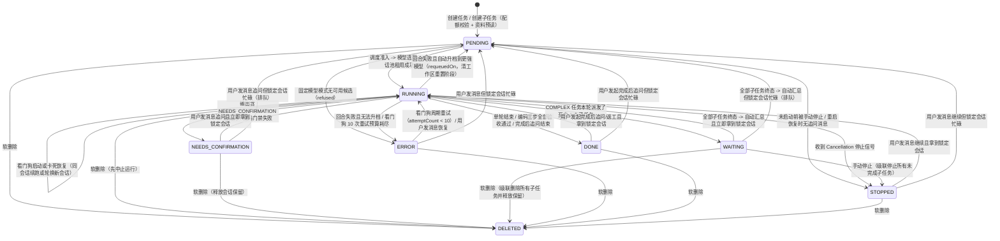

# 05. 异步任务引擎、研发三步流与自动化调度

> 本文档定义 SuperAgent 的长周期异步执行体系，涵盖任务领域模型与 8 状态完整状态机、编码三步门禁流、复杂任务扇出/扇入编排、双层人机确认（HITL）、多租户调度器、会话池、看门狗崩溃恢复以及定时/一次性/API 自动化引擎。全文严格保持技术栈无关。

---

## 1. 任务领域模型与核心关系

SuperAgent 贯彻**“在对话里讨论对齐，在任务里可靠交付”**的原则。每个任务（`Task`）是一次有目标、可追踪、可中途纠偏、可失败升档与崩溃恢复的持久化异步工作单元，其执行过程事件与追问消息复用会话事件存储模型（以 `task.id` 为键）。

### 1.1 任务核心实体 (`Task` 及附属表模型)

| 实体 / 字段组 | 关键字段与业务规则 |
|---|---|
| **`Task` 主记录** | `id` (UUID)、`title`（留空默认 `"Untitled task"`）、`brief`（任务说明，创建期可自动追加外部资料索引）、`source` (`WEB_CHAT` \| `TASK_FORM` \| `AUTOMATION` \| `INBOX`)、`repo` & `branch`（代码库与分支元数据）、`flow`（存储小写任务类型 `coding` \| `general` \| `complex`）、`status`（8 态状态机）、`progress`（钳位 0–100）、`spend`（累计美元花费）、`model` & `agentType`（执行模型与底层引擎）、`workspaceDir`（租用会话的工作区绝对路径，未排期时为空）、`createdBy`（所有者不可变用户 ID）、`error`（失败原因）、`createdAt` / `startedAt` / `finishedAt` / `updatedAt` |
| **`TaskOrigin`（来源归属）** | `(taskId, agentId, sessionId, messageId)`：永久记录由哪个 Agent、哪次对话会话及哪条消息发起；用于非 SuperAgent 任务的人设/记忆注入与结果回流对话 |
| **`TaskPhase`（编码阶段）** | `key` (`prd`/`dev`/`accept`)、`name` (`PRD`/`开发`/`验收`)、`status` (`PENDING`/`RUNNING`/`DONE`)、`content`（PRD Markdown 正文）、`evidence`（验收证据输出）；以单行 JSON 数组持久化 |
| **`TaskRunState`（恢复状态）** | `(taskId, agentSessionId, failureCount, attemptCount, updatedAt)`：持久化底层 CLI 会话 ID、当前会话连续失败次数与累计尝试次数（上限 `MAX_ATTEMPTS = 10`） |
| **`TaskLink`（任务关系）** | `(taskId, parentId, continuesFrom, createdAt)`： 1. **子任务 (`parentId`)**：仅允许 1 层嵌套（子任务强制 `GENERAL`），不在顶层任务列表展示，费用向上归集至父任务与所有者月度花费，不发通知也不自动打标。 2. **续做链 (`continuesFrom`)**：基于前序任务结论继续推进，首轮沿链回溯最多 **5 个祖先**（含环路保护），将最近前序结论（截断 10,000 字 + 其工作区路径）与更早祖先结论（各截断 1,200 字）拼入首轮提示词 |
| **`TaskModelChoice`（选型审计）** | 按 `seq`（1 起始）追加记录每次模型决策：`by` (`judge`/`user`/`fallback`/`escalation`/`default`/`fixed`)、`difficulty` (`easy`/`medium`/`hard`)、`model`、`cli`、`judge`、`candidates`、`reasoning`、`createdAt`。当固定模型模式无可运行候选时记录 `model = null, by = fixed`（拒止状态） |
| **`TaskTag`（主题标签）** | 人工可编辑（去 `#`、单标签 ≤20 字、去重、最多 **8 个**）；非子任务进入 `DONE` 且尚无标签时，后台单线程 `TaskTagger` 使用最便宜模型参考所有者常用 Top 40 标签自动生成 **2–4 个**标签 |

---

## 2. 任务 8 状态完整状态机与事件扇出

### 2.1 状态流转全景图

### 2.2 状态变更三路事件扇出

所有**非子任务**的状态变更都会发布 `TaskStatusChanged(taskId, owner, title, status, progress, result, error, agentId)` 领域事件，触发三个独立下游响应：
1. **统一待办通知中心 (`NoticeService`)**：`pending` 建隐藏 `TRACK` 记录任务来源；`running` 将待确认降回 `TRACK`；`needs_confirmation`/`error` 置顶生成 `CONFIRM` 确认卡；`done` 生成带 200 字纯文本摘要的 `DONE` 通知；`stopped`/`deleted` 标为 `IGNORED`。
2. **Agent 对话回流 (`ChatTaskResults`)**：`done`/`error`（摘要 1,500 字）与 `needs_confirmation` 回写为源非 SuperAgent 所属最新会话中的 `ASSISTANT` 消息（`author = "task:<taskId>"`）。
3. **自动主题打标 (`TaskTagger`)**：监听 `done` 异步补齐未打标任务的 2–4 个主题标签。

### 2.3 双层人机确认（HITL）机制

1. **创建前参数确认门禁（对话层）**：
   系统提示词与每轮检查规则强约束 Agent 在建任务前必须以 Markdown 展示 `### 任务参数`（逐项标 `✅ 已确定` / `❓ 待确认`）、`### 推荐`、`👉 下一步：回复「…」` 及加粗提示 `**目前尚未创建任务**`，并先用 `read_link` 验证所有外部链接可读；仅当用户明确回复确认且零 `❓` 时方可调用创建工具。
2. **执行中确认暂停门禁（任务层）**：
   任意输出行（去前导空白后）以 `"NEEDS_CONFIRMATION"` 开头，或编码阶段硬门禁失败时，任务暂停为 `NEEDS_CONFIRMATION` 并以 `RESERVED` 状态锁留会话（不占并发配额）。**例外**：复杂父任务及其子任务处于自主模式（`onItsOwn == true`），程序化抑制 `NEEDS_CONFIRMATION` 暂停，要求其自行做合理假设并说明。

---

## 3. 三类任务执行模式详解

### 3.1 任务类型判定与能力对比

- **类型判定规则**：MCP 调用必须显式指定 `coding` / `general` / `complex`；REST API 创建时若未传 `kind` 或传 `"auto"`，仅当 `repo` 非空时判为 `CODING`，否则判为 `GENERAL`（绝不做脆弱的关键词猜测）；子任务强制 `GENERAL`。

| 对比维度 | `GENERAL`（通用单轮） | `CODING`（编码三步流） | `COMPLEX`（复杂分治流） |
|---|---|---|---|
| **模型选型策略** | LLM 裁判选最便宜胜任模型 | LLM 裁判选最便宜胜任模型 | 父任务直接用默认/最强模型（不裁判）；子任务逐个裁判选最便宜模型 |
| **持久化阶段** | 无 | 固定 3 阶段：`prd` -> `dev` -> `accept` | 无阶段表，靠 `TaskLink` 子任务与 `【子任务汇总】` 消息推进 |
| **进度更新规则** | 启动 ≥10%，每调用 1 次工具 +5%（上限 90%，每跨 10% 桶写库）；暂停 50%；完成 100% | 固定阶段里程碑：运行 `{10, 33, 66}`，完成 `{33, 66, 100}` | 同 `GENERAL`；进入 `WAITING` 置 50%；最终完成 100% |
| **专属 MCP 工具** | 标准工作工具 + 外部连接器 | 标准工作工具 + 外部连接器 | 额外放行 `create_subtask` / `list_subtasks` / `subtask_output` |
| **交付产物** | `<workspaceDir>/output.md` + 文件库 | `TaskPhase.content`(PRD)、`TaskPhase.evidence`(验收)、`output.md` | `output.md`（最终综合交付） |

### 3.2 编码任务三步流 (`CodingFlow`)

编码任务强制在**同一个 CLI 会话**内按序推进三个阶段（无单独设计阶段），每步无缝继承前一步完整上下文：

| 序号 | 阶段键 (`key`) | 显示名 | 运行中/完成进度 | 后端硬门禁与流转规则 |
|---|---|---|---|---|
| 0 | `prd` | `PRD` | 10% -> 33% | 必须直接将 PRD Markdown 作为最终回复（**禁止写文件**），后端校验标题行（`#` 开头）必须同时包含 **`背景`**、**`需求`**、**`技术思路`** 三词。若首次未达标，**自动在同一会话重试 1 次**；重试仍未达标则触发硬门禁失败，写入 `NEEDS_CONFIRMATION: 第1步未产出 PRD` 并暂停（阶段保持 `RUNNING`）。通过后将正文存入 `phase.content`，**立即自动进入第 2 步（不强制停下等人工批准）** |
| 1 | `dev` | `开发` | 33% -> 66% | 依据已确认 PRD 实现代码改动并简述改动文件清单；仅检查取消与模型主动提出的 `NEEDS_CONFIRMATION:`，无内容硬校验 |
| 2 | `accept` | `验收` | 66% -> 100% | 运行构建、测试与必要接口验证；前端任务优先使用无头浏览器截图，无环境时必须如实声明并降级为「构建通过 + 关键 DOM 断言」，**严禁编造截图**。后端硬校验最终回复非空（否则暂停 `NEEDS_CONFIRMATION: 缺少验收证据`）。通过后存入 `phase.evidence` 并落盘 `output.md`，任务结案 `DONE` |

- **Git 仓库处理现状**：`repo` 与 `branch` 仅作为任务元数据保存与展示，平台后端**不内置自动 `git clone` / `checkout` / worktree 管理**，由编码 Agent 在租用的会话工作区目录中通过自身工具执行版本库操作。
- **中途确认、恢复与完成后返工**：
  - 任意阶段暂停后，用户发消息答复将直接作为当前阶段的新一轮提示词续跑，完成后自动串行推进剩余阶段。
  - 若发生进程崩溃或因错误轮换了全新会话（`freshSession == true`），进入 `dev`/`accept` 阶段恢复时系统自动重新注入原始 `brief` 与已持久化的 `prd` 正文，避免上下文断层。
  - 三步全部 `DONE` 后用户继续发消息，进入独立的 `runFollowUp` 单轮续跑分支，**不重置三步状态、不覆盖 `output.md`**。
  - 若任务失败触发**模型升档**，三阶段全部重置为 `PENDING`，由更强模型从第 1 步完整重跑。

### 3.3 复杂任务扇出 / 扇入编排 (`COMPLEX`)

- **租户可配参数**：单父任务子任务数上限 `task.complex.max-subtasks`（默认 `10`，范围 `1..50`）；同父任务最大并发子任务数 `task.complex.max-parallel`（默认 `5`，范围 `1..20`）；最大汇总轮数硬上限 **`3` 轮**。
- **失败替换配额**：可用子任务余量公式为 `room = max(0, maxSubtasks + count(ERROR|STOPPED 子任务) - 总子任务数)`，失败或被停掉的子任务不浪费名额。
- **执行循环**：
  1. **第 1 轮规划**：系统包装提示词引导父任务调用 `create_subtask` 拆出可独立并行的子任务并立即结束本轮；若本轮确已派发子任务，父任务切入 `WAITING`（进度 50%，锁留会话 `RESERVED`），否则直接结案 `DONE`。
  2. **子任务并行受控执行**：子任务继承父任务的来源、引擎、所属 Agent 与项目，跳过资料预读；调度器准入阶段严格限制同父任务下同时活跃的子任务不超过 `max-parallel`。
  3. **终态判定与自动扇入汇总**：子任务判定为“已结束”的条件是：`DONE`、`STOPPED`、`DELETED`，或 `ERROR` 且**看门狗尝试次数已达上限 10 次**（尚未耗尽重试的失败子任务会继续保持父任务等待）。一旦全部子任务结束，调度器自动拼装带 `【子任务汇总】` 标记的汇总消息恢复父任务：总预算 **60,000 字**，单子任务上限 `min(12,000, 60,000 / 子任务数)`，错误截断 500 字（被截断者父任务可按需调 `subtask_output` 读全文）。
  4. **多轮补派或终结**：若未达第 3 轮且有剩余名额且存在失败/停止子任务，允许父任务补派替代子任务再次进入 `WAITING`；第 3 轮时系统拒绝 `create_subtask`，强制父任务直接输出最终综合结论并 `DONE`。

---

## 4. 任务创建前置、调度器、会话池与看门狗恢复

### 4.1 创建前置校验与资料预读 (`TaskService.create`)

1. **月度 Token 配额检查**：调用租户配额服务校验当月消耗，超限直接拒止（HTTP 403）。
2. **外部资料并行预读（非子任务）**：
   - 提取显式传入的 `materials` 或从 `brief` 中解析去重 URL，最多并发预读 **`8` 个链接**，共享总截止时间 **`90` 秒**。
   - **全部成功才建任务（Fail-Fast）**：任意链接不可读或超时立即抛出 HTTP `409`（`UnreadableMaterials`）列出全部失败链接、原因与修复建议，**零数据库写入**，杜绝任务在缺失关键资料的情况下盲跑。
   - 预读成功的文档全部存为工作文件（`ORIGIN_TASK`），并在 `brief` 末尾追加 `## 已读取的外部资料` 文件 ID 清单，指示执行 Agent 通过 `file_get` 直接读取而无需重复抓取。
3. **人设与技能绑定**：绑定源 Agent 当前技能快照（无 Agent 时使用所有者全部可用技能），每轮执行前均通过 `TaskDoers` 注入非 SuperAgent 的名称、人设与长期记忆（确保复用同一会话池槽位运行不同 Agent 任务时不串人格）。

### 4.2 多租户公平调度器 (`TaskScheduler`)

- 单守护线程运行，采用**信号量即时唤醒 + 30 秒周期兜底扫描**（`task.scheduler.sweep-seconds`，最小 1 秒）。
- 每轮通过租户公平轮转（起始租户每次递增取模，单租户异常隔离）遍历全部启用公司，依次执行：
  1. **复杂任务扇入检查 (`sumUpFinished`)**：唤醒子任务已全部结束的 `WAITING` 父任务。
  2. **FIFO 准入排期 (`awaitingAdmission`)**：筛选 `status == PENDING && workspaceDir == null` 且按 `createdAt` 升序排列的任务，同时受双重门控约束：
     - 父任务并发上限 `complex.max-parallel`；
     - 公司级运行中任务配额 `tenant.quota.max-running-tasks`（`0` 表示不限）。
- **异步模型裁判防阻塞**：准入后若尚未确定模型，将耗时较长的 LLM 裁判选型投入异步线程池执行，避免阻塞主调度循环；选型完成后再进入会话池排期。

### 4.3 三态会话池与免队头阻塞队列 (`TaskSessionPool`)

每个员工按 `(owner, agentType)` 维护可复用的 CLI 会话与工作区目录（`<task.workspace-dir>/<companyId>/<sessionId>`），**绝不跨 CLI 复用**，所有池状态变更在统一调度锁内串行化：

| 池状态 | 是否计入并发上限 | 语义与可复用规则 |
|---|---|---|
| `IDLE` | 否 | 空闲，可被同租户、同员工、同 CLI 的任意新任务复用 |
| `BUSY` | **是**（每员工跨全部 CLI 上限 `task.max-parallel = 50`） | 正在执行回合 |
| `RESERVED` | **否** | 由处于 `NEEDS_CONFIRMATION` 或 `WAITING` 的任务锁留；禁止新任务抢占，**但允许原任务或同会话的追问/汇总通过指定 `sessionId` 租用**，追问结束后自动恢复为 `RESERVED` |

- **免队头阻塞排队**：并发满或指定锁定会话正忙时进入每员工 FIFO 队列；释放槽位触发派发时遍历整个队列，**跳过锁定会话仍忙的条目**，放行后续未锁定或其他空闲 CLI 的任务，杜绝队头阻塞。
- **重启恢复**：系统启动或公司加载时，自动扫描磁盘仍存在的工作区目录，重建 `IDLE`/`RESERVED` 池映射，并将重启前因会话忙碌而排队的追问任务（`PENDING` 且 `workspaceDir != null`）重新入队（若无用户消息则标 `STOPPED`）。

### 4.4 看门狗与崩溃自愈 (`TaskWatchdog` & `TaskRecovery`)

- **配置参数**：`task.watchdog.enabled = true`、`interval-seconds = 30`（最小 5）、`stall-seconds = 120`（最小 30）、硬常量 `MAX_ATTEMPTS = 10`、`ROTATE_AFTER = 1`。
- **启动即刻恢复**：应用就绪瞬间遍历所有启用公司，将数据库中全部处于 `RUNNING` 的孤儿任务立即交给 `recover()` 接管续跑。
- **30 秒周期巡检**：
  1. **遗漏/卡死 `RUNNING` 任务**：仅当任务**不在当前进程活跃运行表 (`activeRuns`) 中** 且 `updatedAt` 距今超过 120 秒时触发 `recover()`（注：不会强杀当前进程仍在 `activeRuns` 中运行的合法长任务，而是专门兜底失联孤儿）。
  2. **`ERROR` 自动重试**：对所有 `ERROR` 任务触发 `recover()`（直到 `attemptCount` 耗尽 10 次后记录告警并停止重试）。
- **会话轮换与恢复策略**：
  - 当 `attemptCount >= 10`：若非 `ERROR` 则终结为 `ERROR("retry budget exhausted after 10 attempts")` 并通知用户。
  - 凡由 `ERROR` 触发的重试（因 `ROTATE_AFTER == 1`）：**立即在原 `workspaceDir` 内铸造全新 `sessionId` 轮换对话历史**（保留工作区已产出文件，彻底规避损坏的上下文或非法签名思考块导致反复崩溃），并以专门恢复提示词继续完成收尾；若由进程重启中断，则沿用原 `agentSessionId` 续跑。

### 4.5 回合执行、模型升档与可见性规则

- **单轮执行保护**：每轮外包 `TurnTimer` 与 `UsageRecorder`；若零输出报错且未被取消，触发 Layer 1 凭证切换重试 1 次；若未取消且报错且无最终正文，强制抛出异常走 `ERROR` 流程（避免误判为确认或完成）。
- **自动成本升档**：回合结算 `ERROR` 时，若非人工锁定模型（`BY_USER`）且路由能给出下一档更贵模型，自动记录 `BY_ESCALATION` 选型、释放会话、清除 `TaskRunState`、重置编码阶段（如有），以 `requeuedOn()` 回到 `PENDING`（保留已花费 `spend`）重新排期执行。
- **可见性与所有权**：读类接口（详情、事件、状态、关系、模型选型、耗时、子任务输出）允许**任务所有者或同项目协作者**访问；写类接口（追问、停止、删除、改标签）**仅所有者**可操作；无权访问一律返回 `404`。

---

## 5. 自动化调度引擎 (`Automation`)

自动化是将固定提示词按计划或外部 API 调用自动转化为 `GENERAL` 异步任务的调度子系统。

### 5.1 核心模型与三种触发模式

| 触发类型 (`AutomationType`) | 调度参数与生命周期行为 |
|---|---|
| `RECURRING`（周期定时） | 标准 **5 字段 Cron 表达式**（`分 时 日 月 周`，秒位固定为 0），配合 IANA 时区（默认 `Asia/Shanghai`）。采用 **DST（夏令时）安全计算**：基于目标时区墙钟时间推算下次 UTC 时刻，保证跨夏令时仍于本地固定钟点触发 |
| `ONCE`（一次性定时） | 指定目标时区本地时刻（`YYYY-MM-DDTHH:mm`，新建或重启用时必须晚于当前时刻）；触发一次后**自动将自身置为 `enabled = false, nextRunAt = null`** |
| `API`（外部 Webhook 触发） | 无定时计划，仅响应公开接口 `POST /api/v1/automations/{id}/trigger`（或手工立即运行）。创建、切换为 `API` 或轮换令牌时生成唯一明文令牌并**仅在该次响应中返回一次**，数据库仅存其 SHA-256 摘要 |

### 5.2 调度防重、重叠策略与 Webhook 安全

1. **崩溃安全的至多一次调度 (`AutomationScheduler`)**：
   - 单守护线程启动后**延迟 0 秒立即首扫**，此后每 **30 秒**（可配 `automation.scheduler.interval-seconds`，最小 5）按租户轮询到期项（`enabled && nextRunAt <= now`）。
   - **关键防重设计**：在真正创建任务**之前**，先在锁内将 `ONCE` 禁用或将 `RECURRING` 的 `nextRunAt` 基于 `now` 推进到下一个未来时刻并落库。这同时保证：（a）服务在创建任务中途崩溃不会重复触发；（b）服务停机数小时恢复后，错过的多次触发自动**折叠为单次补跑**而不会引发任务雪崩。
2. **两种重叠策略 (`OverlapPolicy`)**：
   - `SKIP`（默认）：检查 `lastTaskId` 状态，若仍为 `PENDING` 或 `RUNNING`，则跳过本次启动，追加一条 `taskId = null` 的跳过运行记录（`AutomationRun`），**保留原 `lastTaskId` 不变**。*关键细节*：`NEEDS_CONFIRMATION` 与 `WAITING` **不视为仍在运行**，防止一次暂停永久阻塞后续排期。
   - `PARALLEL`：忽略上次运行状态，直接并行创建新任务。
3. **外部 Webhook 认证与多租户路由**：
   - 触发令牌格式为 **`<companyId>.<64位小写随机十六进制>`**（32 字节加密安全随机数），通过请求头 `X-Automation-Token` 传递；可选 JSON 体 `{"input": "..."}` 注入本次动态入参。
   - 网关收到未登录请求后，按第一个 `.` 提取 `<companyId>` 切换租户上下文，使用**常量时间字节比较**核验令牌 SHA-256 哈希；ID 不存在、类型非 `API`、令牌格式错误或哈希不匹配统一返回相同的 **HTTP 403**（防探测）；鉴权通过但已暂停返回 HTTP 400。
4. **任务映射与无人值守约束**：
   - 标题格式化为 `<名称> · <MM-dd HH:mm>`（按自动化时区）；
   - 提示词拼装 `prompt` + 可选 `## 本次输入` + 固定无人值守声明（要求模型遇到不确定处自行合理假设并说明，不要停下等待确认）；
   - 启动任务若抛出异常（如配额耗尽、资料不可读），捕获异常并记为一条带失败原因的跳过运行记录，不拖垮调度器。
   - 列表与详情中每条 `AutomationRun` 的状态不冗余落库，而是实时关联 `TaskStore` 计算（`skipped` / 任务小写状态 / `deleted`）；删除自动化本身时**保留全部历史运行记录与已生成的任务**。
   - **权限边界**：普通用户仅能查看与管理自己的自动化（访问他人返回 `404`）；公司管理员可查看与管理本公司全部自动化；对话内 MCP 工具始终以非管理员身份仅限操作调用者本人自动化。

---

## 6. 本模块贡献的 MCP 工具契约（3 提供方，17 工具）

### 6.1 任务管理工具 (`TaskMcpTools` — `Kind.CHAT`，6 工具)

| 工具名 | 输入参数（`*` 必填） | 核心行为 |
|---|---|---|
| `create_task` | `title*`, `brief*`, `kind*`(`coding`/`general`/`complex`), `repo`, `branch`, `continues_from`, `materials` | 创建 `source=web_chat` 任务，关联当前 Agent/会话/消息，执行资料预读（失败返回工具级错误提示模型不得声称创建成功）并唤醒调度器 |
| `list_tasks` | `{}` | 列出当前用户所有活跃顶层任务（不含子任务）的 ID、标题、状态与进度 |
| `get_task` | `id*` | 查询指定任务的标题、状态、进度与错误信息 |
| `send_task_message` | `id*`, `content*` | 向暂停/完成/失败/停止的任务发送回复或追问，恢复原锁定会话（运行中返回忙碌异常） |
| `stop_task` | `id*` | 中止运行中任务、移出排队或级联停止 `WAITING` 复杂父任务及其子任务 |
| `delete_task` | `id*` | 软删除任务（级联删子任务）并释放会话池保留 |

### 6.2 复杂任务子任务工具 (`ComplexTaskMcpTools` — `Kind.TASK`，仅对 `COMPLEX` 放行，3 工具)

| 工具名 | 输入参数（`*` 必填） | 核心行为 |
|---|---|---|
| `create_subtask` | `title*`, `brief*` | 校验父任务为 `COMPLEX`、汇总轮次 `< 3` 且剩余配额 `> 0`；创建继承归属的 `GENERAL` 子任务并唤醒调度器，返回子任务 ID 与剩余名额 |
| `list_subtasks` | `{}` | 列出当前父任务下所有未删除子任务的 ID、标题与状态 |
| `subtask_output` | `id*` | 校验子任务归属当前父任务后，返回子任务最后一条完整助手答复全文（或错误信息/未完成提示） |

### 6.3 自动化管理工具 (`AutomationMcpTools` — `Kind.CHAT`，8 工具)

| 工具名 | 输入参数（`*` 必填） | 核心行为 |
|---|---|---|
| `create_automation` | `prompt*`, `name`, `type`(`recurring`/`once`/`api`), `cron`, `run_at`, `timezone`, `model`, `overlap`(`skip`/`parallel`) | 创建 `source=chat` 自动化并返回未来执行时刻；若为 `api` 类型刻意**不在聊天输出中回显明文令牌**，引导用户至自动化页面查看或重置 |
| `list_automations` | `{}` | 列出调用者全部自动化的排期、启停状态、下次时间与上次结果 |
| `get_automation` | `id*` | 返回详情、未来 3 次计划时刻、API 路径（不含密钥）、最近 5 次运行与完整提示词 |
| `update_automation` | `id*`, 其余字段均可选 | 增量更新配置并重算下次运行时间 |
| `set_automation_enabled` | `id*`, `enabled*` | 暂停或恢复自动化（拒绝恢复已过期的一次性自动化） |
| `run_automation_now` | `id*` | 立即触发一次手动运行，不影响原定排期 |
| `delete_automation` | `id*` | 删除自动化配置，保留历史任务与运行记录 |
| `get_current_time` | `timezone`(默认 `Asia/Shanghai`) | 返回当前本地日期时间与星期，辅助模型将「明天上午 9 点」换算为绝对 `run_at` |
