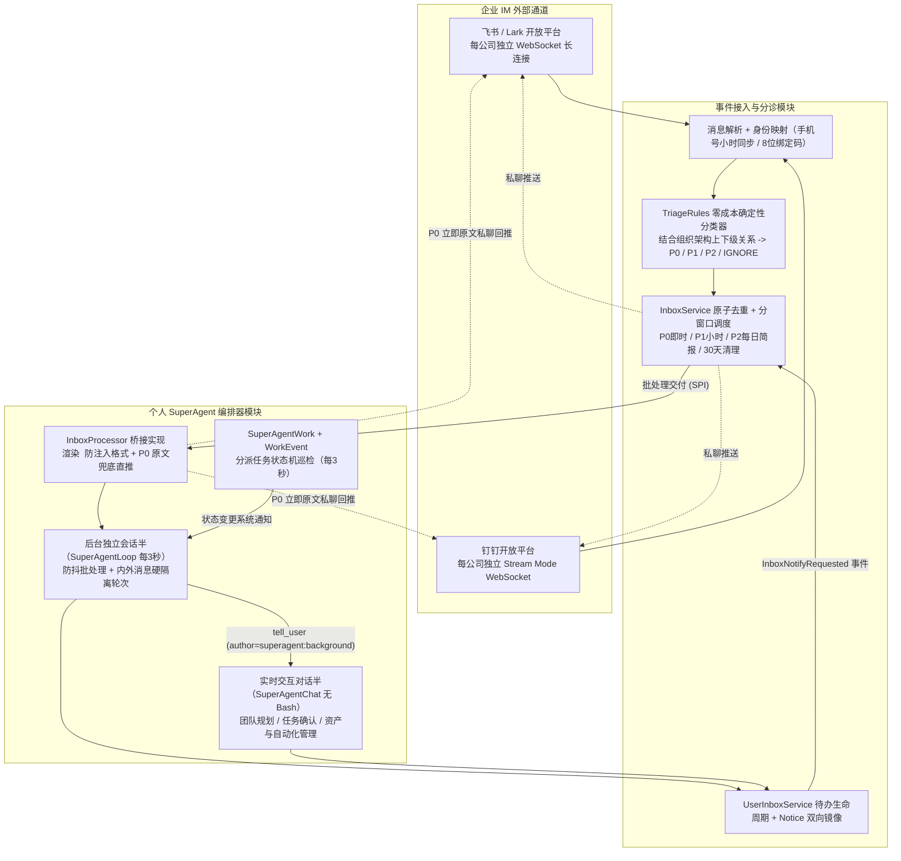
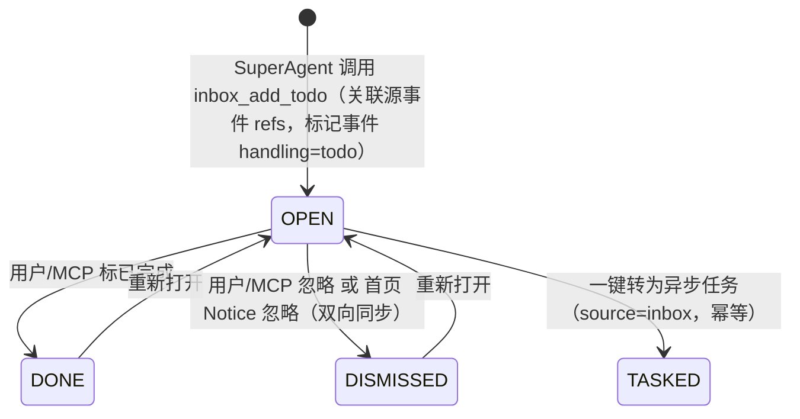

# 06. 个人 SuperAgent 编排器与 IM 收件箱分诊系统

> 本文档定义 SuperAgent 的顶层编排与企业消息入口子系统：每位员工专属的**双半隔离个人 SuperAgent 编排器**（计划审批门禁、团队招募与任务追踪、外部消息防提示词注入隔离）以及**飞书/Lark 与钉钉企业级 IM 长连接接入、确定性四级分诊与待办闭环系统**。全文严格保持技术栈无关。

---

## 1. 子系统分层协作总览

收件箱事件模块位于编排器模块之下，二者通过核心层的抽象接口与领域事件完全解耦（单向依赖，无循环引用）：

---

## 2. 个人 SuperAgent 编排器设计

### 2.1 双半隔离架构与平台硬不变量

每位员工懒加载拥有一个全局唯一的 `AgentKind.SUPER`（默认名 `"SuperAgent"`，头像 `"🦸"`），在运行时被刻意拆分为**永不共享同一个底层 CLI 会话的两半**：

1. **实时交互对话半 (`SuperAgentChat`)**：
   - 通过标准对话引擎的 `AgentTurnCustomizer` 钩子深度接管：替换全部标准系统提示词、**强制剥离 `Bash` 与关闭 `skipPermissions`**、开启带 `sessionId` 和 `messageId` 的 `SUPER` 授权令牌。
   - **跨半上下文衔接**：每次收到用户发言时，自动从主会话消息末尾逆序收集所有 `author = "superagent:background"` 的后台发言（直到遇见上一条普通助手回复），连同当前计划状态、团队人数与「先确认再建任务」检查块一并前置到 `## 用户说` 之前，使实时对话半无缝知晓后台刚刚向用户汇报过什么。
2. **异步后台事件半 (`SuperAgentLoop` + 后台会话)**：
   - 运行在一个对普通对话列表不可见的独立脱离会话上（确定性 ID：`UUIDv3("superagent-background:" + superAgentId)`，标题 `"SuperAgent 后台"`）。
   - 持续消费两类严格区分的 `SYSTEM` 输入：内部任务进展通知 与 带 `【外部消息】` 前缀的第三方 IM 批次。
   - 后台回合的原始思考与回复仅留存在后台记录抽屉；只有对用户真正重要的结论才通过专用工具 `tell_user` 写入主会话，避免刷屏打扰。

**`AgentKind.SUPER` 平台级硬不变量**：
- 不可删除；
- 不可共享给协作者（处理员工私有消息与待办）；
- 名称、性格预设与自定义人设平台锁定不可改；
- 不可设置上级、不可作为其他 Agent 的上级、不可放进项目、不可通过对话挂载技能；
- 永远禁止直接执行宿主机 `Bash` 命令，一切需读文件、产交付物或耗时操作均通过确认表委托给异步任务。

### 2.2 计划审批硬门禁与工作追踪体系

#### 1. 团队规模与计划审批 (`SuperAgentState` & `SuperAgentPlan`)
- **团队上限**：`superagent.team-limit`（默认 **`6`** 人，最小 1），计入该员工名下全部未删非 Super 标准 Agent（含用户自建与 SuperAgent 招募），在提案与招募两阶段双重拦截。
- **两级操作通道**：
  - **快速任务通道 (`start_task`)**：仅限实时对话半使用；经用户对话确认任务参数表后，直接派给已有成员或作为 `"独立任务"`（`memberId = superAgentId`）启动，**无需先过计划审批卡**。
  - **团队变更与规划通道 (`propose_plan` -> UI 卡片审批 -> `hire_member`/`update_member`/`assign_task`)**：
    - `propose_plan` 写入 8 位短 ID 计划并置 `planStatus = "proposed"`，同时发布 `PlanChanged(open=true)` 在用户待办首页生成 `CONFIRM` 确认卡。
    - **服务端强门禁**：`hire_member`、`update_member`、`assign_task` 执行前一律调用 `requireApproved`，**用户仅在聊天里回复“开始”不能解锁**，必须点击计划卡片上的「确认执行」（`POST /api/v1/superagent/plans/{planId}/approve`）将状态改为 `"approved"` 并关闭待办确认卡后方可执行。
    - 成员归位（调整项目或汇报上级 `place_member`）、技能维护、自动化管理与文件整理无需计划审批。

#### 2. 工作台账与监控状态机 (`SuperAgentWork` & `SuperAgentWorkEvent`)
- 每次通过 `assign_task` 或 `start_task` 派发任务，同步写入一条 `SuperAgentWork` 记录（开放态：`running` / `needs_confirmation`；终态：`done` / `error` / `stopped` / `deleted`）及追加式 `SuperAgentWorkEvent` 时间线（`assigned` / `needs_confirmation` / `replied` / `done` / `error` / `stopped` / `deleted`）。
- 派给团队成员时，同时向**该成员自己的最新对话会话**写入一条任务接单通知（`author = "task:<taskId>"`），让成员视角与主管视角保持一致。
- **3 秒任务巡检状态机 (`SuperAgentInbox.watch`)**：后台每 3 秒扫描开放工作项对应任务的实时状态：

| 当前任务状态 | 相对上次已上报是否有变化 | 决策动作 | 系统行为 |
|---|---|---|---|
| `DONE` / `ERROR` / `STOPPED` / `DELETED` | 是 | `REPORT_AND_DROP` | 写入后台会话系统通知（附最多 1,500 字最终答复或报错）、更新工作项为终态与 `finishedAt`、追加终态事件 |
| `DONE` / `ERROR` / `STOPPED` / `DELETED` | 否 | `DROP` | 静默收口工作项，不重复发通知 |
| `NEEDS_CONFIRMATION` | 是 | `REPORT_AND_KEEP` | 写入后台会话系统通知（附问题与 `reply_task` 提示）、更新工作项为 `needs_confirmation`、追加事件，继续保持追踪 |
| 其余情形 | — | `KEEP` | 无变化，跳过 |

- **历史存量补录**：公司启动时幂等扫描尚未入台账但 `brief` 匹配 `^你是团队成员「(.+?)」，由 SuperAgent 分派本任务` 的历史任务，自动补齐 `SuperAgentWork` 及补录事件。

### 2.3 后台调度防抖、防提示词注入隔离与防毒丸机制

后台守护调度器（`SuperAgentLoop`）默认每 **`3` 秒**（可配 `tick-seconds`）按租户公平轮询所有拥有 `SuperAgentState` 的员工，每个员工严格串行（**同时至多运行 1 个后台回合**）：

1. **三条件防抖触发规则 (`SuperAgentInbox.due`)**：
   自游标 `processedUntil` 之后存在未处理非助手消息时，满足以下任一条件即触发回合：
   - 处于**立即唤醒集合**（例如收到 `P0` 紧急外部消息，或上轮拆分出剩余异质批次）；
   - **静默窗口达标**：最新一条待处理消息距今 `>= 10 秒`（`quiet-seconds`，合并短时间连续消息）；
   - **防饥饿上限达标**：最早一条待处理消息距今 `>= 60 秒`（`max-wait-seconds`，防止消息不断涌入导致永不处理）。
2. **外部消息与内部通知的硬隔离拆分（核心安全防线）**：
   - 取待处理队列首条消息判定其类别：`external = (role == SYSTEM && content.startsWith("【外部消息】"))`。
   - **仅截取连续同类的最大前缀**作为本轮输入；若队列后部存在另一类别消息，立即将用户重新标为 `immediate`，下一轮（3 秒后）再在独立轮次中处理。
   - 这样保证**外部第三方文本绝不会与可动用执行工具的内部轮次混跑**！
3. **三档工具白名单与双重安全门禁**：

| 工具类别 | 外部消息后台轮 (`EXTERNAL_ROUND_TOOLS`) | 内部通知后台轮 (`BACKGROUND_TOOLS`) | 实时对话半 (`CHAT_TOOLS`) |
|---|:---:|:---:|:---:|
| 只读查询 + `propose_plan` + `get_current_time` | ✅ | ✅ | ✅ |
| `tell_user`（向主对话发消息） | ✅ | ✅ | ❌（服务端拒止） |
| 团队/任务执行工具（`hire_member`, `update_member`, `place_member`, `assign_task`, `reply_task`） | ❌（白名单裁剪 + 服务端 `requireOwnInput` 双拦截） | ✅ | ✅ |
| 收件箱 6 工具（`inbox_*`, `todo_*`） | ✅ | ✅ | ✅ |
| `start_task` / 协作 4 工具 / 自动化 7 工具 / 文件管理 11 工具 / 技能 8 工具 / 办公文档只读 7 工具 | ❌ | ❌ | ✅ |
| `Bash` 命令执行 | ❌ | ❌ | ❌ |

4. **防毒丸死循环与游标必进规则**：
   - 无论本轮后台模型调用成功还是失败，**游标 `processedUntil` 均无条件推进到本批最后一条消息的时间戳**。
   - 若本轮零输出报错：在后台会话记录 `（本轮处理失败：<error>）` 并将底层 `agentSessionId` 置空，强制下一轮开启全新会话，避免坏消息或损坏上下文锁死整个后台循环。

---

## 3. 企业级 IM 长连接接入与身份映射

平台支持 **飞书 / Lark** 与 **钉钉** 两套企业级 IM 机器人应用，均以**每公司一条由内向外的持久 WebSocket 长连接**运行（无需企业暴露公网 Webhook 端口），监听 `CompanyStarted` 与 `IntegrationChanged` 事件实现单公司精准热重载与断连清理。

### 3.1 飞书 / Lark 接入规格 (`FeishuConnector`)

- **连接与校验**：读取公司 `feishu` 集成配置（`appId`、`appSecret`、`domain` 支持国内飞书与国际 Lark 切换）；建连前先调 `GET /open-apis/bot/v3/info` 校验凭据并区分网络代理故障与鉴权拒绝；开启自动重连 WebSocket 订阅 `im.message.receive_v1`，收到推送后**立即异步转交 4 线程消费池**以便毫秒级 ACK 防止重复投递；关闭或配置变更时彻底终止旧连接与心跳线程池，并校验连接句柄是否仍为最新（防过期连接污染状态）。
- **12 类富消息解析**：将 `@_user_N` 占位符替换为真实 `@显示名`，正文截断 **8,000 字**；支持 `text`、`post`（含多语言解包、标题、段落、链接、`@`、代码块及媒体占位）、`image` (`[图片]`)、`file` (`[文件] <文件名>`)、`audio` (`[语音]`)、`media` (`[视频] <文件名>`)、`sticker` (`[表情]`)、`interactive` (`[卡片消息]`)、`share_chat`、`share_user`、`merge_forward` 及兜底占位。
- **路由与元数据缓存**：
  - **私聊 (`p2p`)**：优先识别绑定指令 -> 未绑定者发引导提示 -> 已绑定者以 `mentionsMe = true, fromOwner = true` 投递本人。
  - **群聊 (`group`)**：收件人取「群内被 `@` 的已绑定员工」与「群成员列表（分页最多 20 页 = 2,000 人，缓存 **10 分钟**，缺权限自动降级为仅 `@` 触发）中的已绑定员工」的并集，并**排除发言者本人**。
  - 用户名与群名按连接内存缓存（用户名查空不缓存，便于后补通讯录权限即时生效）。
- **回推能力**：核验员工绑定归属当前 `appId` 后，通过机器人私聊接口按 `open_id` 推送文本消息。

### 3.2 钉钉接入规格 (`DingTalkConnector`)

- **协议与重连**：直连钉钉 Stream Mode WebSocket（先换 OAuth2 `accessToken` 提前 300 秒刷新 -> 调 `/v1.0/gateway/connections/open` 订阅 `/v1.0/im/bot/messages/get` 取 ticket -> 建立 WebSocket）。收到 `SYSTEM/ping` 原样回包，`SYSTEM/disconnect` 或断线按指数退避 **`5s -> 10s -> 20s -> 40s -> 80s -> 160s -> 300s`** 重连；收到业务消息帧后**立即回发 `code=200` ACK** 再入 4 线程消费池。
- **消息解析与 `@机器人` 特殊路由**：支持 `text`、`richText`、`picture`、`audio`（**优先提取钉钉自带语音转写 `recognition`**）、`video`、`file`。钉钉仅推送单聊及群内 `@机器人` 消息；路由给发言者及所有被 `@` 员工；对于发言者本人在群里 `@机器人` 的消息，刻意将 `chatType` 归一化为 `"p2p"` 并标注群名 `（@机器人）`，避免被分诊规则误伤为“自己在群里的普通发言”。
- **回推能力**：调用 `/v1.0/robot/oToMessages/batchSend` 向员工 `userId` 发送私聊文本。

### 3.3 双路径员工身份绑定（飞书 & 钉钉统一规范）

因 IM 外部用户 ID 归属具体企业应用，员工绑定记录（`EventSource`）同时校验 `ownerExternalId` 与当前 `appId` 一致方视为有效绑定，且强约束 **1 个外部 ID 仅归属 1 位员工**（重新绑定会自动解除原归属）：
1. **每小时手机号自动匹配**：连上瞬间及每小时定时扫描未绑定且填有手机号的启用员工，规范化号码（去符号；钉钉对 13 位 `86` 开头去国码）批量调用 IM 接口匹配外部 ID（飞书每次 50 个，钉钉逐条）。
2. **8 位绑定码私聊自绑定**：员工在连接器页面生成 8 位无歧义字符绑定码（去掉易混字符 `I/O/L/0/1`），私聊机器人发送 `绑定 <code>` 或 `bind <code>`（忽略大小写）。
   - **安全限流**：同一外部账号连续输错 **`5` 次**绑定码即锁定报错（防暴力枚举），成功则清零失败计数并清空绑定码。
   - **引导冷却**：未绑定员工发送非绑定私聊时，向其回复绑定指引，同一人每 **`6` 小时**至多提醒一次。

---

## 4. 确定性四级分诊、批处理与待办闭环

### 4.1 零成本确定性分诊规则 (`TriageRules`)

系统不消耗任何模型 Token 进行初筛，严格按以下 **7 步优先级顺序**结合公司实时组织架构图（`OrgStore` 查直属 `"上级"` 与 `"下属"`，上级优先）分类并产出中文理由：

| 步序 | 判定条件 | 分诊优先级 | 分诊理由 |
|:---:|---|:---:|---|
| 1 | `fromBot == true`（其他机器人消息） | `IGNORE` | `机器人消息` |
| 2 | `fromOwner == true && chatType != "p2p"`（自己在群里的发言） | `IGNORE` | `我自己在群里的发言` |
| 3 | 正文（去空白小写）命中 17 个敷衍/确认短词（`收到`/`好的`/`好`/`ok`/`okay`/`嗯`/`嗯嗯`/`谢谢`/`多谢`/`thanks`/`thx`/`👍`/`1`/`+1`/`了解`/`明白`/`[表情]`）**或**仅含标点/空白/Emoji 符号 | `IGNORE` | `无需处理的简短回复` |
| 4 | 正文包含 8 个紧急信号词之一（`线上故障`/`紧急`/`加急`/`今天必须`/`马上`/`宕机`/`urgent`/`asap`）**且**（私聊或 `@我` **或** 发件人是直属上级/下属） | `P0` | `紧急信号「<词>」` |
| 5 | 发件人是直属上级或下属 **且**（私聊或 `@我`） | `P0` | `<上级/下属>「<发件人>」(私聊/@我)` |
| 6 | 私聊或 `@我`（普通同事） | `P1` | `私聊` / `@我` |
| 7 | 其余普通群聊消息 | `P2` | `<关系>的群消息` / `群消息` |

*注：步骤 4 的噪声保护极为关键——大群里无关人员喊“紧急”不会误触 P0 警报，必须同时指向本人或来自直属汇报线。*

### 4.2 原子去重、分窗口批处理与 P0 原文兜底

1. **存储层原子去重**：事件主键采用确定性 UUID v3：`UUIDv3(source + ":" + externalId + ":" + owner)`，落库采用忽略主键冲突插入（`INSERT IGNORE`），天然免疫 IM 平台重推。`IGNORE` 事件入库即标记 `processed = true, handling = "ignored"`。
2. **三类时间窗口调度**：
   - **`P0` 紧急窗口**：入库瞬间提交至 2 线程紧急执行池**立即交付**；交付前 `SuperAgentInboxProcessor` 同步构造一条 `【SuperAgent 紧急提醒】<发件人>（<会话>）：<前200字>` 直接回推员工 IM 私聊——**确保即使大模型完全宕机或后台轮次仍在思考，紧急告警也能秒级触达**。
   - **`P1` 小时汇总窗口**：后台 60 秒巡检线程检测到距上次 `lastHourlyAt >= 1 小时` 时，批量打包交付。
   - **`P2` 每日简报窗口**：按员工所设时区（默认 `Asia/Shanghai`）到达 `digestTime`（默认 `09:00`）且当日尚未执行（`lastDigestDate != today`）时批量打包交付。
   - **数据保留清理**：每公司每天执行一次，自动清除超过 **`30` 天**（`inbox.retention-days`）的历史 `inbox_event`。
3. **防并发、批量上限与退避**：
   - 每位员工持有独立串行锁，确保 `P0`/`P1`/`P2` 永不同步并发。
   - 单批次最多提取 **`300` 条**最早待处理消息，格式化为带 8 位短引用 `[<ref>]`、单条截断 1,500 字的 `<messages>...</messages>` XML 块并附防注入声明，交付后标记 `processed = true, handling = "delivered"`。
   - 交付异常时保持 `processed = false`，并对 `(owner, source, window)` 实施 **10 分钟退避**，60 秒巡检到点自动重试。

### 4.3 收件箱待办状态机与通知中心双向同步 (`InboxTodo`)

待办仅有 **4 个状态**（无延后/贪睡态）：

- **双向镜像**：`InboxTodo` 任何创建/状态变更均发布 `InboxTodoChanged`，在待办首页同步维护 `key = "todo:<id>"` 的 `ACTION` 通知（`open->OPEN`、`dismissed->IGNORED`、`done/tasked->DONE`）；用户在首页忽略该通知时发布 `NoticeIgnored`，自动将对应 `OPEN` 待办置为 `DISMISSED`。
- **遗留迁移 (`SecretaryCleanup`)**：公司启动时自动清理历史版本曾为每位用户创建的独立「秘书」Agent 并清空 `EventSource.secretaryAgentId`，平滑收敛至统一的个人 SuperAgent。

---

## 5. 编排器与收件箱 MCP 工具全量契约（31 工具）

全部注册在 `McpGrants.Kind.SUPER` 作用域下：

### 5.1 个人主管核心工具 (`SuperAgentTools` — 13 工具)

| 工具名 | 适用轮次 | 核心参数（`*` 必填） | 行为与约束 |
|---|---|---|---|
| `list_team` | 全部 | `{}` | 列出所有自建与招募团队成员的 ID、名称、项目、上级、模型、技能与人设摘要 |
| `list_projects` | 全部 | `{}` | 列出所属项目 ID、名称、归档态与成员 Agent 数 |
| `list_skills` | 全部 | `{}` | 列出已启用的可用技能清单 |
| `propose_plan` | 全部 | `summary*`, `members*`, `tasks*` | 校验 `现有人数 + 新招数 <= teamLimit`，覆写待批计划并生成首页确认卡 |
| `hire_member` | 对话、内部后台 *(需计划已批)* | `name*`, `persona*`, `model`, `skill_ids`, `project_id`, `parent_id` | 校验已批计划、人数上限、模型健康、不重名及归位合法性后招募新成员 |
| `update_member` | 对话、内部后台 *(需计划已批)* | `id*`, 其余可选（`"none"` 清归位） | 校验已批计划与模型健康后更新成员人设/模型/技能/归位 |
| `place_member` | 对话、内部后台 *(免计划)* | `id*`, `project_id`, `parent_id` | 调整成员所属项目或汇报上级（防环、禁 SuperAgent） |
| `assign_task` | 对话、内部后台 *(需计划已批)* | `member_id*`, `title*`, `brief*`, `kind*` | 校验已批计划后向成员派发任务，同步写成员会话通知与工作台账 |
| `list_assigned_tasks` | 全部 | `{}` | 列出所有开放工作项及其实时任务状态 |
| `get_task` | 全部 | `id*` | 查询本人任务状态、进度与错误 |
| `reply_task` | 对话、内部后台 | `task_id*`, `content*` | 代答需确认的工作台账任务，将工作项复位为 `running` 并记 `replied` 事件 |
| `get_current_time` | 全部 | `{}` | 返回当前 `Asia/Shanghai` 时间与星期 |
| `tell_user` | **仅后台轮次** | `text*` | 向主对话发送 `author = "superagent:background"` 的 Markdown 汇报 |

### 5.2 快速任务、自动化与协作工具（仅实时对话半 — 12 工具）

- **`SuperAgentTaskTools`（1 工具）**：`start_task(title*, brief*, kind*, member_id?)` — 免计划卡直接启动用户已确认的成员任务或独立任务，并挂接内联任务卡。
- **`SuperAgentAutomationTools`（7 工具）**：委托自动化模块提供 `create_automation`、`list_automations`、`get_automation`、`update_automation`、`set_automation_enabled`、`run_automation_now`、`delete_automation`（剔除重名的 `get_current_time`，严格拒绝后台轮次调用）。
- **`SuperAgentCollabTools`（4 工具）**：`collab_find_people(query*)`、`collab_list_members(agent_id*)`、`collab_invite(agent_id*, usernames*)`（创建确认卡）、`collab_remove(agent_id*, username*)`（仅限本人拥有的非 `SUPER` 成员）。

### 5.3 收件箱分诊工具 (`InboxMcpTools` — 全部轮次可用 — 6 工具)

| 工具名 | 核心参数（`*` 必填） | 行为与约束 |
|---|---|---|
| `inbox_search` | `query`, `limit`(1..200, 默认 30) | 在最近 2,000 条收件箱事件中按发件人/会话/正文检索，返回带 8 位短引用与防注入尾注的清单 |
| `inbox_add_todo` | `title*`, `detail`, `requester`, `due`, `refs` | 创建 `OPEN` 待办（关联源事件、同步首页通知），并将引用事件标为 `handling = todo` |
| `inbox_notify` | `text*`, `refs` | 截断 500 字加 `【SuperAgent】` 前缀推送至员工全部已启用 IM 私聊，并将引用事件标为 `notified` |
| `inbox_mark` | `refs*`, `handling*`(`read`/`ignored`/`task`) | 批量更新引用事件的处理状态并返回命中条数 |
| `todo_list` | `{}` | 列出调用者全部收件箱待办及关联任务 ID |
| `todo_update` | `id*`, `status*`(`done`/`dismissed`/`open`) | 更新待办状态（禁直设 `tasked`）并同步首页通知 |
