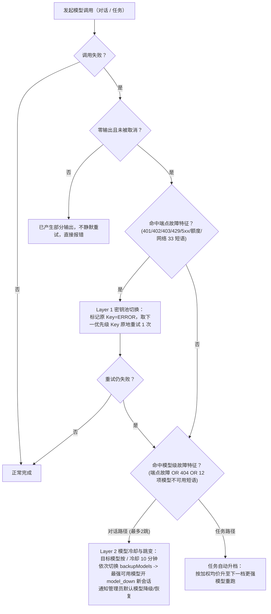

# 07. 模型提供商管理、多密钥容灾、成本路由与用量分析

> 本文档定义 SuperAgent 的模型治理与 FinOps 成本优化体系，涵盖 10 大官方 CLI 供应商目录、私有 Node.js 与 CLI 在线安装升级、多密钥优先级池与双层容灾切换、实时推理探活、动态价格目录与智能任务路由（LLM-as-Judge + 失败逐级升档），以及多维 Token 账单与公司运营分析。全文严格保持技术栈无关。

---

## 1. 模型供应商目录与在线安装体系

### 1.1 10 大官方供应商静态目录 (`ProviderCatalog`)

为杜绝数据库被篡改执行任意命令，所有 CLI 安装命令与元数据均固化在代码静态目录中（数据库 `model_provider` 仅存运行状态与模型清单）；全部 10 项均通过无 shell 的安全参数数组调用 `npm install -g <pkg>@latest --no-fund --no-audit` 安装/升级：

| 供应商键 | 显示名称 | CLI 二进制 | 官方 npm 包 | 最低 Node | 预览态 | 探活协议 | 默认 API 端点 | 密钥环境变量 | 端点环境变量 |
|---|---|---|---|---|:---:|---|---|---|---|
| `claude` | Claude Code | `claude` | `@anthropic-ai/claude-code` | `22.0.0` | 否 | `anthropic` | `https://api.anthropic.com` | `ANTHROPIC_API_KEY` | `ANTHROPIC_BASE_URL` |
| `codex` | OpenAI Codex | `codex` | `@openai/codex` | `16.0.0` | 否 | `openai` | `https://api.openai.com/v1` | `OPENAI_API_KEY` | — |
| `deepseek` | DeepSeek Harness | `dsh` | `@deepseek-ai/dsh` | `24.9.0` | **是** | `anthropic` | `https://api.deepseek.com/anthropic` | `DEEPSEEK_API_KEY` | `DEEPSEEK_BASE_URL` |
| `glm` | GLM（智谱） | `claude` | `@anthropic-ai/claude-code` | `22.0.0` | 否 | `anthropic` | `https://open.bigmodel.cn/api/anthropic` | `ZHIPU_API_KEY` | — |
| `kimi` | Kimi Code | `kimi` | `@moonshot-ai/kimi-code` | `22.19.0` | 否 | `openai` | `https://api.moonshot.cn/v1` | `KIMI_API_KEY` | `KIMI_CODE_BASE_URL` |
| `qwen` | Qwen Code | `qwen` | `@qwen-code/qwen-code` | `22.0.0` | 否 | `openai` | `https://dashscope.aliyuncs.com/compatible-mode/v1` | `DASHSCOPE_API_KEY` | — |
| `grok` | Grok Build | `grok` | `@xai-official/grok` | `20.0.0` | 否 | `openai` | `https://api.x.ai/v1` | `XAI_API_KEY` | `XAI_BASE_URL` |
| `codebuddy` | CodeBuddy Code | `codebuddy` | `@tencent-ai/codebuddy-code` | `18.0.0` | 否 | `other` | *(CLI 内置)* | `CODEBUDDY_API_KEY` | `CODEBUDDY_BASE_URL` |
| `gemini` | Gemini CLI | `gemini` | `@google/gemini-cli` | `20.0.0` | 否 | `other` | *(CLI 内置)* | `GEMINI_API_KEY` | `GOOGLE_GEMINI_BASE_URL` |
| `minimax` | MiniMax Code | `mcode` | `@minimax-ai/code` | `22.19.0` | 否 | `other` | *(CLI 内置)* | `MCODE_PROVIDER_API_KEY` | `MCODE_API_BASE_URL` |

*自定义企业网关/中转支持*：任意供应商均可在密钥条目中填写自定义 `baseUrl`（校验 `http(s)://`，自动去尾斜杠）与 `bearer` 开关（`claude` 默认 `true`，`glm` 强制 `true`，其余厂商强制 `false`）。

### 1.2 私有 Node.js 托管与 CLI 在线安装 (`NodeRuntimeService` & `InstallJob`)

管理员可在 Web 界面一键安装/升级官方 CLI，无需登录服务器或 `sudo`：
1. **自动私有 Node.js LTS 兜底**（macOS / Linux `x64`/`arm64`，全局互斥）：
   - 安装任意 CLI 前先校验当前 Node 版本是否满足 `minNode`；不足或缺失时自动拉取 `https://nodejs.org/dist/index.json` 选中最新 LTS，下载压缩包（配 **60 秒无字节断流看门狗**）、核验官方 `SHASUMS256.txt` SHA-256 摘要，解压并原子切换至 `<runtime.node-dir>/current`。
   - 若使用系统 `npm` 安装时遭遇 `EACCES`/`EPERM` 权限错误且尚未安装私有 Node，自动回退安装私有 Node 并设 `npm_config_prefix=<nodeRoot>/current` 重试，零人工介入。
2. **串行安装队列与双看门狗**：全局单线程串行执行 npm 安装（防止并发写坏全局目录），按供应商去重防重入；若连续 **3 分钟无输出** 或总时长超过 **30 分钟**，递归查杀整个子进程树。
3. **实时日志与智能排障**：内存环形缓冲区保存最近 **400 行**去 ANSI 转义日志供前端轮询；失败时解析 `npm ERR! code`（网络超时、权限不足、404、Node 版本不匹配、磁盘满、TLS 证书、401/403）及失败 URL/路径生成中文诊断提示。

---

## 2. 多密钥池、健康探活与双层容灾体系

### 2.1 企业级密钥池与严格租户隔离 (`CredentialService`)

- **强隔离原则**：每家公司独立管理各供应商的多个 API Key（`provider_credential`，按 `priority ASC, created_at ASC` 排序）。若某公司对某供应商未配置任何启用密钥，**立即拒绝执行（HTTP 403 `NoCompanyKey`），绝不静默回退到宿主机环境变量或本地 CLI 登录态**，杜绝跨公司盗刷。
- **防泄露与软删墓碑**：密钥明文经 `SecretCipher` 加密落库永不离开服务端，接口仅展示脱敏提示（前 4…后 4，不足 12 位示 `••••`）；同供应商下通过 `key_hash`（SHA-256）防重；删除仅置 `deleted = 1` 保留哈希，防止宿主机密钥发现逻辑重复导入管理员已删的密钥。
- **选钥算法**：过滤启用且非排除项 -> 优先返回优先级最高（`priority` 最小）且 `status != "error"` 的条目 -> 若全部为 `error` 仍返回优先级最高项兜底尝试 -> 若未填 `baseUrl` 则显式填入厂商默认端点，防止 CLI 误继承宿主机中转配置。

### 2.2 模型发现与非破坏性推理探活 (`ProviderModelFetcher` & `ProviderInferenceProbe`)

| 后台巡检维度 | 默认频率 | 核心执行逻辑 |
|---|---|---|
| **本地状态检查** | 每 `3` 秒 | 扫描 CLI 是否存在、读取 `package.json` 或 `--version`（8s 超时）判断版本，刷新供应商状态机（`installing` -> `not_installed` -> `no_auth` -> `needs_upgrade` -> `ok`） |
| **最新版本与模型列表** | 每 `3600` 秒（启动即扫） | 调 `npm view <pkg> version`（30s）；按厂商发现聊天模型并正则剔除非对话模型（`embed\|tts\|whisper\|image\|dall-e\|rerank\|realtime\|audio\|moderation\|...`）：Claude 分页调 `/v1/models` 并标记原生 `claude-*`；Codex 调 `codex debug models`；Gemini 调 `gemini --list-models -o json`；OpenAI 兼容系调 `/models`；CodeBuddy/MiniMax 无自定义端点时用内置列表 |
| **逐模型真实推理探活** | 每 `3600` 秒（6 线程并发，冷却 50 分钟；手动刷新冷却 1 分钟） | 发送极简提示 `"你好"`（HTTP `max_tokens: 8` / Codex Responses `16` 省去 ~7k 系统提示开销，或 CLI `--max-turns 1`），**Token 消耗记账在 `user="system"`, `source="model_check"`**。遇网络/DNS/超时等不可达异常（`ProbeUnreachable`）时**保留模型原状态不误判下线**，并在 **5 分钟**后自动补测 |
| **密钥池健康恢复** | 每 `600` 秒（启动延迟 60s） | **非 `ok` 密钥每 10 分钟复测一次**（使恢复的高优先级主密钥迅速夺回流量）；**健康 `ok` 密钥每小时复测一次**；增改密钥后异步立即单测。支持 OpenAI 风格零 Token `GET /models` 快速验钥 |

- **供应商模型归属路由 (`cliFor`)**：在全部已通过 `canInfer` 探活的模型中匹配 `modelId`，**强优先选择原生厂商（`nativeModel == true`）**，避免将原生 Claude 模型错派给中转网关。
- **单机配置写入器 (`CliConfigWriter`)**：默认关闭（多租户共享宿主机必须靠单回合注入隔离）；仅在显式开启的单公司部署下监听主密钥切换事件原子覆写本地 CLI 配置文件，并在覆写前备份原始文件。

### 2.3 双层自动化容灾架构

---

## 3. 动态价格目录与智能成本路由

### 3.1 全球模型价格目录 (`ModelCatalog` & `ModelPriceService`)

1. **四级价格解析优先级（美元 / 百万 Token）**：
   1. **管理员手动覆写**（`system_setting`: `cost.price.<modelId>`，置空即回退目录价，拒绝负数）；
   2. **在线价格目录**（默认 `https://models.dev/api.json`：每 10 分钟检查一次，常规 **24 小时**全量刷新，若任意租户存在未定价的可运行模型或上次拉取失败则缩短为 **1 小时**重试）；
   3. **每公司离线价格缓存**（`cost.fact.<modelId>`，随在线刷新持久化，断网重启不丢价）；
   4. **内置离线快照**（随安装包内置 14 个厂商节区、**339 条**模型基准价与发布日期）。
2. **模型 ID 规范化与多渠道消歧**：
   - 规范化规则：去首尾空白转小写 -> 剥离最后 `/` 前的渠道前缀（如 `siliconflow/deepseek-v3.2` -> `deepseek-v3.2`）-> 剥离 `[variant]` 后缀 -> 剥离末尾日期 `-YYYYMMDD` / `-YYYY-MM-DD` 或 `-latest` -> 将 `.` 统一替换为 `-`。
   - 同一模型存在多个上游报价时，优先按 **14 个官方规范厂商顺位**匹配，无官方报价则按加权均价取**中位数**消除异常极值。
3. **加权均价指标 (`blended`)**：按典型 3:1 输入输出比定义为 `blended = (3 × input + output) / 4`；无价模型排在最末（`∞`）。

### 3.2 智能任务模型路由与失败升档 (`TaskModelRouter`)

> **架构事实说明**：SuperAgent 并未将模型硬划为固定“低/中/高档”，而是基于动态价格目录实现 **LLM-as-Judge 最低成本胜任选型 + 价格阶梯逐级升档**，外加管理员固定模型模式。

1. **候选池构造**：取当前公司全部通过推理探活的模型按 `(blended ASC, id ASC)` 排序，剔除被管理员标记 `cost.task-off.<id> = true` 的模型得到 `forTasks`；定义天花板/兜底模型 `defaultFor(forTasks)` = 管理员 `agentDefaultModel`（若在 `forTasks` 中），否则为 `forTasks` 中加权均价最贵的模型。
2. **三种任务路由模式**：
   - **模式 A — 管理员固定模型模式**（`task.fixed-models.on == true`）：
     跳过裁判，仅在管理员指定的固定模型列表中选择最便宜的可运行模型（`by = fixed`）；失败时仅在固定列表内向下一档更贵模型升档；若列表中无可用模型或已用尽，**绝不越界回退列表外模型**，直接返回拒止决策（`model = null, by = fixed`）使任务终结为 `ERROR`。
     *(注：参考源码合并提交中遗漏了固定模式两个辅助方法体，重建时应按此既定契约与单测规格完整实现。)*
   - **模式 B — 复杂父任务最强模式 (`strongest`)**：
     `COMPLEX` 父任务直接选中 `defaultFor(forTasks)`（`by = default, difficulty = hard`），确保拆分与综合汇总质量拉满；其派生的每个子任务走模式 C 精打细算。
   - **模式 C — 标准任务 LLM-as-Judge 选型 (`choose`)**：
     1. 选出最多 **3 个裁判模型**（优先 `chatModels()`，不足则从全量可运行模型（含 `forTasks = false`）按最贵补齐），依次尝试直至首个成功（单次超时 **180 秒**，记账 `source = model_choice` 归属任务创建人）；
     2. 将任务标题、类型、说明（截断 4,000 字）及按价格升序排列的候选清单（ID、单价、发布日期、引擎）交由裁判，要求输出严格 JSON：`{"difficulty":"easy|medium|hard","model":"<id>","reason":"..."}`；
     3. 若裁判返回了不在 `forTasks` 中的非法模型名，按难度自动映射兜底：`easy` -> 最便宜有价模型、`medium` -> 中位数有价模型、`hard` -> `defaultFor`；若全部 3 个裁判均失败，以 `by = fallback` 选用 `defaultFor`。
3. **失败自动价格阶梯升档 (`escalate`)**：
   - 保护前提：若任务历史上存在任意用户手动锁定的决策（`by == user`）或已达天花板 `defaultFor` 或已固定拒止，则不升档。
   - 升档步进：在 `forTasks` 中选出满足 `current.blended < c.blended <= top.blended` 的**最小加权均价模型**（若当前或天花板缺价则直跳 `top`），记录 `by = escalation` 及截断 300 字的失败原因，清空原任务会话与编码阶段后重排执行。

---

## 4. 精准 Token 计费、用量报表与运营分析

### 4.1 五维不重叠 Token 成本计算 (`TokenUsageService`)

每次底层调用产出的 `TokenUsage` 经计费拦截器实时记入 `token_usage`（按入账瞬间单价快照冻结 `costUsd`，防止后续调价追溯污染历史账单）。

当目录或覆盖价未单独声明缓存单价时，采用行业标准默认倍率：缓存读 `0.1×`、常规缓存写 `1.25×`、1 小时扩展缓存写 `2.0×`：

$$\text{costUsd} = \frac{u_{\text{in}} \cdot p_{\text{in}} + u_{\text{cacheRead}} \cdot r_{\text{read}} + (u_{\text{cacheWrite}} - u_{\text{1h}}) \cdot r_{\text{write}} + u_{\text{1h}} \cdot (2.0 \cdot p_{\text{in}}) + u_{\text{out}} \cdot p_{\text{out}}}{1{,}000{,}000}$$

其中 $r_{\text{read}} = p_{\text{cacheRead}} \text{ 或 } 0.1 p_{\text{in}}$，$r_{\text{write}} = p_{\text{cacheWrite}} \text{ 或 } 1.25 p_{\text{in}}$，$u_{\text{1h}} = \min(u_{\text{cacheWrite1h}}, u_{\text{cacheWrite}})$；若单价未知则 `costUsd = null` 并在聚合统计中标记 `costPartial = true`。

### 4.2 多维用量报表与管理运营大盘

1. **Token 与费用账单 (`/api/v1/usage` 个人 / `/api/v1/admin/usage` 全公司 / `/api/v1/tasks/{id}/usage` 单任务)**：
   - 支持按当月（`period=month`）或近 `1..366` 天查询，支持查看者自定义时区 `tz`。
   - **归集规则**：
     - 将 `user == "system"` 的探活记录单独分离至 `system` 视图（按 `source|model` 聚合），不污染员工账单；
     - 复杂任务的所有子任务用量在任务维度与周期汇总中**自动向上归集至根父任务**，单任务详情同时提供 `byTask` 子任务明细；
     - 输出总计、任务小计、对话小计、按日堆叠趋势、按任务、按 Agent、按模型及管理端专属的**按员工排名 (`byUser`)**。
2. **公司运营分析大盘 (`/api/v1/admin/analytics?days=14`，范围 7–90 天)**：
   - 直接聚合业务主表（剔除软删除记录），提供：总用户数 / 启用用户数 / **近 7 日活跃创建任务人数**、活跃 Agent 数、总自动化 / 启用自动化数、全量任务总数 / 完成数 / 失败数 / **成功率** `done/(done+failed)` / 累计任务美元开销、近 N 日零填充每日创建/完成/失败趋势序列，以及按模型的任务量与花费排行。
