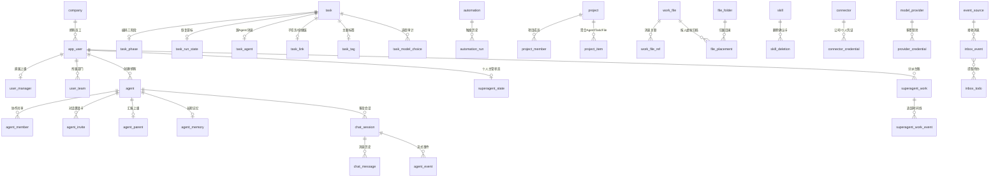

# 09. 数据存储模型全量设计

> 本文档完整定义 SuperAgent 的 **46 张逻辑数据表**（1 张全局租户表 + 45 张租户强隔离业务与分析表），涵盖存储分层策略、逻辑实体关系图、逐表字段规格、主键与索引约束、并发幂等写约定及可选列式分析存储映射。所有字段类型均采用**技术栈与具体数据库方言无关的逻辑类型**表示。

---

## 1. 存储分层架构与通用约定

### 1.1 双层逻辑存储策略

1. **核心事务型关系存储（必选，默认承载全部 46 张表）**：
   - 字符集须支持完整 Unicode（含 4 字节 Emoji，如 UTF-8MB4）。
   - 所有时间戳列统一以 **UTC 毫秒精度** (`TIMESTAMP_UTC_MS`) 存储与比较，避免时区漂移。
2. **可选分析型列式存储（`storage.analytics = clickhouse` 时启用）**：
   - 仅将 **3 张高吞吐追加/时序分析表** 剥离至分析库：`agent_log`、`token_usage`、`turn_timing`；其余 43 张核心业务表始终驻留关系型事务库。
   - 对应的列式排序键与去重引擎语义：`agent_log` 按 `(company_id, agent_id, at_time)` 追加排序；`token_usage` 按 `(company_id, at, id)` 追加排序；`turn_timing` 按 `(company_id, message_id)` 以 `finished_at` 为版本列做替换合并。

### 1.2 全局数据建模约束

- **多租户强隔离不变量**：除全局 `company` 表外，其余 **45 张表全部包含非空 `company_id STRING(64)` 作为复合主键及全部二级索引的首列**，且每一次读写均强制带 `company_id = <当前租户>` 条件（Fail-Closed）。
- **无物理外键（逻辑关联）**：全库零物理 `FOREIGN KEY` 约束，所有关联由应用层服务维护，使软删除后仍能完整保留历史任务、审计账单与归属引用。
- **逻辑数据类型映射约定**：
  - `STRING(N)`：定长上限 UTF-8 字符串；`TEXT`：可变长文本（约 64 KB 级）；`LONGTEXT`：大文本/Markdown/JSON 载荷（约 16 MB 级）；
  - `INT32` / `INT64`：32/64 位有符号整数；`FLOAT64`：双精度浮点；`DECIMAL(16,6)`：高精度金额；
  - `BOOLEAN`：布尔标志；`TIMESTAMP_UTC_MS`：UTC 毫秒时间戳。
- **空串与 NULL 约定**：部分可选字符串列在写入时将 `null` 归一化为 `""`、读取时将 `""` 还原为 `null`；需特别区分的列（如 `file_placement.folder_id = ""` 表示已判定未归档、`skill_binding.skill_ids = ""` 表示显式空绑定）须严格保留语义差异。

### 1.3 核心领域逻辑 ER 关系全景

---

## 2. 全量 46 张逻辑表详细规格

### 2.1 域一：租户、用户身份与组织架构（4 张表）

#### 1. `company`（全局表 — 唯一不含 `company_id`）
- **主键**：`(id)` | **说明**：注册企业租户、每公司加密 DEK 与配额覆写；永不自动删表重建。

| 字段 | 逻辑类型 | 非空 | 默认值 | 业务语义 |
|---|---|:---:|---|---|
| `id` | `STRING(64)` | 是 | — | 企业英文简称（3–32 字符小写 slug） |
| `name` | `STRING(255)` | 是 | — | 企业显示名 |
| `enabled` | `BOOLEAN` | 是 | — | 启停标记（禁用禁止登录与后台巡检） |
| `data_key_cipher` | `TEXT` | 否 | — | 主密钥加密包裹的 32 字节公司 DEK（`v1:...`，AAD=`company:<id>`） |
| `max_users` | `INT32` | 否 | — | 最大用户数覆写（`NULL` 走全局默认，`0` 不限） |
| `max_running_tasks` | `INT32` | 否 | — | 最大并发运行任务覆写 |
| `monthly_tokens` | `INT64` | 否 | — | UTC 月度 Token 上限覆写 |
| `created_at` / `updated_at` | `TIMESTAMP_UTC_MS` | 是 | — | 创建与更新时间 |

#### 2. `app_user`（租户隔离）
- **主键**：`(company_id, id)` | **唯一键**：`uq_user_username (company_id, username)` | **索引**：`idx_user_phone (company_id, phone)`、`idx_user_external (company_id, external_id)`
- **写约定**：更新须采用 `UPDATE ... WHERE (company_id, id)` 后按需 `INSERT`（严禁 `REPLACE`），防止重名覆盖他人行。

| 字段 | 逻辑类型 | 非空 | 默认值 | 业务语义 |
|---|---|:---:|---|---|
| `company_id` | `STRING(64)` | 是 | — | 租户 ID |
| `id` | `STRING(64)` | 是 | — | 不可变用户 UUID（全系统唯一用户引用键） |
| `username` | `STRING(190)` | 是 | — | 登录名（公司内唯一） |
| `display_name` | `STRING(255)` | 否 | — | 展示姓名 |
| `roles` | `STRING(512)` | 否 | — | 逗号分隔角色（如 `USER`, `ADMIN`） |
| `enabled` | `BOOLEAN` | 是 | `true` | 账号启用标记 |
| `password_hash` | `STRING(255)` | 否 | — | BCrypt 密码哈希（仅 `LOCAL` 有效） |
| `phone` | `STRING(32)` | 否 | — | 手机号（用于 IM 自动身份匹配与预留短信登录） |
| `external_id` | `STRING(255)` | 否 | — | 预留 SSO/微信外部 ID |
| `source` | `STRING(16)` | 是 | — | `LOCAL` \| `PHONE` \| `SSO` \| `WECHAT` |
| `must_change_password` | `BOOLEAN` | 是 | `false` | 强制首次改密标记 |
| `created_at` / `updated_at` | `TIMESTAMP_UTC_MS` | 是 | — | 时间戳 |

#### 3. `user_manager`（租户隔离）
- **主键**：`(company_id, username)` | **字段**：`company_id STRING(64)`、`username STRING(190)`（存 `app_user.id`）、`manager STRING(190)`（直属上级 `app_user.id`）、`updated_at TIMESTAMP_UTC_MS`。

#### 4. `user_team`（租户隔离）
- **主键**：`(company_id, username, team_path)` | **索引**：`idx_user_team_path (company_id, team_path)`
- **字段**：`company_id STRING(64)`、`username STRING(190)`（存 `app_user.id`）、`team_path STRING(514)`（`/` 分隔规范化路径，至多 8 层 × 64 字）。

---

### 2.2 域二：Agent 与个人 SuperAgent 编排（9 张表）

#### 5. `agent`（租户隔离）
- **主键**：`(company_id, id)` | **索引**：`idx_agent_updated (company_id, updated_at)`

| 字段 | 逻辑类型 | 非空 | 默认值 | 业务语义 |
|---|---|:---:|---|---|
| `company_id` / `id` | `STRING(64)` | 是 | — | 租户 ID / Agent UUID |
| `name` | `STRING(255)` | 是 | — | 显示名称 |
| `avatar` | `STRING(32)` | 否 | — | 24 个内置 Emoji 之一 |
| `character_key` | `STRING(64)` | 否 | — | 24 个内置性格预设键之一（`NULL` 为纯自定义） |
| `persona` | `LONGTEXT` | 否 | — | 自定义人设或追加指令 |
| `model` | `STRING(128)` | 否 | — | 可选存储模型 ID |
| `status` | `STRING(32)` | 是 | — | `ACTIVE` \| `DELETED` |
| `owner` | `STRING(255)` | 否 | — | 所有者 `app_user.id` |
| `kind` | `STRING(16)` | 否 | — | `STANDARD` \| `SUPER`（空视作 `STANDARD`） |
| `managed_by` | `STRING(64)` | 否 | — | 招募该成员的 SuperAgent ID |
| `tier` | `STRING(16)` | 否 | — | 遗留档位列 |
| `created_at` / `updated_at` | `TIMESTAMP_UTC_MS` | 是 | — | 时间戳 |

#### 6. `agent_member`（租户隔离）
- **主键**：`(company_id, agent_id, username)` | **索引**：`idx_member_user (company_id, username)`
- **字段**：`company_id STRING(64)`、`agent_id STRING(64)`、`username STRING(128)`（协作者 `app_user.id`，不含所有者）、`added_by STRING(128)`、`active BOOLEAN`（软移除置 `false`）、`created_at` / `updated_at`。

#### 7. `agent_invite`（租户隔离）
- **主键**：`(company_id, id)` | **索引**：`idx_invite_agent (company_id, agent_id, created_at)`
- **字段**：`company_id`、`id`、`agent_id`、`owner STRING(190)`、`usernames STRING(2048)`（逗号分隔提议用户 ID）、`session_id`、`message_id`（卡片锚点）、`status STRING(16)`（`PENDING`/`CONFIRMED`/`CANCELLED`）、`created_at` / `updated_at`。

#### 8. `agent_parent`（租户隔离）
- **主键**：`(company_id, agent_id)` | **字段**：`company_id`、`agent_id`、`parent_id STRING(64)`、`updated_at`。

#### 9. `agent_memory`（租户隔离）
- **主键**：`(company_id, agent_id)`
- **字段**：`company_id`、`agent_id`、`owner STRING(255)`、`summarized_until TIMESTAMP_UTC_MS`（可空，已蒸馏水位线）、`last_model STRING(128)`（当前会话模型，`"-"` 为默认哨兵）、`session_failures INT32`（默认 `0`，连续非瞬态失败数）、`memory LONGTEXT`（Markdown 长期记忆全文）、`updated_at`。

#### 10. `superagent_state`（租户隔离）
- **主键**：`(company_id, owner)`
- **字段**：`company_id`、`owner STRING(255)`、`agent_id STRING(64)`（用户唯一 `SUPER` ID）、`processed_until TIMESTAMP_UTC_MS`（后台输入处理游标）、`plan_id STRING(64)`、`plan_status STRING(16)`（`proposed`/`approved`/空）、`plan_json LONGTEXT`（序列化计划对象）、`tracked_json LONGTEXT`（*历史废弃列，由 `superagent_work` 取代*）、`updated_at`。

#### 11. `superagent_work`（租户隔离）
- **主键**：`(company_id, task_id)` | **索引**：`idx_superagent_work_owner (company_id, owner, assigned_at)`
- **字段**：`company_id`、`task_id`、`owner STRING(255)`、`plan_id`、`title STRING(512)`、`member_id STRING(64)`（独立任务存 `superAgentId`）、`member_name STRING(255)`（独立任务存 `"独立任务"`）、`status STRING(32)`（`running`/`needs_confirmation`/`done`/`error`/`stopped`/`deleted`）、`summary TEXT`（300 字结果摘要）、`assigned_at`、`finished_at`（可空）、`updated_at`、`message_id STRING(64)`（内联卡片锚点）。

#### 12. `superagent_work_event`（租户隔离）
- **主键**：`(company_id, id)` | **索引**：`idx_superagent_work_event (company_id, task_id, at_time)`
- **字段**：`company_id`、`id`、`task_id`、`owner STRING(255)`、`kind STRING(32)`（`assigned`/`needs_confirmation`/`replied`/`done`/`error`/`stopped`/`deleted`）、`detail TEXT`、`at_time TIMESTAMP_UTC_MS`。

#### 13. `agent_log`（租户隔离 — *可选分析库表 #1*）
- **主键**：`(company_id, id)` | **索引**：`idx_agent_log (company_id, agent_id, at_time)`
- **字段**：`company_id`、`id`、`agent_id`、`owner STRING(255)`、`at_time TIMESTAMP_UTC_MS`、`level STRING(8)`（`info`/`warn`/`error`）、`category STRING(16)`（`session`/`turn`/`memory`/`superagent`/`settings`）、`summary STRING(1024)`、`detail TEXT`。

---

### 2.3 域三：对话会话、消息与标准化事件流（3 张表）

#### 14. `chat_session`（租户隔离）
- **主键**：`(company_id, id)` | **索引**：`idx_session_updated (company_id, updated_at)`
- **字段**：`company_id`、`id`、`title STRING(255)`、`agent_type STRING(32)`（10 种引擎枚举）、`agent_session_id STRING(64)`（底层 CLI 续跑 ID）、`workspace_dir STRING(1024)`、`agent_id STRING(64)`（脱离后台会话为空）、`status STRING(32)`（`ACTIVE`/`CLOSED`/`DELETED`）、`model STRING(128)`、`reason STRING(32)`（`first`/`model`/`model_down`/`failures`）、`cli_restarts INT32`（默认 `0`）、`created_at` / `updated_at`。

#### 15. `chat_message`（租户隔离）
- **主键**：`(company_id, id)` | **索引**：`idx_message_session (company_id, session_id, created_at)`
- **说明**：由**对话会话 (`session_id = chat_session.id`) 与异步任务 (`session_id = task.id`) 共同复用**。
- **字段**：`company_id`、`id`、`session_id STRING(64)`、`role STRING(16)`（`USER`/`ASSISTANT`/`SYSTEM`）、`content LONGTEXT`、`created_at`、`author STRING(128)`（`USER` 存 `app_user.id`；特殊助手消息存 `"task:<taskId>"` 或 `"superagent:background"`）。

#### 16. `agent_event`（租户隔离）
- **主键**：**无主键**（纯追加事件流表，重建时可按需补充自增或复合序号主键） | **索引**：`idx_event_session (company_id, session_id, created_at, seq)`
- **字段**：`company_id`、`session_id STRING(64)`（对话或任务 ID）、`message_id STRING(64)`、`seq INT64`、`type STRING(32)`（`SYSTEM`/`THINKING`/`TEXT`/`TOOL_USE`/`TOOL_RESULT`/`RESULT`/`USAGE`/`ERROR`，不含被截流的 `TOKENS`）、`payload LONGTEXT`、`created_at`。

---

### 2.4 域四：异步任务与自动化（9 张表）

#### 17. `task`（租户隔离）
- **主键**：`(company_id, id)` | **索引**：`idx_task_created (company_id, created_at)`

| 字段 | 逻辑类型 | 非空 | 默认值 | 业务语义 |
|---|---|:---:|---|---|
| `company_id` / `id` | `STRING(64)` | 是 | — | 租户 ID / 任务 UUID |
| `title` | `STRING(512)` | 是 | — | 任务标题 |
| `brief` | `LONGTEXT` | 否 | — | 完整任务说明 |
| `source` | `STRING(16)` | 是 | — | `WEB_CHAT` \| `TASK_FORM` \| `AUTOMATION` \| `INBOX` |
| `repo` / `branch` | `STRING(512)` / `STRING(255)` | 否 | — | 代码仓库与分支元数据 |
| `flow` | `STRING(255)` | 否 | — | 小写任务类型：`coding` \| `general` \| `complex` |
| `status` | `STRING(32)` | 是 | — | `PENDING` \| `RUNNING` \| `NEEDS_CONFIRMATION` \| `WAITING` \| `DONE` \| `ERROR` \| `STOPPED` \| `DELETED` |
| `progress` | `INT32` | 是 | `0` | 0–100 进度值 |
| `spend` | `DECIMAL(16,6)` | 是 | `0` | 累计美元成本 |
| `model` / `agent_type` | `STRING(128)` / `STRING(32)` | 否 / 是 | — | 执行模型与底层引擎 |
| `workspace_dir` | `STRING(1024)` | 否 | — | 租用会话工作区路径（未启动时为 `NULL`） |
| `created_by` | `STRING(255)` | 否 | — | 所有者 `app_user.id` |
| `error` | `LONGTEXT` | 否 | — | 失败详情 |
| `tier` | `STRING(16)` | 否 | — | 遗留档位列 |
| `created_at` / `started_at` / `finished_at` / `updated_at` | `TIMESTAMP_UTC_MS` | 是/否/否/是 | — | 全生命周期时间戳 |

#### 18. `task_phase`（租户隔离）
- **主键**：`(company_id, task_id)` | **字段**：`company_id`、`task_id`、`phases_json LONGTEXT`（JSON 数组 `[{key, name, status, content, evidence}]`）、`updated_at`。

#### 19. `task_run_state`（租户隔离）
- **主键**：`(company_id, task_id)` | **字段**：`company_id`、`task_id`、`agent_session_id STRING(64)`、`failure_count INT32`(默认 `0`)、`attempt_count INT32`(默认 `0`)、`updated_at`。

#### 20. `task_agent`（租户隔离）
- **主键**：`(company_id, task_id)` | **索引**：`idx_task_agent (company_id, agent_id, created_at)`
- **字段**：`company_id`、`task_id`、`agent_id`、`session_id`（可空）、`message_id`（可空）、`created_at`。

#### 21. `task_link`（租户隔离）
- **主键**：`(company_id, task_id)` | **索引**：`idx_task_link_parent (company_id, parent_id)`、`idx_task_link_from (company_id, continues_from)`
- **字段**：`company_id`、`task_id`、`parent_id STRING(64)`（复杂任务父 ID）、`continues_from STRING(64)`（续做前序任务 ID）、`created_at`。

#### 22. `task_tag`（租户隔离）
- **主键**：`(company_id, task_id)` | **字段**：`company_id`、`task_id`、`tags TEXT`（**换行 `\n` 分隔**）、`updated_at`。

#### 23. `task_model_choice`（租户隔离）
- **主键**：`(company_id, task_id, seq)`
- **字段**：`company_id`、`task_id`、`seq INT32`(1 起始)、`decided_by STRING(16)`（`judge`/`user`/`fallback`/`escalation`/`default`/`fixed`）、`difficulty STRING(16)`（`easy`/`medium`/`hard`）、`tier STRING(16)`、`model STRING(128)`（固定拒止时为 `NULL`）、`cli STRING(32)`、`judge STRING(128)`、`candidates TEXT`、`reasoning TEXT`、`created_at`。

#### 24. `automation`（租户隔离）
- **主键**：`(company_id, id)` | **索引**：`idx_automation_next (company_id, next_run_at)`
- **字段**：`company_id`、`id`、`name STRING(255)`、`prompt LONGTEXT`、`type STRING(16)`（`RECURRING`/`ONCE`/`API`）、`cron STRING(128)`、`run_at TIMESTAMP_UTC_MS`、`timezone STRING(64)`、`model STRING(128)`、`overlap_policy STRING(16)`（`SKIP`/`PARALLEL`）、`enabled BOOLEAN`(默认 `true`)、`source STRING(16)`（`manual`/`chat`）、`owner STRING(255)`、`api_token_hash STRING(128)`（SHA-256 摘要）、`next_run_at`、`last_run_at`、`last_task_id`、`tier STRING(16)`、`created_at` / `updated_at`。

#### 25. `automation_run`（租户隔离）
- **主键**：`(company_id, id)` | **索引**：`idx_automation_run (company_id, automation_id, fired_at)`
- **字段**：`company_id`、`id`、`automation_id`、`trigger_kind STRING(16)`（`schedule`/`api`/`manual`）、`task_id STRING(64)`（跳过时为 `NULL`）、`skipped_reason STRING(512)`、`fired_at`。

---

### 2.5 域五：协作项目（3 张表）

#### 26. `project`（租户隔离）
- **主键**：`(company_id, id)` | **字段**：`company_id`、`id`、`name STRING(255)`、`description TEXT`、`owner STRING(128)`、`status STRING(16)`（`ACTIVE`/`ARCHIVED`）、`created_at`、`updated_at`、`archived_at`（可空）。

#### 27. `project_member`（租户隔离）
- **主键**：`(company_id, project_id, username)` | **索引**：`idx_project_member_user (company_id, username)`
- **字段**：`company_id`、`project_id`、`username STRING(128)`（`app_user.id`）、`added_by STRING(128)`、`active BOOLEAN`、`created_at` / `updated_at`。

#### 28. `project_item`（租户隔离）
- **主键**：`(company_id, kind, item_id)`（保证每个对象至多归属 1 个项目） | **索引**：`idx_project_item_project (company_id, project_id, kind)`
- **字段**：`company_id`、`kind STRING(16)`（`AGENT`/`TASK`/`FILE`）、`item_id STRING(64)`、`project_id STRING(64)`、`updated_at`。

---

### 2.6 域六：工作文件与个人目录（4 张表）

#### 29. `work_file`（租户隔离）
- **主键**：`(company_id, id)` | **索引**：`idx_work_file_owner (company_id, owner, deleted, updated_at)`、`idx_work_file_agent (company_id, agent_id, deleted, updated_at)`、`idx_work_file_task (company_id, task_id)`
- **字段**：`company_id`、`id`、`name STRING(255)`、`kind STRING(16)`（小写 `document`/`image`/`video`/`link`/`other`）、`mime_type STRING(128)`、`size INT64`、`storage STRING(32)`（`internal`/`link`/渠道 ID）、`location STRING(1024)`（对象键或 URL）、`owner STRING(128)`、`agent_id STRING(64)`、`task_id STRING(64)`、`origin STRING(16)`（`chat`/`task`/`delivery`/`upload`）、`deleted BOOLEAN`、`tags STRING(512)`（`\n` 分隔）、`tag_state STRING(8)`（`""`/`agent`/`auto`/`user`）、`created_at` / `updated_at`。

#### 30. `work_file_ref`（租户隔离）
- **主键**：`(company_id, file_id, message_id)` | **字段**：`company_id`、`file_id`、`session_id`、`message_id`、`created_at`。

#### 31. `file_folder`（租户隔离）
- **主键**：`(company_id, id)` | **索引**：`idx_file_folder_owner (company_id, owner, deleted)`
- **字段**：`company_id`、`id`、`owner STRING(190)`、`name STRING(255)`、`parent_id STRING(64)`（`""` 表顶层）、`deleted BOOLEAN`、`created_at` / `updated_at`。

#### 32. `file_placement`（租户隔离）
- **主键**：`(company_id, owner, file_id)` | **字段**：`company_id`、`owner STRING(190)`、`file_id`、`folder_id STRING(64)`（`""` 表已评估未归档）、`placed_by STRING(16)`（`user`/`agent`/`auto`）、`updated_at`。

---

### 2.7 域七：可复用技能（3 张表）

#### 33. `skill`（租户隔离）
- **主键**：`(company_id, id)` | **字段**：`company_id`、`id`、`name STRING(255)`、`description STRING(1024)`、`category STRING(64)`、`content LONGTEXT`、`space STRING(512)`（`personal:<userId>` / `company` / 预留 `team:<path>`）、`enabled BOOLEAN`、`deleted BOOLEAN`、`created_by` / `updated_by`、`created_at` / `updated_at`。

#### 34. `skill_binding`（租户隔离）
- **主键**：`(company_id, owner_type, owner_id)` | **字段**：`company_id`、`owner_type STRING(16)`（`agent`/`task`）、`owner_id`、`skill_ids TEXT`（逗号分隔有序 UUID；`""` 区别于无行）、`updated_at`。

#### 35. `skill_deletion`（租户隔离）
- **主键**：`(company_id, id)` | **索引**：`idx_skill_deletion_agent (company_id, agent_id, created_at)`
- **字段**：`company_id`、`id`、`skill_id`、`skill_name STRING(255)`、`agent_id`、`requester STRING(190)`、`session_id`、`message_id`、`status STRING(16)`（`PENDING`/`CONFIRMED`/`CANCELLED`）、`created_at` / `updated_at`。

---

### 2.8 域八：外部连接器与模型供应商（4 张表）

#### 36. `connector`（租户隔离）
- **主键**：`(company_id, id)` | **字段**：`company_id`、`id`、`name STRING(255)`、`description STRING(1024)`、`kind STRING(16)`（`MCP`）、`auth_method STRING(32)`（`NONE`/`SHARED_TOKEN`/`PERSONAL_TOKEN`/`OAUTH`）、`enabled BOOLEAN`、`transport STRING(16)`（`STDIO`/`HTTP`/`SSE`）、`endpoint STRING(2048)`、`token_env STRING(128)`、`created_at` / `updated_at`。

#### 37. `connector_credential`（租户隔离）
- **主键**：`(company_id, connector_id, owner)` | **字段**：`company_id`、`connector_id`、`owner STRING(128)`（`""` 表公司共享，否则 `app_user.id`）、`secret_cipher STRING(4096)`（信封密文）、`account_label STRING(255)`、`refresh_cipher STRING(4096)`（可空）、`expires_at TIMESTAMP_UTC_MS`（可空）、`updated_at`。

#### 38. `model_provider`（租户隔离）
- **主键**：`(company_id, id)` | **唯一键**：`uq_provider_key (company_id, provider_key)`
- **字段**：`company_id`、`id`、`provider_key STRING(64)`、`installed BOOLEAN`、`can_infer BOOLEAN`、`current_version STRING(64)`、`latest_version STRING(64)`、`status STRING(32)`（`unsupported`/`not_installed`/`no_auth`/`ok`/`needs_upgrade`）、`last_checked_at`、`models_json LONGTEXT`、`models_error STRING(1024)`、`models_checked_at`、`created_at` / `updated_at`。

#### 39. `provider_credential`（租户隔离）
- **主键**：`(company_id, id)` | **索引**：`idx_provider_credential (company_id, provider_key, deleted, priority)`
- **字段**：`company_id`、`id`、`provider_key STRING(32)`、`label STRING(100)`、`base_url STRING(512)`、`key_cipher TEXT`、`bearer BOOLEAN`、`priority INT32`、`enabled BOOLEAN`、`status STRING(16)`（`ok`/`error`/`unknown`）、`last_error STRING(1000)`、`checked_at`、`deleted BOOLEAN`（软删保留哈希防重复导入）、`source STRING(16)`（`console`/`machine`）、`key_hash STRING(64)`（SHA-256）、`created_at` / `updated_at`。

---

### 2.9 域九：IM 收件箱与统一待办通知（4 张表）

#### 40. `inbox_event`（租户隔离）
- **主键**：`(company_id, id)`（`id = UUIDv3(source:externalId:owner)`，写库忽略冲突实现原子去重） | **索引**：`idx_inbox_pending (company_id, owner, priority, processed, received_at)`、`idx_inbox_received (company_id, received_at)`
- **字段**：`company_id`、`id`、`owner STRING(128)`、`source STRING(32)`（`feishu`/`dingtalk`）、`external_id STRING(255)`、`chat_id`、`chat_name`、`chat_type`（`p2p`/`group`）、`thread_id`、`sender_id`、`sender_name`、`text LONGTEXT`、`mentions_me BOOLEAN`、`raw LONGTEXT`、`priority STRING(16)`（`P0`/`P1`/`P2`/`IGNORE`）、`triage_reason STRING(255)`、`processed BOOLEAN`、`handling STRING(16)`（`delivered`/`notified`/`todo`/`task`/`read`/`ignored`）、`occurred_at`、`received_at`、`updated_at`。

#### 41. `inbox_todo`（租户隔离）
- **主键**：`(company_id, id)` | **索引**：`idx_todo_owner (company_id, owner, created_at)`
- **字段**：`company_id`、`id`、`owner`、`title STRING(500)`、`detail TEXT`、`requester STRING(255)`、`due STRING(128)`、`event_ids TEXT`（逗号分隔事件 ID）、`source STRING(255)`、`status STRING(16)`（`OPEN`/`TASKED`/`DONE`/`DISMISSED`）、`task_id STRING(64)`、`created_at` / `updated_at`。

#### 42. `event_source`（租户隔离）
- **主键**：`(company_id, owner, type)`
- **字段**：`company_id`、`owner`、`type STRING(32)`（`feishu`/`dingtalk`）、`app_id STRING(128)`、`enabled BOOLEAN`、`owner_external_id STRING(128)`、`bind_code STRING(32)`、`digest_time STRING(8)`、`timezone STRING(64)`、`secretary_agent_id STRING(64)`（遗留清理用）、`last_digest_date STRING(16)`（`YYYY-MM-DD`）、`last_hourly_at TIMESTAMP_UTC_MS`、`created_at` / `updated_at`。（*另有 5 个已废弃兼容列 `secret_cipher`/`vip_names`/`urgent_keywords`/`status`/`last_error`，新实现可直接去除*。）

#### 43. `notice`（租户隔离）
- **主键**：`(company_id, id)` | **唯一键**：`uk_notice_key (company_id, owner, notice_key)` | **索引**：`idx_notice_owner (company_id, owner, updated_at)`
- **字段**：`company_id`、`id`、`owner`、`notice_key STRING(200)`、`kind STRING(16)`（`CONFIRM`/`ACTION`/`DONE`/`NOTICE`/`TRACK`）、`state STRING(16)`（`OPEN`/`DONE`/`IGNORED`）、`title STRING(500)`、`body TEXT`、`actor STRING(255)`、`link_type STRING(32)`（`task`/`agent`/`superagent`/`todo`）、`link_id STRING(128)`、`created_at` / `updated_at`。

---

### 2.10 域十与域十一：系统配置与用量耗时分析（3 张表）

#### 44. `system_setting`（租户隔离）
- **主键**：`(company_id, setting_key)` | **字段**：`company_id`、`setting_key STRING(128)`、`setting_value STRING(4096)`（空串代表未设，敏感项为信封密文）、`updated_at`。

#### 45. `token_usage`（租户隔离 — *可选分析库表 #2*）
- **主键**：`(company_id, id)` | **索引**：`idx_usage_task (company_id, task_id)`、`idx_usage_user_at (company_id, user_name, at)`、`idx_usage_at (company_id, at)`
- **字段**：`company_id`、`id`、`at TIMESTAMP_UTC_MS`、`user_name STRING(128)`（`app_user.id` 或 `"system"`）、`source STRING(32)`（`task`/`chat`/`superagent`/`superagent_background`/`model_choice`/`memory`/`file_tags`/`task_tags`/`model_check`/`key_check`）、`agent_id`、`task_id`、`session_id`、`cli STRING(32)`、`model STRING(128)`、`input_tokens INT64`、`cache_read INT64`、`cache_write INT64`、`cache_write_1h INT64`、`output_tokens INT64`、`reasoning INT64`、`cost_usd FLOAT64`、`cli_cost_usd FLOAT64`。

#### 46. `turn_timing`（租户隔离 — *可选分析库表 #3*）
- **主键**：`(company_id, message_id)` | **索引**：`idx_turn_timing_session (company_id, session_id, started_at)`
- **字段**：`company_id`、`message_id`、`session_id`（对话或任务 ID）、`label STRING(32)`（编码阶段键或 `""`）、`started_at`、`finished_at`、`prep_ms`、`startup_ms`、`model_ms`、`tools_ms`、`output_ms`、`retry_ms`、`save_ms`（均 `INT64`）、`attempts INT32`、`tools TEXT`（按耗时降序的 `name\tcount\tms\n` 行文本）。
