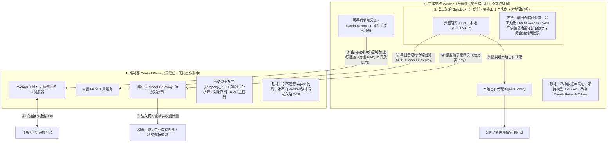

# 12. 目标演进架构：三层沙箱隔离、Model Gateway 与四阶段路线

> 本文档整理自 SuperAgent 官方架构设计蓝图（`superagent-architecture`、`superagent-runtime-sandbox`、`superagent-core-thesis` 等），明确区分**现行已落地基线（Phase 1）**与**目标企业级三层隔离架构（Phase 2a–4）**，为全新实现预留清晰、可平滑演进的架构接口与信任边界。全文严格保持技术栈无关。

---

## 1. 现行单机基线 vs 目标三层信任架构

现行版本中，控制面业务逻辑与官方 Coding Agent CLI 子进程同机运行，多租户隔离已落实到**数据存储层、文件系统路径层与密钥信封加密层（Phase 1）**。面向大规模多租户 SaaS 与严苛内网合规部署，SuperAgent 规划了一套**一套代码同时支撑单机 Docker、多机私有化与多租户 SaaS** 的三层严格信任边界架构：

---

## 2. 五条严格允许的流量与最小凭证落点

### 2.1 仅允许的 5 条网络路径
1. **`Worker -> Control Plane`**：由 Worker 主动向外拨号建立持久双向控制与流式上行通道，支持 Worker 部署在 NAT/内网后且宿主机零监听端口。
2. **`Sandbox -> Control Plane (MCP & Model Gateway)`**：仅凭**单回合临时令牌**认证（回合结束立即失效），用于调用平台 MCP 工具与经由模型网关访问模型。
3. **`Sandbox -> Worker Egress Proxy -> 公网 / 管理员白名单内网`**：沙箱禁止直连外网；代理无条件封禁内网私有网段、控制面地址、数据库端口与云元数据 `169.254.169.254`，支持“默认公网”或“严格域名白名单”策略。
4. **`Control Plane <-> 飞书 / 钉钉`**：企业 IM 长连接与开放 API 交互。
5. **`Model Gateway -> 模型上游`**：唯一持有并注入真实模型 API 密钥的出口。

### 2.2 凭证最小化分布矩阵

| 敏感资产 | Control Plane | Model Gateway | Worker | Sandbox |
|---|:---:|:---:|:---:|:---:|
| 数据库连接凭证 | ✅ | — | ❌ | ❌ |
| 主密钥 (KMS/文件) & 公司 DEK | ✅ | — | ❌ | ❌ |
| OAuth Refresh Token（长期） | ✅ | — | ❌ | ❌ |
| 模型厂商 API Key | ❌（仅密文存储） | ✅（运行时解密注入） | ❌ | ❌ |
| 节点通信凭证（可吊销） | ✅（签发校验） | — | ✅ | ❌ |
| 单回合临时令牌（回合结束即废） | ✅（签发校验） | ✅（校验） | — | ✅ |
| 员工短期 OAuth Access Token | ✅（签发） | — | — | ✅（仅本地 STDIO MCP 按需短用） |

---

## 3. 可插拔沙箱运行时与员工容器规格

### 3.1 `SandboxRuntime` 插件矩阵与多租户混部规则

| 运行时插件 | 隔离强度 | 多租户混部安全？ | 适用场景与宿主前提 |
|---|---|:---:|---|
| `local` | `NONE`（无隔离） | ❌ | 仅本地开发调试 |
| `docker` | `SHARED_KERNEL`（共享宿主机内核） | ❌（**单宿主机仅限单公司**） | 企业私有化单租户部署 |
| `gvisor` | `STRONG`（用户态内核 `runsc` systrap） | ✅ | 多租户 SaaS 通用主机（**无需 `/dev/kvm` 硬件虚拟化**） |
| `kata` / microVM | `STRONG`（独立轻量化内核虚拟化） | ✅ | 最高安全等级多租户集群（需宿主机 `/dev/kvm`） |
| `k8s` | `Pod` + `RuntimeClass` | ✅ | Phase 2b 之后的云原生集群编排扩展 |

### 3.2 单员工沙箱生命周期与硬资源护栏

- **按员工一箱一卷（拒绝 NFS 共享工作区）**：命名规则 `sa-<company>-<user12>`，使用 Worker 本地独占数据卷，防止单个 Worker 沦陷通过共享 NFS 扩散至全员工作区。
- **单沙箱硬配额**：
  - CPU：**2 vCPU**；
  - 内存：**2 GB RAM（禁 Swap）**；
  - 进程数上限：**512 PIDs**；文件句柄上限：**4096 FDs**；磁盘软上限：**5 GB**；
  - 空闲回收：连续 **15 分钟无活跃回合自动停止休眠**（保留卷，下次秒级拉起）；
  - 单机容量规划公式：$\text{最大并发活跃沙箱数} = \lfloor (\text{宿主机总内存} - 4\text{ GB}) / 2\text{ GB} \rfloor$。
- **宿主机挂载防逃逸**：在控制面与沙箱尚共享宿主机目录期间（Phase 2a），控制面读写挂载目录强制 `O_NOFOLLOW` 防符号链接、拒绝对设备/命名管道等特殊文件操作、校验写入大小上限并统一运行 `uid 10001` 属主；**进入沙箱模式后禁用管理界面的宿主机在线安装 CLI 功能**（CLI 统一随不可变沙箱基础镜像发版）。

---

## 4. 集中式 Model Gateway 设计

将当前分散在各 CLI 适配器内的密钥注入、中转路由与 stdout 解析 Token 计量，统一收敛到控制面侧的集中式 `Model Gateway`：
1. **三协议原样透传优先**：直接透传 **`Anthropic Messages`**（Claude Code）、**`OpenAI Chat Completions`**（国产模型与企业网关）与 **`OpenAI Responses`**（Codex），完整保留原生工具调用、扩展思考（Extended Thinking）与 Prompt Caching 特性；优先将 CLI 匹配至对应原生协议上游，尽量规避脆弱的协议翻译。
2. **企业自有模型网关一等公民**：原生支持自动模型发现、企业自定义单价、透传员工/任务账单头用于企业内部成本中心分摊，以及按员工映射企业网关 Key。
3. **权威计量与统一容灾**：直接在网关层解析上游 HTTP/SSE 响应体做权威 Token 与费用记账（彻底告别各 CLI 日志格式变动导致的漏记/错记），并在网关统一实施限流、多密钥故障切换、模型熔断冷却与成本路由。

---

## 5. 四阶段演进路线与核心架构权衡

### 5.1 四阶段渐进落地路线

| 阶段 | 当前状态 | 核心交付与架构跃迁 |
|---|---|---|
| **Phase 1：数据层多租户** | **已落地** | 全表 `company_id` 强隔离、每公司 DEK 信封加密、企业自助注册、强制改密、三项租户配额、租户独立连接器/模型密钥/IM 连接 |
| **Phase 2a：单机运行时沙箱** | **已出 v0.1 详设，待实现** | 核心层抽离 `ProcessLauncher` SPI；新增 `SandboxManager` + `local`/`docker`/`gvisor`/`kata` 插件；每员工容器与硬配额；进程内出口代理；全部 CLI 与 STDIO MCP 迁入员工或公司系统沙箱。（*阶段性妥协：模型密钥仍暂进沙箱环境、控制面仍挂载宿主机路径*） |
| **Phase 2b：Worker 拆分 + Model Gateway** | **规划中** | 抽离独立 `Worker` 守护进程与上行通讯协议，文件经协议传输使控制面彻底不碰工作区路径；上线 `Model Gateway`，模型密钥彻底离开沙箱，计量收敛至网关 |
| **Phase 3：多节点集群与 microVM** | **规划中** | 落地 Kata/Firecracker microVM 运行时与多节点调度器（依次按隔离级别过滤 -> 公司配额 -> 员工亲和性 -> 节点余量）；工作区快照持久化至对象存储支持跨节点故障迁移 |
| **Phase 4：控制面无状态高可用** | **规划中** | 剥离全部进程内有状态结构：通过事件总线（DB 轮询 / Redis / MQ 待选型）实现多副本 SSE 扇出与 Worker 指令路由；通过数据库租约或按公司分片接管后台循环与飞书/钉钉长连接；外置任务会话池索引。先主备、再双活 |

### 5.2 重建时应提前预留的 8 项架构权衡

1. **进程启动抽象 (`ProcessLauncher`)**：在新建实现的第一天即可将子进程拉起与 I/O 流抽离为独立接口，未来从本机进程切换至容器/远端 Worker 时无需改动任何上层对话与任务逻辑。
2. **gVisor 性能与系统调用兼容性**：Node.js/Python 类 CLI 在 `runsc` 下的冷启动与文件系统开销需提前压测验证。
3. **Phase 2a 容器套接字特权面**：同机阶段控制面访问容器引擎套接字具备等效 root 权限，须尽快向 Phase 2b 独立 Worker 演进收缩攻击面。
4. **多 CLI 沙箱镜像体积与更新**：预装 6–10 个高频迭代的官方 CLI 会使镜像达 1–2 GB，需建立自动化定期构建与灰度滚动发布流水线。
5. **共享 Agent 的沙箱归属边界**：当同事 B 操作同事 A 拥有的共享 Agent 时，运行在 A 的沙箱还是 B 的沙箱涉及文件共享与权限隔离权衡，需在进入多用户沙箱阶段明确策略。
6. **Phase 4 事件总线选型**：需提前将 `LiveTurn` 事件广播与分布式锁抽象为接口，避免强绑定单机内存结构。
7. **协议翻译边界**：仅在客户强制要求 Claude Code 访问纯 OpenAI 兼容私有网关时，以可插拔翻译中间件形态接入，避免侵入核心网关主干。
8. **官方 CLI 商业分发合规**：在多租户公有云镜像中预装第三方官方 CLI 需核查对应厂商服务条款与分发授权。
