# SuperAgent 功能与架构设计全景总览

> **文档说明**：本目录是对 SuperAgent 参考实现（全部 17 个子模块、约 6.7 万行源码及全套官方产品/架构设计文档）进行逐文件深度调研后产出的**完整、与技术栈完全无关**的功能规格与系统设计文档集。文档以领域模型、状态机、协议契约、业务规则、逻辑表结构与安全边界为核心，可直接作为使用任意目标语言与技术栈重新设计并实现 SuperAgent 的工程蓝图。

---

## 1. 产品定位与核心设计哲学

### 1.1 一句话定位
**企业的 AI 协作工作系统（而非个人助手）**：全员与 AI 在同一个受控系统内协同完成真实工作，所有对话、文件、技能与记忆自动沉淀为公司的长期数字资产；支持开源与私有化自部署。

### 1.2 六大核心判断
1. **分散的个人 AI 使用必将收归企业统一管理**：持久价值落在**可控治理、资产沉淀与成本优化**。
2. **将原始智能留给前沿模型与官方 Agent CLI**：不重复造脆弱的自研 Agent Loop，而是统一驱动 Claude Code、Codex、Gemini CLI、Qwen Code、Kimi Code、DeepSeek Harness、Grok 等官方引擎，模型与官方 CLI 的每次进步自动转化为系统能力提升。
3. **真正壁垒在组织层**：多租户隔离、协作共享、审批门禁、审计日志、账单归因、企业 IM/办公文档打通跨越了人、时间与系统。
4. **严格保持模型厂商中立**：支持任意厂商、企业自有中转网关与私有模型；按任务难度与价格动态路由最便宜胜任模型，失败自动升档；企业资产不绑定任何单一模型商。
5. **先立规矩再放权干活**：隔离运行、最小权限授权、全程留痕、关键决策交由人类一键拍板。
6. **任务越复杂越需要可靠执行系统**：当工作从几分钟延伸到跨小时、跨天、常态化定时运行，系统必须具备准入流控、会话池复用、看门狗巡检与崩溃自愈能力。

### 1.3 九条产品原则与非目标边界
- **产品原则**：资产留在工作发生处 · Agent 是持久数字同事而非一次性工具 · 在对话里对齐、在任务里交付 · 每位员工配一名个人主管（SuperAgent） · 可复用方法（Skills）重于单次答案 · 人类决策与 AI 执行分离 · 厂商中立 · 默认节俭路由 · 原始消息经分诊沉淀为待办（刻意不追求全场景实时打扰）。
- **明确非目标**：不做个人消费级聊天机器人；不替代飞书/钉钉办公套件（只做深度集成）；不做拖拽式低代码工作流编排器；不把关键业务拍板权交给 AI。
- **四阶段演进阶梯**：`人类驱动 AI` -> `AI 执行、人类把关关键门禁（当前主形态）` -> `流程自动运转、人类验收成果` -> `依赖成熟软件与沉淀企业资产的全天候自治运行`。

---

## 2. 系统总体逻辑架构

SuperAgent 严格遵循 **L0–L6 七层单向向下依赖架构**；同层核心执行模块（如对话引擎与异步任务引擎）彼此隔离，通过核心层的 SPI 接口与领域事件解耦：

```mermaid
flowchart TB
    subgraph L5["L5 接口网关与前端交互层"]
        REST["REST API 网关（182 端点）<br/>认证/改密/租户/TraceID 过滤链"]
        MCP["内置 MCP Server 端点<br/>POST /mcp (JSON-RPC 2.0)"]
        SPA["Web 单页应用 SPA<br/>双语 i18n · SSE 流式与旁观 · 17 业务视图"]
    end

    subgraph L4["L4 个人编排与企业消息入口层"]
        Orch["个人 SuperAgent 编排器<br/>实时对话半 + 3s 后台半 · 计划审批门禁 · 防注入隔离"]
        Event["IM 收件箱与分诊引擎<br/>飞书/钉钉长连接 · 四级确定性分诊 · 待办闭环"]
    end

    subgraph L3["L3 核心执行、成本治理与文档层"]
        Agent["Agent 对话与协作引擎<br/>24 人设 · 长期记忆蒸馏 · LiveTurn · 7 阶段埋点"]
        Task["异步任务与自动化引擎<br/>8 态状态机 · 编码三步流 · 复杂分治 · 会话池 · 看门狗"]
        Cost["成本优化与智能路由<br/>价格目录 · LLM-as-Judge · 失败升档 · 五维计费"]
        Docs["办公文档与链接阅读<br/>飞书/钉钉文档 · 防 SSRF 5 源链接阅读器"]
    end

    subgraph L2["L2 平台治理与知识资产层"]
        Platform["平台管理<br/>多租户/用户/配额/供应商/密钥池/连接器/OAuth/通知/分析"]
        Files["工作文件与多后端存储<br/>Local / S3 路由 · 个人3层虚拟目录 · 自动打标归档"]
        Projects["协作项目空间<br/>成员封闭 · 归档只读"]
        Skills["可复用技能库<br/>个人/企业空间 · 确认删卡 · 渐进披露"]
    end

    subgraph L1["L1 持久化与执行运行时层"]
        Storage["数据存储层<br/>46 逻辑表 (company_id 强隔离) + 可选 3 分析表"]
        Runtime["Agent 运行时引擎<br/>10 类 CLI/ACP 适配器 · 热进程池 · McpGrants · 图片存储"]
    end

    subgraph L0["L0 核心领域契约层"]
        Core["领域实体与 25 枚举 · 37 存储 SPI · 跨模块 SPI · 错误基类 · 信封加密 · 出口守卫"]
    end

    L5 --> L4 --> L3 --> L2 --> L1 --> L0
```

---

## 3. 核心量化规模速览

| 架构维度 | 精确规模 | 说明 |
|---|---|---|
| **逻辑数据表** | **46 张** | 1 张全局租户表 (`company`) + 45 张租户强隔离表；其中 3 张分析表 (`agent_log` / `token_usage` / `turn_timing`) 可选卸载至列式分析库 |
| **HTTP 接口端点** | **182 个** | 176 个业务接口 + 2 个会话认证过滤端点 + 4 个运维探针/指标端点（含 2 条 SSE 流端点与 1 条外部 Webhook 触发端点） |
| **内置 MCP 工具提供方** | **20 个** | 按 `CHAT` / `TASK` / `SUPER` 三类 Per-Turn 令牌动态裁剪，暴露 90+ 业务、文件、技能、文档、协作、任务、自动化、编排与收件箱工具 |
| **官方 Agent 引擎适配** | **10 类** | Claude Code、GLM（复用 Claude）、Codex、Gemini、DeepSeek (`dsh`)、Qwen、Kimi、MiniMax (`mcode`)、CodeBuddy、Grok (ACP 双向协议) |
| **企业级集成与 OAuth** | **6 集成 / 6 预置连接器 / 4 OAuth** | 集成：GitHub、Gitee、飞书/Lark、钉钉、Notion、Confluence；另支持管理员自定义 `STDIO`/`HTTP`/`SSE` MCP 连接器 |
| **内置领域素材** | **24 头像 · 24 性格 · 3 种子技能** | 24 种中英双语性格预设、24 个白名单头像、3 套企业级初始技能规范、339 条离线基准模型定价 |

---

## 4. 分功能详细设计文档导航

| 编号 | 文档链接 | 核心覆盖模块与设计要点 |
|---|---|---|
| **01** | [01_系统架构与多租户安全底座.md](./01_系统架构与多租户安全底座.md) | 7 层架构依赖规则、Fail-Closed 多租户与目录布局、自助注册与强制首次改密、RBAC 过滤链、AES-256-GCM 租户信封加密、`EgressGuard` 公网防 SSRF、三维配额、用户/组织/品牌/21+ 系统配置键、统一待办通知中心、统一错误码与运维部署规范 |
| **02** | [02_Agent执行运行时与CLI-ACP协议适配.md](./02_Agent执行运行时与CLI-ACP协议适配.md) | 统一 `AgentRunner` / 12 字段请求 / 9 类标准事件 / 并发取消、10 类官方 CLI/ACP 适配器全量命令与能力差异矩阵、Claude 长驻热进程池（LRU + SHA-256 指纹 + Stand-In 令牌 + 差分计量）、6 类流式解析器与 Grok ACP 双向协议、Token 不重叠拆桶、路径发现与图片魔数附件存储 |
| **03** | [03_内置MCP工具网关与外部连接器集成.md](./03_内置MCP工具网关与外部连接器集成.md) | 内置 `POST /mcp` JSON-RPC 2.0 协议与工具级/协议级双层错误、Per-Turn 48 位随机令牌授权（`CHAT`/`TASK`/`SUPER`）与工作区防逃逸、6 大企业集成、6 个预置连接器与自定义 MCP、员工级 OAuth 2.0 防 CSRF 握手与 10 分钟前加锁刷新、外部只读 `McpClient` (STDIO/HTTP/SSE) 与运行期装配 |
| **04** | [04_Agent管理_多轮对话_长期记忆与团队协作.md](./04_Agent管理_多轮对话_长期记忆与团队协作.md) | Agent 生命周期、24 种内置性格全文规则、汇报树防环、零管理员穿透权限矩阵、双路径协作邀请状态机、17 步对话回合管道与三层容灾恢复、SSE 与 `LiveTurn` 断线重连/同屏旁观、纯 DB 长期记忆三段式注入与后台周期蒸馏、28 项瞬态错误驱动的会话轮换、运行日志、7 阶段耗时埋点、后台文件打标及 10 个 MCP 工具 |
| **05** | [05_异步任务引擎_研发三步流与自动化调度.md](./05_异步任务引擎_研发三步流与自动化调度.md) | 任务 8 态完整状态机与三路事件扇出、`GENERAL`/`CODING`/`COMPLEX` 对比、编码任务三步硬门禁流（`prd`->`dev`->`accept`）、复杂任务扇出/扇入与 3 轮 60k 汇总、8 链接 90s 前置预读、公平调度器、三态会话池与免队头阻塞队列、看门狗启动恢复与 10 次重试轮换、Cron/Once/API Webhook 自动化引擎及 17 个 MCP 工具 |
| **06** | [06_个人SuperAgent编排器与IM收件箱分诊.md](./06_个人SuperAgent编排器与IM收件箱分诊.md) | 个人主管双半隔离架构（无 `Bash` 对话半 vs 3s 后台半）、计划审批硬门禁、工作台账与 3s 监控状态机、10s/60s 防抖与外部消息硬隔离防提示词注入、游标必进防毒丸、飞书/钉钉每公司 WebSocket 长连接与手机号/绑定码身份映射、7 步零成本确定性分诊（结合组织上下级）、P0 原文兜底推送、待办与通知双向镜像及 31 个 MCP 工具 |
| **07** | [07_模型提供商管理_多密钥容灾_成本路由与用量分析.md](./07_模型提供商管理_多密钥容灾_成本路由与用量分析.md) | 10 大官方供应商目录、私有 Node LTS 自动托管与 EACCES 自愈安装、多密钥严格租户隔离与双层容灾（Layer 1 密钥池 10m 复检 / Layer 2 模型 10m 冷却与对话双跳）、实时推理探活与不可达状态保护、4 级价格目录与 339 条快照、LLM-as-Judge 最低成本选型与价格阶梯升档、五维 Token 计费公式、个人/公司账单与运营分析大盘 |
| **08** | [08_知识资产体系_文件_项目_技能与办公文档阅读.md](./08_知识资产体系_文件_项目_技能与办公文档阅读.md) | 单版本工作文件与 5 条自动采集路径（上传去重/链接收藏/≥3k 长粘贴落盘/交付/预读）、个人 3 层虚拟目录与无损删除提升、Local/S3 多渠道零迁移读写路由、三路可见性与防 XSS 预览头、成员封闭项目与归档只读、个人/企业技能库与 3 种子技能、确认删卡与渐进披露、飞书 OAuth 与钉钉 `operatorId` 办公文档、5 源防 SSRF 通用链接阅读器及 35 个 MCP 工具 |
| **09** | [09_数据存储模型全量设计.md](./09_数据存储模型全量设计.md) | 事务库 + 可选分析库分层架构、全局 ER 关系全景图、全部 **46 张逻辑数据表** 的精确字段、技术栈无关逻辑类型、主键/唯一键/二级索引、并发幂等写约定与遗留列清理指引 |
| **10** | [10_外部API与实时通信协议全量契约.md](./10_外部API与实时通信协议全量契约.md) | 通用 REST 响应信封与例外端点规范、全部 **182 个 HTTP 接口** 按域明细表（Method、Path、鉴权角色、入参出参、特殊响应）、SSE/Webhook/OAuth 契约，以及全部 **20 个内置 MCP 提供方** 跨模块总索引 |
| **11** | [11_前端交互与界面功能规格.md](./11_前端交互与界面功能规格.md) | 顶栏/工作区/管理侧栏完整导航拓扑、4 种登录入口与强制改密交互、17 大核心视图操作流、6 类对话内联交互卡片、SSE 断流保持与 2.5s 协作同屏接管、全视图轮询节拍与双语安全渲染规范 |
| **12** | [12_目标演进架构_沙箱隔离与模型网关设计.md](./12_目标演进架构_沙箱隔离与模型网关设计.md) | 现行单机基线 vs Control Plane / Worker / Sandbox 三层信任边界、5 条严格允许网络流量与凭证最小化分布、5 类 `SandboxRuntime` 多租户混部规则、单员工沙箱硬配额、集中式 3 协议透传 Model Gateway、Phase 1–4 演进路线与 8 项核心架构权衡 |

---

## 5. 横切架构不变量速查

在任意语言与技术栈重新实现时，以下 **8 条核心不变量** 必须从第一天贯彻到底：

1. **Fail-Closed 多租户**：无租户上下文即报错拒绝查库；除 `company` 外所有表与索引以 `company_id` 领衔；异步任务/定时器/长连接回调必须显式携带租户上下文；磁盘路径按 `<root>/<companyId>` 校验防穿越。
2. **密码学租户绑定**：所有存储密钥均以每公司独立 AES-256-GCM DEK 加密（`v2:<companyId>:...` + AAD），解密时强制校验当前上下文租户与密文前缀一致。
3. **防探测 404 策略**：对无权访问的 Agent、会话、任务、文件、项目、个人技能、自动化统一返回 `404` 而非 `403`，避免泄露资源 ID 是否存在；个人 Agent 严禁公司管理员越权穿透。
4. **不可变用户主键**：所有业务归属、协作、审计、账单字段一律存储不可变 `user.id`（UUID），不存储可变登录名 `username`。
5. **提示词注入纵深防御**：外部 IM 消息必须拆分进独立后台轮次，通过**工具白名单裁剪 + 服务端运行时拒止**双重封禁一切行动工具；文件读取、链接阅读、办公文档阅读均加注数据非指令声明。
6. **轻量化人机决策门禁（HITL）**：对话建任务前须经参数表确认；团队招募与计划派活须经 UI 计划卡审批；对话邀请协作者与删除技能须经卡片确认；任务执行中遇关键抉择通过 `NEEDS_CONFIRMATION` 锁留会话暂停等待。
7. **确定性资源释放**：Per-Turn MCP 令牌在回合 `finally` 立即销毁；热进程两轮间隙解除 Stand-In 映射；文件预览强制 `text/plain` + `nosniff` + `CSP: sandbox`；图片上传一律忽略客户端 MIME 仅认文件头魔数。
8. **绝对不落明文与不回退宿主机密钥**：API Key、OAuth 密钥、初始管理员密码与自动化触发令牌明文永不落库或进入命令行 `argv`；公司未配置模型密钥时立即拒绝，绝不回退宿主机环境变量。

---

## 6. 参考实现调研发现的缺陷与全新实现规避清单

在逐行审计参考实现源码时，我们发现了以下 **10 处具体缺陷、未完成重构或设计局限**。在基于本文档从零重新开发新版本时，应直接按正确设计规避这些问题，切勿照搬：

| # | 所属域 | 参考实现中观察到的具体问题 | 重建时的正确处理建议 |
|---|---|---|---|
| 1 | 成本路由 | `TaskModelRouter` 调用了固定模型模式的 `fixedStart()` / `fixedNext()`，但参考版本在合并时遗漏了这两个辅助方法体，且 `strongest()` 缺少固定模式短路 | 严格按 [07_模型提供商管理_多密钥容灾_成本路由与用量分析.md](./07_模型提供商管理_多密钥容灾_成本路由与用量分析.md) §3.2 完整实现三种模式的统一路由与拒止逻辑 |
| 2 | 任务恢复 | `TaskService.restoreSessions()` 与 `recover()` 存在重构半成品残留（未声明变量与未调用的 `recoverRun`） | 清晰统一实现启动恢复池重建、等待队列恢复与看门狗同会话/轮换恢复提示词分支 |
| 3 | 任务会话池 | `TaskSessionPool.acquire()` 注释声明跨模型复用空闲会话须轮换避免思考签名冲突，但代码实际未比对 `session.model` | 复用空闲池槽位时显式校验模型一致性，模型不同时轮换新会话 ID（保留同工作区） |
| 4 | 运行时并发 | `KimiCliAgentRunner` 多会话共享同一 `KIMI_CODE_HOME` 覆写 `config.toml`/`mcp.json`；`DeepSeekCliAgentRunner` 将全部 HTTP MCP 塞进同一个 `SUPERAGENT_MCP_TOKEN` 环境变量 | 统一按 `sessionId` 隔离所有引擎配置目录；为每个 HTTP MCP 服务器分配独立环境变量名 |
| 5 | 运行时对称性 | 仅 Claude/GLM、CodeBuddy、Grok 支持 `STDIO` MCP；仅 Claude/GLM、Codex 支持原生图片附件 | 在新引擎适配器层尽量拉齐多传输 MCP 与图片输入能力，并对引擎能力边界做显式元数据声明 |
| 6 | Agent 协作与审计 | `AgentService.runLog` 未注入导致 `SETTINGS` 审计日志从未触发；`AgentService.update()` 意外清空 `tier`；`createChild()` 调用了 `ProjectAccess` 未声明的方法；共享发言人前缀仅检查直接协作者未检查项目协作者 | 完整接线审计日志与项目归属 SPI；废弃无用的 `tier` 列或保持透传；发言人前缀统一基于“直接协作者 + 项目协作者”判定 |
| 7 | 任务 MCP 错误处理 | `TaskMcpTools` 未将业务异常（如不存在/忙碌）包装为工具级 `McpToolException`，导致返回 JSON-RPC `-32603` 内部错误 | 所有 MCP 工具提供方统一将预期领域异常转换为 `isError: true` 工具级错误，便于模型自纠错 |
| 8 | 员工离职交接 | `Agent.withOwner()` 已定义但全库零调用；删除用户不会转交其名下 Agent、任务与自动化 | 补充显式的员工停用/离职资产一键转交工作流（原子转移 Agent 所有权、保留记忆与文件） |
| 9 | 未接线与遗留项 | `/api/v1/admin/org` 无 HTTP 控制器；手机/SSO/微信登录仅有白名单无实现；`MaterialPrompt` 为死代码；`agent_event` 无主键；`event_source` 与 `superagent_state` 含废弃历史列 | 清理全部废弃列与死代码；为 `agent_event` 增加主键；按实际产品排期决定是否接通组织管理 API 与 SSO/短信登录 |
| 10 | 附件与观测完善 | `ImageAttachmentStore` 暂无过期/孤儿清理机制；自定义业务指标尚未注册、`LogContext.userId` 未注入 | 规划附件引用计数或归档策略；在网关与核心执行路径补齐业务 Prometheus 指标与 `userId` 日志上下文字段 |
